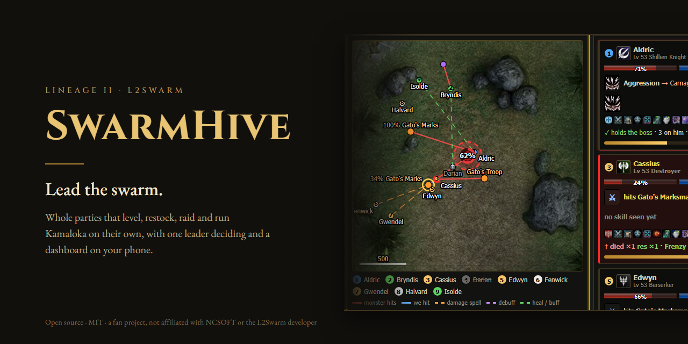
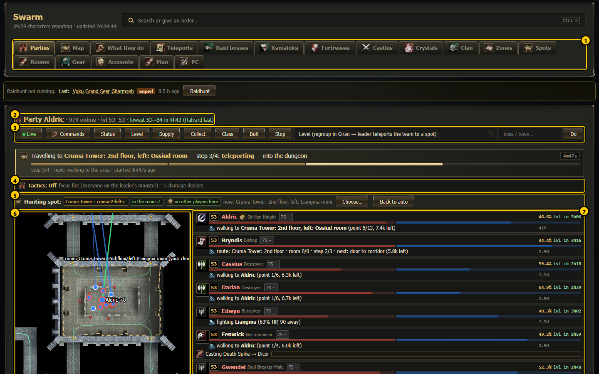

<p align="center"></p>

# SwarmHive

*Lead the swarm.* A swarm kit for L2Swarm.


**Version 1.10.2 (2026-10-25)** · [Changelog](CHANGELOG.md) · [History](docs/HISTORY.md) · [User guide](docs/guide/README.md) · [PDF manual](docs/guide/L2Swarm_User_Manual.pdf) · [Installer zip (Releases)](../../releases/latest) · [Quick start](#quick-start-automatic-installer)

This kit runs a **whole swarm of Lineage 2 characters with L2Swarm**: up to 40 accounts in several parties that level,
restock, gear up, run Kamaloka and hunt raid bosses on their own, with one leader per party making the decisions. It
consists of one orchestration script for every L2Swarm window (`Scripts/swarm.js`), a phone-friendly **web dashboard** to
watch and command every party, a wall-aware **path finder** on the geodata of your L2Swarm install, generated **game data**
(spawns, NPCs, teleports, dungeon rooms, hunting areas, raid bosses) and a **one-file setup** (`swarm.config.json` +
`SETUP.cmd`). It was built for and tested on the L2Toggle server (High Five-like chronicle).

**Just for fun:** a hobby project, not affiliated with NCSOFT, the L2Swarm developer or any server - see the [Disclaimer](#disclaimer).

**This repository contains no part of L2Swarm.** L2Swarm is a separate, closed program by its own developer; you need your
own install of it. This kit only adds our script, dashboard, tools and data next to it.

<p align="center">
  
  &nbsp;
  
</p>

| | | |
|:-:|:-:|:-:|
|  |  |  |
| Party map with the hunting room outline | Dungeon room picker | Field-area picker |
|  |  |  |
| Escape box on the live map | Raid live view | Command center |
|  | | |
| Shape editor (rooms, spots, zones) | | |

---

## Contents

- [Supported versions](#supported-versions)
- [Features](#features)
- [What the kit changes on your machine](#what-the-kit-changes-on-your-machine)
- [Quick start (automatic installer)](#quick-start-automatic-installer)
- [Import your existing L2Swarm accounts](#import-your-existing-l2swarm-accounts)
- [Install by hand](#install-by-hand)
- [Update](#update)
- [Uninstall](#uninstall)
- [Changelog](#changelog)
- [Troubleshooting and FAQ](#troubleshooting-and-faq)
- [Security notes](#security-notes)
- [License and notice](#license-and-notice)
- [Disclaimer](#disclaimer)

---

## Supported versions

| Component | Supported | Notes |
|---|---|---|
| **L2Swarm** | **3.8.14 or newer** (3.8.10 – 3.8.13 work too) | A plain install, as L2Swarm's own installer / `updater.exe` sets it up. **No patch is needed**: every L2Swarm bug we found while running 40 accounts was fixed by the developer, the last ones in 3.8.14. The script finds out by itself which build it runs on and adapts. |
| Game server | L2Toggle | High Five-like chronicle (skill and item IDs are High Five). Server-specific things: Community Board buffs, `.townname` commands, Class Master on the board. Other High Five servers need small changes in `Scripts/data/` and `swarm.config.json`. |
| Windows | 10 / 11 (x64) | L2Swarm is a WPF program and needs admin rights. |
| Node.js | LTS, **18 or newer** | Dashboard, path finder, tools, tests. Python is not needed. |
| git | optional (recommended) | Install + one-command updates. Without git: unpack the zip, update with `update.ps1 -Zip <zip>`. |

---

## Features

Details for every feature are in the [user guide](docs/guide/README.md).

**Swarm script (`Scripts/swarm.js`, one copy per L2Swarm window)**

- **Leader-controlled parties.** Every party has a leader who decides: where to hunt, when to restock, when to teleport.
  Members follow, assist, defend themselves and each other, heal, rest, rebuff and resurrect. See [Parties](docs/guide/README.md#parties).
- **Automatic leveling.** The leader picks a hunting spot for the party's lowest level (your own zones in
  `Scripts/data/custom_zones.json`, else the built-in hunting spots), takes the party there by `.townname` + gatekeeper and
  walks the rest. Dungeon **rooms** and outdoor **field areas** can be chosen per party on the dashboard. See [Leveling](docs/guide/README.md#leveling).
- **Supply runs.** Every character reports what it lacks (Scrolls of Escape/Resurrection, shots, potions, spirit ore);
  the leader buys the total in Giran and trades each member its share. Junk is sold automatically.
- **Gear upgrades and enchanting.** Buys better weapons/armor/jewelry per class and grade (shop data in `Scripts/data/`),
  respects your preferences (`gear_prefs.json`), enchants up to a safe limit, converts Kamael weapons. **Off by default**: switch it on per
  character or party on the dashboard **Gear** page (`Scripts/data/gear_auto.json`), or lock what a character wears. Even when it is on it never
  changes the weapon type (a spear stays a spear, a bow a bow), never takes a lower grade, never puts a shield next to a two-handed weapon or
  polearm and keeps the armor type, unless your own gear plan names that item.
- **Class changes only with your approval.** On the dashboard's **Classes** page you pick and approve a class path per character (every class of every race, from the game data), per party, or apply a group template. Without an approved plan a character **never** changes class; it shows an animated "No class plan" warning instead. Approved changes go through the server's Community Board (Career → Professions) at levels 20 / 40 / 76.
- **Buffs** from the Community Board (12-hour schemes), one character at a time, with the rest of the party guarding it.
- **Healer brain.** Healers only heal: fastest heal on the dying, group heals, cures, recharge, mana potions.
- **Raid hunting.** Picks bosses the party can beat (no raid curse), clears the area, counts down, pulls with the tank,
  focus fire on minions then the boss, destroyer opening, debuffs; never runs away from a raid. Kill logs and reports.
  See [Raids](docs/guide/README.md#raids).
- **Daily Kamaloka.** Each party leader runs a Kamaloka that fits the whole party once per day.
- **Catacombs and necropolises** (Seven Signs: the characters you enroll on the dashboard **7 Signs** tab sign up with Dawn;
  nobody by default), fortress/castle siege planning, soul crystal leveling, clan level quests, clan ranks.
- **Quests**: every High Five quest as data (`Scripts/data/quests/`), a quest page with live progress, beginner gear coupons and an
  optional repeatable-quest farm (**off by default**). A navigation atlas (`Scripts/data/nav_atlas/`) routes the party to every raid boss,
  NPC and hunting area.
- **New engine (the default since v1.6.2):** swarm.js runs inside the dashboard's brain host and L2Swarm only runs the small
  `Scripts/agent2.js` - much less memory per character. On for every character (`Scripts/data/brain_host.json` `"allowAll": true`);
  `"on": false` switches back to swarm.js inside L2Swarm. An updated install moves its accounts on the dashboard's PC tab
  (see [INSTALL](docs/plan/INSTALL.md#new-engine-on-by-default-since-v162) and `docs/plan/new_engine/DESIGN.md`).
- **Commanders (optional):** characters named in `swarm.config.json` `commanders` can order every party over clan chat or a whisper.
- **Escape and rescue.** Escape from a lost fight to a safe spot (aggro ranges of every aggressive monster), cross-floor
  rescue, regroup of anyone left behind, never teleporting while a teammate is still fighting.
- **Hunting pairs** (optional per party): the leader splits damage dealers into small groups with their own targets.
- **Robust navigation.** A wall-aware A* path finder on L2J geodata (`docs/plan/tools/geopath.js`), recorded routes,
  stuck detection and unstick steps, the missing *Appearing* packet after teleports is sent automatically.
- **Priority system.** Survival > unfreeze > team safety > safe teleport > orders > leveling > upkeep; long tasks step aside
  when something more important needs the party.

**Dashboard (`Dashboard/`, http://127.0.0.1:8090, phone friendly)**

- **Parties**: one compact row per character (level, class, HP/MP, task, target, adena) and one live map per party with
  the hunting room/area outline, monsters and walk targets. See [Dashboard](docs/guide/README.md#dashboard).
- **Character page**: mini-map, what the character is doing in plain sentences, intent timeline, inventory, in-game / out-of-game switch.
- **Command center**: every order (level, supply, town, raid, Kamaloka, gear up, stop, ...) for one character, a party or
  everyone, always with a confirmation that shows who changes orders. See [Commands](docs/guide/README.md#commands).
- **Raids** (live view, reports, route editor), **Kamaloka** (fit/done per party, instance maps, live view), **Teleports**,
  **Gear**, **Crystals**, **Clan**, **Sieges**, **PC** (L2Swarm memory, start/stop/restart, deploy the script).
- **Shape editor**: drag-edit dungeon rooms, hunting spots, zones and field areas; manual edits are protected from being
  overwritten by the generators.
- **Accounts**: add an account (the password is stored encrypted by L2Swarm), transfer adena/items between characters.

**Setup and operation**

- **Automatic installer** (`INSTALL.cmd`): finds L2Swarm, offers Node.js / Git, imports your existing L2Swarm accounts, runs SETUP, starts the dashboard. Asks before every change.
- **Account importer** (`import_l2swarm.js`): turns the accounts you already have in L2Swarm (80+ is fine) into `swarm.config.json`: login, character, party (from who follows whom), role. Never touches passwords.
- **One config file** (`swarm.config.json`): paths, server, ports, accounts, parties, roles. No passwords.
- **`SETUP.cmd`**: dry run first, then `-Apply` creates the account configs, L2Swarm groups (one per party), AutoStart list,
  scheduled tasks and the dashboard key. Idempotent.
- **Staggered login** (`docs/plan/tools/l2swarm_ctl.ps1`): accounts log in one by one, a few seconds apart, so the login
  server does not refuse a mass login.
- **MemWatch**: watches L2Swarm's memory and restarts it before the PC runs out of RAM; restarts after a crash or deadlock.
- **Safe deploys** (`deploy_swarm.ps1`): edit `Scripts_dev/swarm.js`, syntax check, rate limit, then deploy.
- **Offline tests** (`docs/plan/tools/test_*.js`).

---

## What the kit changes on your machine

Nothing is installed outside the L2Swarm folder except the four scheduled tasks. **Nothing is sent anywhere**: no
telemetry, no update pings (only `update.ps1`, when you run it, talks to the GitHub repository). L2Swarm's own program files are
never changed.

| What | Where | When |
|---|---|---|
| Script + data | `Scripts_dev/swarm.js` (the source; deployed to `Scripts/swarm.js`, the file L2Swarm watches), `Scripts/data/**` | copied with the kit; deployed by `SETUP.cmd -Apply` / `update.cmd` |
| Your data files | `Scripts/data/custom_zones.json`, `party_spots.json`, ... (from the shipped `*.example.json`) | `SETUP.cmd -Apply`, once; yours from then on |
| Dashboard | `Dashboard/**` (`server.js`, `index.html`, `*.js`, `*.css`, `start.cmd`) | copied with the kit |
| Tools, docs, tests | `docs/**`, `docs/plan/tools/**` | copied with the kit |
| Setup + update | `INSTALL.cmd` / `install.ps1` (automatic installer), `docs/plan/tools/import_l2swarm.js` (account importer), `SETUP.cmd`, `SETUP.ps1`, `swarm.config.example.json`, `update.cmd` / `update.ps1`, account templates `Settings/templates/*.xml` (no login, password or names) | copied with the kit |
| Your config | `swarm.config.json` | you create it from the example |
| Account configs | `Settings/<config>.xml` (login, character, group, server, script paths, follow settings) | `SETUP.cmd -Apply` |
| AutoStart list + MCP port | `Settings/settings.xml` (created when L2Swarm never ran there; all entries `enabled="false"`: the Start task logs in one by one) | `SETUP.cmd -Apply` |
| Client mode, login gap | `Settings/client_mode.json`, `Settings/login_gap.txt` | `SETUP.cmd -Apply` |
| Dashboard key | `Dashboard/key.txt` (random) | `SETUP.cmd -Apply`, when missing |
| Generated from your L2Swarm | `Dashboard/maptiles/`, `Dashboard/minitiles/`, `Dashboard/icons/`, `Dashboard/data/{items,skills,classes}.json`, `Scripts/data/npc_strings.json` | `SETUP.cmd -Apply` (when missing) or `SETUP.cmd -Images`, made **from your own** L2Swarm `Data/` and `Maps/`; never shipped |
| Scheduled tasks | **L2Swarm Start**, **L2Swarm Stop**, **L2Swarm Restart**, **L2Swarm MemWatch** (elevated, run as you; MemWatch every 2 min) | `SETUP.cmd -Apply` (admin) |
| Logs | `Logs/` | at run time |
| Backups | `Settings/backup/<date>_setup/` (every file SETUP changes) | `SETUP.cmd -Apply` |

**Ports** (both local):

| Port | Who | Access |
|---|---|---|
| 8083 | L2Swarm's own MCP server (enabled by SETUP) | 127.0.0.1; used by the dashboard and, optionally, Claude Code |
| 8090 | Dashboard (`node server.js`) | open on 127.0.0.1; from another device on your LAN only with `?key=<Dashboard\key.txt>` |

**Passwords** are never in `swarm.config.json` or any file of this kit. `SETUP.cmd -Apply` asks for each new
account's password with a hidden prompt (or reads `SWARM_PW_<LOGIN>` / `SWARM_PASSWORD`) and writes only the value
encrypted by your L2Swarm's own `Option.EncryptPassword` (`docs/plan/tools/new_account.ps1`) into `Settings\<config>.xml`.

---

## Quick start (automatic installer)

**You need:** Windows 10/11, your own L2Swarm folder (3.8.14 or newer recommended, installed with the developer's installer / `updater.exe`,
with its `Data\`, `Maps\` and `Geodata\` folders) and admin rights. Node.js and Git are offered by the installer when they are missing.

1. **Get the kit.** Easiest: download **`SwarmKit-v<version>.zip`** from the [latest release](../../releases/latest) (it also holds the
   PDF manual) and unpack it anywhere, for example your Downloads folder - the installer copies it into the L2Swarm folder for you.
   Or clone the repository / unpack it **into your L2Swarm folder** directly.
2. **Double-click `INSTALL.cmd`.** It walks through 8 steps and asks before every change (`[y/N]`: just pressing Enter means *No*):

   | Step | What happens |
   |---|---|
   | 1. L2Swarm folder | Uses the folder the kit is in; otherwise it looks in the usual places and on your drives and asks which one. Checks that `L2Swarm.exe` is there. |
   | 2. Node.js, Git | Checks them. When one is missing it offers `winget install` (Node.js LTS is required, Git is optional). Nothing is installed without your *yes*. |
   | 3. Copy the kit | Only when the kit is not already in the L2Swarm folder. Copies the kit's files; **never** touches L2Swarm's own files (`L2Swarm.exe`, its DLLs, `Data\`, `Maps\`, `Geodata\`), your `Settings\*.xml`, `Logs\` or `swarm.config.json`. Files that already exist with other content are only replaced when you say so (old copies go to `Logs\install_backup\`). |
   | 4. Import accounts | Reads the accounts you already have in L2Swarm and shows them as a table (see the next section). You can change characters / roles / parties right there, then it writes `swarm.config.json`. |
   | 5. Review | Opens `swarm.config.json` in Notepad and waits until you close it. |
   | 6. SETUP | Runs `SETUP` as a dry run (shows every change), then - when you say yes - `SETUP -Apply` as administrator (UAC prompt). It stops L2Swarm first if it runs. |
   | 7. Images | Generates the dashboard maps and icons from **your** L2Swarm `Data\` and `Maps\` (when SETUP did not already). |
   | 8. Dashboard | Starts the dashboard and opens **http://127.0.0.1:8090**. |

3. **Start the bots:** `schtasks /run /tn "L2Swarm Start"` (or the dashboard's PC tab). It starts L2Swarm and logs every account in,
   one by one.

`INSTALL.cmd` can be run again at any time: every step checks what is already done and skips it. Useful options:

```
INSTALL.cmd -DryRun                 show what every step would do, change nothing
INSTALL.cmd -Root D:\Games\L2Swarm  use this L2Swarm folder
INSTALL.cmd -SkipTasks              SETUP without the four scheduled tasks
INSTALL.cmd -SkipCopy -SkipImport -SkipSetup -SkipImages -SkipDashboard -SkipPrereqs    skip a step
```

**Passwords:** the installer never asks for, reads or prints a password. Accounts that already have an L2Swarm config keep their own
(encrypted) password in their own `Settings\<name>.xml`. Only when SETUP has to *create* a config for a new account does it ask
for that account's password (hidden prompt, in the admin window) and store it encrypted by L2Swarm's own function.

**Manual (PDF):** the whole user guide with screenshots (about 650 pages), for reading offline, is [docs/guide/L2Swarm_User_Manual.pdf](docs/guide/L2Swarm_User_Manual.pdf) (also in the release zip and as its own download on the release page). Online: [docs/guide/README.md](docs/guide/README.md).

---

## Import your existing L2Swarm accounts

If you already have your accounts in L2Swarm (one config per account in `Settings\<name>.xml`), you do not have to type them into
`swarm.config.json`. The importer reads them and writes the file for you. The installer runs it in step 4; you can also run it by
hand in the L2Swarm folder:

```
node docs\plan\tools\import_l2swarm.js            dry run: prints the table, writes nothing
node docs\plan\tools\import_l2swarm.js --write    writes swarm.config.json
```

Example table:

```
  #   login          character        party            role           from           auto config
  1   mylogin1       Tankname         Tankname         sk             skills (guess) yes  Mylogin1.xml
  2   mylogin2       Healername       Tankname         bishop         class Bishop   yes  Mylogin2.xml
  3   mylogin3       Nukername        Tankname         TODO           -              yes  Mylogin3.xml
  4   mylogin4       (choose!)        -                TODO           -              no   Mylogin4.xml
```

**What it takes from L2Swarm** (from each account config, never the password):

| `swarm.config.json` | comes from |
|---|---|
| `login` | `<Name>` |
| `character` | `<SelectedCharacter>` - the character that account logs in with |
| `config` | the file name in `Settings\` |
| `party` | who follows whom: accounts that follow (`ActiveFollow` + `FollowName`) the same character are one party, that character is the leader. Someone who follows nobody joins the party whose leader invites it (`SendParty`), else the party most of its L2Swarm group is in, else it is a party of its own. |
| L2Swarm group | kept: when a whole party already has its own group name, it goes into `groups.overrides` so SETUP does not rename it |
| `autoStart` | whether the config is in L2Swarm's AutoStart list (`Settings\settings.xml`) |
| `role` | the class the swarm script last saw for that character (after the first login with the kit), else a guess from the skills in the config's skill lists, else empty (**TODO**) |
| class plan | **never imported or guessed.** Every character starts with *no class plan* (the dashboard shows a warning) and never changes class until you choose and approve its plan on the dashboard's **Classes** page |
| `server`, `mcp.port`, `paths.l2Client` | the login server / MCP port / game client most of your configs use (only for a new `swarm.config.json`) |

**Merging:** when `swarm.config.json` already exists, everything you wrote in it stays as it is. The importer only adds accounts that
are new and fills fields that are empty. It saves the old file to `Settings\backup\<time>_import\` first. `--replace` builds the
account list again from L2Swarm (top-level settings are still kept).

**Odd files are skipped with a warning:** `settings.xml`, copies such as `Name - Copy.xml` / `Name (2).xml` / `Name_backup.xml`,
broken or cut-off XML, files that are not an L2Swarm account config, configs without a login. UTF-8 and UTF-16 files (with or without
BOM) are both read. When **two configs use the same login** (an old team on the same account), the one in AutoStart is used and the
other one goes to `legacyConfigs` (SETUP leaves it alone). When **two logins select the same character**, the second one is set to
`"enabled": false`.

### Choosing the character an account plays

One L2Swarm account = one login. A login can hold several characters; `<SelectedCharacter>` picks the one that logs in.

- **See them:** L2Swarm keeps no offline list of the characters on a login. The kit's script writes one at every login
  (`Logs\chars_<login>.json`); the importer shows those names in the column *other characters on this login*. Before the first
  login only the selected character is known - log the account in once with the kit's script running. Afterwards the importer
  shows them, and the dashboard's **Accounts** page lists every known character in its *Transfer* box (the account table there
  shows the character each login plays now). There is no dashboard button that changes `<SelectedCharacter>` for good: use
  `--set` / `swarm.config.json` + SETUP as below.
- **Choose:** `--set login=Character` (repeatable), or type `mylogin3=Nukername` when the installer asks in step 4, or write the
  name into `"character"` in `swarm.config.json`. Then run `SETUP.cmd -Apply`: it writes the name into that account's
  `<SelectedCharacter>`, so L2Swarm logs in with it from then on.
- **No character yet** (`"character": ""`, shown as *(choose!)*): create it in game or with the dashboard's *add account*, then set
  it as above. SETUP warns about such accounts and the script ignores them until then.
- A login with **several config files**: `--use login=File.xml` picks which file is used.
- For a short switch while the bots run (to hand adena / items from another character), the dashboard's **Accounts -> Transfer**
  switches the running session to that character and back, without changing the config.

### Roles and parties

```
node docs\plan\tools\import_l2swarm.js --role mylogin3=nuker --party mylogin5=Tankname --write
```

Roles work for **every class**. Give a **kind**: `tank, healer, buffer, melee, archer, dagger, nuker, summoner, spoiler, crafter`,
or `auto` (the kind of the character's current class, re-checked after every class change). The script finds the skills in the
character's own learned skills, so there are no skill ids to maintain:
- **tank** (Paladin, Dark Avenger, Temple Knight, Shillien Knight and their 3rd classes): holds aggro (single and area aggro skills), uses its emergency defence skill and opens raids.
- **buffer** (Prophet, Swordsinger, Bladedancer, Overlord, Warcryer, Hierophant, Sword Muse, Spectral Dancer, Dominator, Doomcryer):
  keeps party buffs up. It never overwrites a stronger buff and respects the song/dance limit. Songs and dances run in full cycles, and a
  Swordsinger and a Bladedancer take turns (song, dance, song ... ; the Bladedancer can open instead). Fighter buffers assist in melee; mystic buffers stay back.
  **Buff groups:** buffs that do not stack in the game (Improved Magic blocks Empower, Magic Barrier and Chant of Fire; Improved Combat
  blocks Might and Shield ...) come from `Scripts/data/buff_groups.json` (made from the game data). A buffer casts the improved buff
  first and never a buff whose group the member already has. A buff that does not land on a member is skipped there for 10 minutes,
  never recast until the buffer is out of MP. **Buff slots:** a member whose buff slots are full (24, plus Divine Inspiration) only gets its
  buffs refreshed. **Never keep:** per character a list of buffs it cancels itself (a healer drops Chant of Blood Awakening). Buffers never cast them on it.
- **archer**: assists from range and steps back from a monster the tank holds.
- **summoner** (Warlock, Elemental Summoner, Phantom Summoner and their 3rd classes): keeps its best servitor out and sends it at the
  party's target. It heals, recharges and buffs the servitor, and uses the servitor's own skills. The item the summon eats goes on the supply list.
- **melee / nuker / dagger / healer / spoiler / crafter**: assist, nuke, heal, spoil or craft as before.

The older named roles keep their special routines: `sk, bishop, shilliensaint, destroyer, doombringer, necromancer, inspector, doomcryer`
(`crafter, spoiler, healer, nuker, dagger` are kinds and named roles at the same time).

**Board buffs:** `"boardBuffs": true` (the default) uses the Community Board buffs of L2Toggle-style servers, and your buffers only fill
what the board lacks. Set `"boardBuffs": false` for an old-school party that has its own buffers. This is a top-level setting; put it on
a party leader's account entry to set it for that party only. With it off, no board buff runs at all: the buffers are the buff source
and self buffs are allowed. Which buffer casts what on whom is set in `Scripts\data\buff_plans.json` (see `buff_plans.example.json`).
Without a plan, a buffer casts the buffs its own skills suggest. With board buffs off it does so straight away; with board buffs on it
only fills what the board lacks. On the dashboard **Buffs** page you tick the songs / dances each singer and dancer casts. The
suggestion keeps the whole set within the song / dance slots. A song / dance that runs out early is not recast on its own: it waits
for the next full cycle. You can also give a single-target buff to several members, switch songs / dances off per character or party,
switch buffing off for a character, or save an empty plan.

An account without a role is not controlled by the script (SETUP warns). Class changes are never automatic until you
approve a plan per character on the dashboard (**Classes** page). `--party` takes the leader's **character** name.

Then: `SETUP.cmd` (dry run) and `SETUP.cmd -Apply` with L2Swarm stopped. For accounts that already have a config, SETUP never asks
for a password; it adds `swarm.js` to their script list, sets the group, the login server and the follow settings (members follow their
party leader; an account without a role keeps its own assist setting).

---

## Install by hand

**Requirements:** Windows 10/11, your own L2Swarm folder (3.8.14 or newer recommended, installed with the developer's installer /
`updater.exe`, with its `Data\`, `Maps\` and `Geodata\` folders), [Node.js](https://nodejs.org) LTS 18 or newer,
[Git for Windows](https://git-scm.com) (`winget install Git.Git`; optional but makes updates one command), admin rights, and
your game accounts. The game client is only needed for characters you want to play in game (`clientMode: "ingame"`).

1. **Put the kit into your L2Swarm folder** (it only adds files). With git, in a command prompt in your L2Swarm folder:
   ```
   git init -b main
   git remote add origin <this repository's clone URL (GitHub: Code -> HTTPS)>
   git fetch origin
   git checkout -f -t origin/main
   ```
   Without git: on GitHub click **Code → Download ZIP** and unpack the contents of its top folder into your L2Swarm folder.
2. **Write your config:**
   ```
   copy swarm.config.example.json swarm.config.json
   notepad swarm.config.json
   ```
   Set the `server` (login IP/port, server id), `mainLeader`, and one line per account:
   ```json
   { "login": "mylogin1", "character": "Tankname",   "party": "Tankname", "role": "sk" },
   { "login": "mylogin2", "character": "Healername", "party": "Tankname", "role": "bishop" }
   ```
   `party` = the party leader's character name (the leader has his own name). Every field is explained in the example file
   (roles, `clientMode`, groups; class plans are chosen on the dashboard, not here). **No passwords in this file.**
3. **Dry run:** double-click `SETUP.cmd`. It lists every change it would make and changes nothing.
4. **Apply** (L2Swarm stopped):
   ```
   SETUP.cmd -Apply
   ```
   It re-starts itself as admin (needed for the scheduled tasks) and asks for the password of each new account with a hidden
   prompt (or reads `SWARM_PW_<LOGIN>` / `SWARM_PASSWORD` from the environment). It creates `Settings\settings.xml` when L2Swarm
   never ran here, the account configs (password encrypted with L2Swarm's own function), the L2Swarm groups (one per party), the
   AutoStart list, the scheduled tasks, the dashboard key, your data files from the `*.example.json`, deploys
   `Scripts\swarm.js`, and **generates the dashboard images and lookup tables** from your own `Data\` and `Maps\` (a minute or two).
   Run `SETUP.cmd` again: it should say "nothing to do". (`SETUP.cmd -Images` regenerates the images any time.)
5. **Start:**
   ```
   schtasks /run /tn "L2Swarm Start"
   ```
   It starts L2Swarm and logs every account in, one by one. (Starting `L2Swarm.exe` by hand logs nobody in: the AutoStart
   entries are disabled on purpose.) Then start the dashboard with `Dashboard\start.cmd` and open
   **http://127.0.0.1:8090**. Phone/tablet on your LAN: `http://<PC-IP>:8090/?key=<contents of Dashboard\key.txt>`.
6. **Optional, Claude Code** (once per PC): `claude mcp add --transport http --scope user l2swarm-mcp http://127.0.0.1:8083`.

Adding an account later: add a line to `accounts`, run `SETUP.cmd`, then `SETUP.cmd -Apply` with L2Swarm stopped.
The script reads the roster (character → role, party, class path) from `swarm.config.json` at start; no script edit is needed.
Full walk-through: [docs/guide/README.md](docs/guide/README.md) and [docs/plan/INSTALL.md](docs/plan/INSTALL.md).

---

## Update

```
update.cmd
```

(= `powershell -ExecutionPolicy Bypass -File update.ps1`; `update.ps1 -Check` only tells whether a newer version exists,
`-Version v1.2.0` takes a specific version.)

- **With git** it fetches the newest version from the repository. **Without git**: `update.ps1 -Zip <downloaded zip>`.
- **Keeps** (never overwritten): `swarm.config.json`, `Settings\` (your account configs; account templates you changed),
  `Logs\`, `Dashboard\key.txt`, the generated images and tables, and your data files `Scripts\data\custom_zones.json`, `party_spots.json`,
  `party_tactics.json`, `gear_prefs.json`, `soul_prefs.json`, `sell_list.json`, `siege_plans.json`, `dye_plan.json`,
  `roster_extra.json`, `clan_quests.json`, `giran_routes.json`, `class_plans.json` (the kit only ships `*.example.json` of them). Recorded/locked
  routes (`Scripts\data\routes\`) and live gatekeeper menus (`gk_live\`) you changed are kept too (the update's copy is saved next
  to them as `<file>.upstream`), and every room / spot / area / zone you edited in the dashboard shape editor (`manual: true`) is
  merged into the new data (`docs/plan/tools/manual_guard.js`).
- **Replaces** the code: `Scripts_dev\swarm.js`, `Dashboard\`, the tools, `SETUP`, docs. A code file you had changed
  is saved first to `Logs\update_backup\<time>\` and listed at the end.
- Then it deploys the new `Scripts\swarm.js` through `docs\plan\tools\deploy_swarm.ps1` (syntax check, time gate, never during a
  live raid). It does **not** stop or start L2Swarm (each window reloads the script once).
- At the end it prints what is new (the top of [CHANGELOG.md](CHANGELOG.md)).

**Updating from v1.1.0 or older:** the old per-version patch files (`patches\patched_*`, `apply_patch_v*.ps1`, the upstream
checker) are no longer part of the kit, and `update.cmd` removes the copies you did not change. If you had installed one of the old
patches, L2Swarm's own `updater.exe` puts the original L2Swarm files back (or keep using it; nothing in the kit depends on it).
Updating L2Swarm itself to 3.8.14 or newer is recommended.

---

## Uninstall

1. Stop the bots: `schtasks /run /tn "L2Swarm Stop"`.
2. **Remove the scheduled tasks** (admin prompt):
   ```
   schtasks /delete /tn "L2Swarm Start" /f
   schtasks /delete /tn "L2Swarm Stop" /f
   schtasks /delete /tn "L2Swarm Restart" /f
   schtasks /delete /tn "L2Swarm MemWatch" /f
   ```
3. Stop the dashboard (close its window, or end the `node server.js` process).
4. Delete what the kit added: `.git\`, `.gitignore`, `.gitattributes`, `Dashboard\`, `docs\`, `Scripts\data\`,
   `Scripts\swarm.js`, `Scripts_dev\`, `Settings\templates\`, `INSTALL.cmd`, `install.ps1`, `SETUP.*`, `SETUP_PC_ALWAYS_ON.cmd`, `update.*`, `swarm.config*.json`,
   `README.md`, `NOTICE.md`, `LICENSE`, `CHANGELOG.md`, `VERSION`, `MANIFEST.sha256`. Remove `swarm.js` from each account's script list in
   L2Swarm (or restore your configs from `Settings\backup\`).

---

## Changelog

The full changelog is **[CHANGELOG.md](CHANGELOG.md)**; the story of how it was built is in **[docs/HISTORY.md](docs/HISTORY.md)**.
Versions follow `MAJOR.MINOR.PATCH`; each release is a git tag `vX.Y.Z`.

---

## Troubleshooting and FAQ

**A character stands still after a teleport or login and sees no NPCs.**
The server waits for the client packet *Appearing*; out-of-game sessions do not always send it. The script sends it
automatically after every teleport and whenever a character sees nothing. Check: the dashboard character page shows
0 NPCs in a town.

**Accounts are refused at login ("Incoming packet stream closed").**
Too many logins at once; the login server blocks for ~5 minutes. Always start with `schtasks /run /tn "L2Swarm Start"`
(staggered login, `login.gapSeconds` in `swarm.config.json`, never below 5).

**L2Swarm's memory keeps growing.**
Every live reload of a large script leaks some V8 memory. Edit `Scripts_dev\swarm.js` and deploy with
`docs\plan\tools\deploy_swarm.ps1` (it batches and rate-limits). MemWatch restarts L2Swarm before the PC runs out of RAM;
its log is `Logs\memwatch.log`.

**All scripts or the MCP server freeze until a restart.**
That was a UI deadlock in L2Swarm up to 3.8.10 (fixed in 3.8.11) and an MCP accept-loop problem (fixed in 3.8.12). Use a current
L2Swarm. MemWatch detects a deadlock and restarts L2Swarm.

**L2Swarm asks for admin / the tasks fail.**
L2Swarm requires admin. The scheduled tasks run elevated so that `schtasks /run` needs no UAC prompt; create them with
`SETUP.cmd -Apply` from an admin prompt.

**MCP port 8083 is busy.**
A game client started by L2Swarm's Hook can keep the port; `L2Swarm Stop` closes such clients. Or set another
`mcp.port` in `swarm.config.json` and run `SETUP.cmd -Apply`.

**The dashboard does not open on my phone.**
Use `http://<PC-IP>:8090/?key=<Dashboard\key.txt>`, allow Node.js through the Windows firewall for private networks.

**The dashboard map is empty / icons are missing / gatekeeper links are not found.**
Run `SETUP.cmd -Images`. The images, the item/skill/class tables and `Scripts\data\npc_strings.json` are generated from your own
L2Swarm install and are not part of the kit.

**Can I use it on another server?**
Yes, with work: set `server` in `swarm.config.json`; server-specific features (board buffs, `.townname`, Class Master)
may need changes, and live gatekeeper menus (`Scripts/data/gk_live/`) and shop lists are server data.

---

## Security notes

- **Passwords** are only stored encrypted by L2Swarm inside `Settings\<config>.xml`. L2Swarm's encryption key is the same
  in every copy of L2Swarm, so **never share your `Settings\*.xml`** (or `swarm.config.json`, which names your accounts).
  The kit contains neither.
- `manage_account_config modify Password` over MCP saves an empty password; always use `new_account.ps1` / SETUP.
- The dashboard listens on port 8090. From the PC itself it is open; from the LAN it needs the key from
  `Dashboard\key.txt`. Do not forward the port to the internet.
- The MCP server (8083) has no authentication; keep it on 127.0.0.1.
- The kit sends nothing anywhere. `update.ps1` only reads from the GitHub repository when you run it.
- The release build scans every file for passwords, keys, e-mail addresses, personal names, private IPs and absolute
  paths and refuses to publish when it finds one.

---

## License and notice

The code in this repository is released under the **[MIT License](LICENSE)**. See **[NOTICE.md](NOTICE.md)** for what is not ours. In short:

- **L2Swarm is not included** and is not covered by this license. It belongs to its developer; get it from them.
- **No game assets are shipped as files.** Map tiles, icons, item/skill/class tables and NPC strings for the dashboard and the
  script are generated locally by `SETUP.cmd -Images` from **your own** L2Swarm install (`Data/`, `Maps/`). The guide
  screenshots show the dashboard with those generated images.
- Spawn, NPC, teleport and other game data in `Scripts/data/` is derived from the **L2J High Five datapack** (GNU GPL v3); that
  data keeps its GPL terms.
- Lineage II is a trademark of NCSOFT. This project is not affiliated with NCSOFT, the L2Swarm developer or any server.

---

## Disclaimer

**This is a hobby project, made for fun.** It is shared as is, for free, for people who like tinkering with Lineage II bots.

- **We do not own anything here except our own code.** Lineage II, its names, art, classes, items and world belong to **NCSOFT**.
  **L2Swarm** belongs to its developer. Server names belong to their owners. The game data in `Scripts/data/` comes from the open
  L2J High Five datapack (GPL v3). We are not affiliated with, endorsed by or connected to NCSOFT, the L2Swarm developer, L2J or any
  game server.
- **No L2Swarm files, no game client files and no game art are in this repository.** You need your own L2Swarm install; the
  dashboard images are generated on your own PC from your own install.
- **Use it at your own risk.** Bots are against the rules of many game servers. Only use this where the server owner allows it,
  and respect their rules. We are not responsible for banned accounts, lost items, broken installs or anything else.
- **No warranty, no support promise.** Things may break with a new L2Swarm or server version. Issues and ideas are welcome, but
  answers come when we have time.
- If you own something used here and want it changed or removed, open an issue and we will sort it out quickly.
