# Dashboard basics

The dashboard is a web page that shows every character, party and running fight, and lets you give orders. It runs on the PC that runs
L2Swarm (`Dashboard/server.js`) and works the same on a PC screen and on a phone. This chapter explains what is the same on every page: how
to open it, the header, the tabs and page addresses, how the page refreshes, and every kind of confirmation and message you can meet.
Words you may not know are in the [glossary](06-glossary.md).

## Opening the dashboard

**On the PC that runs the bots:** double-click `Dashboard\start.cmd`. It starts the dashboard server and opens
`http://127.0.0.1:8090` in your browser (the port comes from `swarm.config.json`, `dashboard.port`). Pages opened on this PC need no key.

**On a phone or another PC in the same network:** open `http://<the PC's network address>:8090/?key=<key>`. The key is the text in
`Dashboard\key.txt` on the PC. Without the right key the server answers "Access denied: open the link with ?key=...".

- The page **remembers the key** in the browser (local storage). After the first visit you can open `http://<address>:8090/` without
  `?key=`, and bookmark or add it to the home screen.
- Keep the key private: anyone with the key can give orders to your characters.
- The page is built for a phone held upright (390 px wide) and for a desktop. Everything works by tapping; keyboard shortcuts are extras.
- Game icons, the item and skill tables load without the key (they hold no secrets); everything else needs it.

## The header

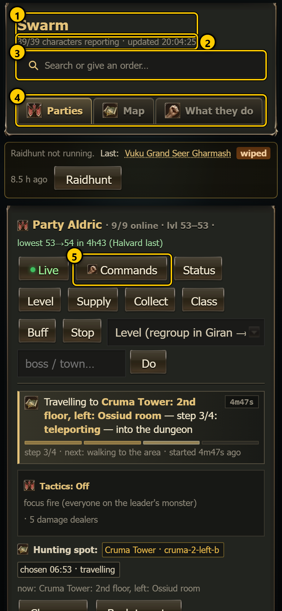 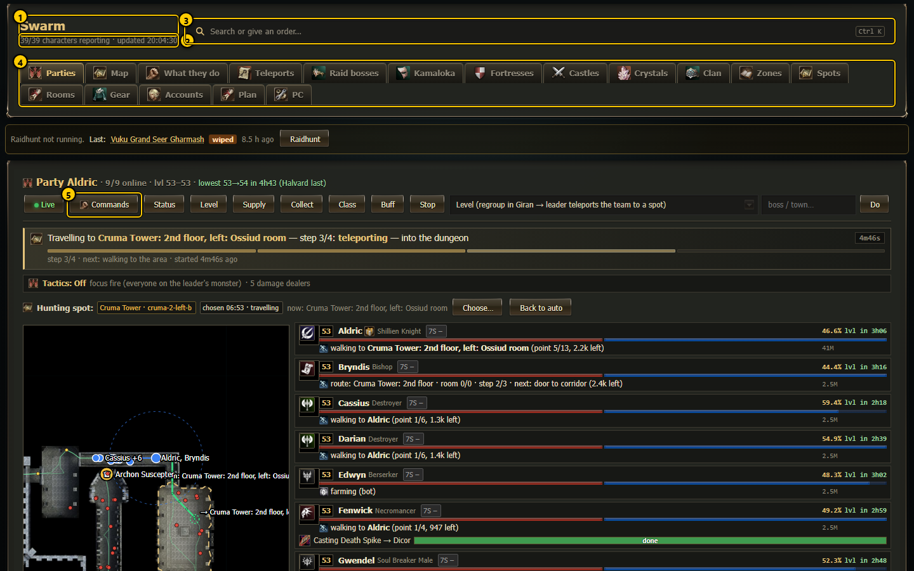

1. **Title** - "Swarm".
2. **Status line** - `N/M characters reporting · updated HH.MM.SS`. *M* is every character the dashboard knows, *N* how many of them
   wrote their status in the last 30 seconds. A character that stops reporting is offline, frozen or its script is stopped. The time is the
   last refresh. If the server cannot be reached, this line says "Dashboard server not reachable: ..." instead.
3. **Search or give an order...** - the [command center](pages/command-center.md). Tap it (or press `Ctrl K`, or `/` when no text field has
   the focus) to find a character, a party, a page or a command and send orders. On a desktop the field shows the `Ctrl K` hint.
4. **Tab strip** - one button per page (see below).
5. **Commands** - on every party card (Parties tab) and on every character page: opens the command center with every command that fits
   that party or character. The button only appears once the command center has loaded.

Under the status line the header also holds the **message line** and the **live banners** (both explained below). They take no space when
empty.

### The old "Tell them" bar

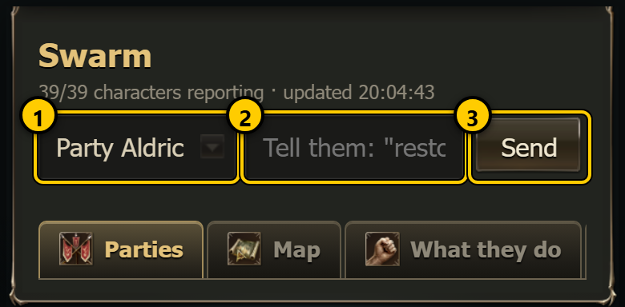 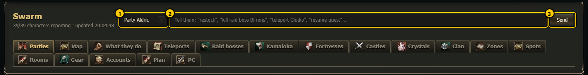

Before the command center existed, the header had a simple order bar. It is still in the page and comes back by itself only when the
command center cannot load (for example an old `server.js` that does not serve `commands.js`). Normally you never see it.

1. **Who** - a party ("Party Aldric") or one character ("Bryndis only").
2. **Free text** - a phrase such as "restock", "kill raid boss Bifrons" or "teleport Gludio", or a `!command`. The server turns phrases
   into commands (the table is in the [command reference](05-commands.md#free-text)).
3. **Send** - asks the [order confirmation](#order-confirmation-confirmorder), then sends.

## Message line

The line under the search field shows the answer to the last thing you did. It stays until the next message replaces it.

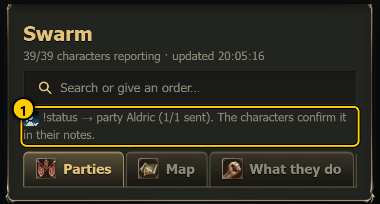 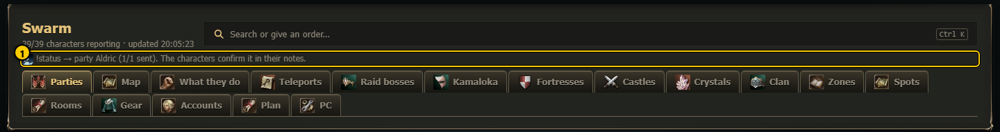

1. A **green tick** (game "yes" icon) means it worked: for orders it shows the command, the target and how many sends went out, for
   example `!status → party Aldric (1/1 sent). The characters confirm it in their notes.` "Sent" means the order reached the game window;
   whether the character could do it shows a few seconds later in its notes (Parties tab, character page, "What they do").

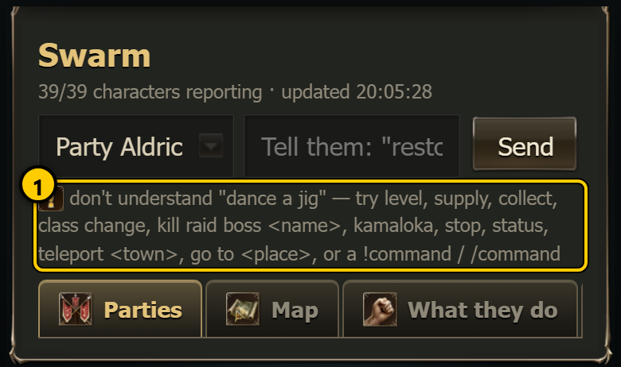 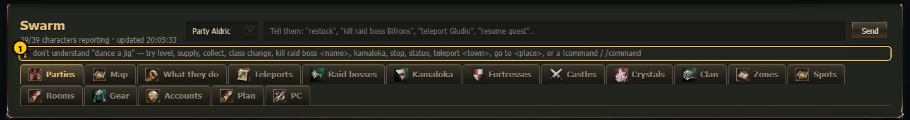

1. A **warning sign** (game "!" icon) means it did not work, followed by the reason, for example
   `don't understand "dance a jig" — try level, supply, collect, ...`.

Every message that can appear there:

| Message | Where it comes from |
|---|---|
| `sending to <name>…` | Old order bar and quick buttons, while the order is on its way. |
| ✓ `<command> → party <name>. The character confirms it in its notes.` | Quick buttons (Status, Level, Supply ... on a party card, Class change / Rebuff / Escape on a character page), the task menu with **Do**, the old order bar. |
| ✓ `<command> → <target> (n/m sent). The characters confirm it in their notes.` | Command center, after **Send**. With `- sent via file channel - ...` when L2Swarm's control interface (MCP) did not answer and the order went through the file channel instead. |
| ⚠ `<reason>` | Any of the above when the server refused the order (unknown command, unknown party, destructive without confirmation, nobody to send it to ...) or could not be reached. |
| `type the boss / town / place in the box next to the menu first` | The task menu with **Do**: the chosen task needs a word in the box next to it. |
| `<name>: ingame — applied within ~2 min` / `<name>: oog — ...` | Client mode buttons on the character page (with a warning text in brackets when the server adds one), or `<name>: <error>`. |
| `start…` `restart…` `stop…` `deploy…`, then the program's answer or `... sent — status updates in about 15 s` | PC tab buttons. |
| ✓ `<leader>: <daily dungeon> ON / OFF` | Parties tab, daily dungeon switches. |
| ✓ `sell list saved — the bots use it at their next town visit` | Sell setting of an item in a character's bag (character page). |
| ✓ `saved — <slot> for <class> (<grade>) set / back to automatic` | Gear tab preferences. |
| ✓ `zone saved — auto-level picks it up on its next check` | Zones tab. |
| `creating…`, then ✓ `<name> is being created on <login> — it appears here when logged in` | Accounts tab, new character. |
| ✓ `soul crystal plan saved` | Crystals tab. |
| ✓ `<what was saved>`, `clan name: 2-16 letters/digits` | Clan tab. |
| `pick a dungeon and a level range (min ≤ max)`, `tick at least one party`, ✓ `spot added: <dungeon>` | Spots tab, adding a dungeon spot. |
| `siege plans saved`, `siege plan: <error>`, `set the siege time first` | Fortresses / Castles tabs. |

Some pages also have their own small message spot next to their buttons (for example the zone editor's "saved — the bots use it on their
next spot check", "give the zone a name", or the new-account form's "creating…"). Those pages explain them.

## Live banners

 

While a raid, a Kamaloka run or a siege is running, a red banner with a pulsing dot appears under the header on **every** page. It is
the quickest way to notice that a fight is on. Tap a banner (**Watch ›**) to open its live view.

1. **LIVE raid** - boss name, boss HP %, how many of the team are alive (`7/9 alive`) and the fight time. Opens the
   [raid live view](live/raid-live.md) (`#/live`). Hidden while you are on that view.
2. **LIVE Kamaloka** - which Kamaloka, the phase (Travel, Enter, Rebuff, Fight, Loot), alive count and time. Opens the
   [Kamaloka tab](pages/kamaloka.md) with the [live view](live/kamaloka-live.md). Hidden while you are on the Kamaloka tab.
3. **LIVE siege** - fortress or castle, phase (Regroup in Giran, Travel, Regroup outside, Waiting for the start, Siege: objectives,
   Flag / artifact), objectives done, who holds the flag, alive count and time. Opens the [siege live view](live/siege-live.md)
   (`#/siege/live`). Hidden while you are on that view.

A banner shows while its live file is fresh (written by the leader within the last 30 seconds) and the run is not finished. The page checks
for a running raid every second, for a Kamaloka run every 3 seconds (every second while one runs) and for a siege every 8 seconds (every
2 seconds while one runs), so a banner can take a few seconds to appear.

## Tabs and page addresses

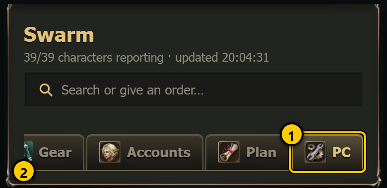 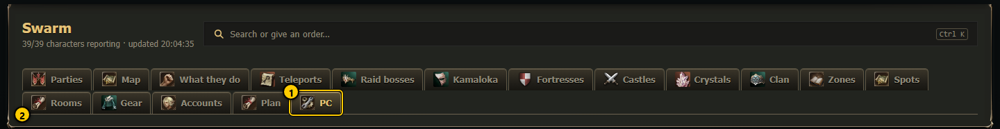

1. The **open tab** is drawn pressed and in gold.
2. On a phone the tab strip is one row that **scrolls sideways**: swipe it to reach the tabs on the right. On a desktop it wraps or
   scrolls (a mouse wheel over the strip scrolls it sideways). Opening a page scrolls its tab into view.

Every page has its own address after `#`. The browser's **back** and **forward** buttons work, you can bookmark any page, and you can send
a link to a single character or boss. Pages that are not tabs (character page, raid boss page, live views, editors) are opened from links
on other pages or from the command center; while one of them is open, the tab it belongs to stays highlighted where it makes sense.

| Tab | Address | What it is | Chapter |
|---|---|---|---|
| Parties | `#/parties` (also the start page; any unknown address opens it) | Every party with its members, map, hunting spot and orders | [Parties](pages/parties.md) |
| Map | `#/map` | World map with every character | [Map](pages/map.md) |
| What they do | `#/logs` | Timeline of what each character did | [What they do](pages/what-they-do.md) |
| Teleports | `#/tp` | Gatekeeper menus, where each character is, Giran town routes | [Teleports](pages/teleports.md) |
| Raid bosses | `#/raids` | Raid boss list, respawns, raid hunter, reports | [Raid bosses](pages/raid-bosses.md) |
| (raid boss page) | `#/raid/<boss id>` | One boss: details, route to it, reports | [Raid bosses](pages/raid-bosses.md) |
| (raid live view) | `#/live` | The running raid fight | [Raid live view](live/raid-live.md) |
| Kamaloka | `#/kamaloka`, `#/kamaloka/<id>` | Every Kamaloka, done today, maps; `<id>` opens one (for example `kamaloka-39`) | [Kamaloka](pages/kamaloka.md) |
| Fortresses | `#/forts`, `#/forts/<id>` | Fortresses, owners, siege plans; `<id>` opens one | [Sieges](pages/sieges.md) |
| Castles | `#/castles`, `#/castles/<id>` | Castles, owners, siege plans | [Sieges](pages/sieges.md) |
| (siege) | `#/siege`, `#/siege/live` | The running siege | [Siege live view](live/siege-live.md) |
| Crystals | `#/crystals` | Soul crystal plan per character | [Crystals](pages/crystals.md) |
| Clan | `#/clan` | Clan level, quests, skills, members | [Clan](pages/clan.md) |
| Zones | `#/zones` | Hand-drawn hunting zones with exclusions and pull routes | [Zones](pages/zones.md) |
| Spots | `#/spots` | Every hunting spot and which party may use it | [Spots](pages/spots.md) |
| (spot editor) | `#/spot`, `#/spot/<name>`, `#/spot/new` | Full-screen map editor for one hunting spot | [Spots](pages/spots.md) |
| Rooms | `#/rooms` | Dungeon rooms and room walks | [Rooms](pages/rooms.md) |
| (shape editor) | `#/edit/<kind>/<id>` with kind `room`, `zone`, `spot` or `area` | Full-screen outline editor | [Shape editor](pages/shape-editor.md) |
| Gear | `#/gear` | What each class buys and wears per grade | [Gear](pages/gear.md) |
| Accounts | `#/accounts` | Accounts, characters, new accounts, item transfer | [Accounts](pages/accounts.md) |
| Plan | `#/plan` | The planning notes (read-only) | [Plan](pages/plan.md) |
| PC | `#/pc` | L2Swarm memory, start / restart / stop, deploy | [PC](pages/pc.md) |
| (character page) | `#/char/<name>` | Everything about one character | [Character page](pages/character.md) |

Names in addresses are written as they are (`#/char/Bryndis`); spaces and special letters are encoded by the browser.

## Refreshing

- The page asks the server for the newest state **every 4 seconds** and redraws only what changed. Some tabs load extra data on their own
  timer (Teleports every 15 s, Raid bosses every 30 s, PC every 15 s, Clan every 4 s, Fortresses / Castles every 15 s, Kamaloka every 20 s,
  live views every 1-2 s while they run).
- While the page is **hidden** (another browser tab, the phone screen off) it does not refresh at all, so it costs nothing. When you come
  back it refreshes at once.
- The redraw keeps what you are doing: the text you are typing, an open drop-down list, a ticked box, opened sections and the scroll
  position stay as they are. You can fill a form calmly while the numbers around it change.
- Lists in drop-downs are only rebuilt when their choices really change, so an open list does not close under your finger.
- The page remembers small things per browser: the dashboard key, which command-center categories you keep open, your recent orders, the
  last target you used, timeline settings. Clearing the browser's site data forgets them; nothing on the PC changes.

## Look (the L2 skin)

The dashboard uses the game's own interface textures (window frames, buttons, tabs, gauges, list headers) and the game's item, skill and
class icons, in one dark theme on every page. There is no light theme. Colours mean the same everywhere: **gold** = headings and links,
**green** = good / done, **yellow** = warning, **red** = problem, danger or offline, **blue** = moving / resting.

## Confirmations

Nothing that changes the game is sent without asking first. There are four kinds of question.

### Order confirmation (confirmOrder)

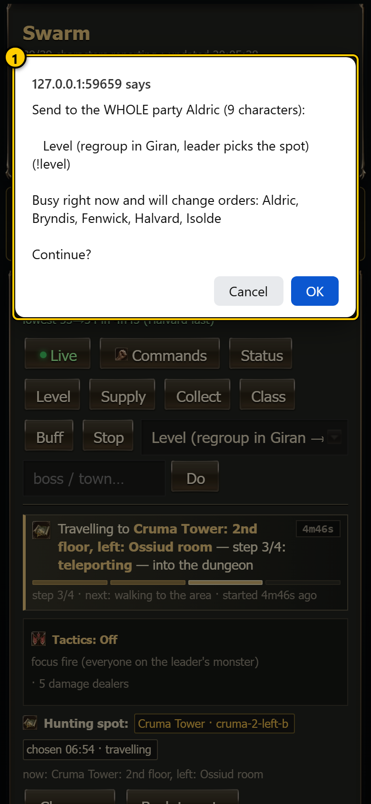 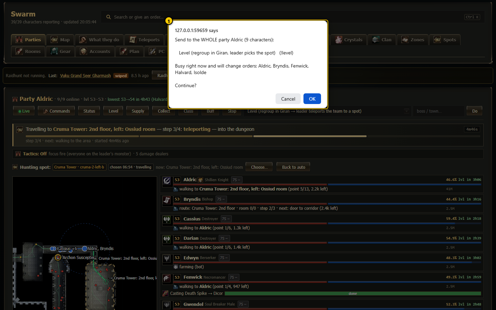

Shown by the quick buttons on a party card (Status, Level, Supply, Collect, Class, Buff, Stop), the task menu with **Do**, the quick buttons
on a character page and the old order bar. It names:

- the target: `Send to the WHOLE party Aldric (9 characters):` or `Send to Bryndis only:`,
- the order in words and the exact command in brackets,
- `Busy right now and will change orders: <names>` when members of that party are doing something (leveling, a trip, a fight). Idle
  characters and plain L2Swarm farming do not count as busy.

**OK** sends it, **Cancel** sends nothing. The command center has its own, more detailed version (see
[Command center: Confirm](pages/command-center.md#confirm-and-send)).

### Typed confirmation (destructive orders)

Orders that cannot be undone or can hurt (for example `/unstuck`, `/leave`, `/trade`, enchanting, logging a character out, restarting or
stopping L2Swarm, deploying the script) ask a second time and only go out when you type `YES` (capital letters) into the box. Anything else,
or Cancel, means "not sent". The server itself also refuses a destructive order that did not come with this second confirmation.

### Yes / no questions on pages

Simple browser questions with **OK** and **Cancel**. Cancel always means "do nothing". The full list:

| Page | Question (short) |
|---|---|
| Parties | `Party <name>: tactics ON / AUTO / OFF — groups of …?` (hunting pairs) · `Party <name> (n characters): hunting spot = <spot>?` · `Daily dungeon for the WHOLE party <name>: <dungeon> → ON / OFF` |
| Character page | `Switch <name> to IN-GAME?` / `Switch <name> back to OUT OF GAME?` (client mode, picture below) |
| Raid bosses | `Send party <name> to raid <boss>? They pause, go home, buff, restock, travel and attack.` |
| Raid route / Giran route editor | `Replace all n points with the m pasted ones?` · `Throw away the unsaved changes?` · `Delete the Giran route '<id>'?` · `Delete the saved route to <boss>?` |
| Gear | `Make <item> the preferred <slot> for <class> at <grade>?` · `<item> is already preferred. Go back to the automatic pick?` |
| Zones | `Delete zone <name>?` (picture below) |
| Accounts | `Transfer all adena / EVERYTHING from <a> to <b>?` · `Create the account <login> ...?` |
| Crystals | `Save the soul crystal plan?` |
| Clan | `Clan name = "<name>"?` · `Clan quest <name> → ACTIVE / OFF?` · `Save clan reputation for <skill>?` |
| Spots | `Delete the spot "<name>"?` |
| Rooms | `Drop the unsaved changes of <room>?` · `Replace your n points with the computed route?` · `Delete the saved route for <room>?` |
| Spot editor | `Leave without saving the changes to this spot?` · `Remove all waypoints, the hunt area and every exclusion of this spot?` · `Delete the spot "<name>" for good?` · `No start (teleport / .town) is set ... Save anyway?` · `A spot called "<name>" exists already — replace it?` |
| Shape editor | `Leave without saving?` · `Start from the monster area of this spot?` (Cancel = start from today's square) · `Replace the outline with one around n monster spawns?` · `Drop every change since you opened this shape?` · `Save <kind> "<name>"?` · `<error> Reload the shape from the file now?` · `Reset "<name>" to the generated shape and values?` |
| Fortresses / Castles | `Cancel the siege plan for <target>?` · `Delete the siege plan for <target>?` |
| PC | `Stop L2Swarm? All characters log out.` · `Restart L2Swarm? All characters log out and back in (about 1 min).` (picture below) · after a refused deploy: `<reason> Deploy anyway?` |

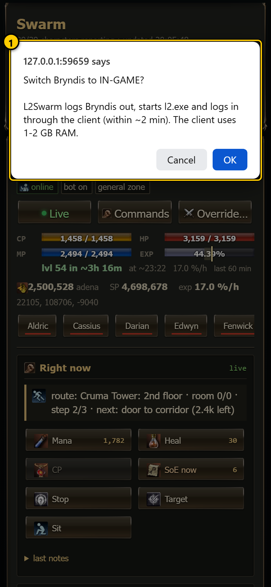 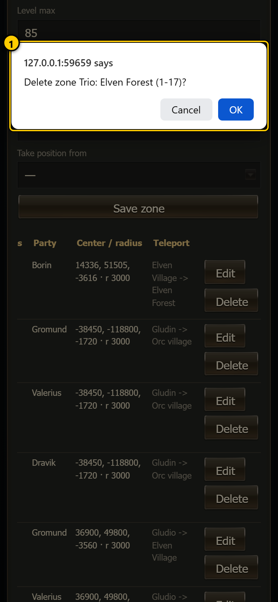 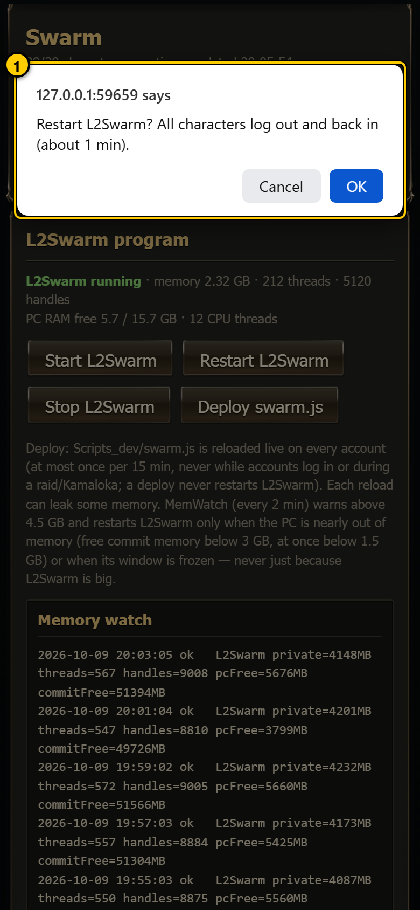

The spot editor also has one **text question**: when you tap a landing where several gatekeeper teleports arrive, it asks
`Which teleport?` with a numbered list; type the number.

### Choice dialogs (more than two answers)

A few questions need more than yes or no. They open as a small window inside the page, in the game skin, with one button per answer
(tapping outside the window = Cancel). They come from the hunting-spot choice on the Parties tab:

- `<dungeon> is closed now` (Seven Signs) - **Save anyway (blocked until it opens)** / **Cancel**.
- `Above the safe level` - **Yes, override** / **Save without override** / **Cancel**.
- `Hunt above the safe level?` - **Yes, override** / **Cancel**.

They are shown with pictures in the [Parties](pages/parties.md) chapter.

## Error boxes

Some editors report a failure in a plain browser box with only **OK**, for example `Could not save: <reason>`, `A route needs at least 2
points`, `No x y z found`, `Need at least 2 lines with x y z`, `Set the start: a gatekeeper teleport ("Dion -> Plains of Dion") or a
.townname`, `Use lowercase letters/digits, e.g. "gatekeeper"` (Giran route names) and `Pick something to edit first.` (shape editor).
Read it, press OK and fix what it says; nothing was saved.

## Toasts (the map editors)

The two full-screen map editors show short messages as a **toast**: a box that appears over the map and disappears by itself.

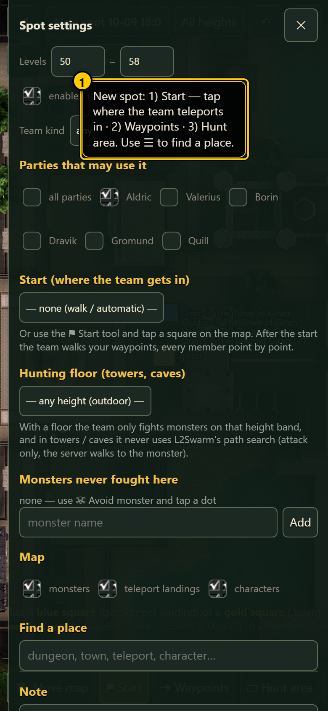 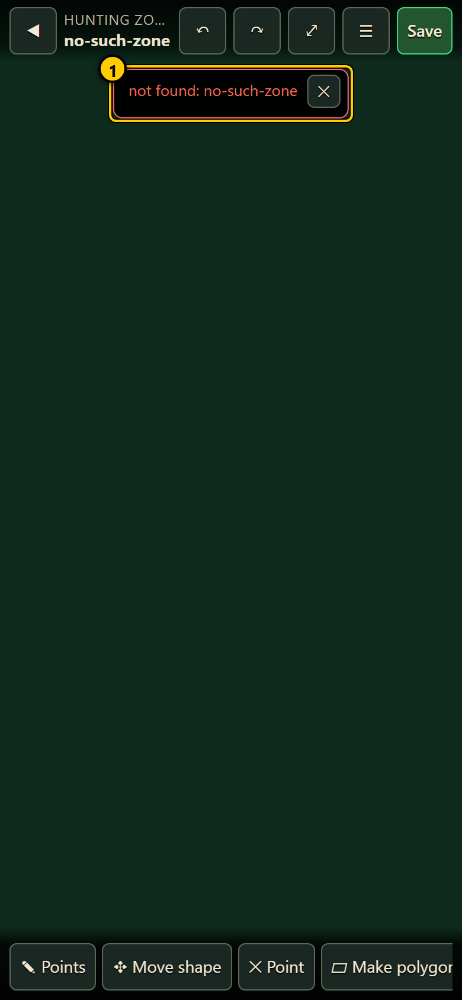

1. **Spot editor** (`#/spot/...`): hints and results, for example the first steps of a new spot, `Start: .giran — now draw the waypoints`,
   `<monster>: never fought in this spot`, `Give the spot a name first`, `Saved — the leaders use it on their next spot pick (within 5 min,
   no deploy needed)` or `Not saved: <reason>`. It stays 3.5 seconds (longer for long hints).
2. **Shape editor** (`#/edit/...`): normal toasts (geodata check results, `✓ Saved (...)`, `✓ Reset to the generated shape.`, recompute
   progress) and **red error toasts** (`Not saved: ...`, `Fix the outline first ...`, `No monsters inside.`, or an error loading the shape as
   in the picture). A normal toast stays 4-15 seconds depending on its length; an error toast 15 seconds.

## Notes

- The dashboard never shows or changes passwords, and it never sends anything to the game by itself: every order comes from a button you
  pressed and confirmed. (The bots act on their own, of course; the dashboard only watches them.)
- "Sent" is not "done". Check the character's notes or the timeline after an order.
- Keep the key out of screenshots and chats.
