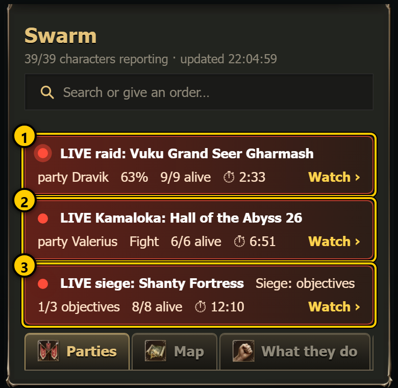
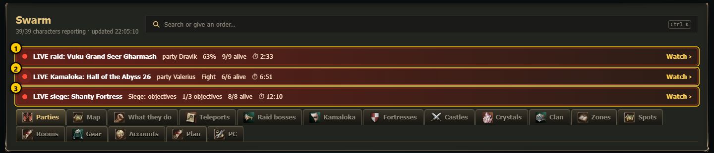
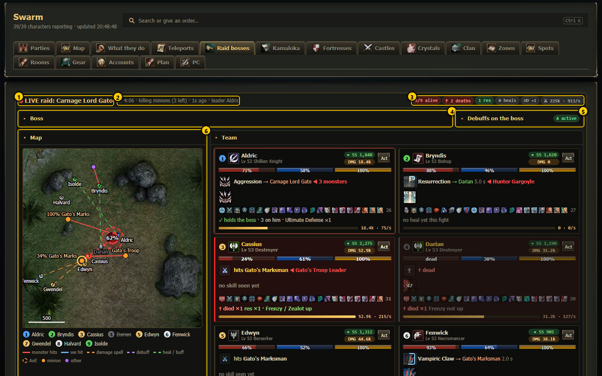
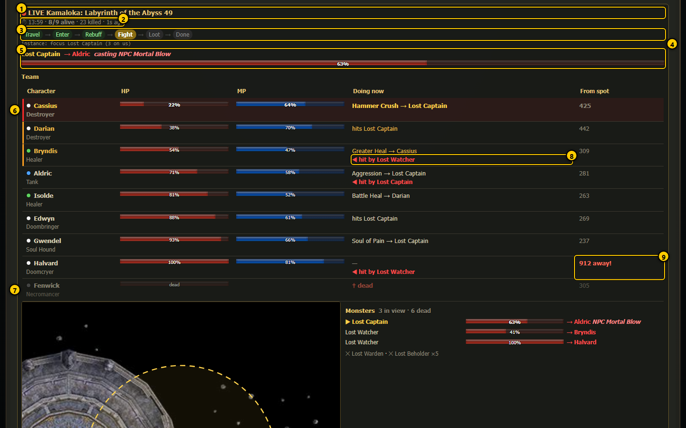
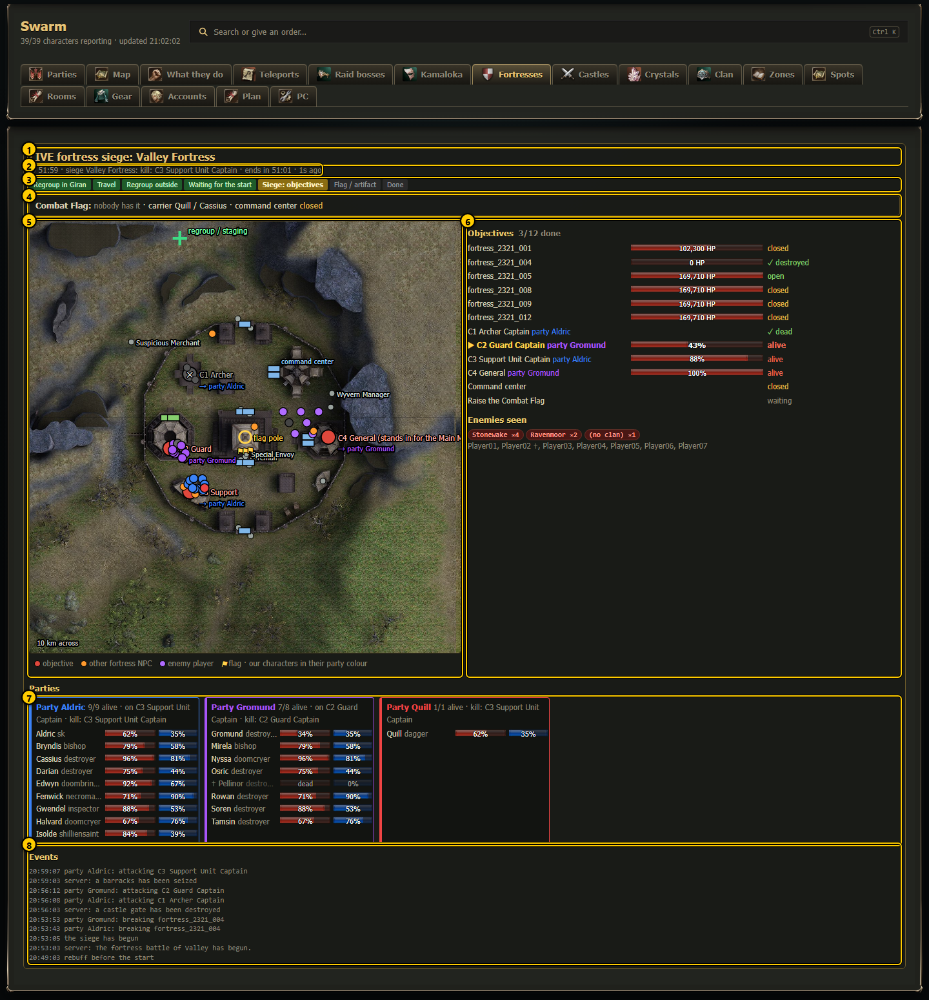
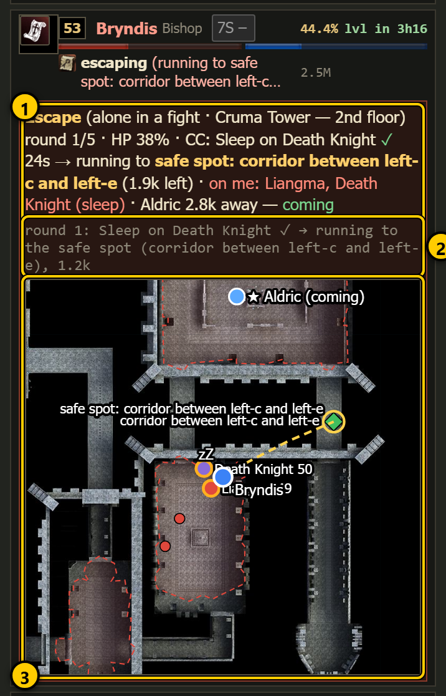

# Live views

Most dashboard pages show the state of the bots every few seconds. A **live view** goes further: while something important happens (a
raid, a Kamaloka run, a siege, an escape from a fight), the party leader's script writes a small live file every one or two seconds, and the
dashboard turns it into a moving picture of the fight. You never have to open a live view yourself: when one starts, a coloured
**LIVE banner** appears under the header on every page, and the matching tab switches to its live layout. Tap **Watch** on the banner to
open it.

 

Live views only show things. Orders are still given from the normal pages and the [command center](pages/command-center.md).

## Which live views exist

| Live view | When it appears | Where | Written by | Guide page |
|---|---|---|---|---|
| **Raid live view** (raid HUD) | the party leader is in a raid fight | `#/live`, the Raid bosses tab, the boss page, the red banner | the leader, `Logs/raid_live.json`, every second | [Raid live view](pages/raid-live.md), older layout: [live/raid-live.md](live/raid-live.md) |
| **Kamaloka live view** | from the moment a Kamaloka run starts until 15 minutes after it ended | the Kamaloka tab, the Parties tab, the banner | the leader, `Logs/kamaloka_live.json`, every second | [Kamaloka live view](live/kamaloka-live.md) |
| **Siege live view** | a planned fortress or castle siege is running (from the regroup until the result) | `#/siege/live`, the Fortresses / Castles tabs, the banner | the main leader, `Logs/siege_live.json`, every 2 seconds | [Siege live view](live/siege-live.md) |
| **Live party view** | always (any party, any time) | `#/live/<leader>`, the green **Live** button on a party card | every member's own state file | [Live party view](pages/live-party.md) |
| **Party live states** | escape from a fight, long casts (Scroll of Escape, `.town`, resurrection), rescue trips, rotating hunting areas, other players at the spot, the chosen-spot status, hunting pairs | inside each party card on the Parties tab | each character's `Logs/swarm_state_<name>.json`, every few seconds | [Party live states](live/party-live.md) |

## How "live" is decided

- A live file counts as **running** while it is fresh. The raid and Kamaloka views treat a file older than about 30 seconds as finished
  (the leader stopped writing it). The Kamaloka view keeps showing a finished run, with its result, for 15 minutes.
- If the leader's game window freezes, the view stops moving and its "updated" time grows. That is the first sign that something is wrong
  with the leader's window (see [Troubleshooting](01-getting-started.md)).
- The banners and live blocks need no setting: they appear and disappear by themselves.

## A first look at each

**Raid live view**: the boss with its HP, what it casts and whom it targets, the debuffs on it with the time left, every team member's
HP / MP and current action, the minions with the focus target, a map, damage totals and a time-stamped event feed.

**Kamaloka live view**: the phase steps (travel, entering, rebuff, fighting, loot, done), the boss bar, the team table, the instance map
with monsters, the focus target and the path walked, damage and events.

 

**Siege live view**: the objectives and their status, the flag or Holy Artifact, enemies seen, every party's members on a close-up map, the
countdown to the end of the siege, and the events.

**Escape box** (party live state): when a character is alone in a fight it cannot win, its row on the Parties tab gets an escape box with a
mini map: the monsters on it, which ones are put to sleep or held, the safe spot it runs to, and whether the leader is coming to rescue it.

