# README gallery images

Anonymised screenshots for the project README (demo names only). Each pick exists at phone size (390 x 844, `_phone.png`) and
desktop size (1440 x 900, `_desktop.png`) where it makes sense. Paths are relative to this folder. Regenerate with
`node docs/guide/tools/make_guide.js`.

| Preview | File stem | Caption | Sizes |
|---|---|---|---|
| 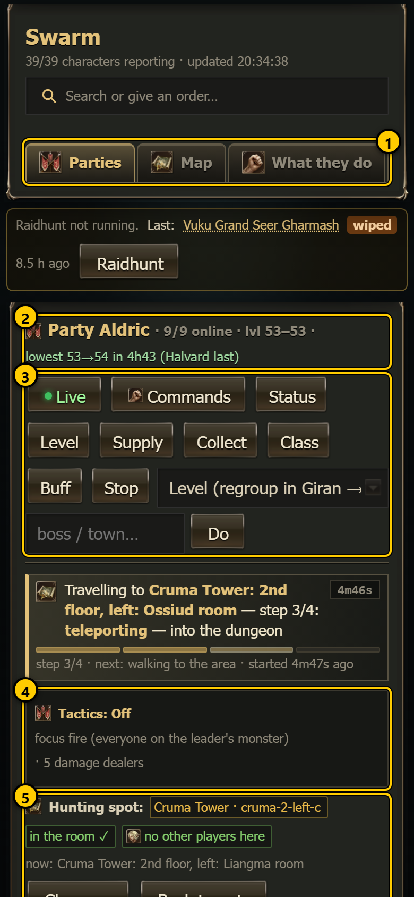  | `readme_parties` | The Parties tab: every party with its members, hunting spot, tactics and live map. | phone, desktop |
| 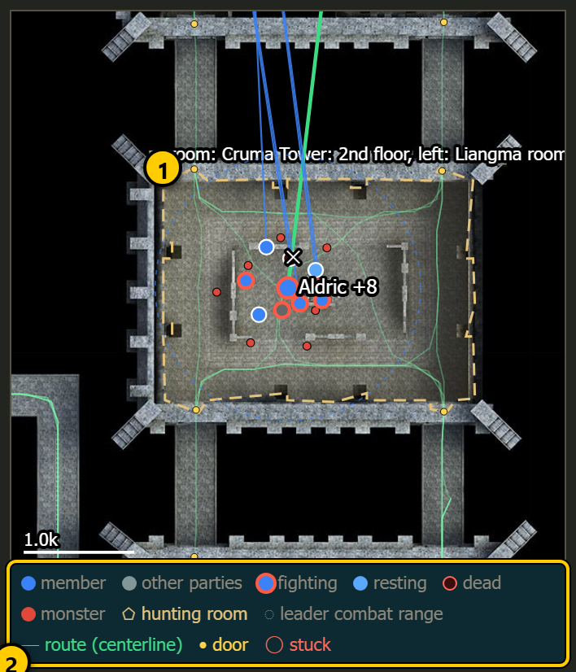  | `readme_party_room_map` | A party card whose map shows the dungeon room the party hunts in. | phone, desktop |
| 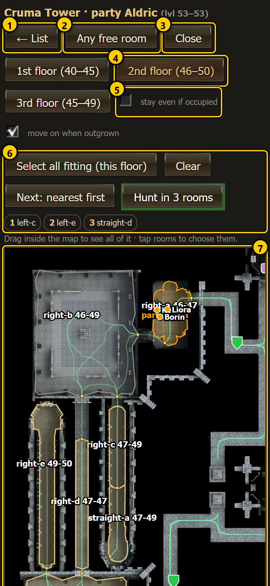  | `readme_dungeon_picker` | The hunting-spot picker with a dungeon floor map: tap a room to hunt there. | phone, desktop |
| 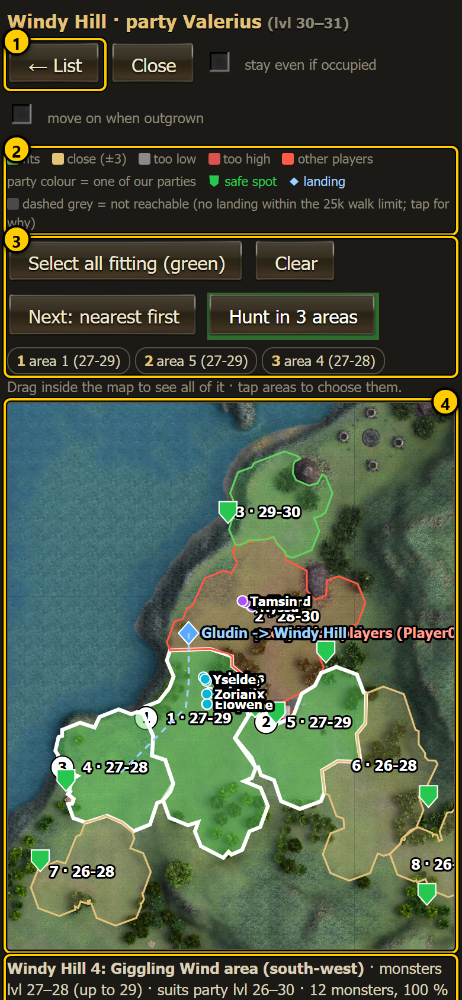  | `readme_field_picker` | The hunting-spot picker with a field region map: pick one or several areas to rotate through. | phone, desktop |
|  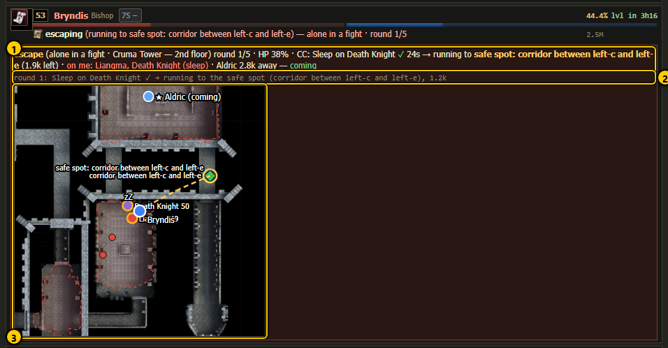 | `readme_escape_box` | A character alone in a fight: the escape box with its mini map, attackers and the way out. | phone, desktop |
| 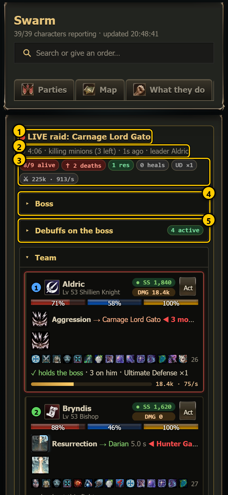  | `readme_raid_live` | The raid live view: boss, debuffs, team, minions, damage and events while a raid runs. | phone, desktop |
| 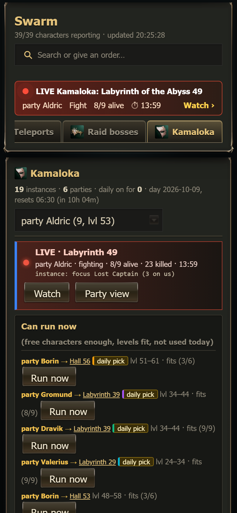  | `readme_kamaloka_live` | The Kamaloka live view: phases, boss, team and the instance map during a run. | phone, desktop |
|  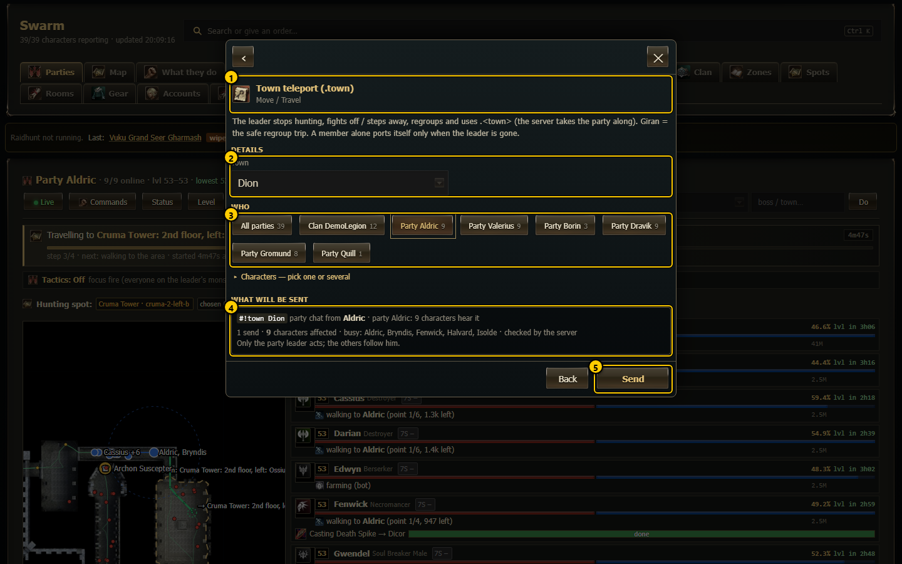 | `readme_command_center` | The command center: search for any order and fill in its form. | phone, desktop |
| 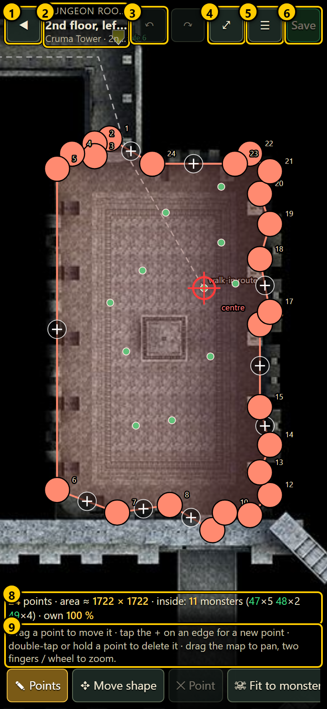 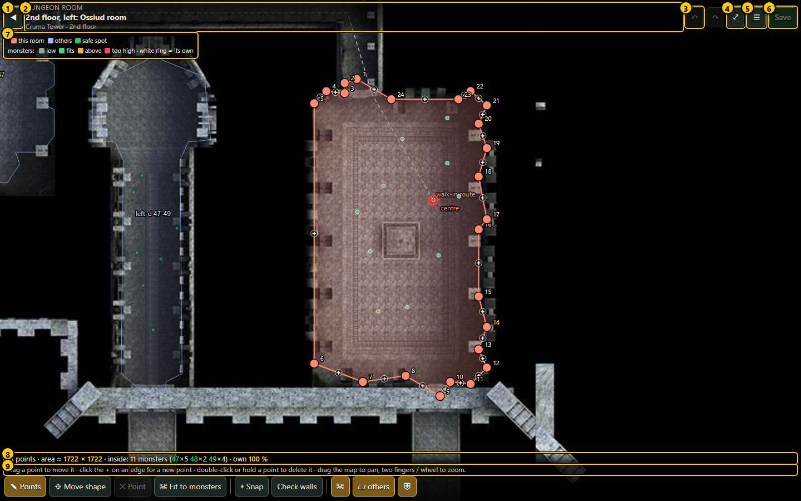 | `readme_shape_editor` | The shape editor: draw the outline of a dungeon room or a field area on the map. | phone, desktop |
|  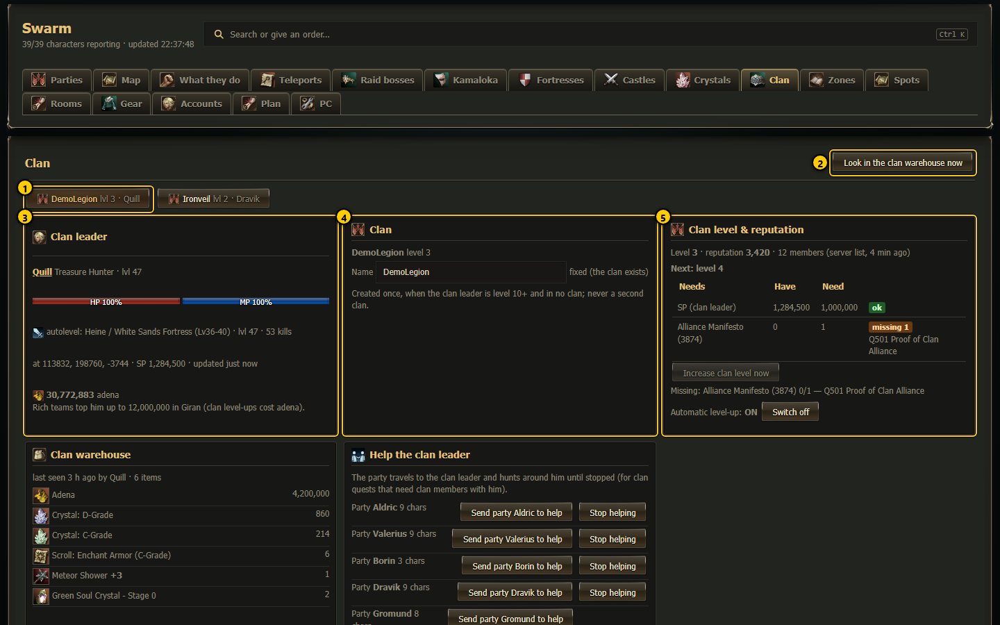 | `readme_clan` | The Clan tab: clan level, reputation, clan quests, Seven Signs and the command channel. | phone, desktop |
