# Accounts (`#/accounts`)

The Accounts tab lists every account config of the install, lets you **add accounts to the swarm** (**+ Add account**), **create a new
character** (on a new or an existing account) and **move adena and items** from one character to another, including old characters that
are not in any party.

## Add account (`+ Add account`)

The button at the top right of the Accounts tab opens one form that adds a game account to the swarm in a single step. No SETUP run and
no file editing are needed.

**One account**

1. **Login** and **Password** of the game account.
2. **Character**: *Use an existing character* (type its exact name) or *Create a new character* (name + **Race**, **Sex** and
   **Start class**; only the start classes that exist for that race and sex are offered, e.g. Dwarves have no mystic, Kamael soldiers
   are male or female by class).
3. **Party**: an existing party (by its leader) or *New party: this character leads it*.
4. **Role**: what swarm.js does with it. `auto` (default) = the kind of its current class, re-checked after every class change. The
   kinds `tank, healer, buffer, melee, archer, dagger, nuker, summoner, spoiler, crafter` work for every class; the named roles
   (`sk, bishop, shilliensaint, destroyer, doombringer, necromancer, inspector, doomcryer`) have special routines.
5. **Auto-start**: on = the *L2Swarm Start* task logs it in at every start.
6. **Log in right away**: when L2Swarm runs, the new account logs in now (several: one by one, `login.gapSeconds` apart). When L2Swarm
   is not running it logs in at the next start.
7. **Add** asks once (a styled dialog that never shows the password), then shows the result.

**Several at once**: paste one account per line, `login;password;character;party;role`. Party empty = the character leads a new party
(other lines of the same list may name it as their party); role empty = `auto`; lines starting with `#` are skipped; tabs work like `;`.
A password that contains `;` works when the line has all 5 fields. Tick *These characters do not exist yet* to create them all with one
start class. **Check** only validates and shows what would happen (nothing is changed); **Add all** adds them. After Add the list is
emptied; lines that failed come back **without** their password so you can fix them and type the password again.

**The result** lists every account: *created*, *already exists* (login or character already in `swarm.config.json`, or an L2Swarm
config with that login already in `Settings\`) or *error* with the reason (bad login, missing password, unknown role, a party that is
not a party leader, a start class that does not fit the race / sex, ...).

**What Add does**

1. Makes the L2Swarm account config `Settings\<Login>.xml` from the role's template (`Settings\templates\<role>.xml`, else
   `default.xml`) with login, character, group (`Party <leader>`), login server and follow settings (members follow their leader;
   healers do not assist). Tool: `docs\plan\tools\new_account.ps1`.
2. **The password is stored only encrypted inside that config**, with L2Swarm's own encryption, exactly as L2Swarm does when you add
   an account in L2Swarm itself. The dashboard passes it to the tool only through an environment variable of that one process; it is
   never written to `swarm.config.json`, a log, or any other file, and the field is emptied right after.
3. A **new character** gets a one-off script `Scripts\mkchar_<login>.js`: at the first login it creates the character at character
   select (progress and "RESULT OK / RESULT FAIL" in `Logs\create_chars.txt`; a taken name gives RESULT FAIL: add it again with
   another name after removing the account line).
4. Adds the account to `swarm.config.json` (a backup copy goes to `Settings\backup\swarm_config_history\` first).
5. Auto-start on: adds the config to `Settings\start_extra.txt` (the start task logs these in after its AutoStart list;
   `Settings\settings.xml` is not touched while L2Swarm runs). Running `SETUP.cmd -Apply` later also puts it into L2Swarm's own
   AutoStart list (optional).
6. One line per account in `Logs\dashboard_commands.log` (never the password).

The other characters of a party learn about a new member at their next script start (next deploy or L2Swarm start).

## Accounts table (`#/accounts`)

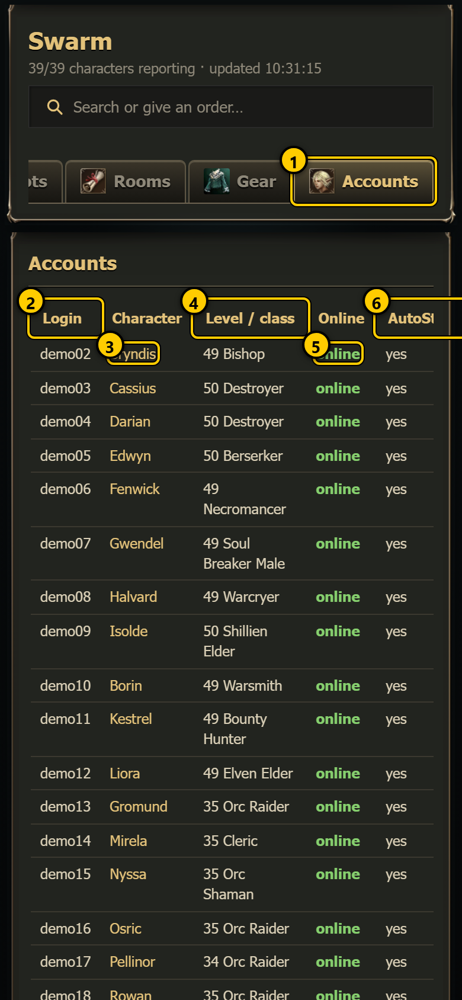 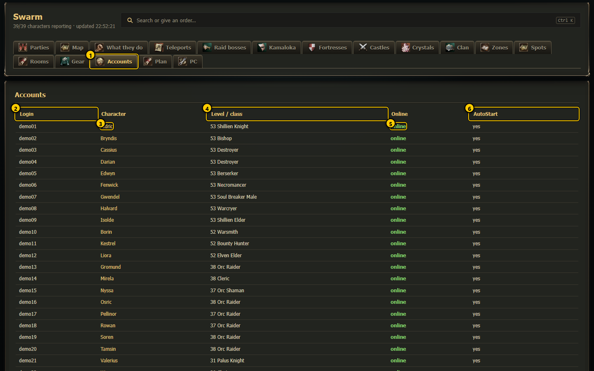

1. **Accounts tab**: opens this page.
2. **Login**: the account's login name (from the account config `Settings/<Login>.xml`).
3. **Character**: the character the account plays (`SelectedCharacter` in the config). Tap the gold name to open its
   [character page](character.md). "none" = the config has no character yet.
4. **Level / class**: from the character's live report. Empty when it has not reported recently. After it the short
   [next level estimate](character.md#next-level-estimate) (*lvl in 1h25*, *no exp*).
5. **Online**: green **online** when its script reported within the last 30 seconds, grey **offline** otherwise.
6. **AutoStart**: **yes** when the config is an enabled entry in L2Swarm's AutoStart list (`Settings/settings.xml`). The staggered
   login of the [PC tab](pc.md) (Start / Restart) opens these accounts one by one.

The whole page, with the two forms under the table:

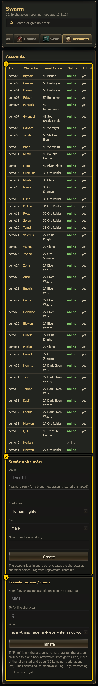 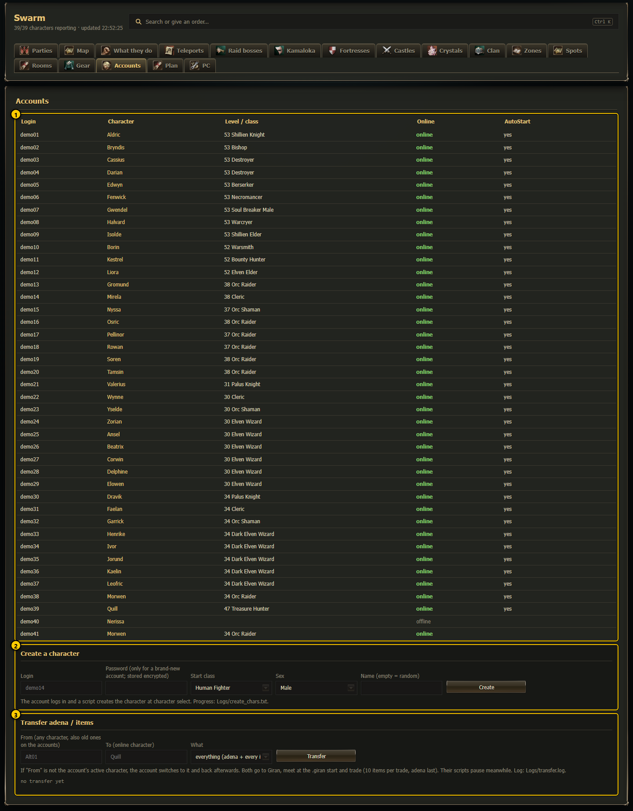

1. **Accounts table**  2. **Create a character**  3. **Transfer adena / items**

The table refreshes every 4 seconds. Every `.xml` in `Settings/` is listed except `settings.xml` itself (and one old duplicate config
the install skips). Passwords are never shown anywhere on the dashboard.

## Create a character

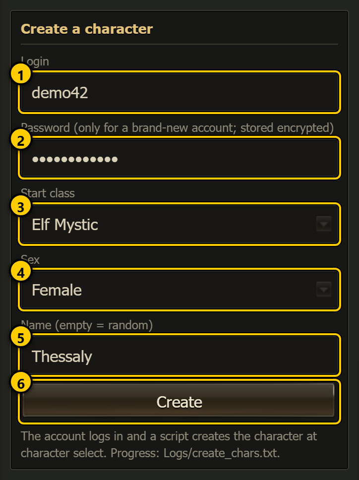 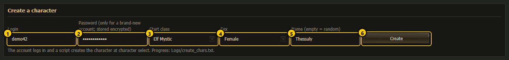

1. **Login**: the account to use. 3 - 16 letters or digits, starting with a letter.
2. **Password (only for a brand-new account; stored encrypted)**: fill it in **only** when no config for this login exists yet. It is
   stored encrypted in the new config (L2Swarm's own password encryption) and the field is emptied right after you press Create. For an
   existing account leave it empty.
3. **Start class**: Human Fighter, Human Mystic, Elf Fighter, Elf Mystic, Dark Elf Fighter, Dark Elf Mystic, Orc Fighter, Orc Mystic,
   Dwarf Fighter, Kamael Soldier (male), Kamael Soldier (female).
4. **Sex**: Male or Female (for Kamael the start class already decides it).
5. **Name (empty = random)**: the character name. Empty gives a random fantasy name.
6. **Create**: starts it. There is **no confirmation**.

What happens after **Create**:

1. If `Settings/<Login>.xml` does not exist, the dashboard creates the account config with the password (tool
   `docs/plan/tools/new_account.ps1`). Without a password you get "new account: password needed once (it is stored encrypted)".
2. The account is opened (logged in) in L2Swarm.
3. A small one-off script is attached to the account. At character select it creates the character with the start class's base stats
   and keeps trying every 5 seconds (up to 30 minutes) until the account is in game.
4. Progress lines go to `Logs/create_chars.txt` ("waiting for character select ...", "CharacterCreate sent", "in game as ...").

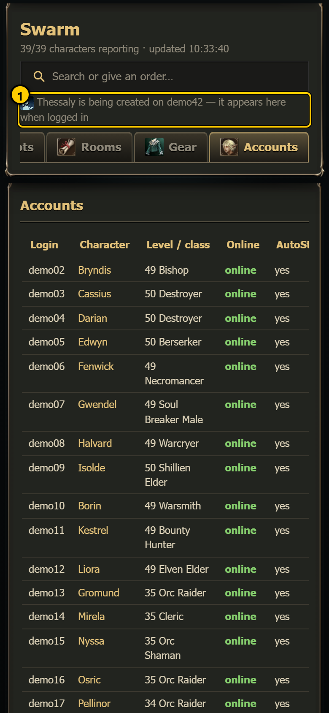 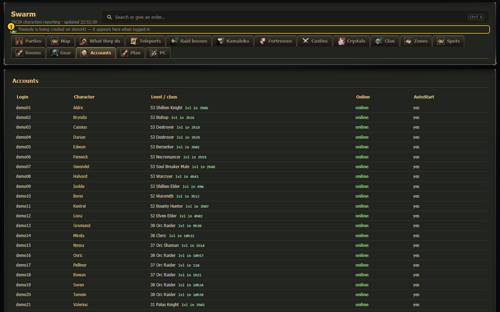

1. The message line: "*Name* is being created on *login* - it appears here when logged in", or the error.

The new character is not in a party yet. To add an account to the swarm (party, role, auto-start) in one step, use
**+ Add account** above instead.

## Transfer adena / items

Use it to empty an old character into an active one: everything it carries (or only the adena) goes to a character that is online.

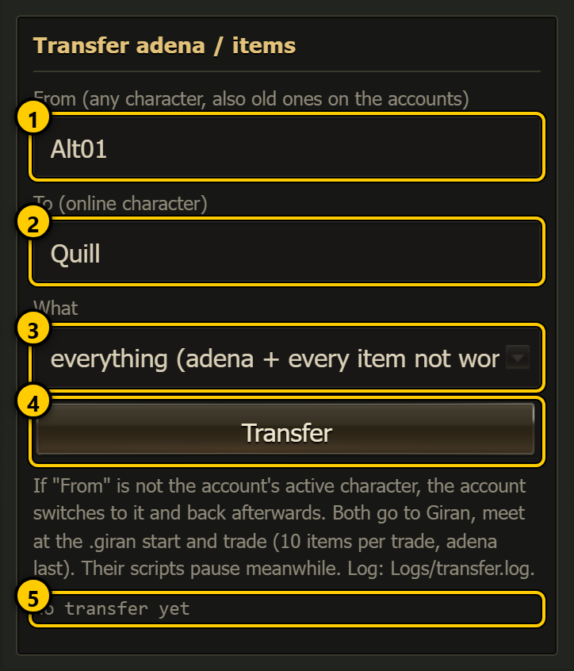 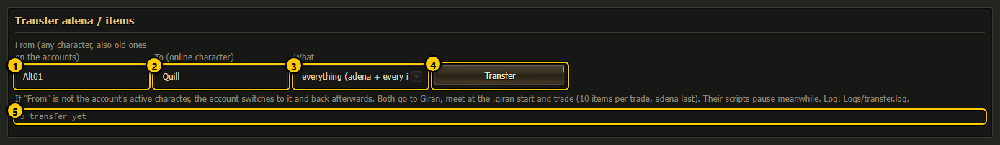

1. **From (any character, also old ones on the accounts)**: the giver. The suggestions list every character known on the accounts,
   with its login. Old characters are known once their account has logged in with the current swarm.js (it saves the account's character
   list to `Logs/chars_<login>.json` at every login).
2. **To (online character)**: the receiver. Must be online, and on **another** account than the giver.
3. **What**: *everything (adena + every item not worn)* or *adena only*. Worn items and quest items are never given.
4. **Transfer**: asks first, then starts.
5. **Log box**: the current or last transfer (see below).

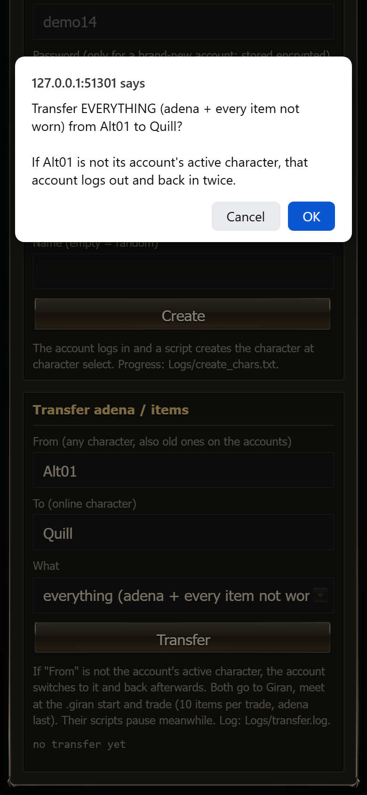 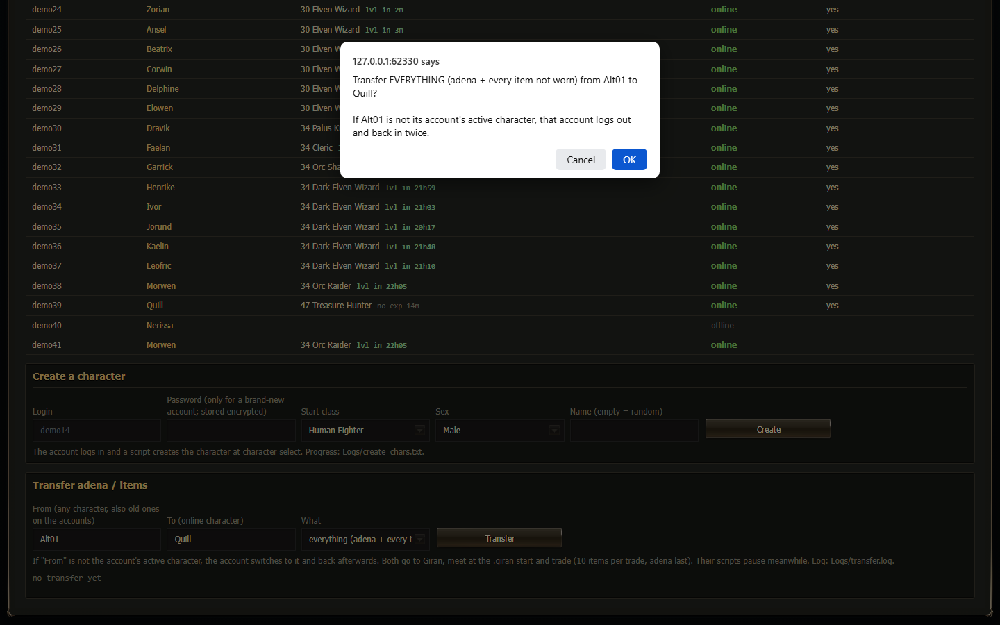

The confirmation: "Transfer EVERYTHING (adena + every item not worn) from *X* to *Y*? If *X* is not its account's active character, that
account logs out and back in twice." Cancel changes nothing.

### What a transfer does

1. If the giver is not in game, its account must be logged in with another character. That account's scripts and bot are paused and
   the running session goes back to character select and picks the giver (the account config is not changed, and the account is never
   closed or reopened). A dead giver respawns in the nearest village first.
2. The receiver goes to Giran by its own safe trip (`!town giran`), the giver with `.giran`, repeated every 20 seconds. Both must be
   near the `.giran` landing within 5 minutes.
3. Both scripts and bots are paused; the giver walks next to the receiver (they must be within 150).
4. Trades of up to **10 item stacks** each, then one last trade with the **adena**. Each trade is checked afterwards ("trade 2/5:
   10/10 moved").
5. At the end the receiver's bot and swarm.js are switched back on. A switched account goes back to its normal character, and its bot and
   swarm.js come back on. If that switch back fails, the log says so in a WARNING line and the account is left with the bot off: retry
   the transfer or switch by hand, but do not close and reopen the account.

Only one transfer runs at a time (a second one answers "a transfer is already running").

### The log box

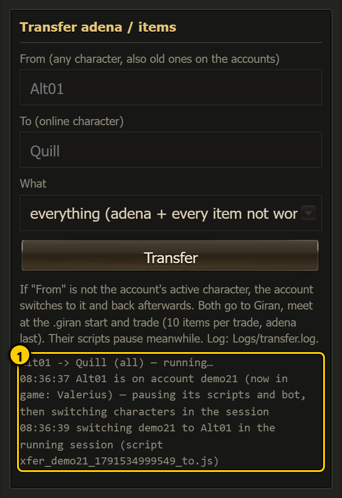 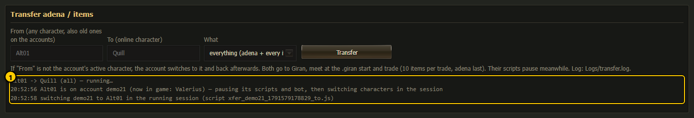

1. The first line is the job: "*From* -> *To* (all | adena) - running..." and later "done" or "failed: *reason*". Below it every step
   with its time. The step times are UTC (they can differ from the clock in the header by your time zone). "no transfer yet" when
   nothing ran since the dashboard started.

The same lines are appended to `Logs/transfer.log` (kept across dashboard restarts).

Typical failures: "*To* is not online", "*From* is not in the character index ...", "account ... is not logged in in L2Swarm",
"*From* and *To* are on the same account", "both did not get to Giran within 5 min", "could not meet".

## How to ...

**Add a character to a new account**

1. Fill in **Login** with the new login and the **Password**.
2. Pick **Start class**, **Sex** and a **Name** (or leave the name empty).
3. Press **Create** and watch the message line, then `Logs/create_chars.txt`.
4. When it appears online in the table, add it to `swarm.config.json`.

**Empty an old character into the party leader**

1. Make sure the old character's account is logged in (with any character) and the leader is online.
2. Type the old character in **From**, the leader in **To**, choose **everything**.
3. Press **Transfer**, read the question, press **OK**.
4. Follow the log box. It takes a few minutes (Giran trip + trades).

## Notes

- Create a character has no confirmation; Transfer asks first.
- A transfer pauses both characters' scripts and, for an old character, switches the account's character for a while.
- The password field is only sent once to create the config. It is never stored in plain text, logged or shown.
