# Character page  (`#/char/<Name>`)

The character page shows **one character in full, live**: what it is doing right now (in plain words, with the cast it is casting, its
target and the monsters on it), a live map, its gear, bag, skills with cooldowns, buffs with the time left, its recent steps, its
progress and supplies, and **direct orders**: use this skill now, take a potion, Scroll of Escape now, drop an item. Open it whenever one
character behaves oddly, or when you want to check or change its gear, buffs or bag.

It looks and moves like the [Live party view](live-party.md), but for one character.

**How to open it**

- Tap a member row on the [Parties](parties.md) tab, a dot on the [Map](map.md), "open ›" on a live party card, a name in
  [What they do](what-they-do.md), [Teleports](teleports.md) or [Accounts](accounts.md), or a teammate button at the top of another
  character page. On its own map, tap a teammate's dot.
- Or type the address: `#/char/<Name>`, for example `#/char/Aldric`. Back / forward in the browser work; **Esc** goes back (or closes an
  open pop-up first).

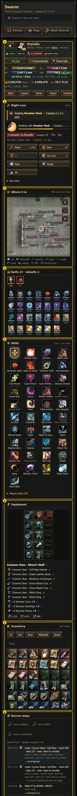 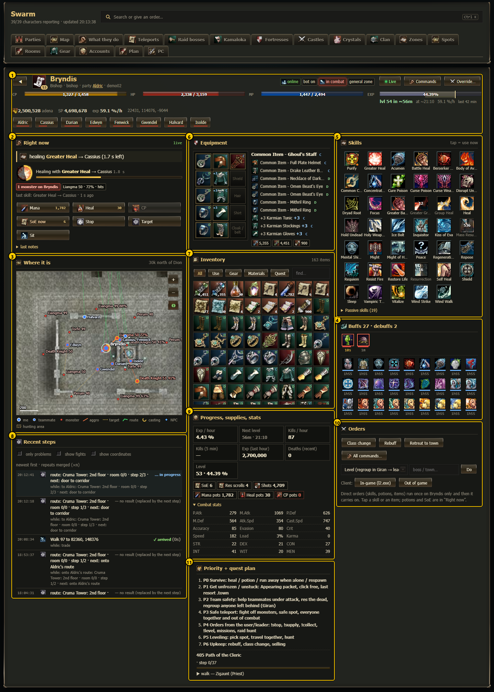

1. **Header** - name, class, chips, CP / HP / MP / EXP bars, money, teammates ([below](#header)).
2. **Right now** - the activity in plain words, the cast, target, aggro and the quick orders.
3. **Where it is** - the live map.
4. **Buffs** - debuffs and buffs with time bars.
5. **Skills** - with cooldown sweeps; tap one to use it now.
6. **Equipment** - the paper doll.
7. **Inventory** - icon grid with filters; tap an item to use, drop or mark it for selling.
8. **Recent steps** - the intent timeline.
9. **Progress, supplies, stats**.
10. **Orders** - Class change, Rebuff, Retreat, the task menu, client mode.
11. **Priority + quest plan**.

## Layout per device

| Screen | Columns | Order |
|---|---|---|
| Phone (under 760 px) | 1 | header, Right now (+ quick orders), map, buffs, skills, equipment, inventory, recent steps, progress, orders, priority |
| Tablet (760 - 1279 px) | 2 | left: Right now, map, buffs, recent steps, orders · right: equipment, skills, inventory, progress, priority |
| Desktop (1280 px and wider) | 3, full width | left: Right now, map, recent steps · middle: equipment, inventory, progress, priority · right: skills, buffs, orders |

The boxes move between the columns when you turn a tablet or resize the window; open menus, scroll positions and typed text stay.

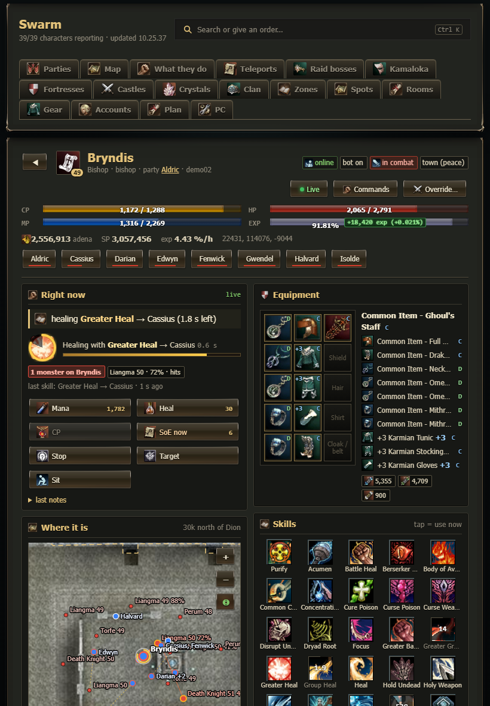

**Where the data comes from** (see the [Glossary](../06-glossary.md) for MCP, swarm_state and intent):

| Part | Source | Refresh |
|---|---|---|
| Activity, cast, target, aggro, route, exp pop-ups, teammates, monsters around the leader | `/api/live?party=<party>` (the characters' `swarm_state` files + the leader's monsters, cached 3 s) | 1.5 s |
| Bars with numbers, stats, buffs, inventory, skills + cooldowns, NPCs and monsters around it | `/api/char` (the game through MCP, read only) | 5 s |
| Recent steps | `/api/intent` (`Logs/intent_<Name>.log`) | 10 s |
| Quest plan | `/api/questplan` (`Logs/questplan_<Name>.json`) | 30 s |

Nothing is fetched while the browser tab is hidden; the cast ring, cooldowns and buff bars animate locally between refreshes. With
"reduce motion" switched on in the system, the animations are off.

---

## Header

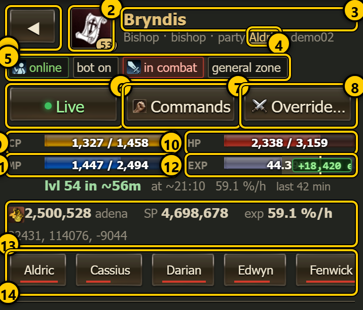 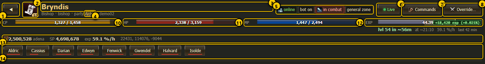

1. **◀ Back** - the page you came from (or Parties). Same as **Esc**.
2. **Class icon with the level badge** - the game's class mark for the current class.
3. **Name** - a ★ after it means party leader.
4. **Class · role · party · login** - tap the party name to open the party's [live view](live-party.md).
5. **Chips** - `online` / `offline`, `bot on` / `bot off` (L2Swarm's bot switch), `in combat` (glows), `dead`, `sitting`, the zone
   (`town (peace)`, `general zone` ...), and `last report N min ago` (red) when the script has been silent for more than 30 seconds.
6. **▶ Start / ■ Stop** - the run switch ([Start and Stop](parties.md#start-and-stop-the-run-switch)). On a party leader (or a
   character alone) it is the PARTY's switch. On a member it stops only that member: it stands still where it is (no follow, no
   assist, no team walks; it still heals, defends itself, trades and obeys your orders) and the party goes on without it; **▶ Start**
   brings it back to its party. Next to it: *party running* / *party stopped* / *stopped on its own*.
   **Live** - the party's live view.
7. **Commands** - every command for this character in the [command center](command-center.md) ([screenshot](#commands-sheet)).
8. **Override…** - the override panel for this character ([below](#override-panel)).
9. **CP** bar - current / maximum.
10. **HP** bar - turns to a warning colour under 30 %.
11. **MP** bar.
12. **EXP** bar - progress to the next level. After a kill a green **+18,420 exp (+0.02 %)** pops up inside the bar for about 6 seconds
    (red when exp was lost, gold on a level-up). The bars slide smoothly when the values change.
13. **Next level line** (under the bars) - when the character reaches the next level: **lvl 52 in ~1h 25m**, the clock time
    (*at ~14:47*, with the weekday when it is not today), the rate (*7.4 %/h*) and what it is based on (*last 60 min*, *1 death left
    out*). A thin yellow mark on the EXP bar shows where the bar will be in 30 minutes (a green mark at the end = it levels within 30
    minutes). Hover or long-press the line for the details. See [Next level estimate](#next-level-estimate).
14. **Money line** - adena, SP, exp per hour (the same rate as the next level line) and the exact position x, y, z.
15. **Teammates** - one button per party member (leader first), with a thin HP line under the name. Tap one to open its page. Dead
    teammates are dark, silent ones grey.

When the game data cannot be read, the bars show the percentages the script last reported.

### Next level estimate

The estimate uses the exp the character really got lately: the exp points of the **last hour** (fewer minutes right after a script
restart), with **deaths left out** (a death moves the bar back once, it does not make the hunting slower; the loss is already in the
exp %), turned into % of the current level and smoothed so it does not jump on every refresh. A level-up does not spoil it: the
points per hour stay, the new level just needs more of them. In the first 5 minutes after a script (re)start it says
*measuring…*; without a gain for 10 minutes it says **no exp for 14 min** (in town, travelling, waiting); with no gains at all
**no exp lately**. Above 48 hours it is shown in days. Offline characters show nothing.

## Right now

What the character does this second, and the fastest orders.

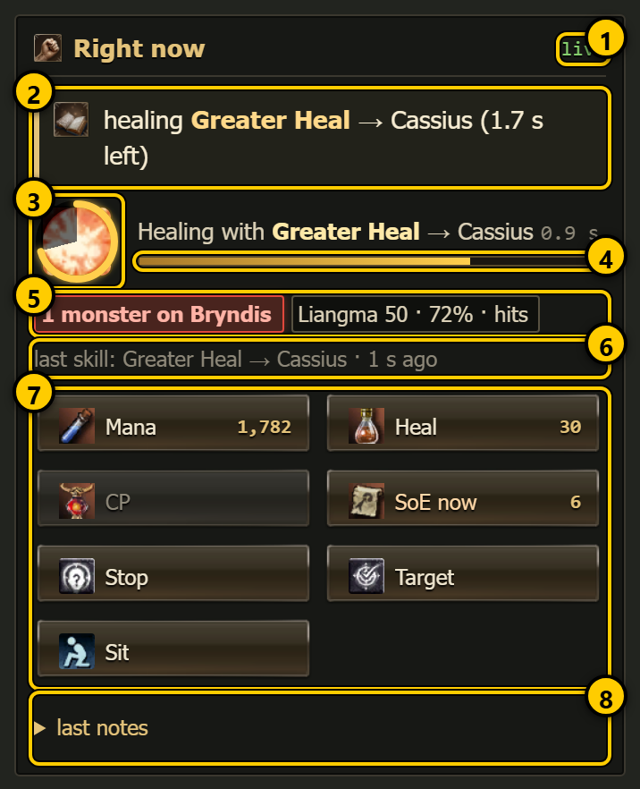 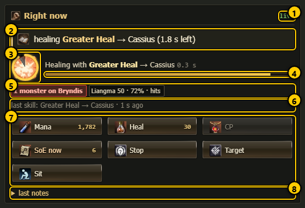

1. **live / reported N s ago** - how fresh the data is (green = live, red = silent).
2. **Activity line** - in plain words, the same sentence as on the live party card ("healing Greater Heal → Cassius", "fighting Liangma
   (72 % HP)", "walking to Gludio (point 3/9, 1.2k left)", "stuck for 40 s — re-planning", "selling at Helvetia" ...). A new activity
   flashes once.
3. **Cast icon** - the skill (or scroll) being cast, with a **progress ring and a sweep drawn on top of the icon**: it fills clockwise
   until the cast lands; green = done, red = interrupted.
4. **Cast bar** - the same progress as a bar, with the seconds left (or how the cast ended).
5. **Aggro** - `1 monster on Bryndis` and one chip per monster: name, level, HP %, and `hits` when it is hitting.
6. **Last skill** - the last skill it used, on whom, and how long ago (for 2 minutes).
7. **Quick orders** - see [the next section](#quick-orders-direct-run-once).
8. **last notes** - tap to unfold the character's last 3 notes.

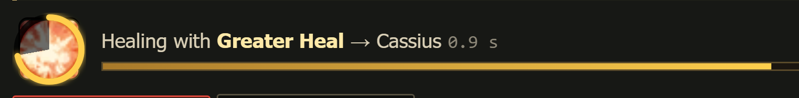

A fighter shows its **target** too:

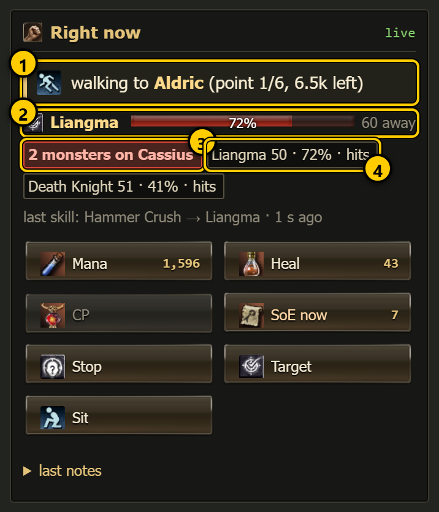 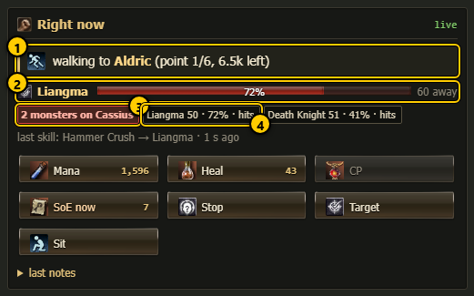

1. **Activity** - *fighting Liangma*.
2. **Target** - name, HP bar and distance.
3. **2 monsters on Cassius** - the aggro count.
4. **Monster chip** - name · level · HP · hits.

### Quick orders (direct, run once)

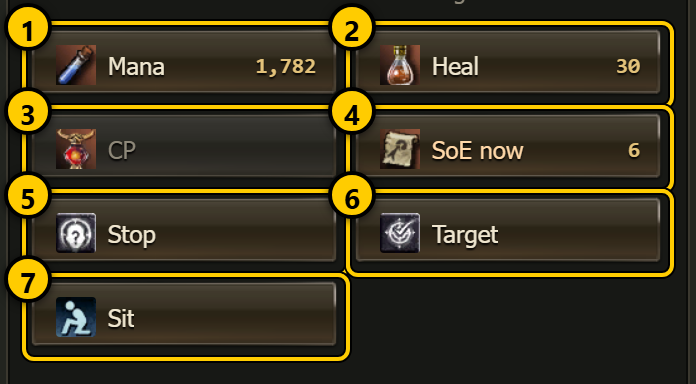 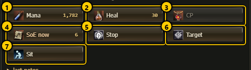

| # | Button | What is sent | Notes |
|---|---|---|---|
| 1 | **Mana** | `!ov <Name> use <item id>` | The best Mana Potion in the bag (Greater first) and how many there are. Greyed out when there is none. |
| 2 | **Heal** | `!ov <Name> use <item id>` | The best Healing Potion. |
| 3 | **CP** | `!ov <Name> use <item id>` | The best CP Potion. |
| 4 | **SoE now** | `!ov <Name> soe` | **Asks first.** Uses a Scroll of Escape now; the party does not follow. |
| 5 | **Stop** | `!ov <Name> stop` | Stops the current attack / cast once (its routine may pick a target again). |
| 6 | **Target** | `!ov <Name> target <monster>` | Targets the nearest monster it can see. |
| 7 | **Sit / Stand** | `/sit` or `/stand` | L2Swarm chat command (the button shows Stand while it sits). |

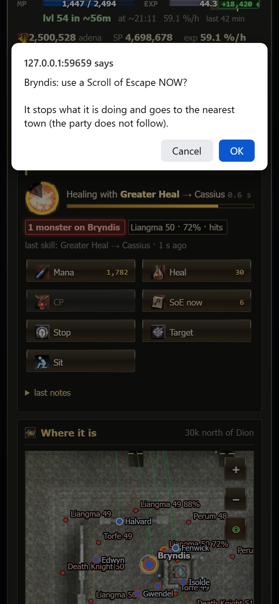 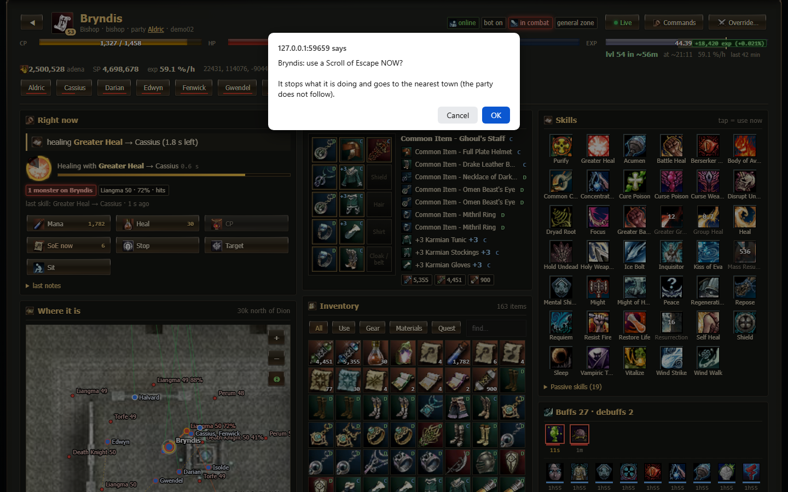

*Bryndis: use a Scroll of Escape NOW? It stops what it is doing and goes to the nearest town (the party does not follow).* —
**Cancel** sends nothing.

### Results of an order

Every direct order goes to **this character only**, once, and it carries on with what it was doing afterwards. A toast in the corner
says "sent…", then "delivered" (or why it was not sent), then the character's own answer ("used Mana Potion", "Greater Heal is on
cooldown" ...) when its window reports it (through the override result file). Orders go through MCP, or through the file channel when
MCP does not answer ("delivered (file channel)").

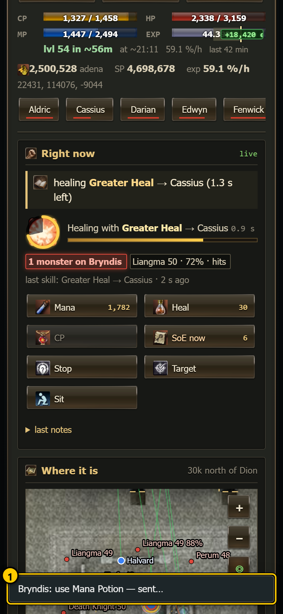 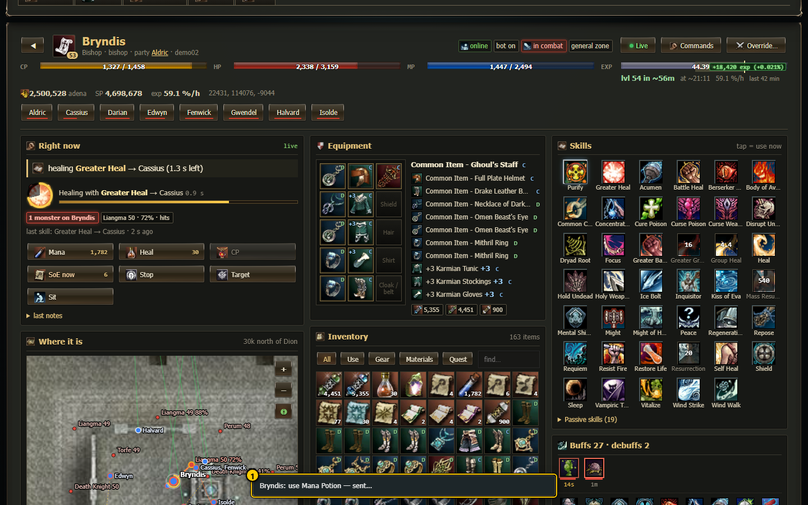

1. **Toasts** - each stays about 6 seconds; green border = worked, red = failed.

## Where it is (live map)

The same layers as the live party view, centred on this character.

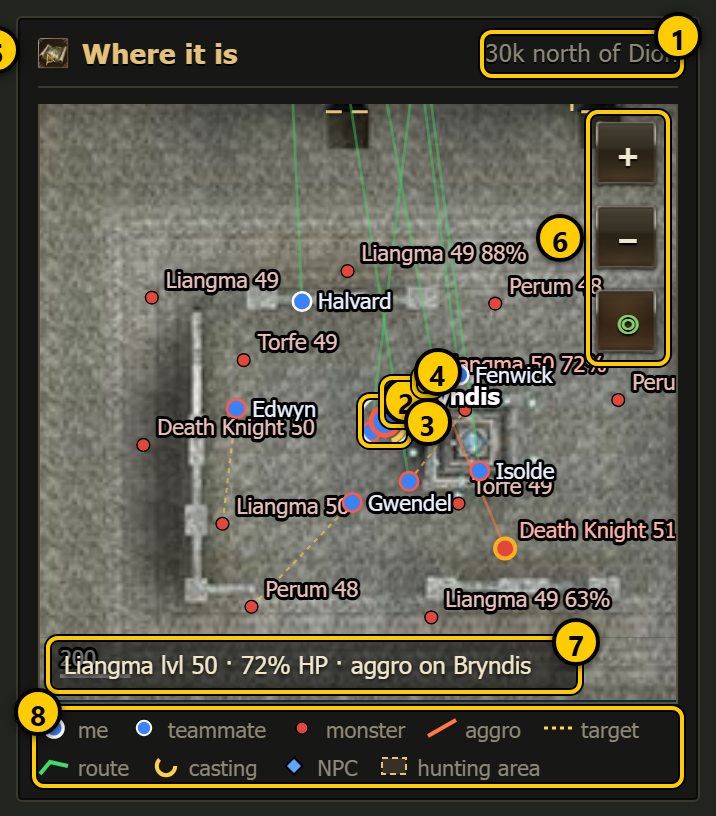 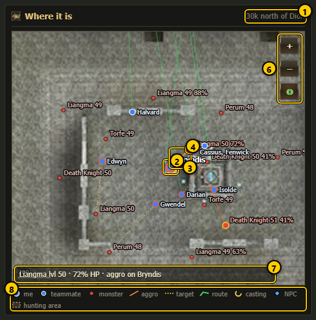

1. **Where** - in words, next to the title: `in Giran` or `24k north of Dion`.
2. **Me** - the big dot in the party colour with a pulsing ring; a **gold arc** around it fills while it casts. Red outline = in combat,
   blue fill = resting, dark red = dead, grey = silent.
3. **Aggro line** - an orange line from a monster to the member it attacks (thick for this character).
4. **Monster with aggro** - red dot with an orange ring. Other monsters are small red dots; raid bosses are gold with a ♛.
5. **Hunting room / area** - the leader's hunting room or area outline (gold, dashed) with its name.
6. **+ / − / ◎** - zoom in, zoom out, and follow: ◎ lit = the map keeps the character and what it is doing in view. Dragging or zooming
   switches follow off; tap ◎ to switch it on again.
7. **Tapped monster** - tap a monster to see its name, level, HP and who it is attacking (shown here). Tap a teammate's dot to open its
   page.
8. **Legend** - me, teammate, monster, aggro, target, route, casting, NPC, hunting area.

Drag to move, pinch / mouse wheel / + − to zoom. All labels have the site's small map size at every zoom. The map art switches to the
right underground floor in dungeons, and NPCs are drawn as diamonds (blue = gatekeeper, green = shop, grey = other) with names for the
important ones.

**Target line and teammates:**

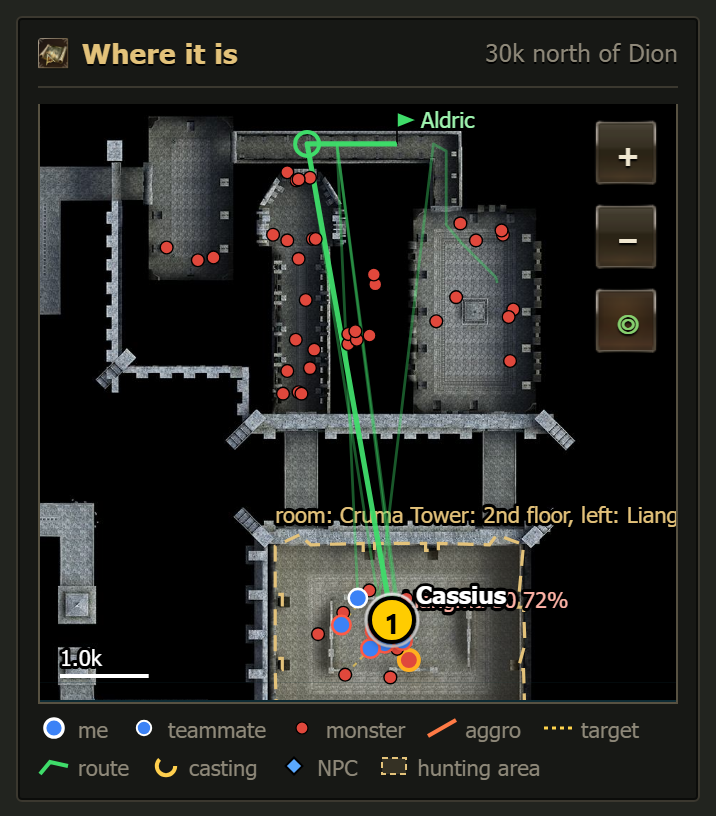 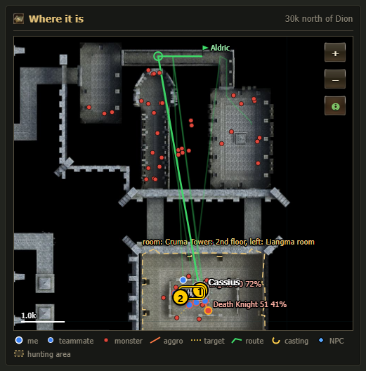

1. **Target line** - a yellow dotted line from a member to its current target.
2. **Teammates** - smaller dots in the party colour; teammates standing together share one label (`Aldric +3`).

**Planned route:**

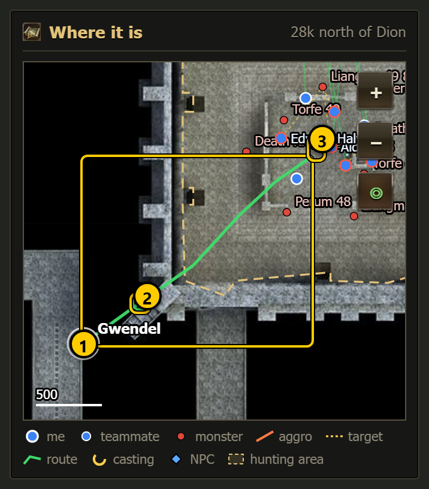 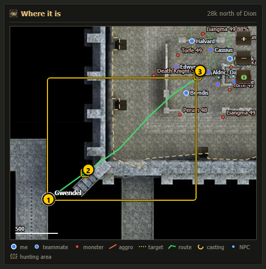

1. **Route** - the green line is the planned walk through the dungeon's room graph (teammates' routes are drawn thin and dim).
2. **Next point** - the green ring.
3. **Goal** - the green flag, labelled with where it goes.

A plain walk without a route is a yellow dashed line with a ring at the end; an escape run is a yellow dashed line labelled
`escape: <safe spot>`.

**Underground floor:**

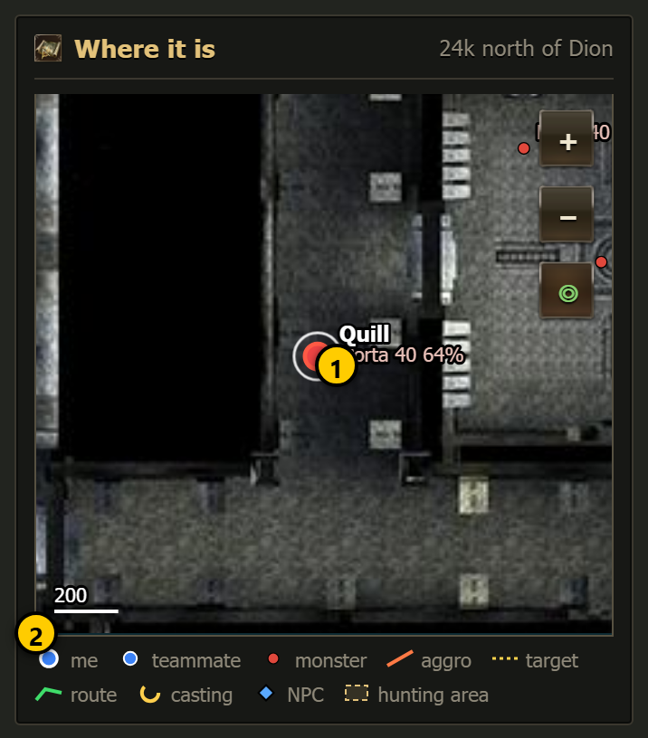 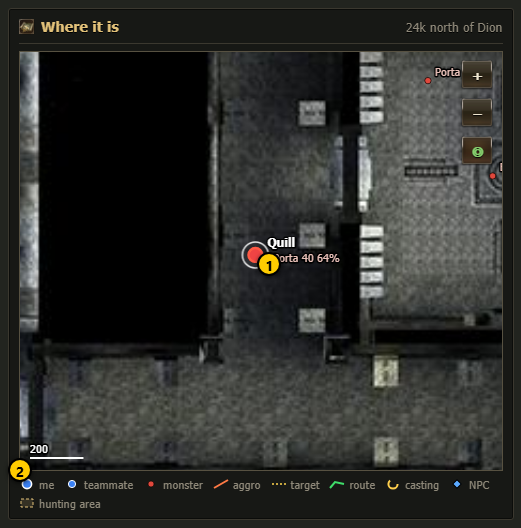

1. **Monsters** - when zoomed in, the monsters get labels: name, level and HP when hurt.
2. **Floor map** - the map art of the floor for the character's height (here a tower floor instead of the surface).

## Dead or silent characters

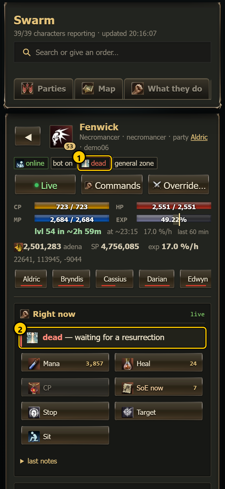 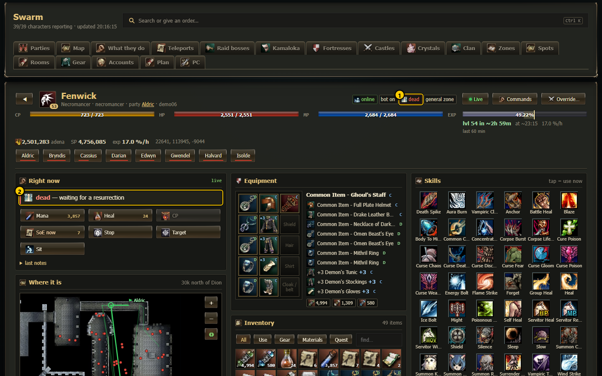

1. **dead** chip in the header.
2. **dead** as the activity. The healers resurrect it, or it respawns in town ([Concepts](../02-concepts.md)).

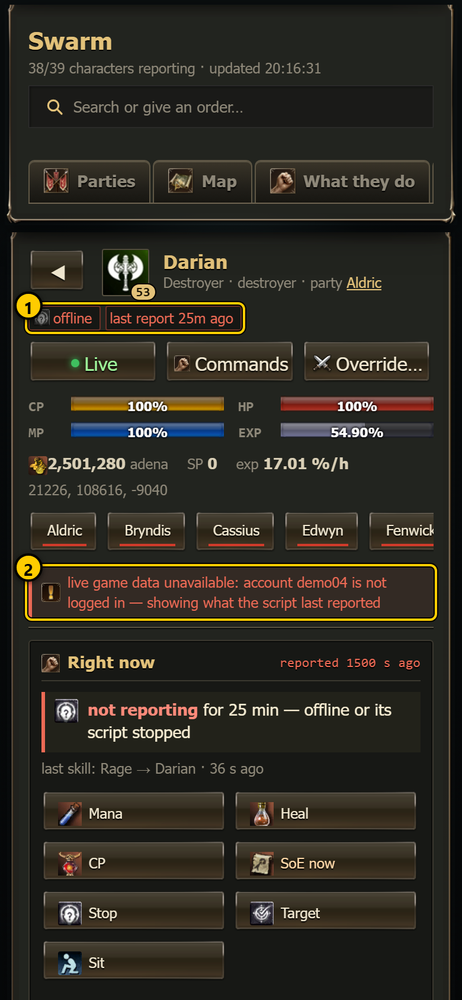 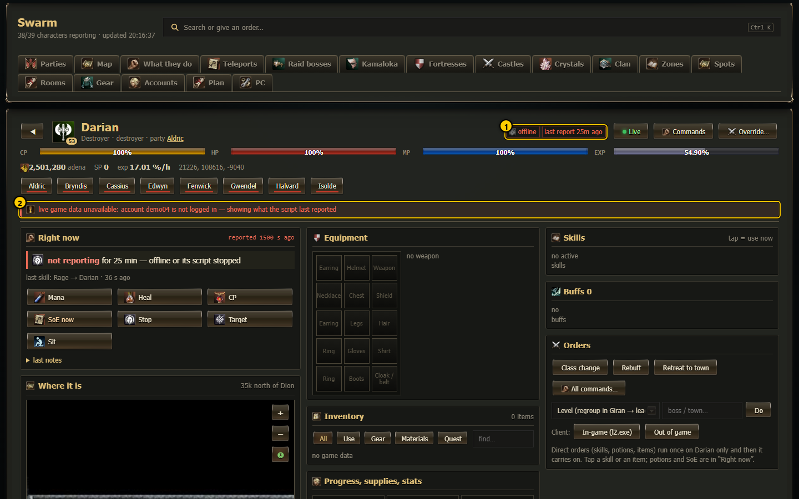

1. **offline · last report 25m ago** - the script stopped reporting.
2. **Live game data unavailable** - red banner with L2Swarm's reason; equipment, bag, skills and buffs are then empty and the page shows
   what the script last reported. A character counts as online when L2Swarm says it is logged in, *or* its script reported within the
   last 2 minutes (a character played in-game through the client is not seen as logged in by L2Swarm, but its script still reports).

## Equipment

A paper doll like the game's.

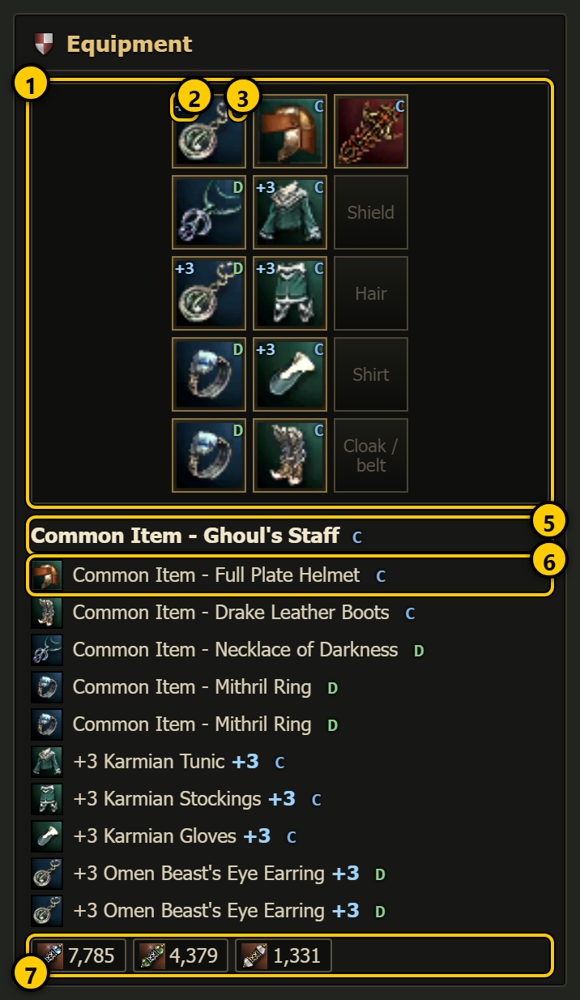 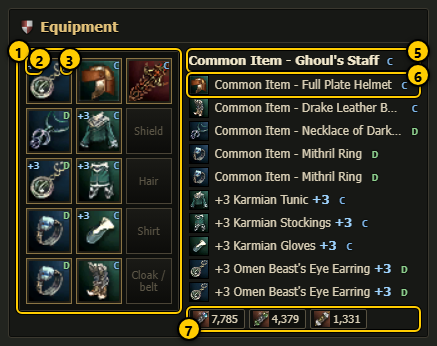

1. **Paper doll** - earrings, necklace and rings on the left, helmet / chest / legs / gloves / boots in the middle, weapon, shield, hair,
   shirt, cloak on the right. Empty slots show their name.
2. **+enchant** - blue, top left of the icon.
3. **Grade** - top right (D, C, B ...).
4. **▲** - a full armor (robe, full plate) also covers the legs slot.
5. **Weapon** - by name, with enchant and grade.
6. **Worn pieces** - every other worn item by name.
7. **Shots** - the soulshots / spiritshots in the bag, and a red `low shots` chip at 100 or fewer.

Tap a worn item for its details. Worn items can never be used, equipped or dropped from here:

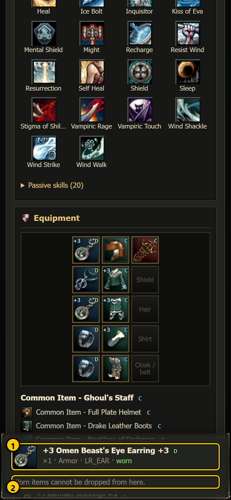 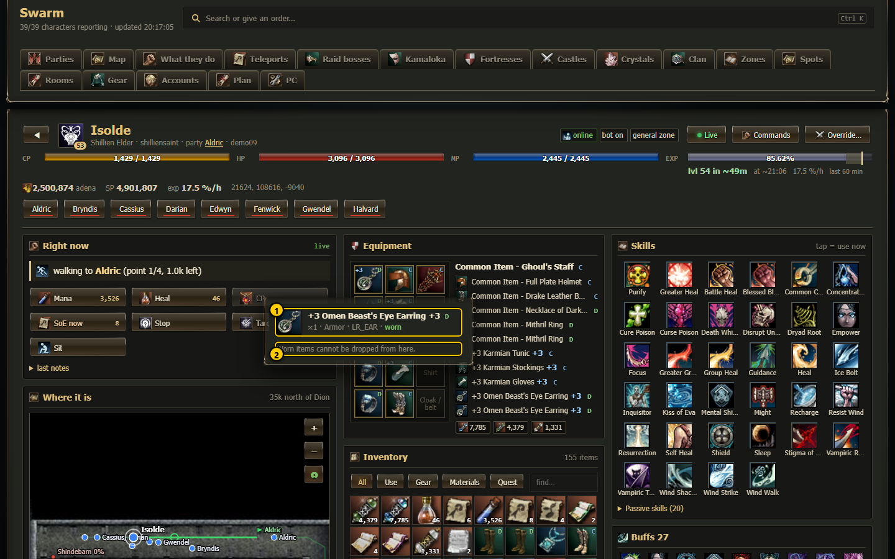

1. **Name, enchant, grade** - count, type, slot, `worn`.
2. **Worn items cannot be dropped from here.**

*Common Item - ...* pieces are the cheap no-set-bonus versions the bots buy for fighters (see [Gear](gear.md)).

## Frenzy kit (destroyers only)

Destroyers (Orc Raider, Destroyer, Titan) get an extra box: **Frenzy kit (HP swap)**. Before Frenzy, the bot puts on a low-HP set and then a
high-HP set, so its maximum HP goes up while its current HP stays the same. Its HP % drops, and Frenzy, Zealot and Guts can be cast sooner.
The box shows:

1. **A summary**: everything there, partly there, or "the gear swap does nothing yet".
2. **Skills**: Zealot, Frenzy, Guts, Rage and Battle Roar, learned or not.
3. **Drain partner**: the other destroyer in the party it trades hits with.
4. **1 · Low-HP set** (a weapon with the Special Ability *Conversion*, Tallum heavy pieces) and **2 · High-HP set** (a weapon with *Health*,
   Doom heavy pieces). Each piece shows ✓ worn / in the bag, ▣ in the clan warehouse, or ✗ missing with the cheapest option.

### Buy what is missing

**The kit is never bought automatically.** Not by supply runs, gear upgrades or anything else. The bot only goes shopping when you
press **Buy what is missing…** (shown when a piece is missing) and confirm. The dialog lists:

- **Buy in Giran**: every missing piece that a Giran merchant with a recorded route sells, with its price and merchant. A checkbox per piece,
  all ticked by default. Untick what you do not want. The total (price + about 20 % castle tax) and the character's adena update as you tick.
  If the adena is not enough, it buys in the order shown and skips what it cannot pay.
- **Not sold in Giran**: pieces nobody in Giran sells. Today that is every kit piece: Giran's weapon and armor merchants stop at C grade,
  Doom is B and Tallum is A, and **no shop sells weapons with a Special Ability**. Get those from drops, crafting or trades, or put the S.A. on a
  weapon with a soul crystal. When nothing can be bought, the dialog only explains this and sends nothing.
- **Already in the clan warehouse**: the clan leader gets a second set of checkboxes, *Take out of the clan warehouse instead*. For everyone
  else there is a note: only the clan leader can take it out (Storage page → Clan warehouse).
- **Warnings**: the party is in a raid or mission (it waits until that is over and never shops during a raid fight), the hunting timer is
  running (your order still goes), the character is not online (the order waits in the order queue).

**What happens after you press "Send the order"** (the order `!kitbuy <Name> <item ids>`):

1. Only that character acts. If it is already in Giran, it starts right away.
2. If it is not in Giran: a party leader or a character playing alone uses `.giran` after the normal safe-teleport checks, and a leader takes
   his whole party along. A party **member** never teleports alone: it asks its leader, who takes the whole party to Giran, waits until the
   member has finished shopping, and then carries on.
3. It walks the recorded Giran routes to each merchant. Before each piece it checks the price in the merchant's list, its own adena, and
   whether it already owns a piece for that slot. It never buys a second piece for a slot.
4. **It puts nothing on.** The pieces stay in the bag, and the HP swap wears them only for Frenzy.
5. It reports each piece in party chat, in the step timeline and in `Logs/frenzykit_buys.log`. Then it walks back to the Giran start, and
   leveling starts again if it was leveling.

Kit pieces in a destroyer's bag are never sold by the automatic sell and never stored by the automatic warehouse stash.

## Inventory

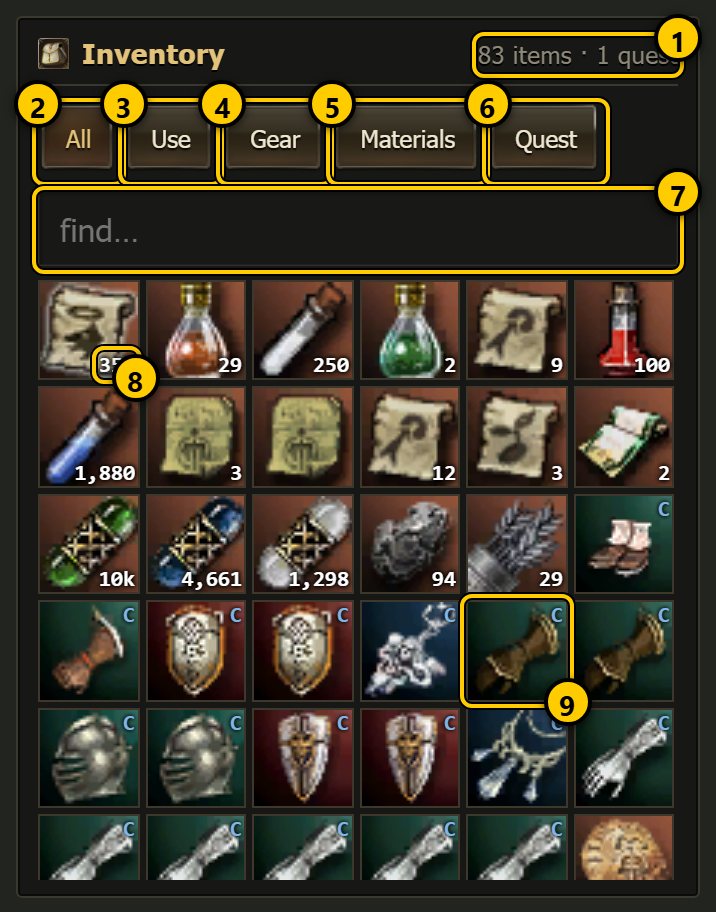 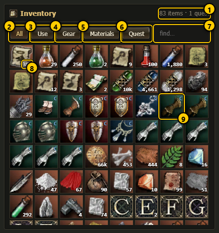

1. **Count** - `90 items · 1 quest`.
2. **All** - everything except quest items.
3. **Use** - potions, scrolls, shots, elixirs, herbs, boxes, coupons, spirit ore, crystals.
4. **Gear** - weapons and armor.
5. **Materials** - everything else.
6. **Quest** - quest items.
7. **find…** - type part of a name; switches the filter to All and also finds quest items.
8. **Count** - bottom right of an icon (1.2k, 3.5M ...). Enchant top left, grade top right.
9. **Tinted icon** - the item is on a sell list (the bots sell it at every town visit).

Worn items and adena are not in the grid. Sorted: Use, Gear, Materials, Quest, then by name.

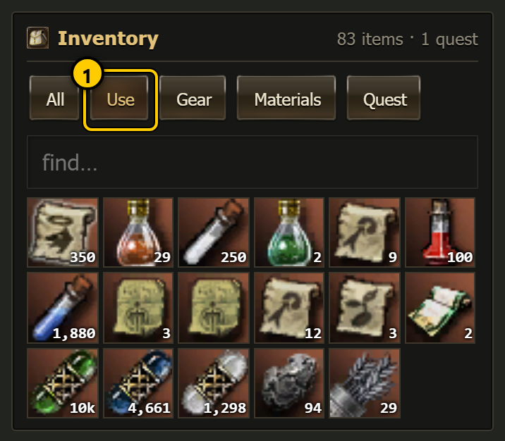 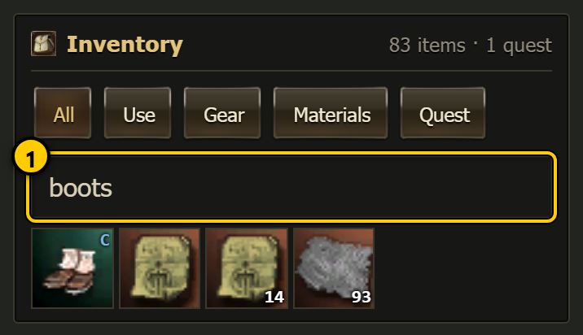

### Tap an item

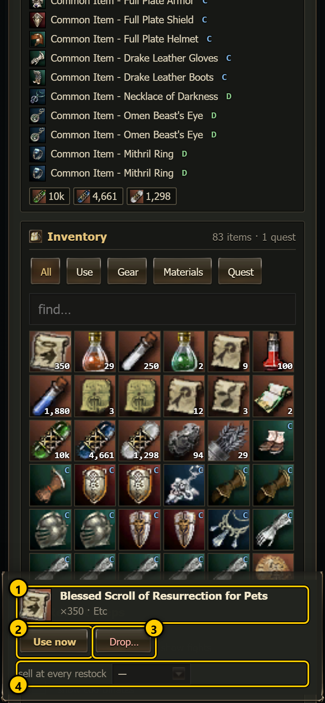 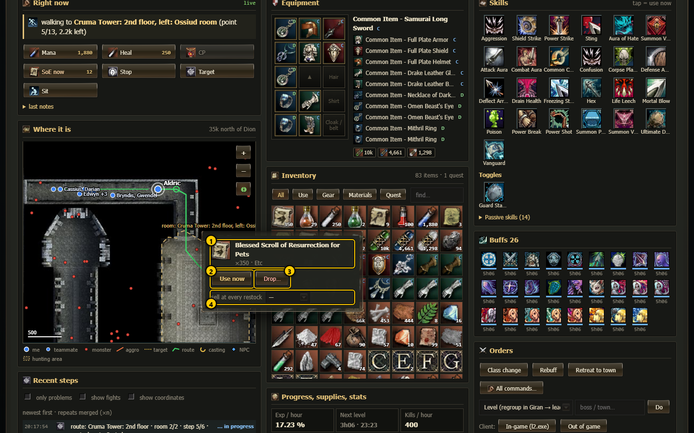

1. **Item** - name, enchant, grade, count, type and slot.
2. **Use now** (**Equip now** for weapons and armor) - `!ov <Name> use <item id>`. Runs once, no confirmation.
3. **Drop…** - asks how many (when there is more than one), then asks you to **type YES** (anything else cancels), then sends
   `!ov <Name> drop <object id> <count>`: the item falls on the ground. Never offered for worn items, quest items or adena.
4. **Sell at every restock** - `—` (not on a list; known junk may still be sold), `sell (<Name>)` (only this character), `sell (all
   bots)`, `never sell`. Saved at once to `Scripts/data/sell_list.json`; the bots read it at their next town visit, no restart.

On a phone the menu is a sheet at the bottom of the screen; on a desktop it opens next to the item. Tap outside or press Esc to close it.

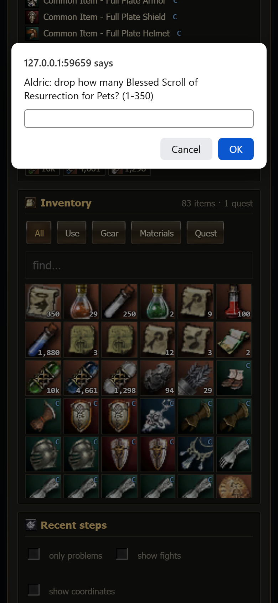 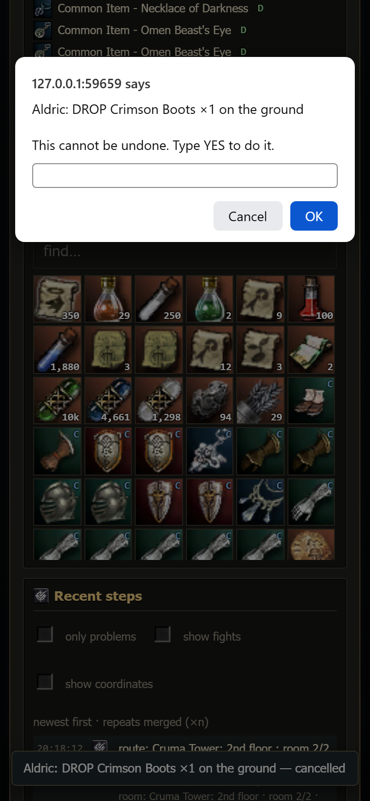

## Skills

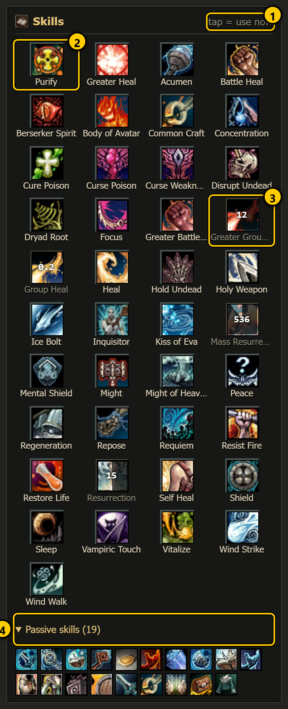 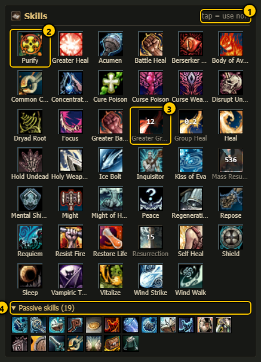

1. **tap = use now** - every skill icon is a button.
2. **Ready skill** - active skills as icons with the name underneath, the most used first.
3. **Cooldown** - a dark **sweep on top of the icon** shrinks clockwise, with the seconds left; when the skill is ready again it flashes
   once.
4. **Passive skills (n)** - folded; hover (or long-press) an icon for its name, level and description.

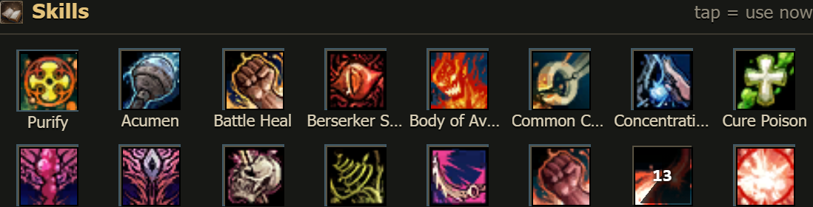

**Toggles** get their own row; a green ring means the toggle is on:

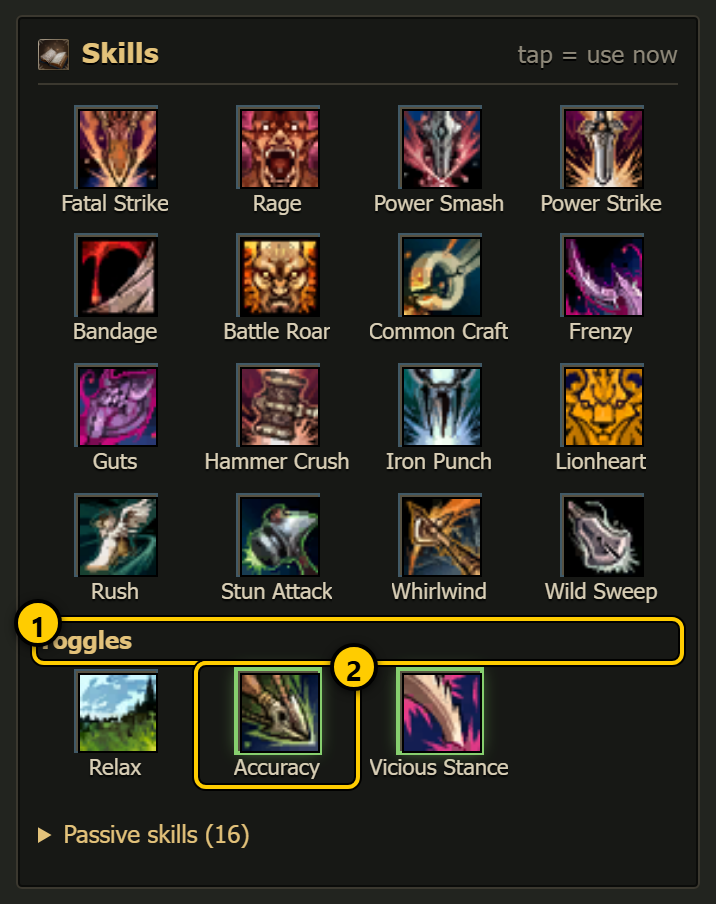 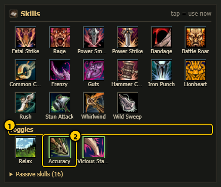

### Tap a skill

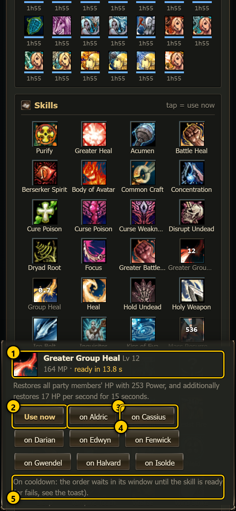 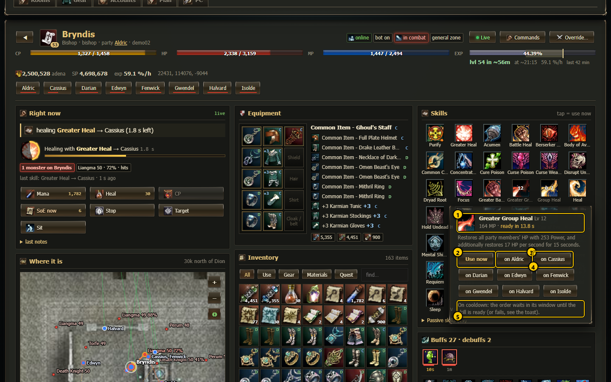

1. **Skill** - level, MP cost, range, and `ready` or `ready in 7.0 s`.
2. **Use now on its target** - `!ov <Name> cast <skill id>`.
3. **on itself** - `!ov <Name> cast <skill id> self`.
4. **on <teammate>** - one button per living teammate: `!ov <Name> cast <skill id> <teammate>`.
5. **On cooldown** - the order waits in the character's window until the skill is ready (or fails; see the toast).

Self-only skills just show **Use now**. No confirmation: the order is sent when you tap.

## Buffs

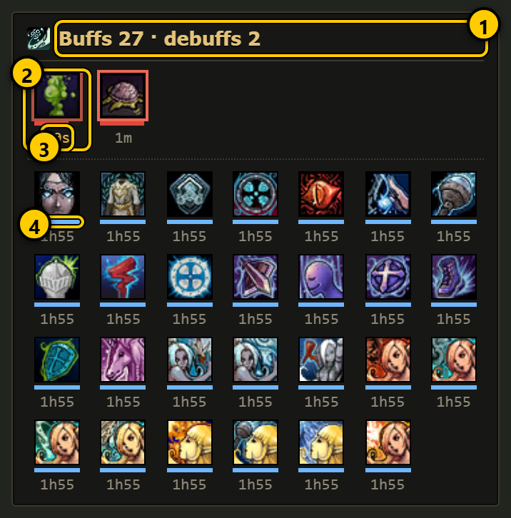 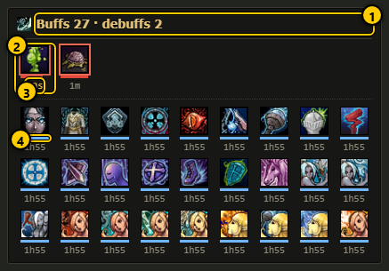

1. **Buffs n · debuffs n** - the counts.
2. **Debuffs** - first, with a red frame.
3. **Under a minute** - the time turns yellow and blinks.
4. **Time bar** - under each icon: the time left relative to the longest time seen for that buff on this page; the text shows hours and
   minutes (`1h47`), minutes (`12m`) or seconds (`45s`). Hover (or long-press) for the name, level and exact time.

Buffs are sorted shortest first. A character with fewer than 10 long buffs shows *few long buffs: it rebuffs from the board at the next
chance*; you can also tap **Rebuff** under [Orders](#orders).

## Recent steps

Every step the character tried, why it tried it, and how it ended. This is the best place to find out *why* a bot did something.

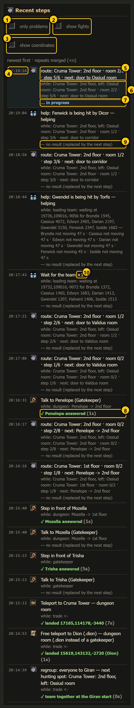 

1. **only problems** - only failed steps, quest retries and steps that ended without a result.
2. **show fights** - also every monster it attacked (hidden by default, they are many).
3. **show coordinates** - start point, target, distance and where the step ended.
4. **Time** - when the step started (your local time). Newest on top, at most 150 lines (the box scrolls).
5. **What it tried** - in plain words, with an icon for the kind of step (walk, talk to an NPC, teleport, town command, fight, help a
   teammate, gather or lead the team, quest, resurrect ...).
6. **while: <task>** - the bigger job this step was part of.
7. **… in progress** - the newest step is still running (only the newest, and only for 15 minutes; light blue background).
8. **✓ <result>** - the step worked, with the time it took in brackets, for example `✓ Helvetia answered (1s)`.
9. **— no result (replaced by the next step)** - the script moved on before this step reported an end. Normal when a newer plan replaces
   an old one.
10. **×n** - the same step happened n times in a row (within 10 minutes) and was merged into one line.

**How to read a line:** `08:22:25 · Free teleport to Giran (.giran) — regroup in Giran: next hunting spot · while: dungeon: Ponti ·
✓ landed 83473,148554 (1s)` means: at 08:22:25 the character used the free `.giran` command because the team regrouped in Giran; it was
doing the dungeon job at that time; it landed in Giran after 1 second.

The three ticks are remembered in your browser and apply to the same timeline on [What they do](what-they-do.md).

 

1. **only problems** ticked.
2. **✗ <reason>** - the step failed and why, for example *not there — 3539 left* (a walk ended 3539 units short) or *Priest of Dawn did
   not answer 3 clicks (676 away)*. Failed lines have a light red background.

 

1. **show fights** - `Fight <monster>` lines appear.
2. **show coordinates** ticked.
3. **Coordinates** - `from x,y,z → x,y,z (distance) · ended at x,y,z`.

## Progress, supplies, stats

 

1. **Progress** - exp per hour (% of a level), **next level** (time left and clock time), kills per hour, kills in the last 5 minutes,
   exp in the last hour, recent deaths, level and exp %.
2. **Supplies** - Scrolls of Escape, resurrection scrolls, shots, mana / healing / CP potions. Red when low (SoE 2 or fewer, res scrolls
   1 or fewer, shots 200 or fewer, mana potions 100 or fewer, healing potions 5 or fewer).
3. **Combat stats** - P.Atk, M.Atk, P.Def, M.Def, Atk.Spd, Cast.Spd, Accuracy, Evasion, Crit, Speed, Load (weight %), Karma, STR, DEX,
   CON, INT, WIT, MEN. Folded on a phone, open on wider screens.

## Orders

Orders for this character only. Every button here asks for confirmation first.

 

1. **Class change** - `!classchange`: Alt+B → Career → Professions, if its level allows the next class.
2. **Rebuff** - `!buff`: fresh buffs from the Community Board.
3. **Retreat to town** - `!soe`: leave the fight and go to town with the free `.townname` command (see [Concepts](../02-concepts.md)).
4. **All commands…** - the [command center](command-center.md) sheet for this character.
5. **Task menu** - every task the dashboard knows (Level, Supplies, Collect adena, Better gear, Dungeon, Soul crystals, Seven Signs,
   Class change, Cabinet setting, Status, Rebuff, Sell, Raid hunter, Raid mission, Joint raid, Kamaloka, Siege, Help character, Town
   teleport, Gatekeeper teleport, Walk to, Stop leveling, Escape, Stop everything ...). Full list: [Command reference](../05-commands.md).
6. **Text box** - for tasks that need a boss, town or other text (the menu entry ends with `…`), for example `giran` for *Town teleport*.
7. **Do** - sends the chosen task.
8. **In-game (l2.exe)** - play this character through the real game client ([client mode](#client-mode-in-game-or-out-of-game)).
9. **Out of game** - back to playing without a client.
10. **Note** - direct orders (skills, potions, items) run once and then the character carries on.

After sending, the message bar says `!buff → char Aldric. The character confirms it in its notes.` Orders meant for a whole party
(Level, Supplies ...) are better given on the [Parties](parties.md) tab.

 

Every order asks: `Send to Aldric only:  Rebuff (!buff)  Continue?`. **Cancel** sends nothing.

 

A task with a text shows the full command, for example `!town giran`. When the task needs a text and the box is empty, nothing is sent:

1. **Message bar** - *type the boss / town / place in the box next to the menu first*.

### Client mode (in-game or out of game)

L2Swarm can play a character **out of game** (no game window, the normal way) or **in game** through the real game client `l2.exe`
(L2Swarm's *Hook* button). In-game is useful when you want to watch or play that character yourself.

 

**In-game (l2.exe)** asks: *Switch Aldric to IN-GAME? L2Swarm logs Aldric out, starts l2.exe and logs in through the client (within
~2 min). The client uses 1-2 GB RAM.*

**Out of game** asks: *Switch Aldric back to OUT OF GAME? Its l2.exe is closed and it logs in without a client.*

After **OK** the wish is saved in `Settings/client_mode.json` and the watchdog task (MemWatch, see [PC](pc.md)) starts at once; it
applies the change within about 2 minutes. The message bar says `Aldric: ingame — applied within ~2 min`. The server refuses (message
in the bar) when no config in `Settings` has this character selected, or when its config has no valid `<L2ExePath>` (L2Swarm would open a
"Select L2.exe" window): close the account in L2Swarm, add `<L2ExePath>` with your client path to its XML, and open it again. L2Swarm
runs only **one** hooked client at a time; if another character is already in game you get a warning and this one waits.

## Priority + quest plan

 

1. **P0 ... P6** - the script's priority list: P0 Survive · P1 Get unfrozen / unstuck · P2 Team safety · P3 Safe teleport · P4 Orders
   from you or the leader · P5 Leveling · P6 Upkeep (rebuff, class change, selling). Lower = more important; a more important task can
   interrupt a less important one.
2. **NOW: <task>** - the line holding control is gold, with the task that holds it. Survival (healing, potions) runs on its own and never
   waits for control.
3. **Current class-quest step** - quest, `step n/total`, a progress bar and the next step (action, NPC or teleport, item to collect,
   place). The bots normally change class through the Community Board and class quests are off in the standard set-up, so this is
   usually a reference. *no class quest plan right now* = nothing fits this character.

## Commands sheet

**Commands** (header) and **All commands…** (Orders) open the command center's sheet for this character: every command, by category,
with its options. See [Command center](command-center.md).

 

## Override panel

**Override…** in the header opens a compact panel with every direct order for this character in one place (the same panel the raid view
uses).

 

1. **Name, HP, MP** and **✕** to close (Esc or a tap outside also close it).
2. **on …** - who the skill buttons target: its current target, itself, or a teammate.
3. **Skills** - tap to cast now (cooldown seconds shown on the button).
4. **Potions / scrolls** - with the count in the bag; greyed out when there is none.
5. **Quick** - Attack its target, Stop attacking, Scroll of Escape NOW, Move to a teammate, and Resurrect <name> for every dead teammate.
   A **Drop an item** section (typed YES) appears when the bag is known.

Every action is one `!ov <Name> <action>` command, run once; the answer comes back as a toast.

---

## Every control on the page

| Control | What it does | Sends / saves | Confirmation |
|---|---|---|---|
| ◀ (or Esc) | previous page (or Parties) | nothing | no |
| Teammate buttons, teammate dots on the map | open that teammate's page | nothing | no |
| Party name | the party's live view | nothing | no |
| Live / Commands / All commands… | live view / command center sheet | nothing until you run a command there | the sheet asks |
| Override… | override panel | `!ov` commands | drop only (typed YES) |
| Mana / Heal / CP | take the best potion of that kind | `!ov <Name> use <id>` | no |
| SoE now | Scroll of Escape now | `!ov <Name> soe` | **yes** |
| Stop / Target | stop once / target the nearest monster | `!ov <Name> stop` / `target <monster>` | no |
| Sit / Stand | sit down / stand up | `/sit` / `/stand` | no |
| last notes | unfold the last 3 notes | nothing | no |
| Map + / − / ◎, drag, pinch, wheel | zoom, move, follow | nothing | no |
| Tap a monster on the map | shows name, level, HP, aggro | nothing | no |
| Inventory filters, find… | filter the grid | nothing | no |
| Tap an item → Use now / Equip now | use or equip it | `!ov <Name> use <id>` | no |
| Tap an item → Drop… | drop it on the ground | `!ov <Name> drop <object id> <count>` | **how many + typed YES** |
| Tap an item → sell menu | sell list | `Scripts/data/sell_list.json` | no |
| Tap a skill → Use now … | cast it on its target / itself / a teammate | `!ov <Name> cast <id> [self\|name]` | no |
| Passive skills / Combat stats | unfold | nothing | no |
| only problems / show fights / show coordinates | filter Recent steps | your browser only | no |
| Class change / Rebuff / Retreat to town | `!classchange` / `!buff` / `!soe` | order to this character | **yes** |
| Task menu + text + Do | any task | order to this character | **yes** |
| In-game (l2.exe) / Out of game | client mode | `Settings/client_mode.json`, starts MemWatch | **yes** |

## How to ...

**Find out why a character is standing still**

1. Open its page (tap it on Parties).
2. Read the activity line in **Right now**, and the map: a route, a walk line, aggro?
3. In **Recent steps**, tick **only problems** to see the last failures and their reasons.
4. Look at **Priority + quest plan**: if a more important task holds control (for example *P2 Team safety*), it is waiting for that.

**Give a healer a mana potion now**

1. Open the healer's page.
2. In **Right now**, tap **Mana**. The toast says "delivered", then the character's answer.

**Make a character cast a skill on a teammate**

1. In **Skills**, tap the skill.
2. Tap **on <teammate>**. If the skill is on cooldown, the order waits until it is ready.

**Throw away an item**

1. In **Inventory**, tap the item, then **Drop…**.
2. Enter how many, then type `YES`. Anything else cancels.

**Stop a bot from selling an item**

1. Tap the item in **Inventory**.
2. Pick `never sell` in *sell at every restock*.

**Play a character yourself in the game client**

1. Tap **In-game (l2.exe)** under Orders and confirm.
2. Wait about 2 minutes: the game client starts and logs the character in.
3. When done, tap **Out of game** and confirm.

## Notes and safety

- The page only *reads* game data until you press an order button. Dangerous orders ask first: SoE now, every order in **Orders**, client
  mode, and Drop (typed YES).
- Direct orders (quick buttons, skills, items, Override) run **once** on this character only and do not change its plan; orders from
  **Orders** replace what it is doing.
- Client mode restarts the character's login: do not use it during a raid or a siege.
- If boxes stay empty (no buffs, no skills), the game data is not available right now: check the chips and the red banner in the header.
- The dashboard uses one text scale on every page (11 px icon counts and map labels, 12 px captions and buttons, 13 px body, 14 px box
  titles, 16 px window titles, 20 px the character name), defined once at the top of `Dashboard/index.html`.
