# Clan

Route: `#/clan`

Everything about your clan in one place: the clan leader, the clan level and what the next level needs, the clan level quests
(Blood Mark, Q501, Q503) step by step, the clan warehouse, the roster, the reputation quests and their raid bosses, clan
skills, the clan level table, new accounts for the Academy, Seven Signs for every character, a clan event (several parties
on an epic boss with a Command Channel) and raid team templates.

The data comes from the clan leader's bot (`Logs/clan_state.json`, written every 30 seconds), from every bot's own clan
report (each asks the server for the clan member list every 10 minutes), from `Scripts/data/clan_quests.json` and
`clan_data.json` (L2J High Five values). The page refreshes every 4 seconds. The clan leader is the `leader` in `Scripts/data/clan_quests.json`
(`clan.leader`), else `clanLeader` in `swarm.config.json` (in the demo: **Quill**).

## Overview

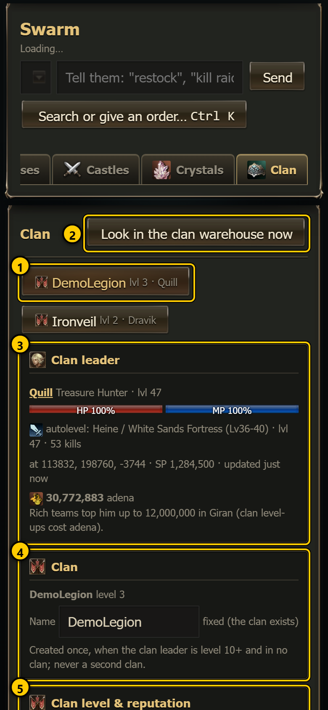 

1. **Clan tabs** - one button per clan the bots are in: clan name, level and leader ("(not ours)" when the leader is not one
   of your characters). Before your clan exists there is one "(planned)" tab for it. Tap a tab to switch; the configured clan
   shows the full page below, any other clan a short page (see [Another clan](#another-clan)).
2. **Look in the clan warehouse now** - the clan leader opens the clan warehouse and reports what is in it (`!clanwh`, confirmation first).
3. **Clan leader card**.
4. **Clan box**.
5. **Clan level & reputation**.

The sections below the cards, in order: Clan level quests, Clan roster, Clan quests, Clan raid bosses, Clan skills, Clan
levels, New accounts (Academy), Seven Signs, Clan event, Raid team templates.

## Leader, clan, level, warehouse and help boxes

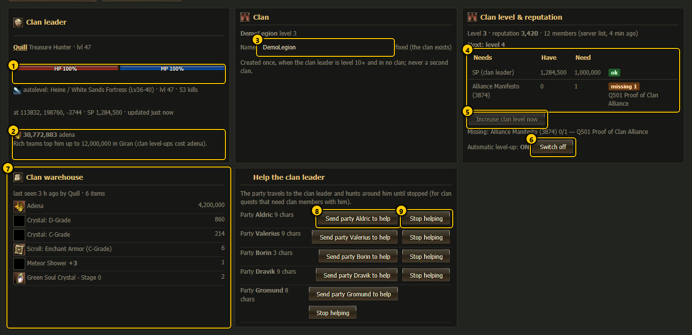

1. **Clan leader card** - name (tap for his [character page](character.md)), class, level, a "dead" chip when dead, HP and MP
   bars, his current task, where he is, his SP and when he last reported.
2. **Adena** - his adena. Rich parties top him up to 12,000,000 adena in Giran, because clan level-ups cost adena.
3. **Clan name** - read-only ("fixed (the clan exists)") once the clan exists. See [Founding the clan](#founding-the-clan).
4. **Next level table** - what the next clan level needs and what he has: SP (clan leader), adena (clan leader), items (with
   where they come from), clan reputation, clan members. Green **ok** or orange "missing n".
5. **Increase clan level now** - sends `!clanlevel` to the clan leader (he raises the level at the Giran village master).
   Greyed out with "Missing: ..." until everything is there. Confirmation first.
6. **Automatic level-up: ON / OFF** with **Switch on / Switch off** - sends `!clanlevel auto on|off`. When on, the clan leader
   raises the level by himself (in a town, when everything is there). Confirmation first.
7. **Clan warehouse** - the items the clan leader saw the last time he opened the clan warehouse, with count and enchant
   level, "last seen <time> by <name>". "never seen yet" until the first look.
8. **Send party X to help** - sends `!assist <clan leader>` to that party: it travels to the clan leader and hunts around him
   until stopped. Clan quests count kills only near the clan leader, so this is how you bring members to him. Confirmation first.
9. **Stop helping** - sends `!assist off` (back to normal hunting). Confirmation first.

The level box says "No clan data from the clan leader yet" until his bot reports. The top line shows level, reputation and
how many members the server listed.

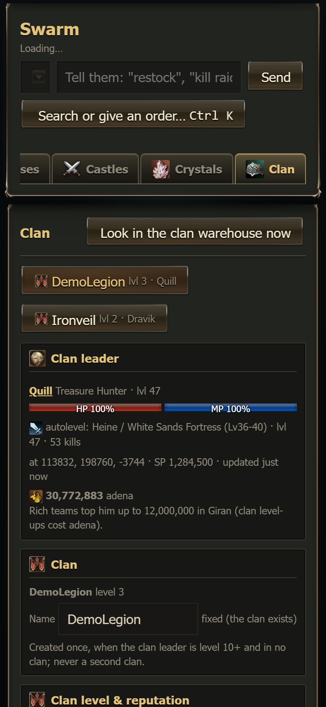 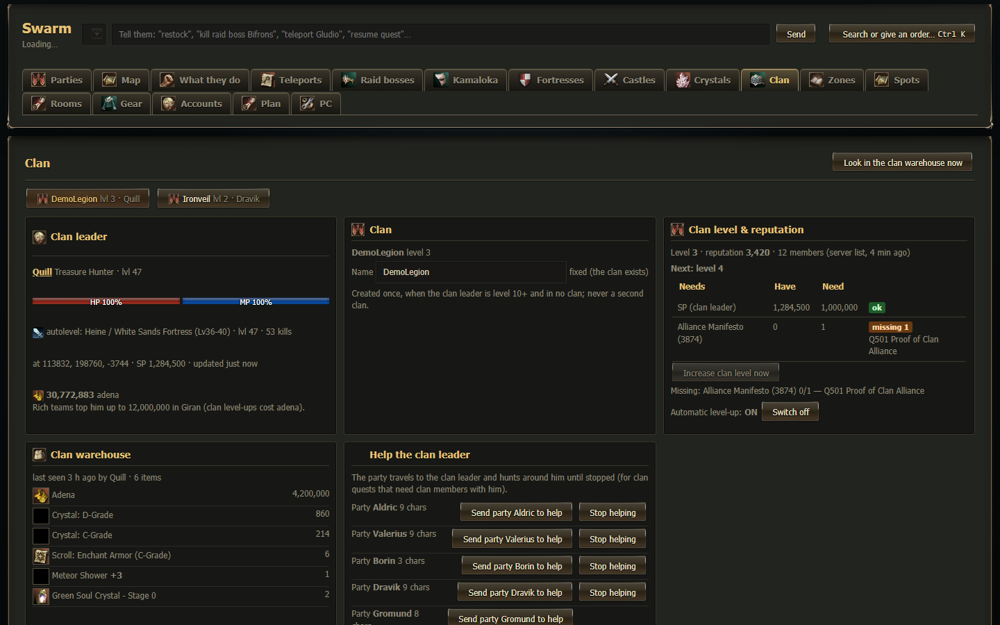

## Clan level quests

Clan levels 1 and 2 only need SP and adena (the **Increase clan level now** button). Level 3 needs a **Blood Mark**, level 4
the quest **Q501 Proof of Clan Alliance**, level 5 **Q503 Pursuit of Clan Ambition**. Each has a box with its steps.
**Automated** steps run with a button; **manual** steps need you or several characters together. Progress per step is in
`Logs/clanquest_<id>.json`.

1. **automated** - the bots can do this step.
2. **manual** - you have to do it (the text says what).
3. **done** - with who did it, when, and the bot's message.
4. **running** - the step the bot is doing now. The golden frame marks the next step that is not done.
5. **Run** - sends `!clanquest <quest> <step>` to the clan leader (confirmation first).
6. **Reset progress** - sends `!clanquest <quest> reset`: the progress starts over (confirmation first).

The grey line under the title says where the quest comes from, and "Starts at clan level X; the clan is level Y" when the clan
is not at the right level for it.

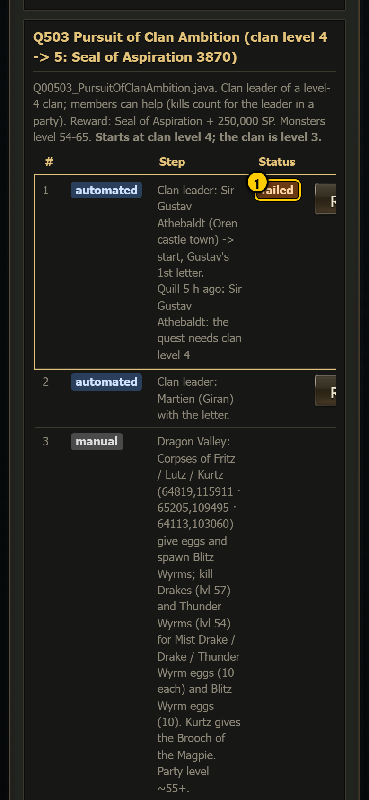 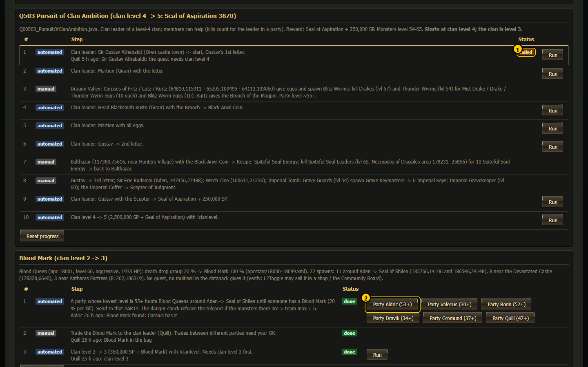

1. **failed** - with the reason from the bot.
2. **Hunt step** - one button per party ("Party Aldric (49+)" = its lowest level). The party hunts there until someone has
   the item. Send it to a party whose lowest level matches the step.

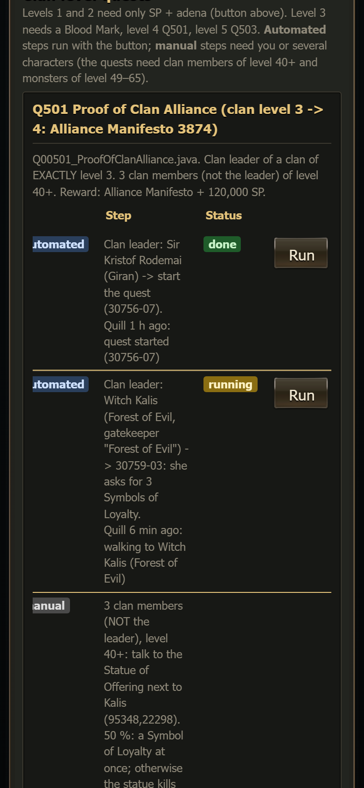 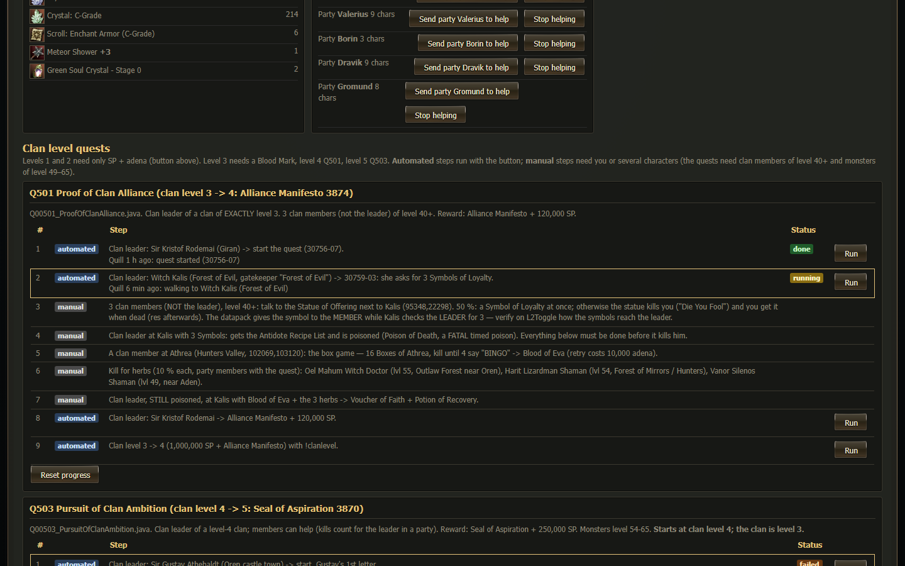

### How to raise the clan to level 4

1. Check **Clan level & reputation**: SP and adena must be ok, only the Alliance Manifesto is missing.
2. In the **Q501** box, press **Run** on the golden step and confirm. Repeat for the next automated steps.
3. Do the manual steps yourself (they need three clan members and the poison run; the text explains each).
4. The last step is the level-up itself; or turn **Automatic level-up** on.

## Clan roster and clan quests

1. **Roster count** - your characters in the clan / the member limit at this clan level. The table lists name, level, role and party.
2. **ON / OFF** - switch a reputation quest (Q508 A Clan's Reputation, Q509 A Clan's Fame, Q510 A Clan's Prestige) on or off,
   after a confirmation. Saved in `Scripts/data/clan_quests.json`. A quest the clan is too low for is greyed out and says
   "needs clan level X, the clan is level Y" (an active one can still be switched off).
3. **Active quest** - ON (highlighted).

What "ON" does:

- Raid hunt puts that quest's bosses first (the level window, raid curse and route checks still apply).
- Every 10 minutes the dashboard sends one fitting party that is not in a raid to one quest boss that is not known dead
  (`!mission raid <boss>`) and sends the clan leader along (`!assist <party>`), because the kill only counts within 1500 of the
  clan leader. At most one call per boss every 6 hours. The calls are logged in `Logs/clan.log`.

## Clan raid bosses

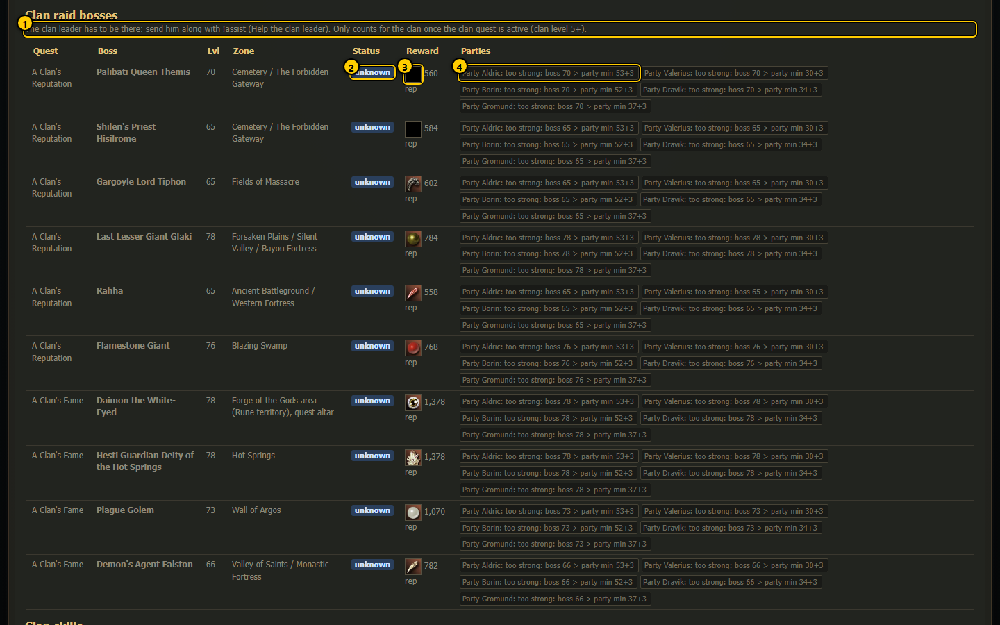

1. **Rule** - the clan leader has to be there; it only counts once the quest is active (clan level 5+).
2. **Status** - alive, dead or unknown, from the raid status the bots record, and when it was seen.
3. **Reward** - the quest item and how much reputation it gives.
4. **Parties** - for every party of 3+: a green chip "Party X fits" with a **Send** button, or a grey chip with the reason
   ("raid curse: party max 50 > 35+8", "too strong: boss 70 > party min 49+3"). **Send** sends `!mission raid <boss>` to that
   party after a confirmation; send the clan leader along with **Send party ... to help** (above).

## Clan skills

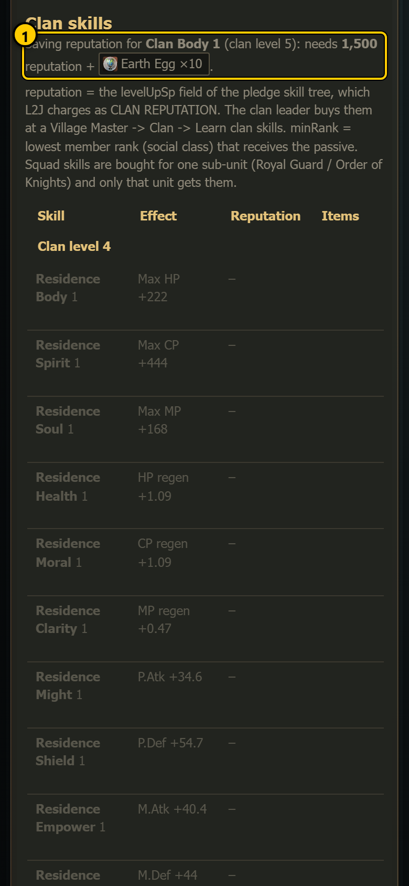 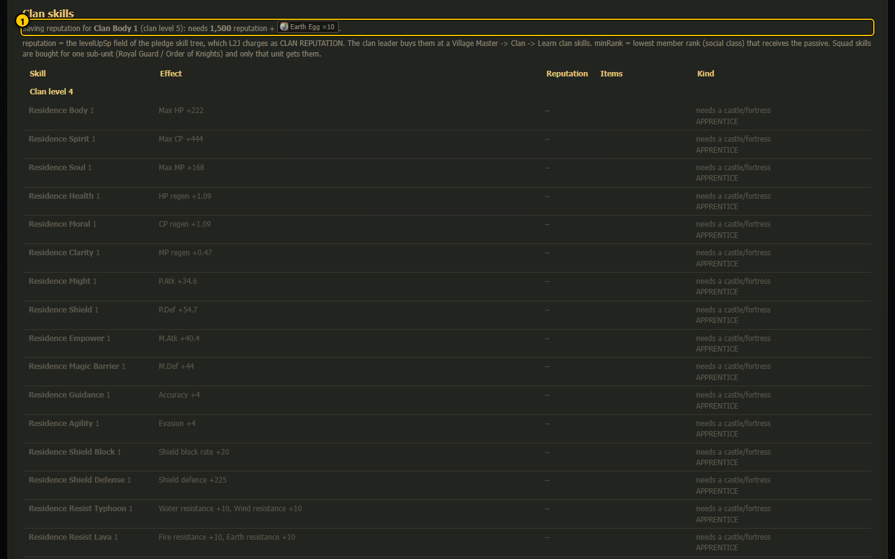

1. **Focus line** - which skill the clan saves reputation for, and what it costs (reputation + items).
2. **Focus ✓** - the chosen skill (its row has a gold frame).
3. **Focus** - choose this skill instead (confirmation first). Saved in `Scripts/data/clan_quests.json`.

The table is grouped by clan level ("(now)" marks the current one): skill and level, effect, reputation, items, kind and
minimum rank. Residence skills are faded and say "needs a castle/fortress"; they cannot be focused.

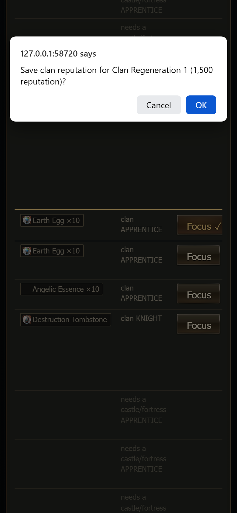 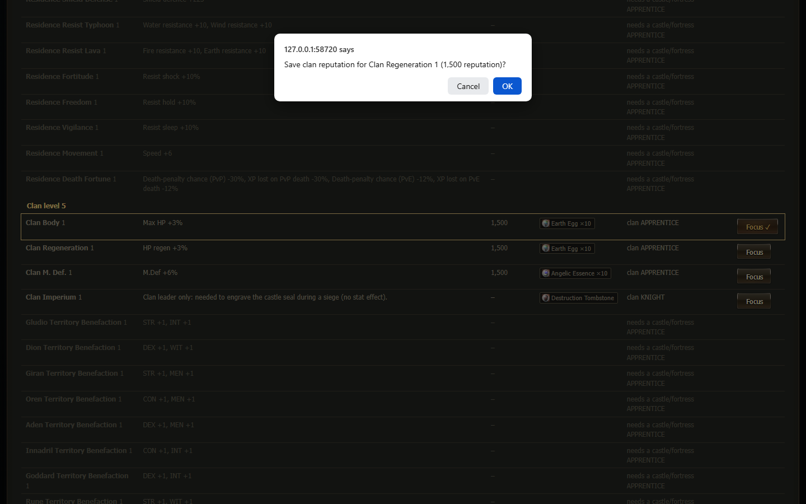

## Clan levels

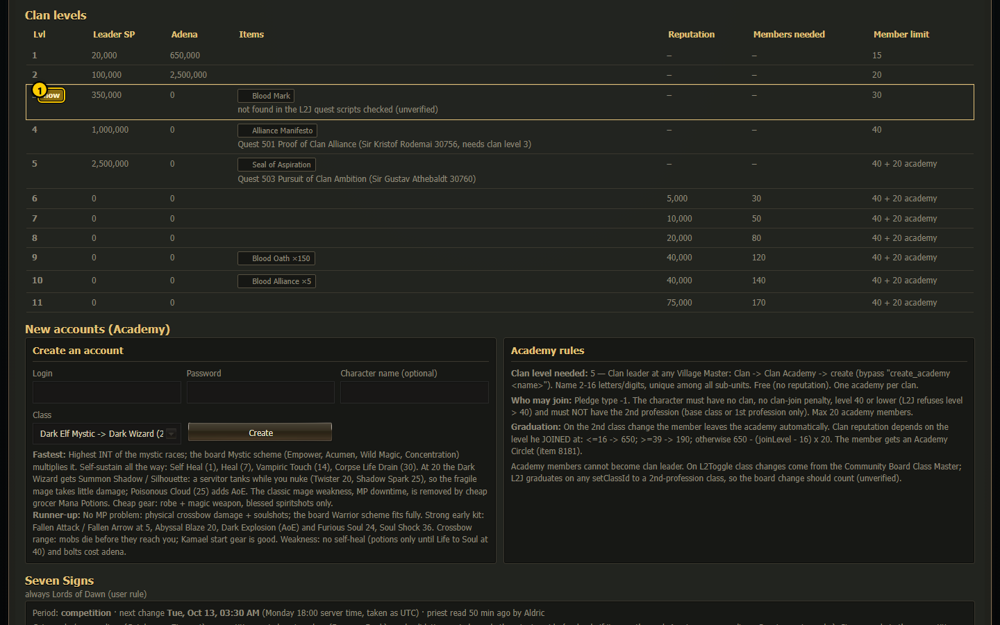

1. **now** - the current level (gold frame).

Per level: leader SP, adena, items (and where they come from), reputation, members needed, member limit after the level-up
(main + academy). Hover a row for where to do it and notes.

## New accounts (Academy)

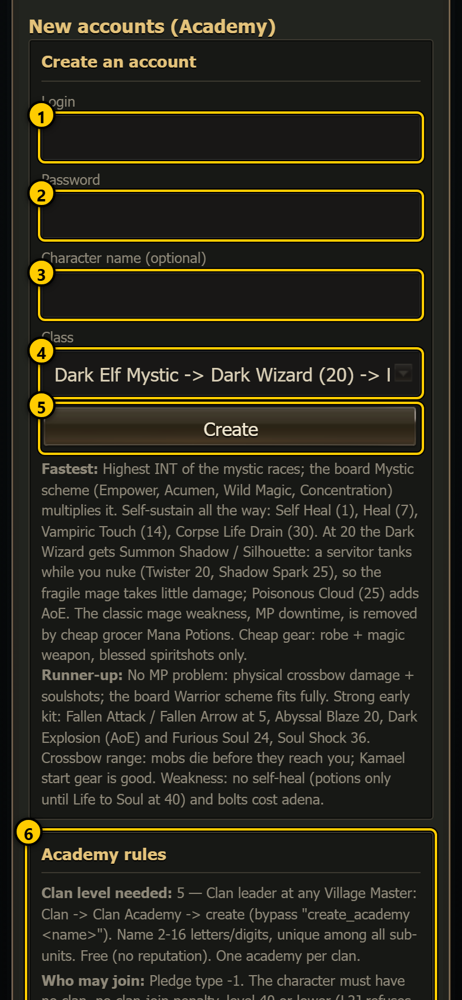 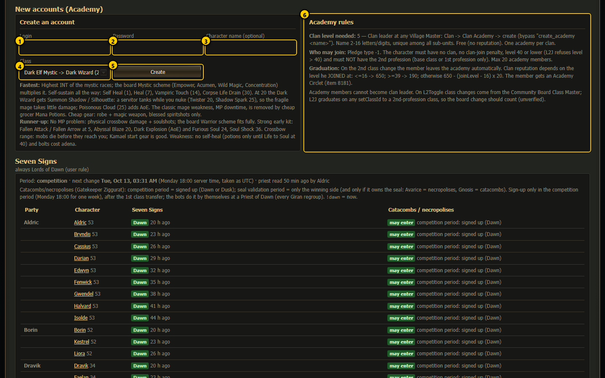

1. **Login** - 3-16 letters or digits, starting with a letter.
2. **Password** - the game password. It is cleared from the page right after sending and stored only encrypted (L2Swarm's own encryption).
3. **Character name** - the character to create at the first login.
4. **Class** - the fastest solo class to level 40 with board buffs, or the runner-up (the reasons are under the form).
5. **Create** - asks for confirmation, then the dashboard creates the account config, a one-time script that creates the
   character at the empty character list, and logs the account in. Progress goes to `Logs/academy.log`.
6. **Academy rules** - clan level needed, who may join, graduation.

> The label says "(optional)", but the dashboard server refuses an empty character name; always fill it in.

## Seven Signs

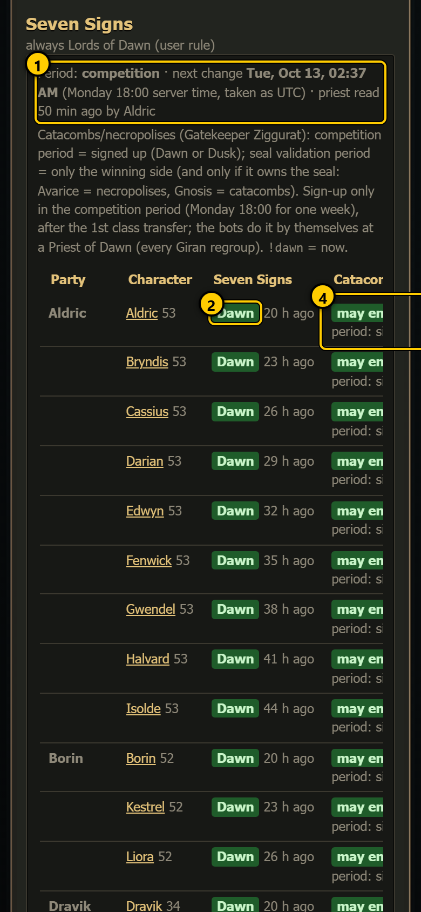 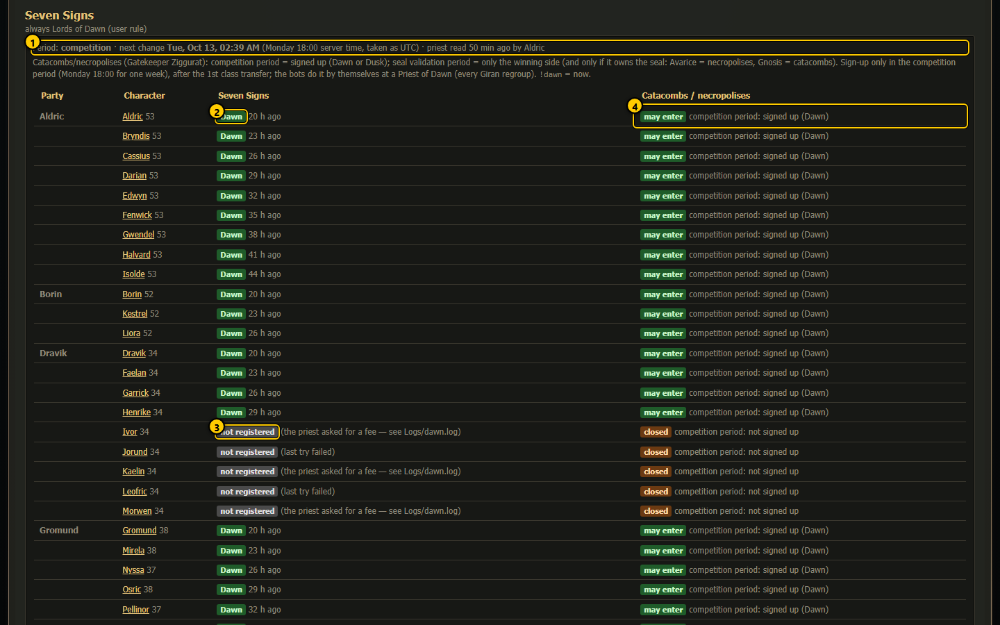

The bots always sign up with the **Lords of Dawn**. They do it by themselves at a Priest of Dawn (at every Giran regroup) in
the competition period, after the first class transfer; `!dawn` does it now.

1. **Period line** - competition or seal validation (with last week's winner), the next change (Monday 18:00), and when and by whom
   the priest was last read.
2. **Dawn** - the character is signed up.
3. **not registered** - with the reason: needs the 1st class transfer, the priest asked for a fee (see `Logs/dawn.log`), or the
   last try failed.
4. **Catacombs / necropolises** - "may enter" or "closed", with the rule: in the competition period anyone signed up may enter;
   in the validation period only the winning side, and only where it owns the seal.

## Clan event: several parties on an epic boss

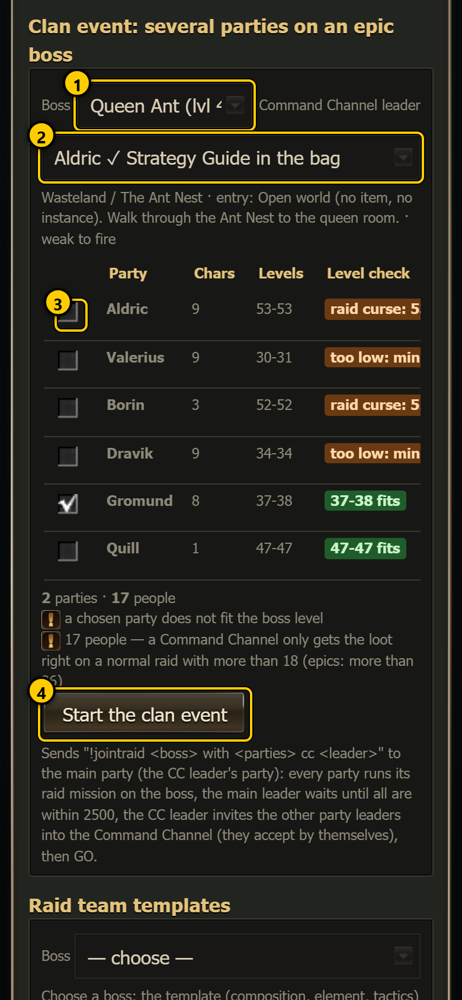 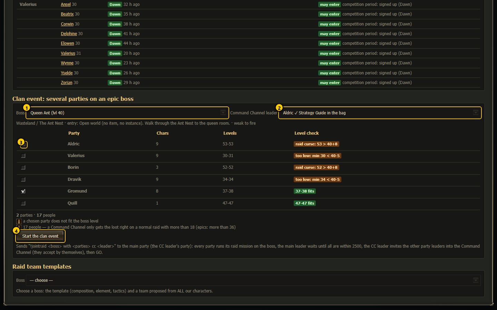

1. **Boss** - Queen Ant, Core, Orfen, Zaken, Baium, Antharas, Valakas, Frintezza (with level). The line under it: zone, entry,
   weak element, whether it needs a Command Channel.
2. **Command Channel leader** - a party leader; "✓ <reason>" when he may open a Command Channel, "(no CC right yet)" otherwise.
   Choosing him also ticks his party.
3. **Party checkboxes** - with size, level range and the level check (green = fits, orange = why not).
4. **Start the clan event** - asks for confirmation, then sends `!jointraid <boss> with <other parties> cc <leader>` to the
   main party. Every party runs its raid mission on the boss, the main leader waits until all are within 2500, the CC leader
   invites the other party leaders into the Command Channel (they accept by themselves), then GO.

Warnings under the count: a party that does not fit the boss level, fewer than 18 people (a Command Channel only gets the loot
right with more), a CC leader without the right, and a CC leader whose party is not ticked.

A Command Channel needs one of: clan leader of a level-5 clan, a Strategy Guide (item 8871) in the bag, or the Clan Imperium skill.

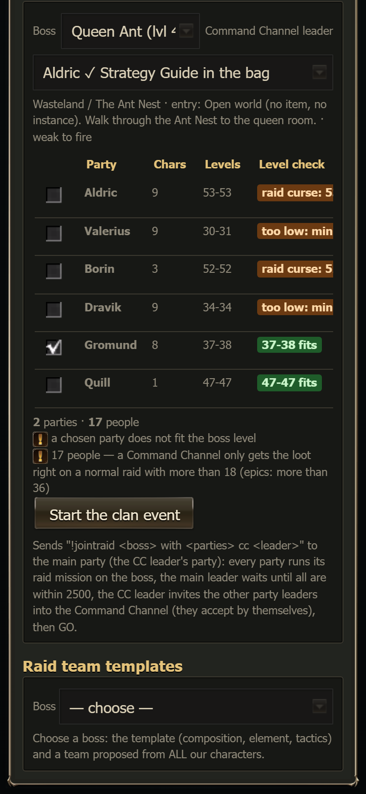 
## Raid team templates

1. **Boss** - every boss that has a template (★ = epic boss).
2. **Template** - level window, weak element, elements to avoid, entry; a table of roles (with suitable classes), the job of each
   role, the characters proposed from **all** your characters (any party; orange = why one does not fit) and what is missing;
   how many places are filled from which parties; and the tactics. Read only: in a raid on this boss the bots use the
   template by themselves (nukers prefer the weak element, the tank keeps the minions).

Templates live in `Scripts/data/raid_templates.json`.

## Another clan

When some of your characters are in another clan, it gets its own tab.

1. **Its tab**.
2. **Clan card** - leader (ours, with party and level, or "not one of our characters"), clan level, reputation, alliance, when seen.
3. **Our members** - your characters in it, with level, class, party, CLAN LEADER, whether one may open a Command Channel, offline.
4. **<Leader> calls other parties** - (only when the leader is ours) **Send to help** (`!assist <leader>`) and **Stop** (`!assist off`) per party.

1. **leader** - the member list as the server sent it: name, level, unit (main / academy), online.

## Founding the clan

Before the clan exists, the clan box lets you pick the name and found it.

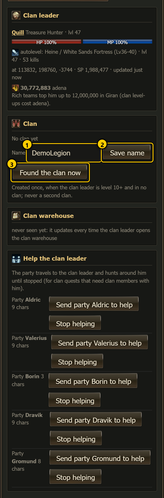 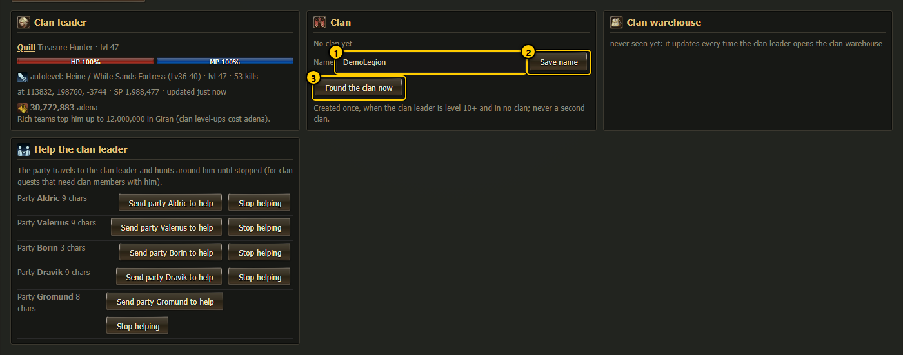

1. **Clan name** - 2 to 16 letters or digits, no spaces.
2. **Save name** - stores the name in `Scripts/data/clan_quests.json` (confirmation first). It cannot be changed here once the clan exists.
3. **Found the clan now** - sends `!clancreate` to the clan leader (confirmation first). The clan is created once, when the clan
   leader is level 10+ and in no clan; the code never creates a second clan.

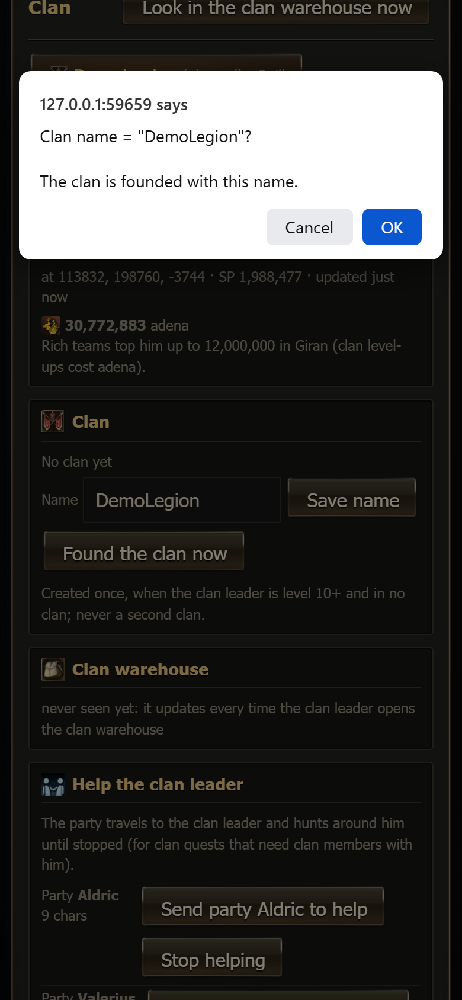 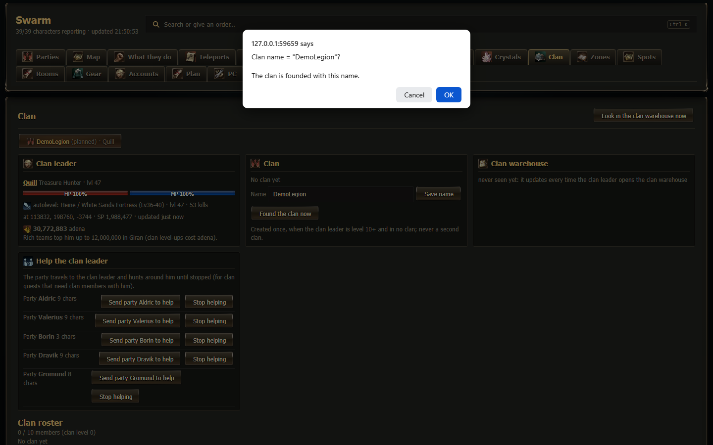

## Commands

| Command | Sent to | What |
|---|---|---|
| `!clanwh` | clan leader | open the clan warehouse and report it |
| `!clanlevel` / `!clanlevel auto on|off` | clan leader | raise the clan level now / automatically |
| `!clanquest <quest> [<step>|reset]` | clan leader (hunt steps: a party) | run the next or a given clan quest step, or start over |
| `!clancreate` | clan leader | found the clan |
| `!assist <name>` / `!assist off` | a party | go and hunt around that character / stop |
| `!mission raid <boss>` | a party | raid a boss (Send button) |
| `!jointraid <boss> with <parties> [cc <leader>]` | main party | clan event on an epic boss |
| `!dawn` | a party | sign up with the Lords of Dawn now |

## Notes

- Every button that sends an order or changes a file asks for confirmation (except switching clan tabs and the selects).
- The roster lists only your own characters; the server's full member list is on another clan's tab and in the level box count.
- Clan levels, quests and skills follow L2J High Five; your server may differ.
