# Crystals (soul crystals)

Route: `#/crystals`

A soul crystal adds a **special ability** (SA, for example Focus, Acumen or Health) to a weapon. You level a crystal by
using it on suitable monsters until it reaches the stage the weapon needs, then a blacksmith puts it into the weapon. (See
"soul crystal" and "special ability" in the [glossary](../06-glossary.md).)

The bots do the leveling by themselves. This tab shows, per party and per character:

- which crystal it is working on now and why (the ability its next weapon grade needs),
- what is in its bag, how many crystals it has finished and stored, and how its tries went,
- and it lets you change the plan: a party may stop leveling, a party may farm extra crystals for the stock, and you can set
  a character's target by hand.

How it works in the game (from the bots' code):

- Crystals start at level **40** (the lowest crystal monsters are level 40). Younger characters show "crystals from lvl 40".
- `!soul get`: the leader takes the team to **Gideon in Oren**, and everyone without a crystal fetches one (free, quest 350).
- While a monster that accepts the crystal's stage is the target and is at 50 % HP or less, the character uses the crystal on
  it once (26 MP). Whoever lands the killing blow gets the try.
- Only **one** crystal may be in the bag. Two crystals = "resonation": no tries at all.
- A crystal that reached its target stage is **READY**. `!soul store` takes the team to the Giran warehouse and every
  character stores its finished crystals (the clan warehouse when in a clan, otherwise its own); `!soul get` fetches the next one.
- Raid bosses (stage 10 and up) need no crystal use: the party gets the try when the boss dies.

The targets come from the **special abilities table** (`Scripts/data/soul_sa.txt`) and the role of each character: destroyers
Focus (plus a Health weapon for the HP swap before Frenzy), casters and healers Acumen, tanks Health, daggers Focus, and so on.
The dashboard writes the result to `Scripts/data/soul_targets.json` every minute; the bots read it live. The page refreshes
every 8 seconds.

## Overview

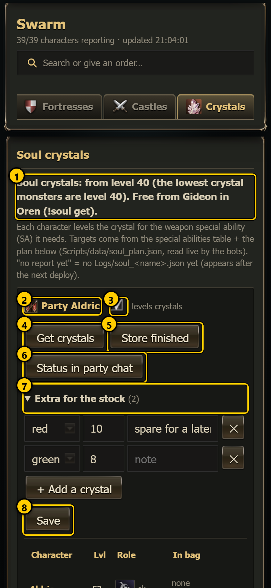 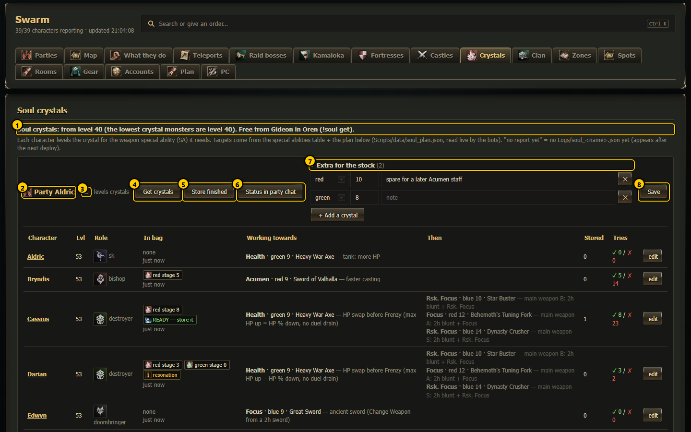

1. **Intro** - the level rule and where crystals come from. The line under it explains "no report yet" (a character that has
   not written `Logs/soul_<name>.json` yet).
2. **Party box** - one box per party ("Not in a party" for characters without one).
3. **levels crystals** - on/off for the whole party. Off = the party's characters do not use crystals (and a finished
   crystal is stored). This is a plan change: press **Save** afterwards.
4. **Get crystals** - sends `!soul get` to the party (confirmation first).
5. **Store finished** - sends `!soul store` to the party (confirmation first).
6. **Status in party chat** - sends `!soul`: everyone writes its crystals and tries into party chat (confirmation first).
7. **Extra for the stock** - fold-out list of extra crystals this party farms after its own targets (see below). The number
   is how many are listed. It opens by itself when the list is not empty.
8. **Save** - saves the plan (`Scripts/data/soul_plan.json`). It turns gold and reads "Save (unsaved changes)" when you have
   changed something.

## The party table

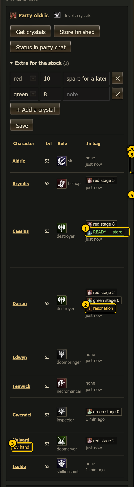 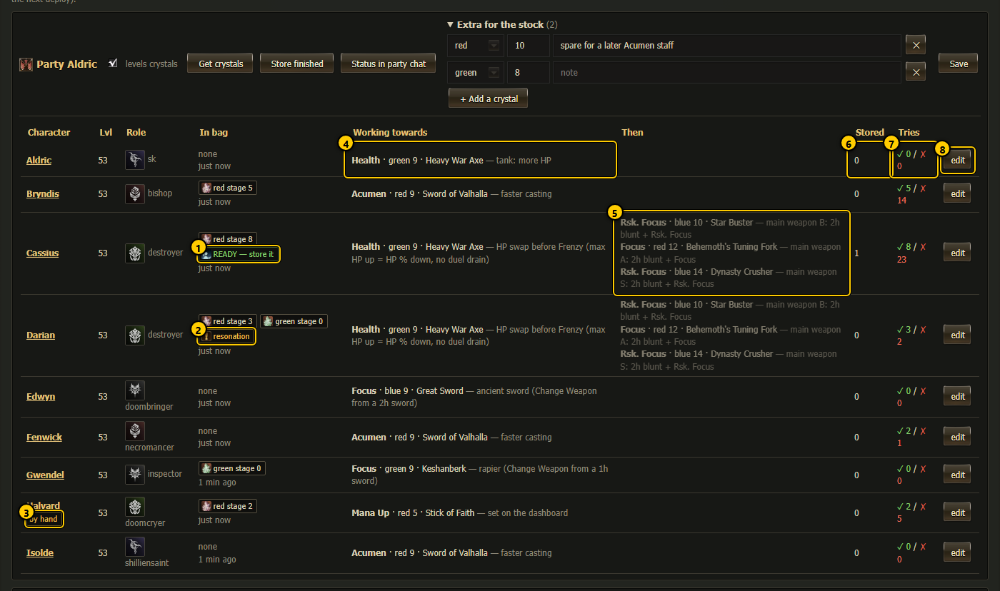

Columns: **Character** (tap for its [character page](character.md)), **Lvl**, **Role**, **In bag**, **Working towards**,
**Then**, **Stored**, **Tries**, **edit**. Characters below level 40 are faded.

1. **READY — store it** - the crystal in the bag reached its target stage. Order **Store finished**.
2. **resonation** - more than one crystal in the bag: no tries happen until one is gone.
3. **by hand** - the target was set on this page (an override), not computed.
4. **Working towards** - the ability, crystal colour and stage, the weapon, and why (for example "Focus · red 8 · Berserker
   Blade — main weapon C: 2h sword + Focus"). "nothing" = no target; "team stock" = the party's stock list.
5. **Then** - the later targets, in order (the next weapon grades).
6. **Stored** - how many finished crystals this character has stored; hover for colour, stage, time and place.
7. **Tries** - successes ✓ and failures ✗ since the bot started; hover for the details (success, not absorbed, broke,
   resonation, refused because the monster level is too low).
8. **edit** - opens the target editor row for this character.

**In bag** shows each crystal as a chip (colour icon, colour, stage, ×count), "none", or "no report yet", plus
"levelling off" when the party does not level, and how old the report is.

## Changing a character's target

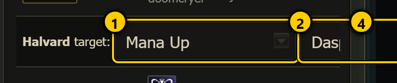 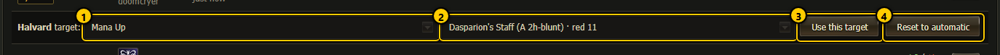

1. **Ability** - every special ability in the table.
2. **Weapon** - every weapon that has this ability, with grade, type, colour and stage, sorted by grade and stage.
3. **Use this target** - saves this weapon's crystal as the character's only target (after a confirmation).
4. **Reset to automatic** - (only for a target set by hand) removes the override, after a confirmation.

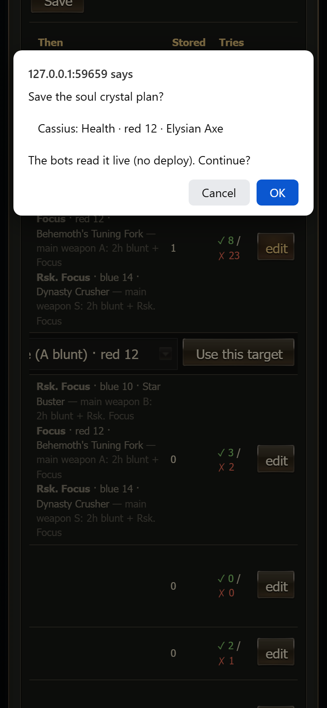 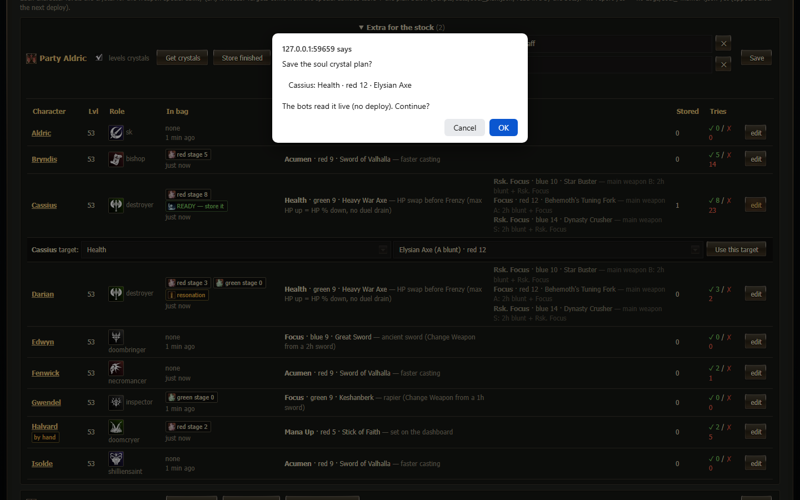

The confirmation names the change ("Cassius: Focus · red 8 · Berserker Blade") and says that other unsaved plan changes on
the page are saved too, and that the bots read the plan live (no deploy). **Cancel** undoes the change.

### How to set a target by hand

1. Tap **edit** on the character's row.
2. Choose the **ability**, then the **weapon**.
3. Tap **Use this target** and confirm.
4. The row shows **by hand**; within about a minute the bot levels the new colour.

## Extra crystals for the stock

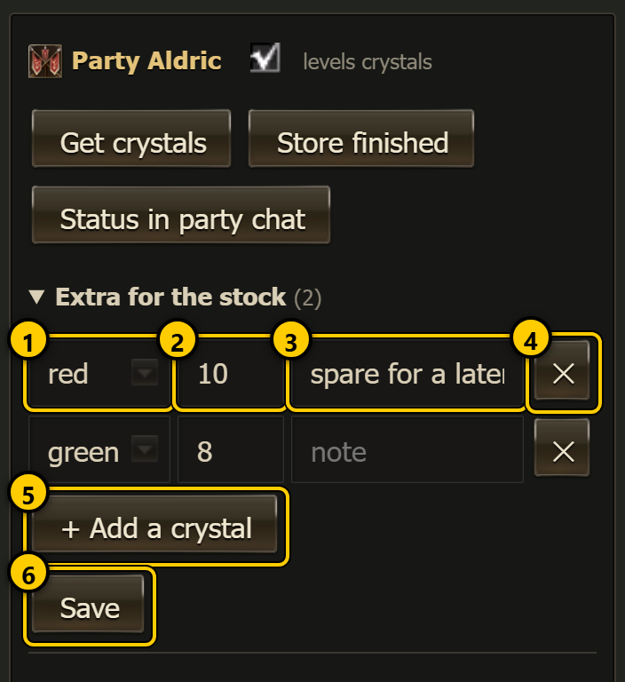 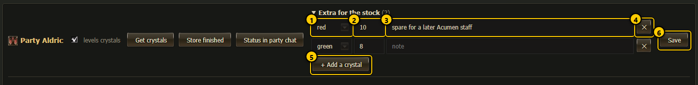

A character that has finished all its own targets levels the first crystal of its party's stock list next.

1. **Colour** - red, green or blue.
2. **Stage** - 1 to 16.
3. **Note** - free text.
4. **✕** - removes the row.
5. **+ Add a crystal** - adds a row (red, stage 10).
6. **Save** - saves the plan.

Changes here are not saved until you press **Save**:

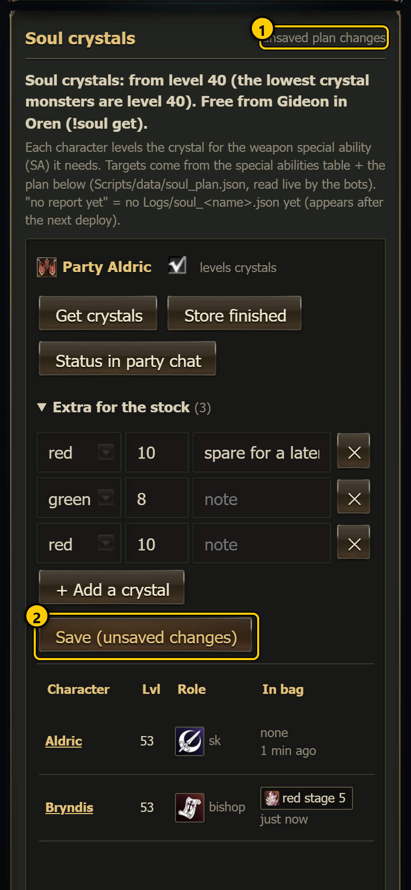 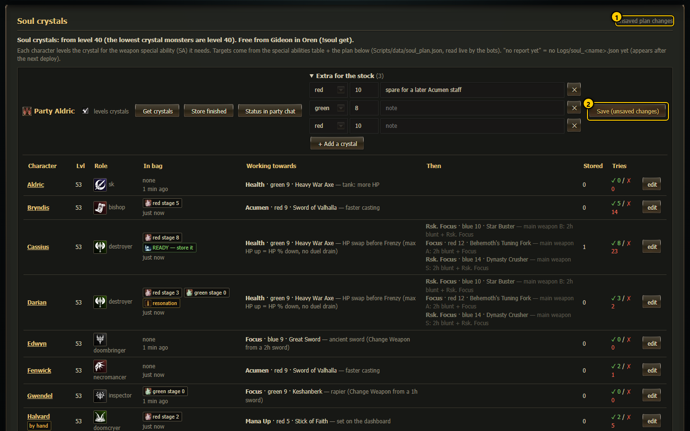

1. **unsaved plan changes** - next to the title.
2. **Save (unsaved changes)** - highlighted.

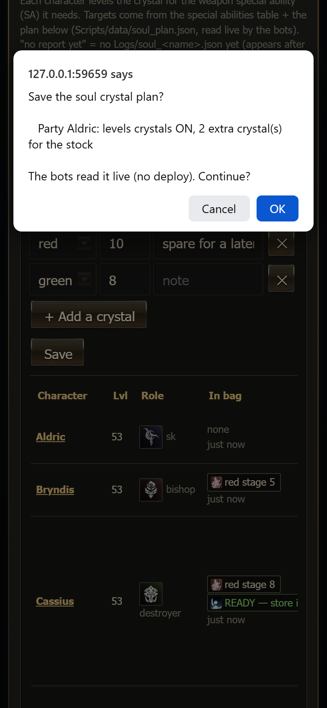 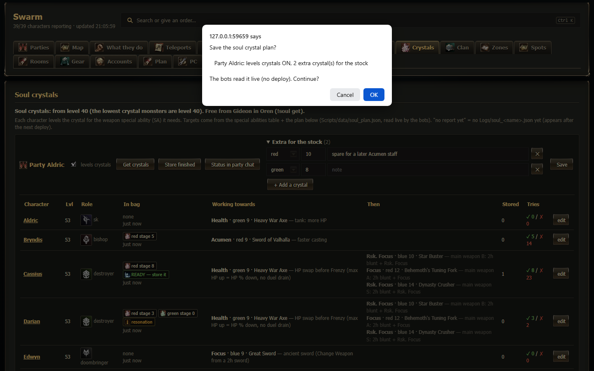

**Save** asks "Save the soul crystal plan? Party <name>: levels crystals ON/OFF, n extra crystal(s) for the stock ... The bots
read it live (no deploy)". On OK the server copies the old plan to `Settings/backup/soul_plan_<time>.json`, writes the new one
and recomputes every target.

The order buttons use the normal order confirmation:

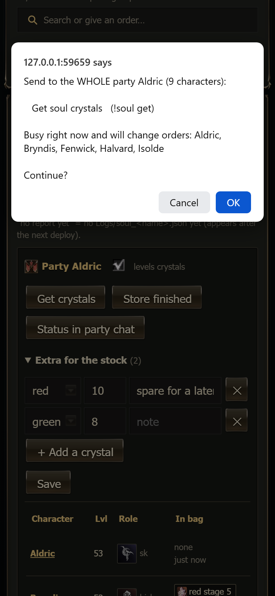 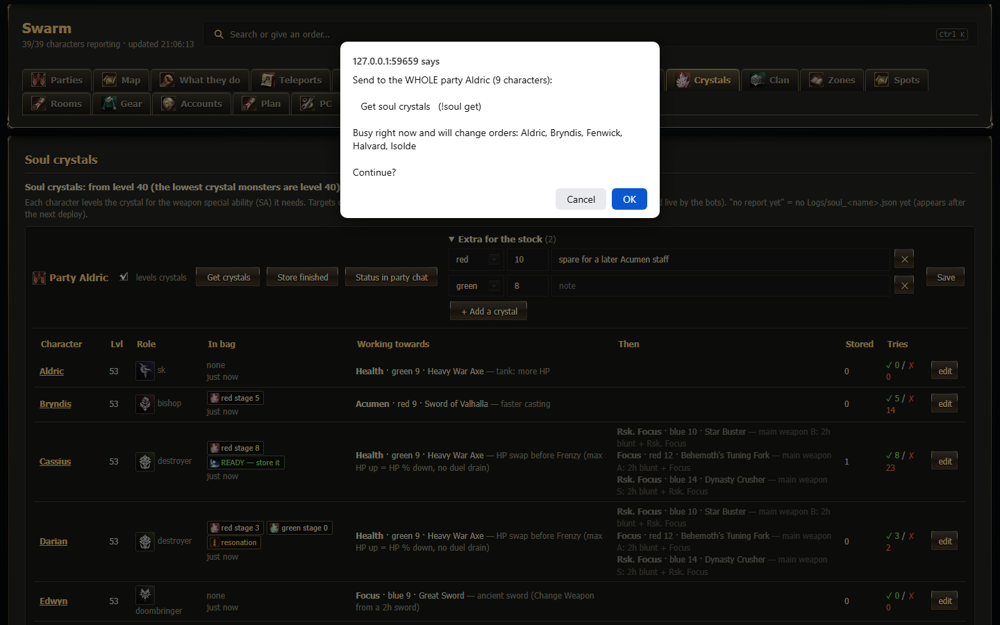

## Stock

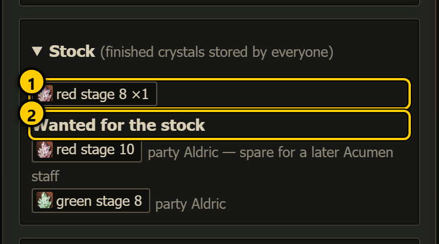 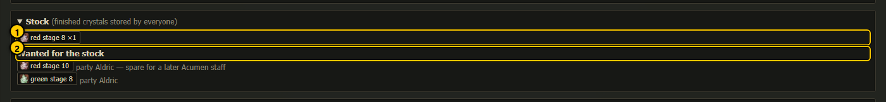

1. **Stored crystals** - every finished crystal stored by anyone, counted by colour and stage.
2. **Wanted for the stock** - the stock lists of all parties.

## Special abilities table

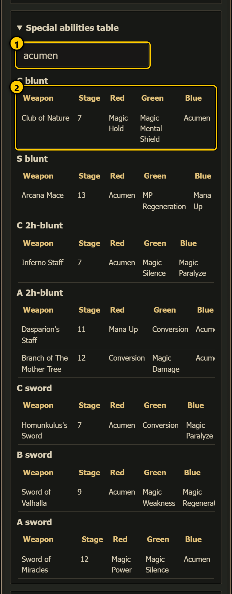 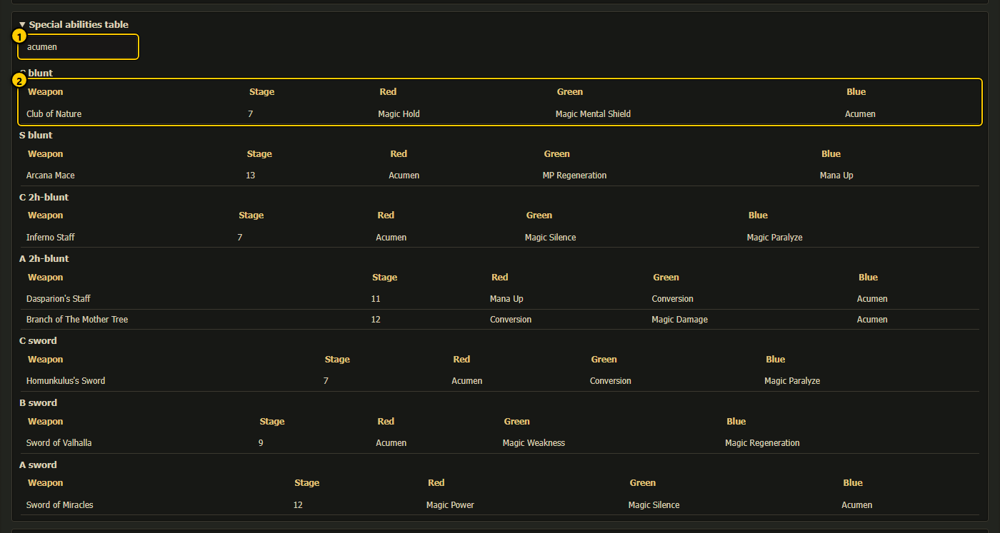

1. **Filter** - type a weapon, ability, grade or type ("acumen", "C blunt", "Focus" ...).
2. **Table** - grouped by grade and weapon type: weapon, crystal stage, and the ability a red, green or blue crystal gives.

The table is `Scripts/data/soul_sa.txt` (one line per weapon: `grade|type|name|stage|red|green|blue`).

## soul.log

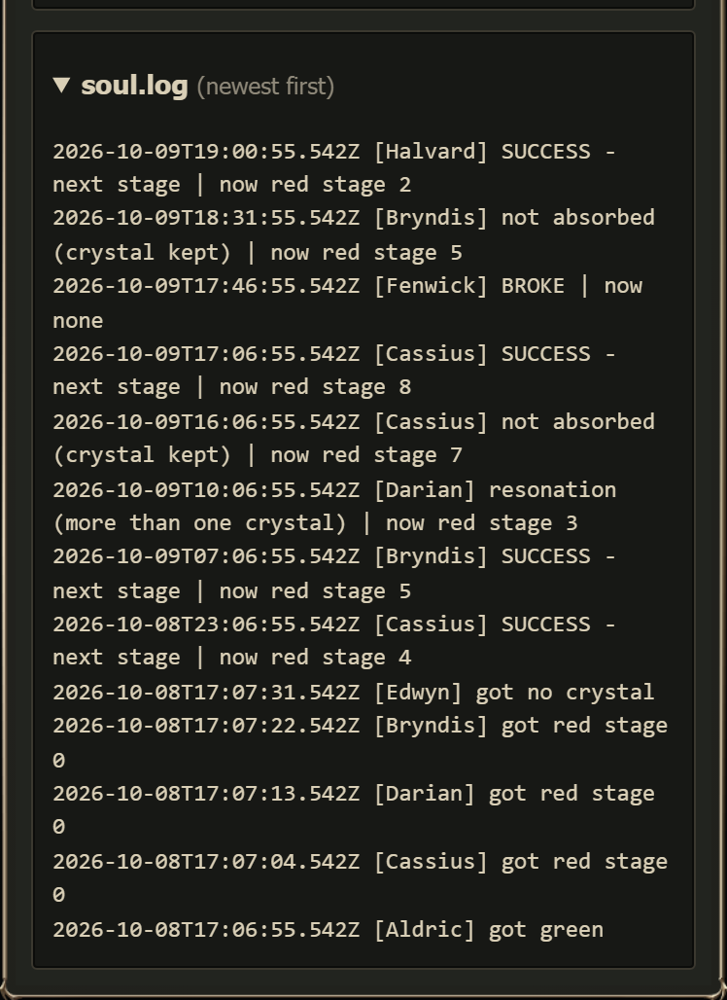 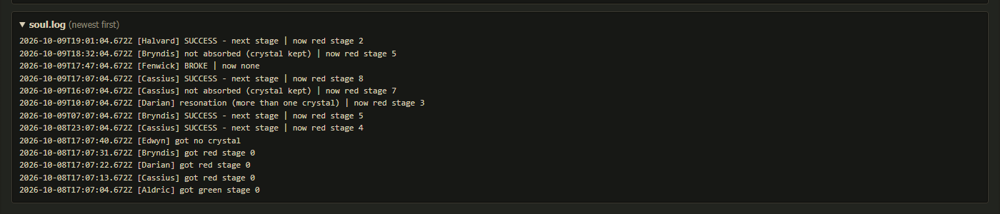

The last 80 lines of `Logs/soul.log`, newest first: crystals fetched ("got red stage 0"), every try result
("SUCCESS - next stage | now red stage 5", "not absorbed", "BROKE", "resonation") and stores.

## Commands

| Command | Sent to | What |
|---|---|---|
| `!soul get` | a party | fetch crystals from Gideon in Oren (level 40+) |
| `!soul store` | a party | store finished crystals in the Giran warehouse |
| `!soul` | a party | everyone reports its crystals in party chat |
| `!soul on` / `!soul off` | a party | crystal use on/off until the next script reload (command center only) |

## Notes

- **levels crystals**, the stock list and the target editor change `Scripts/data/soul_plan.json`; all saves ask for confirmation.
- The three order buttons ask for confirmation.
- Colour preferences per character can also come from `Scripts/data/soul_prefs.json` (used only when a character has no target).
