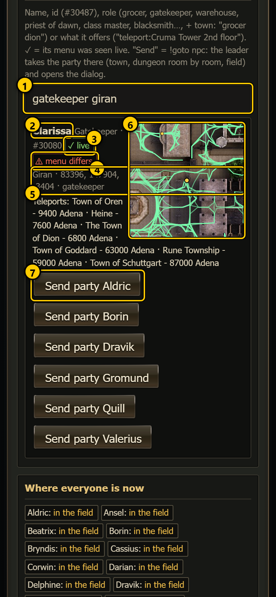
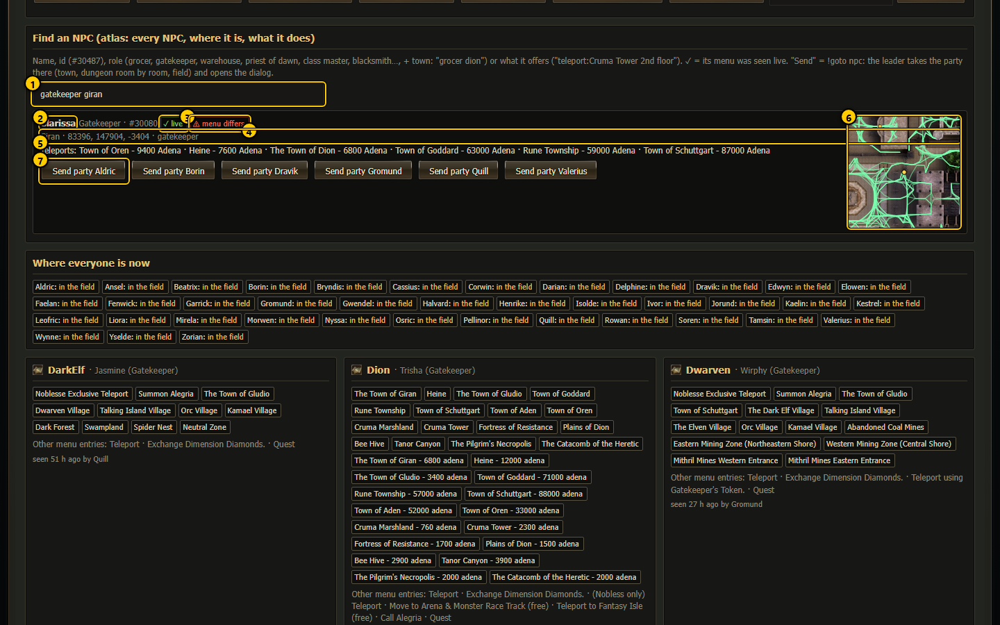
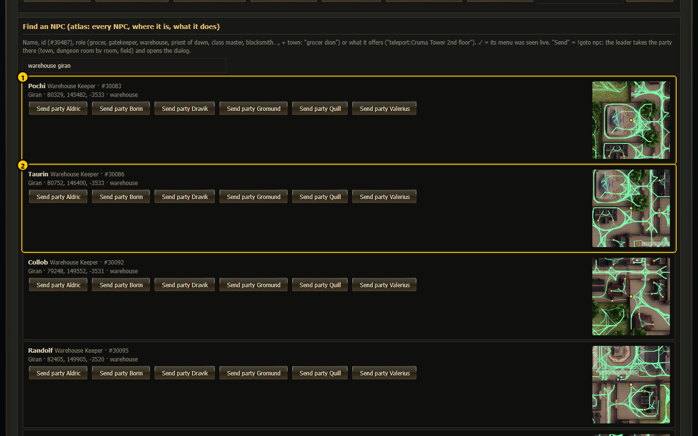
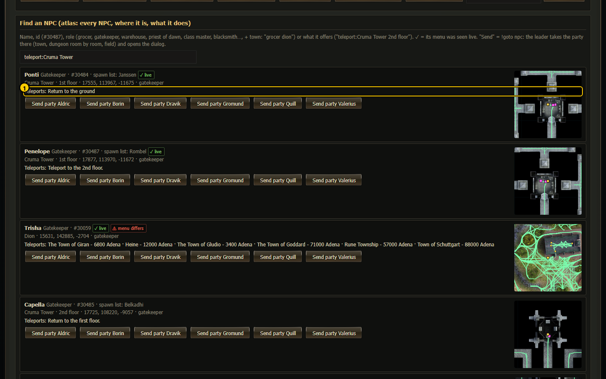
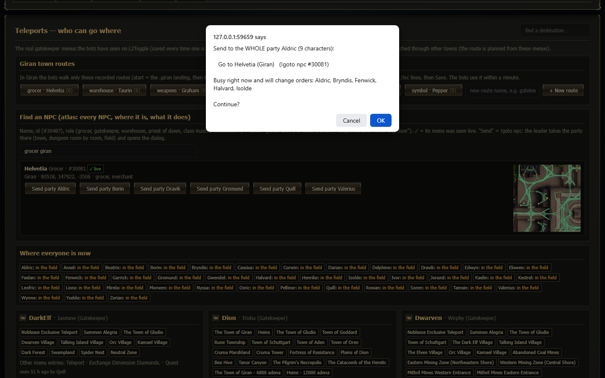

# Find an NPC (NPC atlas)  (`#/tp`)

**Find an NPC** searches the NPC atlas: every NPC of the game world, where it stands (town, dungeon floor and room, or field), what it does
(grocer, gatekeeper, warehouse, priest of dawn ...), which teleports it offers and which quests it gives. Each match has a small map, and
one tap sends a party there: the leader takes the whole party to that NPC and opens its dialog. Use it when you need a particular NPC and
do not want to walk the party there by hand.

It is a box on the [Teleports](teleports.md) tab (`#/tp`), between "Giran town routes" and "Where everyone is now".

## The search box and a match

 

1. **Search box** - type at least 2 letters. The results appear about a third of a second after you stop typing.
2. **NPC name** - followed by its title (Grocer, Gatekeeper ...), its NPC id (#30080) and, when it differs, its name in the spawn list.
3. **✓ live** (green) - a bot has opened this NPC's dialog and its menu was saved. Hover to see which saved dialogs it comes from.
4. **⚠ menu differs** (red) - the live menu does not match the datapack (hover for the differences). Live matches come first in the list.
5. **Where** - the dungeon · floor · room, or the town, or the region and how far it is from the nearest town; then its position (x, y, z)
   and its roles.
6. **Small map** - 3,000 x 3,000 game units around the NPC (yellow dot), on the game's map art. In a town the street network is drawn
   faintly; in a dungeon the hallway network of its floor.
7. **Send party <leader>** - one button per party whose leader reported in the last 2 minutes. See [Send a party](#send-a-party).

A match can also show **Teleports:** (the first 6 destinations it offers, with what they need, for example a level or an item) and
**Quests:** (the first 5 quests it starts or takes part in).

## What you can type

| You type | Finds |
|---|---|
| a name: `Penelope`, `Helvetia` | the NPC with exactly that name (or that spawn-list name). From 4 letters, names that contain the text are found too. |
| an id: `30487` or `#30487` | the NPC with that id |
| a role: `grocer`, `gatekeeper`, `warehouse`, `priest of dawn`, `class master`, `blacksmith` ... | every NPC with that role (a role that starts with the text counts too) |
| role or name + town: `grocer giran`, `warehouse in dion`, `gatekeeper at oren` | the same, only in that town |
| what it offers: `teleport:Cruma Tower 2nd floor` (also `link:` or `offers:`) | NPCs whose teleport list, or whose live dialog links, contain that text |

At most 12 matches are shown, live ones first. "nothing found" means no NPC matches.

1. **First match** 2. **Second match** - every warehouse keeper of Giran, each with its own map and buttons.

1. **Teleports it offers** - the destinations of a dungeon teleporter, for example the Cruma Tower floor teleporters.

## Send a party

**Send party <leader>** sends the swarm command `!goto npc #<id>` to that whole party. It **asks first**:

The dialog names the party, how many characters it has, the order ("Go to Helvetia (Giran)") with its command, and which members are busy
right now and will change orders. **Cancel** sends nothing.

What the party does (the leader leads, the members follow):

1. The leader stops leveling and any raid hunt, and takes control of the party. (If a more important task holds control at that moment,
   for example survival or a safe teleport, the order is skipped and the leader notes "a more important task holds control".)
2. **To the town** - when the NPC is in a town, the party teleports there with `.townname`.
3. **Into the dungeon** - for an NPC in a dungeon: the gatekeeper route to the dungeon, the floor teleporter or the walk-in to the right
   floor, then a room-by-room walk to the NPC (floor teleporters on the way are used).
4. **Into the field** - for an NPC outside towns and dungeons: a teleport as close as possible, then a walk.
5. **In town** - in Giran the recorded Giran town routes are walked; in other towns the street network.
6. **Talk** - the leader opens the NPC's dialog (it is saved to `Logs/npc_<name>.html`).

After that the party stays there and waits for your next order: leveling does not start again by itself (as after `!stop`). The trip
shows in [What they do](what-they-do.md) as "npc trip: ... -> <NPC> ...: <plan>", with done or failed and the reason ("could not get to
Giran", "<NPC> is not in sight", "<NPC> did not answer" ...). The task line of the leader shows the current step, for example
"to Helvetia: walk (3/4)".

## The command

| Command | Does |
|---|---|
| `!goto npc <what>` | the party leader takes the whole party to the best matching NPC and opens its dialog. `<what>` is anything from the table above. |
| `!goto npc <what> <character>` | only that character goes, alone |

The command understands a few short forms the search box does not: `gk` (gatekeeper), `wh` (warehouse), `shop` (merchant), `dawn` /
`dusk` (priest of dawn / dusk), `master` (class master), `weapons`, `armor`, `jewelry`, `trainer`, `spellbook`, `ziggurat`, `olympiad`.
A name in the command must be the exact NPC name.

"Best matching" means the cheapest trip from where the leader stands: the same dungeon floor first, then the same dungeon, the same town,
and so on. With an id (`#30081`) there is only one NPC. In the [command center](command-center.md) the command is **Move → Go to an NPC
(anywhere)…** (it also asks first).

## How to ...

**Take a party to a grocer**

1. Open the Teleports tab and type `grocer giran` in the Find an NPC box.
2. Check the match (the small map shows where it stands).
3. Tap **Send party <leader>** and confirm with **OK**.
4. Follow the trip on the [live party view](live-party.md) or in [What they do](what-they-do.md).

**Find which NPC teleports to a dungeon floor**

1. Type `teleport:` and the destination, for example `teleport:Cruma Tower 2nd floor`.
2. Each match lists its teleports; the ones you need are in the list.

## Notes

- The atlas is `Scripts/data/npc_atlas.json`, built from the datapack (spawns, teleports, quests, shops) and from the NPC dialogs the
  bots saved (the "live" menus). `swarm.js` re-reads it when the file changes, so a rebuilt atlas is used without a restart.
- The dashboard reads the atlas on every search (`/api/npcfind?q=...`); the search only reads, it never changes anything.
- The street and hallway networks on the small maps come from `Scripts/data/town_graph/` and `Scripts/data/dungeon_graph/`. Without them
  the small map shows only the map art.
