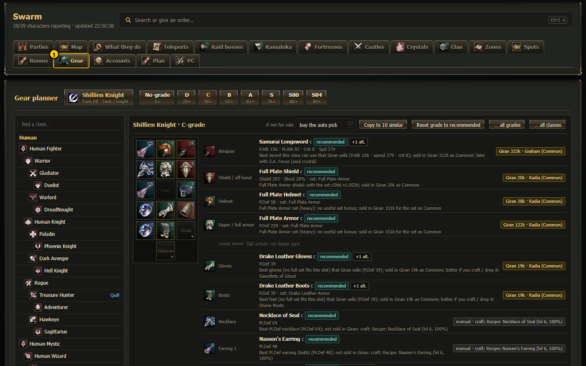
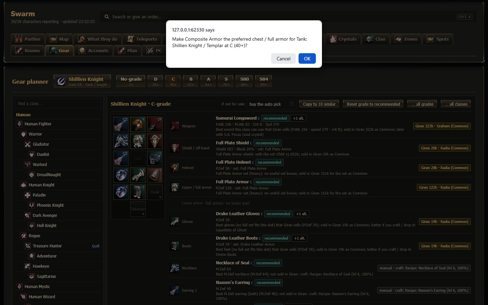
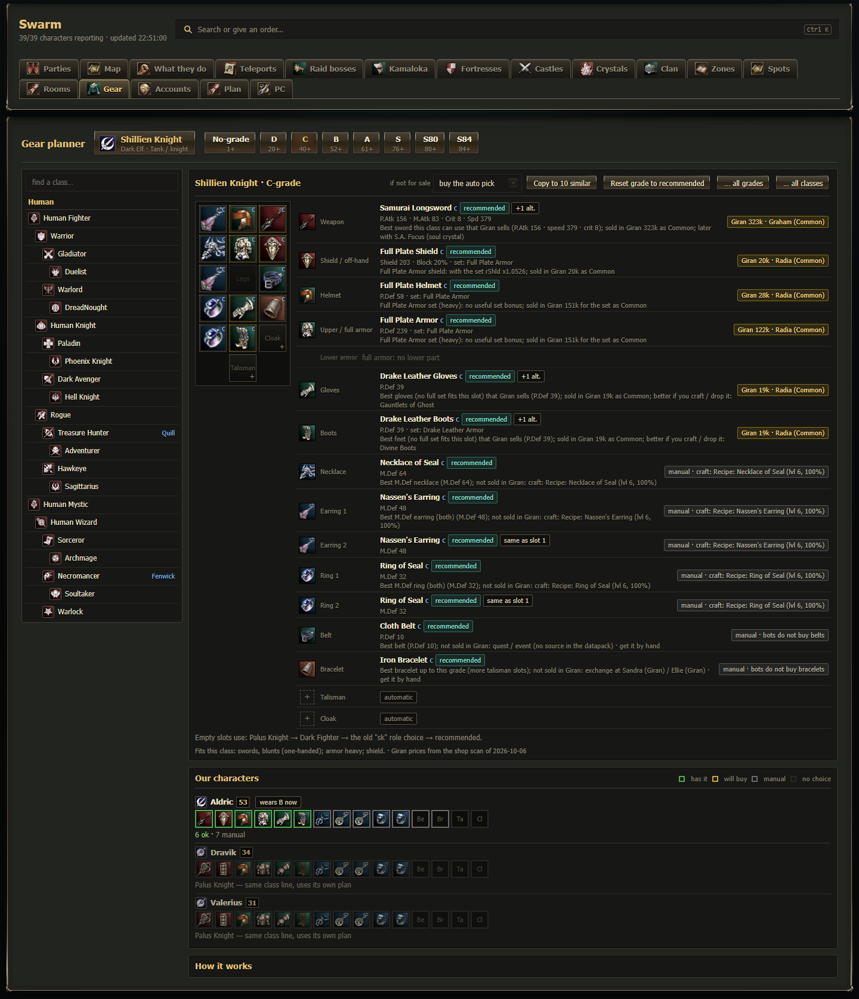

# Gear planner (`#/gear`)

The **Gear** tab is the gear planner. For **every class** (base, 1st, 2nd and 3rd class, Kamael included) and **every grade**
(No-grade, D, C, B, A, S, S80, S84) you choose the item each slot should hold: weapon, shield or sigil, helmet, upper and lower armor
(or a full armor), gloves, boots, necklace, two earrings, two rings, belt, bracelet, talisman and cloak. You can choose **any** item of
that grade, including the ones no shop in town sells. The bots read your choices live: they use them on their next gear upgrade, with no
restart and no deploy.

> New to the words used here (grade, Common item, S.A., set bonus, supply run)? See the [glossary](../06-glossary.md).
> The old per-role Gear tab (2026-10-06) is what you see until the dashboard server has been restarted once; its choices keep working
> (they show up in the planner as "from the old *role* choice").

## The page

1. **Class button** (phone / tablet) or **class list** (desktop, left column): every class grouped by race, each class line indented
   base → 1st → 2nd → 3rd. Next to a class: which of **our characters** play it now, and a green number = how many grades already have
   a plan. Type in *find a class…* to filter by class or character name.
2. **Grade tabs**: No-grade, D (20+), C (40+), B (52+), A (61+), S (76+), S80, S84. A green dot = this class has choices at that grade.
3. **Plan box**: the paper doll (same as the character page's Equipment box) and one row per slot. Tap a doll cell or a row to choose.
   Each row shows the chosen item, its grade, its key stats (P.Atk / M.Atk / crit / speed, P.Def / M.Def / shield / MP) and a chip
   that says how the bots get it:

   | Chip | Meaning |
   |---|---|
   | **Giran 449k · Radia** (gold) | Sold in Giran (live shop scan): the bots buy it on the next supply run. "(Common)" = the cheap Common twin. "(sword + Change Weapon)" = a Kamael buys the sword and turns it. |
   | **manual · drop … / craft …** (grey) | No Giran shop sells it: get it by hand (drop, craft, exchange). The chip says where it comes from. |
   | **manual · bots do not buy belts** | Belts, bracelets, talismans and cloaks are never bought by the bots. |
   | **from Shillien Knight** / **from the old "sk" role choice** (blue) | Nothing chosen for this class: it uses its parent class (then the old per-role choice). Choosing here makes it the class's own. |
   | **auto: Full Plate Helmet** / **automatic** | Nothing chosen anywhere: the bots' automatic pick. |
   | **real only** / **Common only** | The buy rule of that slot (see below). |
   | **+1 alt.** | Alternatives, tried in order when the first item cannot be bought. |

   Greyed rows: *no shield for this class*, *two-handed weapon*, *full armor: no lower part*, *nothing at this grade*.
4. **if not for sale**: what the bots do while a chosen item cannot be bought: *buy the auto pick* (default) or *keep what they wear*.
5. **Copy to N similar**: copies this class's plan at this grade to every class of the same kind (e.g. Destroyer → Orc Raider + Titan;
   all healers; all daggers). It asks first and lists the classes. Items a class cannot wear are skipped (it says which).
6. **Clear**: removes every choice of this class at this grade (asks first). Choices inherited from the parent class stay.
7. **Our characters**: every character of this class (and, dimmed, of its class line) with one small cell per slot:
   green = wears the planned item (or its Common twin), gold = the bots will buy it, grey = manual, dark = nothing chosen. Tap the
   name for the character page. "wears C now" = the character's level is in another grade band (the bots buy for their own grade).

## Recommended plan (pre-filled)

Every class has a **recommended** item for every slot at every grade, worked out from the datapack and the live Giran shop scan
(`Dashboard/gear_recommend.js`). It is shown pre-filled with a teal **recommended** chip and one line saying **why**, e.g.
"Karmian Tunic set (magic): set bonus cast speed +15%, P.Def +5.3%; sold in Giran 659k for the set (real pieces, for the bonus)".

- **Weapon:** the highest damage the class line can use (P.Atk x attack speed x crit; mystics M.Atk). Destroyers two-handed, tanks
  one-handed + shield, daggers, bows, Kamael ancient sword / rapier / crossbow (bought as the sword and changed). The best S.A. for the role
  (Acumen / Empower / Mana Up for casters and healers, Focus / Haste / Health for fighters, Cheap Shot for archers ...) is added as an
  alternative.
- **Armor:** the complete SET with the best score for the role: the pieces' P.Def / M.Def / MP plus the set bonus (P.Atk / attack
  speed / crit for damage dealers, P.Def / CON / shield for tanks, M.Atk / cast speed / INT / WIT / MP for casters and healers). Slots the
  set does not cover get the best single piece.
- **Jewellery:** best M.Def of the grade. Epic boss jewels (Queen Ant, Core, Orfen, Zaken ...) are only an alternative.
  **Belt / bracelet:** the best of the grade (manual: the bots never buy them). Talisman / cloak: no recommendation.
- **Availability:** what Giran sells wins; a better piece that Giran does not sell becomes the first alternative ("better if you craft /
  drop it"). Fighters buy the Common twin (1/20 price) unless the set bonus is worth it (C-grade and up); casters and healers buy the real
  set. Above C nothing is sold in Giran, so B+ recommendations are manual.

Your own choice always wins (gold **your choice** chip; a different recommendation shows next to it as "rec.: …"). Order the bots use:
your choice for the class → its parent classes → the old per-role choice → **recommended** → their automatic pick. A recommended piece
is only bought when it really beats what the character wears, and an unsold recommendation never adds a "needs manual" note.

Buttons: **Use recommended** (in the picker: removes your choice for that slot), **Reset grade to recommended**, **… all grades** (every
grade of this class), **… all classes** (every class; the old per-role choices stay). All of them ask first; the old file is kept in
`Scripts/data/gear_prefs_history/`.

The bots read the recommendations from `Scripts/data/gear_rec/<classId>.json`; the dashboard rewrites them whenever the item catalog or the
Giran shop scan changes (or run `node docs/plan/tools/gear_recommend.js`).

## Choosing an item (the picker)

A bottom sheet on phones, a side panel on wide screens.

- **Chosen** line at the top: the first choice and the alternatives. **↑** = try earlier, **✕** = remove (removing the first choice of a
  slot without alternatives = back to the automatic pick).
- **find an item…** search; **sort**: best stats (P.Atk with crit and speed for fighters, M.Atk for mystics, P.Def / M.Def for armor
  and jewellery), Giran price, name.
- **fits <class>** / **all items**: by default only what the class line uses (its weapon types, one- or two-handed, robe / light /
  heavy armor, shield or sigil). Tap it to see everything the class can equip (race limits and Kamael rules always apply).
- **sold in Giran**: only items the bots can buy.
- **S.A. versions** (weapons): shows "Berserker Blade - Focus" etc. Normally they are folded under the base weapon ("3 S.A.").
- **buy as**: *auto* (the Common twin for fighters, the real piece for a caster's armor because of the set bonus), *real only* (e.g.
  for an S.A. weapon or a set bonus), *Common only*.
- Each item row: icon, name, grade, type, stats, and source chips: **Giran Common 78k**, **Giran 1.42M**, **shop Aden**, **craft**,
  **exchange**, **drop** / **boss drop**, **spoil**, **S.A. by soul crystal**.
- Tap a row for the details: every Giran offer, other shops with prices, the craft recipe (craft level, success rate, materials, where
  the recipe drops), exchanges, the monsters that drop or are spoiled for it (level and chance), how to put an S.A. on it, the armor set
  with its bonus (+ shield bonus and the +6 bonus), Kamael Change Weapon, race limits. Then **Choose** or **Add as alternative**.
  The S.A. buttons choose that S.A. version directly.

## Rules the bots follow

- A character uses the plan of **its own class** at **the grade of its level**; empty slots use the parent class, then the old per-role
  choice, then the automatic pick.
- The bots buy only in Giran (supply run / `!upgrade`). Anything else is **manual**: `!gearplan` lists it ("needs manual: Necklace of
  Seal (craft: …, drop …)") and writes `Logs/gear_plan_<name>.json` → `planned` (slot, wanted item, wearing / buy / manual).
- Wearing any of the chosen items (or the alternatives, or their Common twin, or a Kamael's changed weapon) counts as done.
- A worn S.A. weapon is never replaced by one of the same grade; enchanted pieces of the same grade stay; the destroyer weapon rule
  (`_weapon`, real weapon once the soul crystal is ready) still applies.
- One earring / ring choice = two of it; a second earring / ring choice = one of each.

## Where it is saved

`Scripts/data/gear_prefs.json` → `"_class": { "<class id>": { "<grade>": { "<slot>": { "id", "alt", "buy", "name", "src" }, "_fallback" } } }`
plus `"_parents"` (class tree for the bots). The old `{ role: { grade: { slot: id, _weapon } } }` entries stay untouched. Every save
copies the old file to `Scripts/data/gear_prefs_history/` (last 200) and writes the new one atomically.
Item data: `Dashboard/data/gear_catalog.json`, rebuilt with `node docs/plan/tools/gear_catalog.js` (L2J High Five datapack: items,
shops, multisells, recipes, monster drops and spoils, armor sets); Giran prices come live from `Scripts/data/shopscan_giran.json`
(re-scan with `!shopscan`).

## Maps on every page

Scrolling the page over a map scrolls the **page** (since 2026-10-09). To zoom or move a map, click / tap into it first (gold outline),
or use Ctrl + scroll (⌘ + scroll on a Mac) or two fingers. Click / tap outside the map to give the scroll back to the page.
