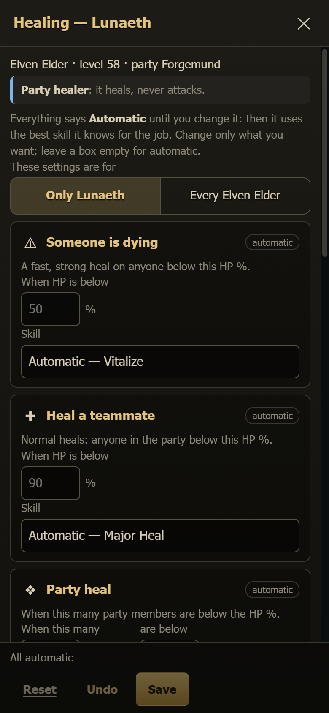

# Healing (heal and MP schemes)

Every character that can heal has a **✚ Healing** button on its character page. The party settings window
(**⚙ Settings**) has a **Healing** section too. It lists everyone in the party who can heal, with an **Edit** button for each.

Both open the same window: which heal skill the character uses, at which HP %, who gets MP, and who is healed first.

**You don't have to set anything.** Every box says **Automatic — *skill*** until you change it. Automatic means the character uses
the best skill it really knows for that job:

- **Heal a teammate:** the strongest single heal it knows. A Shillien Elder at 80 uses Greater Heal. An Elven Elder or a Cardinal
  uses Major Heal.
- **Someone is dying:** the fastest heal that still has at least half the power of its strongest one. A Shillien Elder uses Battle
  Heal (2 s cast), an Elven Elder Vitalize, a Bishop or Cardinal Greater Battle Heal.
- **Party heal:** the strongest party heal (Major Group Heal > Greater Group Heal > Group Heal). Benediction is used only when three
  or more people are below 30 %. Balance Life is used only when no party heal is ready and the HP is very uneven.
- **Heal myself:** the strongest heal it knows, cast on itself. **Self Heal is used only when the character knows no other heal**
  (a mystic below level 7).
- **MP for teammates:** Recharge on the caster with the lowest MP (below 40 %). It never gives MP to itself. Mass Recharge
  (Shillien Saint / Eva's Saint at 80) is used when three or more teammates are low.

The skills are ranked by their real power at the level the character learned them. The numbers come from the game data.

## How to use it

1. Open **✚ Healing** on the character page, or **⚙ Settings → Healing → Edit**.
2. Choose who the settings are for: **Only *Name*** or **Every *class*** (for example every Shillien Elder). A character's own
   settings win over the class settings.
3. Change only what you want. Leave a box empty to keep it automatic. The grey number in an empty box is the value it uses now.
4. Press **Save**. The bot uses the new settings within a few seconds. Nothing needs a restart.
5. **Reset** removes these settings, so the character (or class) is automatic again. It asks first.

If someone else changes the heal settings while your window is open, **Save** tells you so. You can **Overwrite with mine** or
**Load theirs**.

## What you can set

| Card | What it does |
|---|---|
| **Someone is dying** | The HP % (default 50) and the skill for a fast emergency heal. |
| **Heal a teammate** | The HP % (default 90) and the skill for normal heals. |
| **Party heal** | How many members (default 3) below which HP % (default 80) trigger a party heal, and the skill. |
| **Heal myself** | For a character that is **not** the party healer (it fights or buffs): its own HP % (default 45 when the bot's survival rule handles it, 50 for the support heal) and the skill. |
| **MP for teammates** | On / off, below which MP % (default 40), **Casters only** or **Everyone**, and the skill (Recharge / Mass Recharge). |
| **Who first** | **Automatic** (lowest HP first), **Tank**, **Healers** (keep the healers alive first), or **Lowest HP**. |
| **Mana potion for itself** | The healer drinks a Mana Potion below this MP % (default 70). |
| **Never use** | Tap a skill to stop it from being used for healing or MP, even automatically. |
| **Details → L2Swarm's own Self Heal** | Many L2Swarm configs have an auto-skill "Self Heal" at 50 %. A healer class that knows a real heal switches it off while running. The config file is not changed. Choose **Keep it** if you want it. |

If the skill you picked is cooling down, the character uses the next best one, so the heal still happens.

## Rules that stay

- **Raids and dungeons:** the tank still comes first below 60 %, and everyone below 80 % gets fast heals (spam). Mana potions
  are used below 90 %.
- **Destroyers lowering their HP for Frenzy** are not healed (also no party heal) until they are almost dead.
- **Healers only heal.** They never attack.
- Recharge never goes to the healer itself (the game does not allow it), nor to the dead.

## Who uses this

- **Party healers** (role healer / bishop / shillien saint, after the class change) use everything above.
- **Other characters with heal skills** (a mystic before its class change, a nuker with Heal, or a Shillien / Elven Elder with
  the role *buffer*) heal only when someone is low (50 %), and otherwise fight or buff. A healer **class** in another role also
  gives MP (Recharge) when nobody needs HP.

The settings are saved in `Scripts/data/heal_schemes.json` (shown under **Details**). The skill data is in
`Scripts/data/heal_skills.json`. It is made from the game data by `docs/plan/tools/heal_skills.js`.
