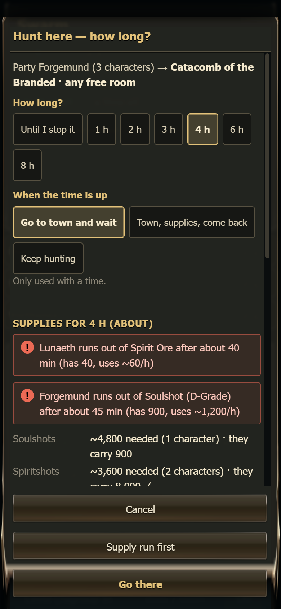
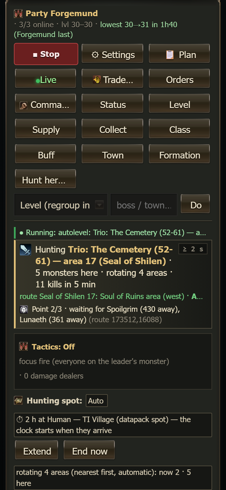

# Hunting timer (how long a party hunts at your chosen place)

When you send a party to a hunting place on the [Parties](parties.md) tab (**Hunting spot → Choose…**, then a room, a field area, a
dungeon, one of your zones or a datapack spot), a window asks **how long** the party should hunt there and **what it should do when the
time is up**. It also shows **the supplies the party needs for that time**, and warns you when someone will run out.

On this page:

- [The window](#the-window)
- [While the time runs](#while-the-time-runs)
- [When the time is up](#when-the-time-is-up)
- [The party card](#the-party-card)
- [How the supply numbers are worked out](#how-the-supply-numbers-are-worked-out)
- [Notes](#notes)

## The window

1. **How long?** - *Until I stop it* (the default: no timer, the party behaves exactly as before), or *1, 2, 3, 4, 6 or 8 hours*.
2. **When the time is up** - what the party does at the end (only used with a time):
   - **Go to town and wait** (the default): back to Giran, a supply run if supply runs are switched on in the party's
     [settings](party-settings.md), then the party stops and waits for you (its Start switch goes OFF).
   - **Town, supplies, come back**: back to Giran, a supply run if it is switched on, then back to the same place and hunting until
     you stop it.
   - **Keep hunting**: nothing changes; the party keeps hunting and the normal automatic trips are allowed again.
3. **Supplies** - about how much the party uses in that time: soulshots, spiritshots (blessed ones when that is what a character uses),
   Mana Potions, Healing Potions, and - only for characters whose skills use them - **Spirit Ore**, **Einhasad's Holy Water** and
   **Soul Ore**. Each line says how many are needed and how many the party carries (✓ = enough).
4. **Warnings** - for example *"Destroyer1 runs out of Soulshot (C-Grade) after about 1 h 20 min"*. These only warn; you can still go.
5. **Buttons**: **Cancel** (nothing changes), **Supply run first** (saves the choice and the timer, and sends the party to Giran for a
   supply run first - the same as the `!supply` order), **Go there**.

## While the time runs

The timer keeps the party **at the chosen place**:

- no automatic supply run - **unless shots really run out** (fewer than 30); then the party says so in party chat, does the supply run
  and comes back (the timer keeps counting);
- no trip to Giran between spots, no daily Kamaloka, no warehouse / letters / clan item / Seven Signs / quest farm / clan skill /
  adena hand-out trips;
- it does not "move on when outgrown";
- a teammate who is far away is waited for up to 15 minutes before the whole party regroups in Giran (so nobody is stranded).

**Always allowed:** healing, potions, escapes, resurrection, rescues, respawning after a death or a wipe (the party then comes back),
and every order you give yourself.

**The clock starts when the party arrives** at the place (travel time does not count). If it has not arrived after 45 minutes the clock
starts anyway.

## When the time is up

Within 15 seconds the leader says *"[hunt timer] hunting time is up at …"* in party chat and does what you chose. During a raid, a
mission or an instance he finishes that first. If the party was stopped (Start switch OFF) when the time ran out, nothing moves.

## The party card

The **Hunting spot** line shows the timer:

- **⏱ 2 h at … — the clock starts when they arrive** - still travelling;
- **⏱ Hunting at … — 1 h 12 min left · then go to town and wait** - running (gold in the last 15 minutes);
- **⏱ Hunting time at … is over — waiting in Giran** - finished, with what happened. **OK** removes the line.

Buttons: **Extend** (+30 min, +1 h, +2 h; a finished timer starts again from now), **End now** (the end action starts within 15
seconds). Hover or long-press the line to see when it started, when it ends and what it held back lately.

Choosing another place asks again; **Until I stop it** and **Back to auto** remove the timer.

## How the supply numbers are worked out

Every character measures what it really uses while hunting (outside towns, while fighting or with its party hunting): each minute it
compares its soulshots / spiritshots / potions / Spirit Ore / Holy Water / Soul Ore with the minute before. Drops in town, trades and
big hand-outs do not count. Once a character has **20 minutes** of measured hunting (from the last 6 hours), its own numbers are used.

Until then a rule of thumb is used (shown as "about"):

| Item | Per hour |
|---|---|
| Soulshots (fighters, archers, tanks) | ~1,200 |
| Spiritshots | casters ~600, healers ~300 |
| Mana Potions | fighters 20, casters 60, healers 80 |
| Healing Potions | 3 |
| Spirit Ore (only skills that eat it) | healers with Major Heal 60, others (cubics, summons) 15 |
| Einhasad's Holy Water (Cleanse, Salvation) | 10 |
| Soul Ore (Banish Undead and similar) | 10 |

Needed = per hour × hours. "Runs out after" = what it carries ÷ per hour.

## Notes

- The timer is saved in `Scripts/data/hunt_timers.json` (the dashboard writes it), the clock in `Logs/hunt_timer_<leader>.json` (the
  leader writes it). Both survive restarts.
- Measured use per character: `Logs/supply_use_<name>.json`.
- New in swarm.js: it needs a swarm.js deploy and a dashboard restart before it works.
