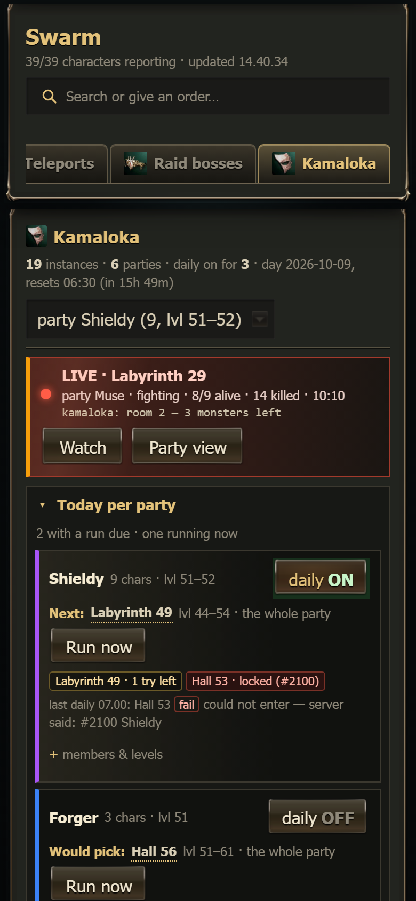
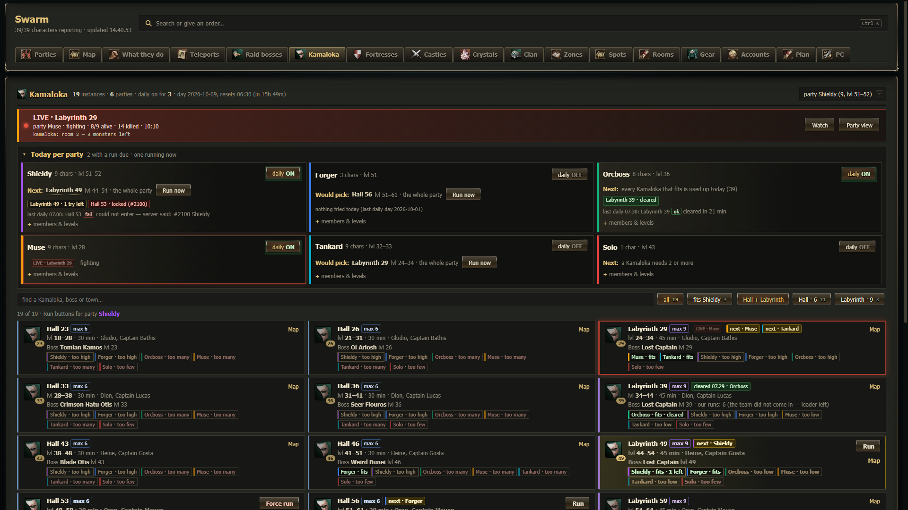
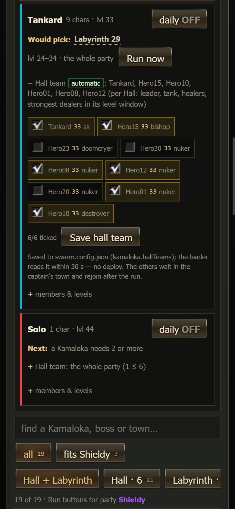
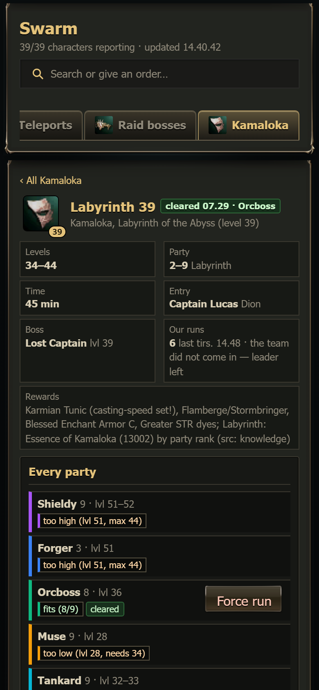
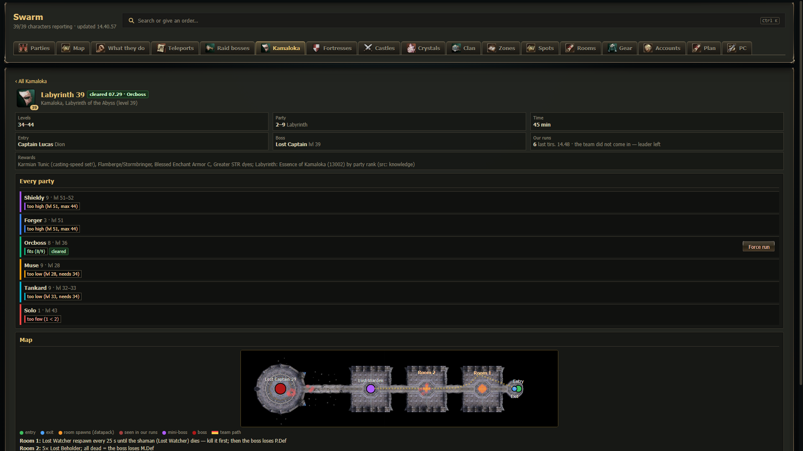
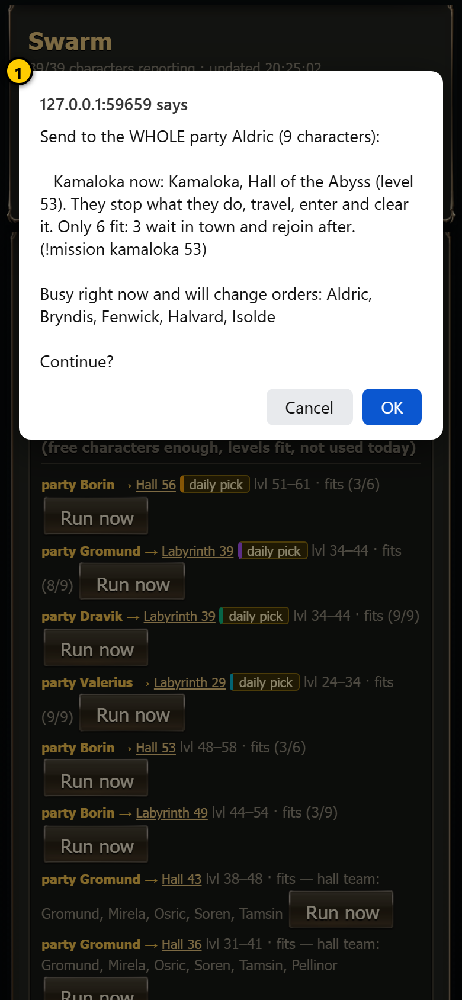
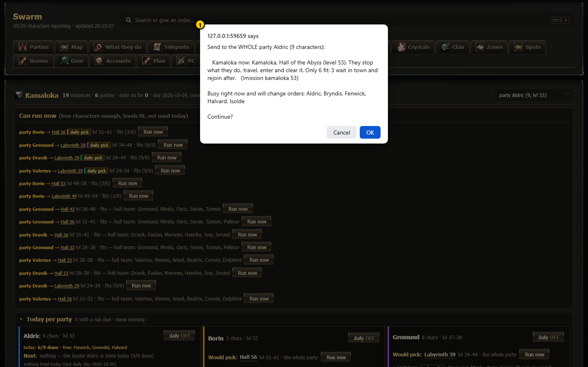
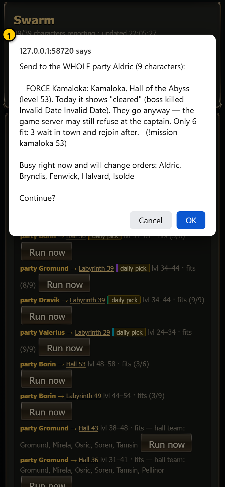
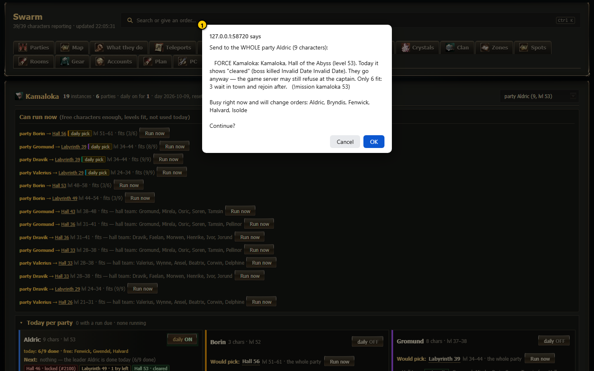

# Kamaloka

The **Kamaloka** page (`#/kamaloka`) is where you run the daily Kamaloka instances. It shows **every party** of `swarm.config.json`
(a party is named after its leader) against all 19 Kamalokas of the game (Halls and Labyrinths of the Abyss, level 23 to 83): which ones
each party fits, which are used today, what the daily run will pick next, and where to enter. Each Kamaloka has its own page with the
instance map, and a running Kamaloka is pinned at the top with a link to the **live view**. You can start a run with one tap (**Run**),
and you can let a party leader run its Kamaloka by itself once a day (**daily ON**).

> New to the words? A *Kamaloka* is a daily instanced dungeon (an [instance](../06-glossary.md), a private copy of a dungeon only your party
> can enter). A **Hall** is one room with a boss, for up to 6 players, 30 minutes. A **Labyrinth** is a corridor of rooms with a mini-boss
> and the *Lost Captain* as raid boss, for up to 9 players, 45 minutes. You enter at a *captain* NPC in a town (Gludio, Dion, Heine, Oren,
> Schuttgart, Rune).

The live view (what you see while a run is going on) has its own chapter: [Kamaloka live view](../live/kamaloka-live.md).

Contents:
- [The Kamaloka page](#the-kamaloka-page-kamaloka)
- [Today per party](#today-per-party)
- [Hall team per party](#hall-team-per-party)
- [The Kamaloka cards](#the-kamaloka-cards)
- [Daily Kamaloka ON / OFF](#daily-kamaloka-on--off)
- [One Kamaloka and its map](#one-kamaloka-and-its-map-kamalokaid)
- [Run history, daily log, how it decides](#run-history-daily-log-how-it-decides)
- [Run and Force run: the confirmation](#run-and-force-run-the-confirmation)
- [What the leader does after you tap Run](#what-the-leader-does-after-you-tap-run)
- [How to ...](#how-to-)
- [Notes and safety](#notes-and-safety)

---

## The Kamaloka page (`#/kamaloka`)

Open it with the **Kamaloka** tab button (the tab row scrolls sideways on a phone). From top to bottom:

 

1. **Summary line** - number of instances and parties, for how many parties the daily run is on, the daily day and the time until the
   06:30 reset (counts down).
2. **Party picker** - the party the **Run** buttons on the cards and the "fits" filter are for ("party Aldric (9, lvl 51-52)"). It starts
   on the main leader's party and is remembered on this device. The **Today** rows have their own Run button per party.
3. **LIVE block** - only while a run is going on (or just ended): Kamaloka, party, phase, alive / total, kills, time, the leader's current
   step. **Watch** opens the live view (`#/kamaloka/live`), **Party view** the live party page of that leader.
4. **Today per party** - one row per party (below).
5. **Search and filters** - find by name, level, boss, town or captain; **all / fits <party>**; **Hall + Labyrinth / Hall / Labyrinth**.
   The filters are remembered on this device.
6. **Kamaloka cards** - one per Kamaloka, lowest level first (below).
7. **Run history**, **Daily log**, **How the daily run decides** - collapsible sections (closed by default; open / closed is remembered on
   this device).

One column on a phone, two on a tablet, three on a wide screen. No sideways scrolling.

---

## Today per party

One row per party, with the party's colour on the left.

| Part | What it shows or does |
|---|---|
| **Name, chars, lvl** | Leader name, number of characters, lowest-highest level. "N offline" in orange when some members are not reporting. |
| **daily ON / OFF** | The party's daily switch (see [Daily Kamaloka ON / OFF](#daily-kamaloka-on--off)). Asks first. |
| **Next** / **Would pick** | What the daily run picks for this party right now - exactly the leader's own rule (whole party first, then the hall team). "Would pick" when the daily switch is OFF. Without a pick it says why: "a Kamaloka needs 2 or more", "no Kamaloka fits 9 at lvl 28", "every Kamaloka that fits is used up today (39)". |
| **Run now** | Starts the next pick now with this party (same confirmation as the cards). "Force" style when it is used up today. |
| **waits until the whole party is in** | The daily run only starts when every member is logged in and in the party; it names who is missing. |
| **Today chips** | Every Kamaloka this party touched today: "Labyrinth 49 - 1 try left", "Hall 53 - locked (#2100)", "Labyrinth 39 - cleared", "cleared (by hand)" for a run started with Run (not in the daily list). |
| **last daily** | The leader's last daily run (time, Kamaloka, ok / fail, message). |
| **Hall team** | Who goes into a **Hall** (max 6) when the party is bigger than 6, and where that comes from: **set on this page**, **the old global list**, or **automatic**. Tap it to change it (see [Hall team per party](#hall-team-per-party)). A party of 6 or fewer says "the whole party". |
| **+ members & levels** | Opens the member list: name, level, green dot = reporting, grey = offline. Remembered per party on this device. |
| **LIVE** | Instead of Next while this party runs a Kamaloka. |

---

## Hall team per party

A **Hall** takes at most 6 characters, a **Labyrinth** 9. A party of 7, 8 or 9 can still run Halls: its **hall team** goes in, and the
others leave the party for the run, travel to the **captain's town** (Dion, Heine, Oren, ...) and wait there. Their task line says
"waiting in Dion — not in the Hall team (Hall 36)". After the run the leader invites them back and they follow him again.

Every party has its own hall team. Where it comes from, in this order:

1. **Set on this page** - the team you saved for this party (stored in `swarm.config.json` as `kamaloka.hallTeams`).
2. **The old global list** - `dailyHallTeam` in `swarm.config.json` (or the built-in default), but only for the party whose leader is
   in that list.
3. **Automatic** - nothing set: for each Hall the leader picks the best 6 himself, from the members inside that Hall's level window:
   the leader, one tank (the leader when he is one), up to 2 healers (the highest level first), then the strongest damage dealers
   (level first, then role: destroyers, then doombringers / necromancers / nukers, ...), then anyone left.

**Change a party's hall team**

1. In **Today per party**, tap the party's **Hall team** line. A box per member opens (name, level, role); the leader is always ticked.
2. Tick up to 6 (at least 2). The counter shows "n/6 ticked". Your ticks stay while the page refreshes; **Undo ticks** puts them back.
3. Tap **Save hall team** and confirm. The leader reads it within 30 seconds (no deploy, no restart of the bots).
4. **Use automatic** removes the saved team again (asks first).

Saving writes `swarm.config.json` (the old file is kept in `Settings/backup/swarm_config_history/`, the last 50). If someone else changed
the same party's team since your page loaded, the save is refused ("changed meanwhile - reload and try again").

---

## The Kamaloka cards

| Part | Meaning |
|---|---|
| **Icon + number** | The Kamaloka's level. |
| **Hall 53 / Labyrinth 49** + **max 6 / max 9** | Hall or Labyrinth and its party size. Tap the name (or the card) for its own page. |
| **lvl 48-58 - 30 min - town, captain** | Level window, time limit, where to enter. |
| **Boss** | Boss name and level, plus how many runs our bots made here and the last result. |
| **next - <party>** (gold) | The daily run of that party picks this one now. |
| **cleared HH:MM - <party>** (green) | `Logs/kamaloka.log` shows its boss killed since 06:30 (and by which party, when the log can tell). |
| **LIVE** | A run of this Kamaloka is going on. |
| **Party chips** | One per party: the ones it fits first, the others dimmed with the reason. Today's state is added for the ones that fit. |
| **Run** / **Force run** | For the party in the picker; only when that party fits. Force run = used up today; the server may still refuse. |
| **Map** | Opens the Kamaloka's page. |

**Party chip** (the leader's own rule, `Dashboard/kamalogic.js` = swarm.js `dailyDue`):

| Chip | Meaning |
|---|---|
| **fits** (green) | Every level is inside the window and the whole party fits in (up to 6 for a Hall, 9 for a Labyrinth). |
| **fits — hall team: A, B, C, D, E, F** (blue) | A Hall for a party bigger than 6: these 6 (the party's [hall team](#hall-team-per-party)) go in, the others wait in the captain's town. |
| **too low** / **too high** / **levels too spread** (orange) | Levels outside the window (names given when only some are). |
| **too many** (red) | More characters than the instance takes and the party's saved hall team does not work (a name not in the party, more than 6, the leader missing) - the reason is in the tooltip. |
| **too few** (red) | Fewer than 2 (a solo character). |
| **levels unknown** (grey) | The leader has not reported a level yet. |

**Today** (a new day starts at 06:30 local time, the same time the game resets the lock): **2 / 1 try left** (open), **locked (#2100)**,
**cleared**, **no entry today** (could not enter twice), **no tries left** (2 starts today), **done today** (any other reason). It comes
from the leader's daily list `Logs/daily_<leader>.json` (written by daily runs only).

---

## Daily Kamaloka ON / OFF

The **daily ON / OFF** button in a party's Today row switches the daily Kamaloka for that **whole party**. Every party has one (before
2026-10-09 only the two `dailyLeaders` had it; the server accepts every party leader once it runs the new code). It asks first:
"Daily Kamaloka for the WHOLE party ... -> ON. The leader takes the party into <next> by itself (once per day) when it is free." Switching
OFF says "Stops future runs; a run already started is not aborted." The dashboard writes `Logs/daily_enabled.json`; the bots read it live.

**What ON does.** Once a minute the party leader checks whether a Kamaloka is due:

1. The whole team must be in his party, and he must be free: not paused by `!stop`, not in a raid boss fight, not on a supply run or
   other team trip.
2. He picks the **highest** Kamaloka that **every** member fits (levels and party size) and that is not done today and was tried fewer
   than 2 times today.
3. Only if none fits the whole party: when the party is bigger than 6, the highest **Hall** its [hall team](#hall-team-per-party)
   fits (the saved one, or the automatic pick for that Hall).
4. Raid hunting or leveling steps aside after the current fight, the run starts, and afterwards the team goes back to what it did before.
5. Every started run counts as a try. The Kamaloka is marked done for the day when its boss died, when the server answered "may not
   re-enter" (#2100), or when it could not enter on the second try. A wipe is not "done": the server only locks a Kamaloka when its boss dies.

The **Next** on the page is computed with exactly this rule (it used to differ: the old page counted Halls first and ignored the tries).

---

## One Kamaloka and its map (`#/kamaloka/<id>`)

Tap a card (or its name / **Map**) to open its page, for example `#/kamaloka/kamaloka-39`. **‹ All Kamaloka** goes back.

 

1. **Header** - level, short and full name, **LIVE** / **cleared** badges.
2. **Facts** - level window, party size, time limit, captain and town, boss, our runs (count, last one, result), rewards.
3. **Every party** - one row per party: its fit (with the reason), today's state for the ones that fit or used it, **next** when its daily
   run picks this one, and its own **Run** / **Force run** button.
4. **Map** - the instance on the game's own map art (entry, exit, room spawns, monsters our runs saw, mini-boss, boss, last path) with the
   legend, the room notes and the mini-boss. The map is a picture: scrolling over it scrolls the page.
5. **Our results here** - the last results of this Kamaloka, with the party when known.

**Map symbols**

| Symbol | Meaning |
|---|---|
| Green dot "Entry" | Where you arrive inside. |
| Blue dot "Exit" | The exit point (Labyrinths). |
| Orange dots + "Room 1", "Room 2" | Monster spawn points of each room, from the server's data files. |
| Purple dot | Mini-boss (Labyrinths: the Lost Warden). |
| Red dot | Boss, with name and level. |
| Pale red dots | Monsters our bots saw inside, learned run by run (`Logs/kamaloka_map.json`). |
| Dashed gold line | The leader's path in the last run. |

A Hall has no monster positions in the data files; they appear after the first run.

---

## Run history, daily log, how it decides

- **Run history** - every Kamaloka run of all parties from `Logs/kamaloka.log`, newest first: time, Kamaloka, party (when `daily.log` or
  the live file tells), result (**cleared**, **wiped**, **timeout**).
- **Daily log** - the leaders' daily runs from `Logs/daily.log`: time, party, Kamaloka, ok / fail and the message.
- **How the daily run decides** - the rule above in short, plus the current hall team and where it comes from (`swarm.config.json
  dailyHallTeam`, else the swarm.js default).

---

## Run and Force run: the confirmation

Every Run, Run now and Force run button asks before anything is sent. The text tells you which party gets the order, how many
characters, the command, and which characters are busy and will drop what they do.

 

1. **Run confirmation** - "Send to the WHOLE party Aldric (9 characters): Kamaloka now: ... They stop what they do, travel, enter and
   clear it. Only the hall team (...) goes in: 3 wait in town and rejoin after. (!mission kamaloka 53)".

 

1. **Force run confirmation** - starts with "FORCE Kamaloka", repeats what the Today column says and why ("locked today" and the server
   message), and warns "the game server may still refuse at the captain".

**OK** sends `!mission kamaloka <level>` (for example `!mission kamaloka 49`) to the party leader through the dashboard's command line;
the message line under the header confirms it. **Cancel** sends nothing. The same order is the **Kamaloka** command in the
[command center](command-center.md) (pick a Kamaloka, or leave it empty and the leader takes the highest one the whole party fits).
`!mission stop` aborts a running mission.

---

## What the leader does after you tap Run

The order goes to the party leader; the members follow him. This is the same run the daily switch starts.

1. **Free the team.** Raid hunting and leveling stop. A raid boss fight is never left: the order waits until it is over (at most 30
   minutes, then it is dropped).
2. **Hall team.** If the party is bigger than the instance (a Hall with 7-9), the characters outside the party's [hall team](#hall-team-per-party)
   leave the party, use `.townname` to the captain's town and wait there. They are invited back after the run. If no hall team fits
   (for example a saved name left the party), the leader says why in party chat and does not start.
3. **Travel.** The team uses the `.townname` command to the captain's town, gathers, and walks to the captain together.
4. **Gather at the captain.** The leader waits (up to 2 minutes) until every teammate reports itself within 900 of him. If someone is
   missing he does not enter ("team not with the leader - not entered"). He never goes in alone.
5. **Enter.** He talks to the captain and clicks the entry for this level. If the server refuses, the run ends with the server's reason.
6. **Inside.** Everyone must show up next to him within 20 seconds. If the server only took him in (this happens when his old instance
   still exists), he tells the others to enter by themselves and waits 60 seconds; if they still do not come, he leaves at once.
7. **Rebuff.** The instance removes all buffs, so everyone takes the Community Board buffs again.
8. **Fight.** The team holds a spot (the *anchor*). The tank pulls one group at a time with Aggression and brings it back, every
   damage dealer hits the leader's *focus* target, casters cast from range, healers stay back and only heal. Between rooms the team
   rests, raises the dead and rebuffs, then moves on together.
9. **Loot and home.** When the boss is dead and the room is empty the result is "cleared"; everybody dead = "wiped"; time limit =
   "timeout". The team collects loot for 20 seconds, the result goes to `Logs/kamaloka.log`, the team goes back to town and resumes what
   it did before.

From the moment the leader starts, the page pins the run at the top; **Watch** opens the [live view](../live/kamaloka-live.md).

---

## How to ...

**Run a Kamaloka now**
1. Open the **Kamaloka** page.
2. Either tap **Run now** in the party's Today row (its next pick), or pick the party in the picker, find a card whose chip for that
   party says **fits** / **hall team**, and tap **Run** (or open the card and use the party's button under **Every party**).
3. Read the confirmation and tap **OK**.
4. Watch the LIVE block that appears at the top; **Watch** opens the live view.

**Let a party do its Kamaloka by itself every day**
1. Open the **Kamaloka** page.
2. Tap **daily OFF** in that party's Today row, read the confirmation, tap **OK**. It turns green and says **ON**.
3. The leader starts its **Next** within a minute or two once the whole team is in the party and free.

**Try again a Kamaloka that looks used today**
1. Tap **Force run** on its card (party picker = that party) or on its page.
2. Read why it looks used (the confirmation repeats the reason) and tap **OK**. If the game server still says "may not re-enter", the live
   view ends with that message.

**See why a party does not fit**
Look at that party's chip on the card (dimmed = does not fit, with the reason), or open the Kamaloka: **Every party** spells it out
("too low (lvl 28, needs 34)", "hall team too low: ...", "too many (8 > 6) - hall team: not in the party: ...").

**Stop a running Kamaloka**
Send `!mission stop` (or `!stop`) to the party leader, for example from the [command center](command-center.md). The live view closes
within about 15 seconds with the result "stopped".

---

## Notes and safety

- **Confirmation:** Run, Run now, Force run and the daily switch all ask first. Filters, the party picker, opening sections and tapping a
  card send nothing.
- **Who gets the order:** always the whole party of that leader. Busy characters are named in the confirmation; a Hall run names the
  hall team and how many wait in town.
- **Halls for big parties:** every party bigger than 6 runs Halls with its own [hall team](#hall-team-per-party) (saved on this page,
  the old global list for its own party, or automatic). Two parties can run Halls at the same time; each leader benches only his own party.
- **Files:** daily switch `Logs/daily_enabled.json` (read live by the leaders); daily progress `Logs/daily_<leader>.json` and
  `Logs/daily.log`; results `Logs/kamaloka.log`; learned monster spots and last path `Logs/kamaloka_map.json`; live run
  `Logs/kamaloka_live.json`. Instance layouts: `Dashboard/data/kamaloka_layout.json`; the Kamaloka list: `Scripts/data/dungeons_h5.json`.
- **Which parties appear:** every party of `swarm.config.json` (accounts[].party). Hall teams: `kamaloka.hallTeams` per party leader,
  else `dailyHallTeam` / the swarm.js default for its own party, else automatic.
- **The server decides:** the page only knows what the bots wrote down. A Kamaloka shown as open can still be refused at the captain
  (on L2Toggle one Hall kill usually locks the other Kamalokas for the day too, #2100).
- **Refresh:** the page reloads every 20 seconds (and right after an order or a switch); the LIVE block every second.
- **Code:** page `Dashboard/kamapage.js` + `.css`, data `/api/kamapage` (`Dashboard/kamapage_api.js`), the fit / next rule
  `Dashboard/kamalogic.js` (unit test `docs/plan/tools/test_kamalogic.js`, page test `docs/plan/tools/test_kamapage_ui.js`).
