# Live party view  (`#/live/<leader>`)

The **live party view** shows one party on a big live map with one live card per member: who has [aggro](../06-glossary.md), what each
member casts or fights, who is stuck or walking a route, who is selling or buying, and the experience each kill gives. Use it when you want
to watch a party closely, for example in a dungeon, during a long walk, or when something looks wrong on the [Parties](parties.md) tab.
The page only shows things. It never sends an order.

`#/live` without a leader name is a different page: the [raid live view](raid-live.md).

## Opening it

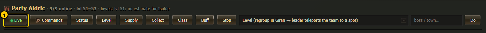

1. **Live** - the button with the green dot in the header of every party card on the [Parties](parties.md) tab. It opens
   `#/live/<leader>` for that party. The same button is on the [character page](character.md) (it opens the character's party).

You can also type the address yourself, for example `#/live/Aldric`. The page updates every 1.5 seconds while it is open and visible. It
pauses when the browser tab is hidden or the phone screen is off, and catches up at once when you come back.

## The whole page

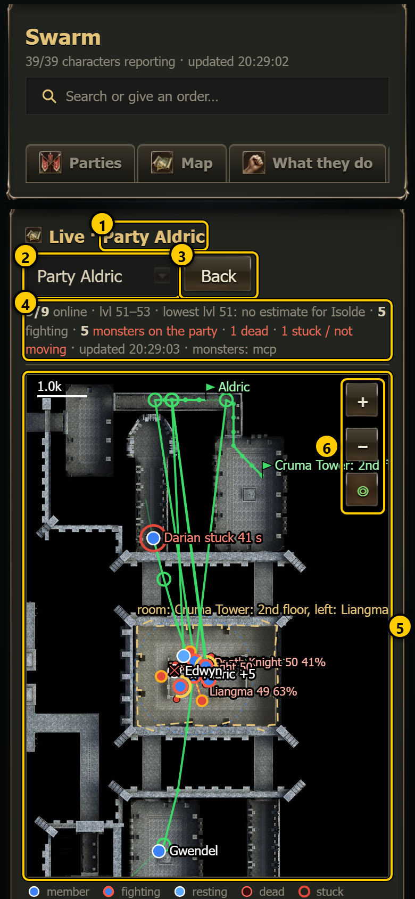 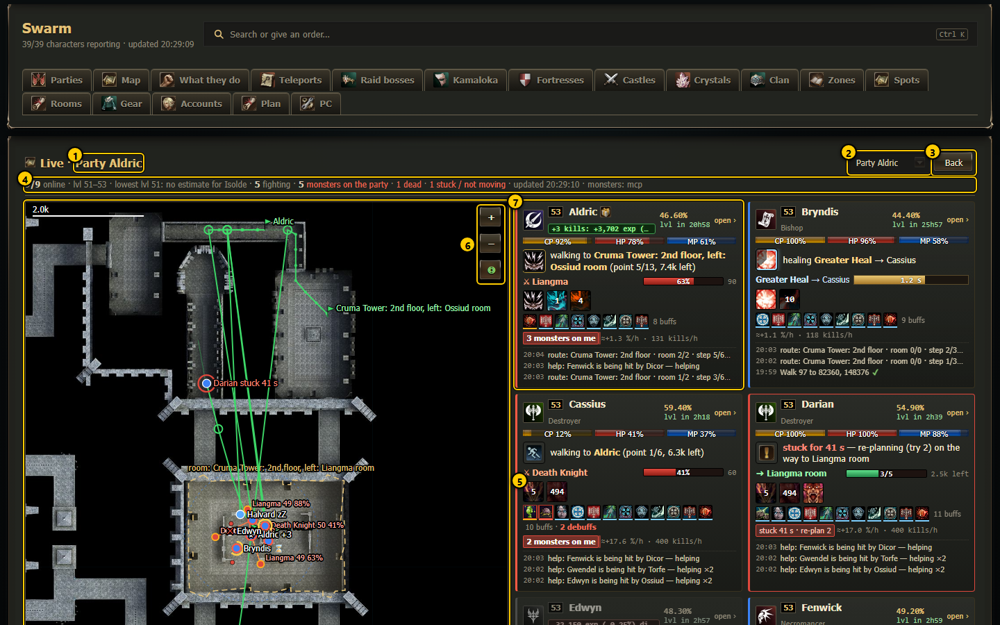

1. **Party name** - "Live · Party Aldric".
2. **Party menu** - switch to another party's live view.
3. **Back** - back to the page you came from (the Parties tab when there is none). The **Esc** key does the same.
4. **Summary line** - see [Top line](#top-line).
5. **Live map** - see [The map](#the-map).
6. **Zoom and follow** - **+** and **−** zoom in and out, **◎** follows the party.
7. **Member cards** - one per member, the leader first, then the others A to Z. See [Member cards](#member-cards).

**Layout per device:**

| Width | Layout |
|---|---|
| Phone (under 700 px) | The map on top (about half the screen high), the cards in one column under it. |
| Tablet (700-1279 px) | The map on top, the cards in a grid under it (two or more columns, each card at least 280 px wide). |
| Desktop (1280 px and wider) | A big map on the left (as high as the window; it stays in view while you scroll), the cards on the right in a grid: 2 columns at 1280-1599 px, 3 at 1920 px. On a 1920x1080 screen all 9 cards of a full party fit without scrolling. |

There is no separate scroll box for the cards: the whole page scrolls. Tablet and full HD sizes are described here but not shown in a
screenshot.

## Top line

The grey line under the title reads, from left to right:

| Part | Means |
|---|---|
| **7/9 online** | members that reported in the last 30 seconds / all members |
| **lvl 49–51** | lowest and highest level in the party |
| **5 fighting** | members in combat or with a monster target |
| **5 monsters on the party** (red) | how many monsters have aggro on a member (shown only when there are some) |
| **1 dead** (red) | dead members |
| **1 stuck / not moving** (red) | members that are stuck or should be walking but do not move |
| **updated 10:43:52** | the time of the last answer from the dashboard server |
| **monsters: mcp** | where the monster dots come from: *mcp* = the leader's game window through L2Swarm. *(8 s old)* is added when that list has not been refreshed for more than 6 seconds; *none* = no list |

If the dashboard server does not answer, the line says so in red ("dashboard server not reachable ..."). A wrong party name shows
"unknown party ...".

## The map

The map uses the same map art as the party map on the Parties tab: the outdoor map, or the dungeon floor the party is on. When you select a
member, the floor of that member is shown (useful when members are on different floors).

**The whole party** (with **◎** on, the map shows everyone):

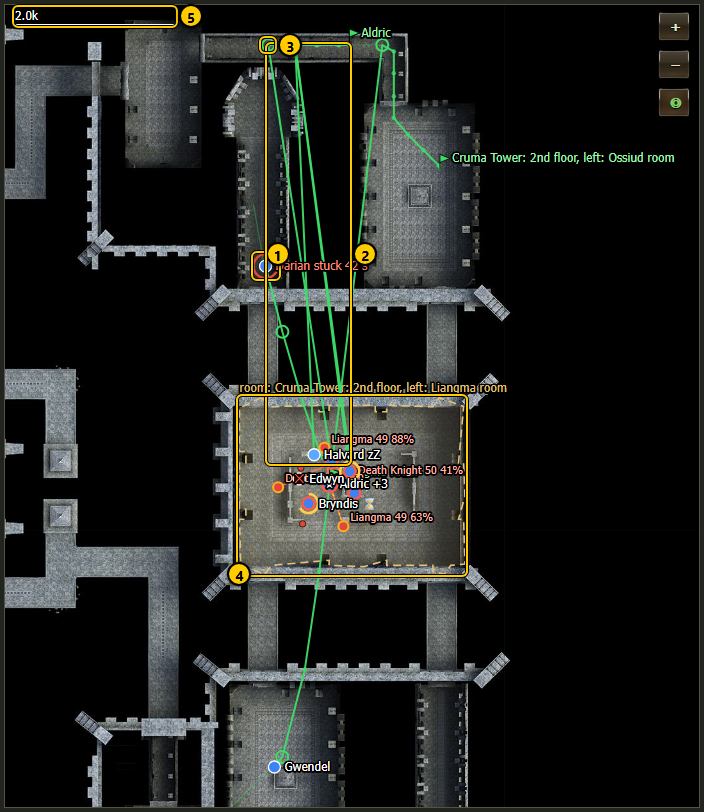

1. **Pulsing red ring** with "Darian stuck 41 s" - the member's walker reports that it is stuck. It re-plans the way by itself.
2. **Green line** - the planned walk (route) of a member, from the member to its goal. Small green dots are the waypoints; the part already
   walked is drawn faint.
3. **Green ring** - the next waypoint of that route.
4. **Gold dashed outline** - the leader's hunting room, field area or hunting square, with its name ("room: ...", "area: ...",
   "hunting: ...").
5. **Scale bar** - top left, in game units (1.0k = 1,000).

**Zoomed in** (tap **+** a few times):

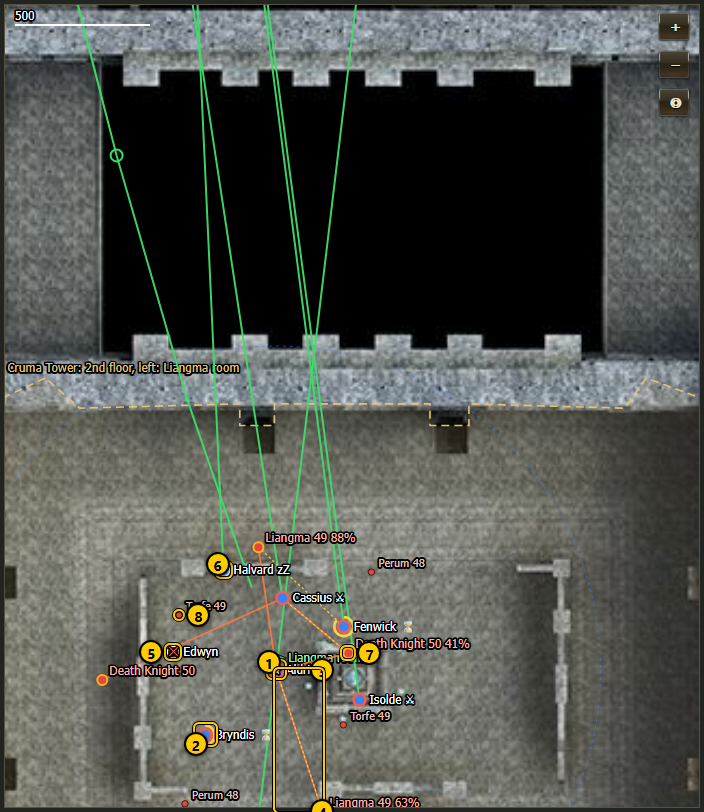

1. **Member dot** - a dot in the party colour. The leader's dot is a little bigger and has a **★**. A **red ring** around a dot =
   fighting.
2. **Gold arc** - a cast in progress, drawn on top of the dot. It fills up clockwise until the cast lands.
3. **Orange line** - from a monster to a member: that monster has **aggro** on that member (it targets or hits it).
4. **Yellow dotted line** - from a member to its current target.
5. **Dark dot with ✕** - a dead member.
6. **Blue dot** - a resting member (sitting to get HP / MP back), label "zZ".
7. **Monster with aggro** - a bigger red dot with an orange ring.
8. **Monster** - a small red dot. Names, levels and HP % show when you zoom in, and always for monsters with aggro.
9. **Green flag** - the goal of a route, with its name (here "Liangma room").

More symbols you may see:

| Symbol | Means |
|---|---|
| **Pulsing orange ring** "not moving 25 s" | the member should be walking (a route or a walk order) but has not moved for 20 seconds or more. The dashboard notices this itself, so it also works when the walker does not report "stuck". |
| **Grey dot** "(offline)" | the member has not reported for more than 30 seconds |
| **Purple monster dot** | a monster that is held by crowd control (sleep, root ...) |
| **White dashed outline** "chosen: ... · travelling" | a room or area you chose for the party on the dashboard, which the party has not reached yet |
| **Thin dashed circle** in the party colour | the leader's combat range |
| **Thin dashed line** to a small ring | a plain walk to a point (no route) |
| **Yellow dashed line** "escape: ..." | the way a member runs while it escapes from a fight |
| **Gold dashed circle** "♛ <boss>" | the spawn of the raid boss the party is hunting (raid hunt) |
| Name labels | next to each dot. Close members share one label ("Aldric, Cassius", "Cassius +2"). A label can end with **⚔** (fighting), **⌛** (casting), **zZ** (resting). Stuck, dead, escaping and selected members always get their own label. |
| **far away: ...** (bottom of the map) | members more than 20,000 game units from the leader, with the distance |

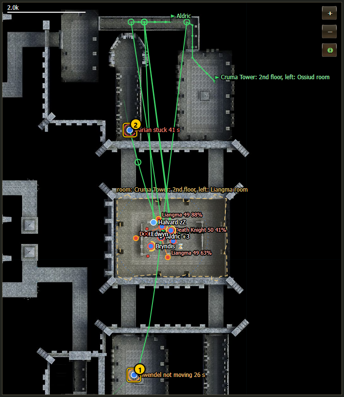

1. **Orange ring** - not moving (noticed by the dashboard).
2. **Red ring** - stuck (reported by the walker).

**Moving around the map:**

- The map is **idle** until you click or tap into it. While idle, the mouse wheel and a one-finger swipe scroll the page as usual (a short
  hint says "Ctrl + scroll or click the map to zoom it"; on a Mac "⌘ + scroll"). Ctrl / ⌘ + wheel and a two-finger pinch zoom it even
  while idle.
- Click or tap the map to make it **active** (gold outline; on a phone a hint says "Map active: drag to move, two fingers to zoom. Tap
  outside the map to scroll the page."). Now drag moves it and the wheel zooms. Clicking outside the map, the mouse leaving it or
  scrolling elsewhere makes it idle again.
- **+** / **−** zoom in and out at any time.
- **◎** (green when on) = **follow the party**: the map keeps every member (within 20,000 of the leader), their next waypoints, the
  monsters with aggro and the hunting area in view. Moving or zooming by hand turns it off; tap **◎** to turn it on again.
- **Tap a member dot** to select it (tap again to unselect). Its card gets a white frame and scrolls into view, and a line at the bottom
  of the map says what it does, for example "Darian: stuck for 41 s — re-planning (try 2) on the way to Liangma room".
- **Tap a monster** to see its name, level, HP, who it has aggro on and whether it is aggressive. Tap empty ground to clear.

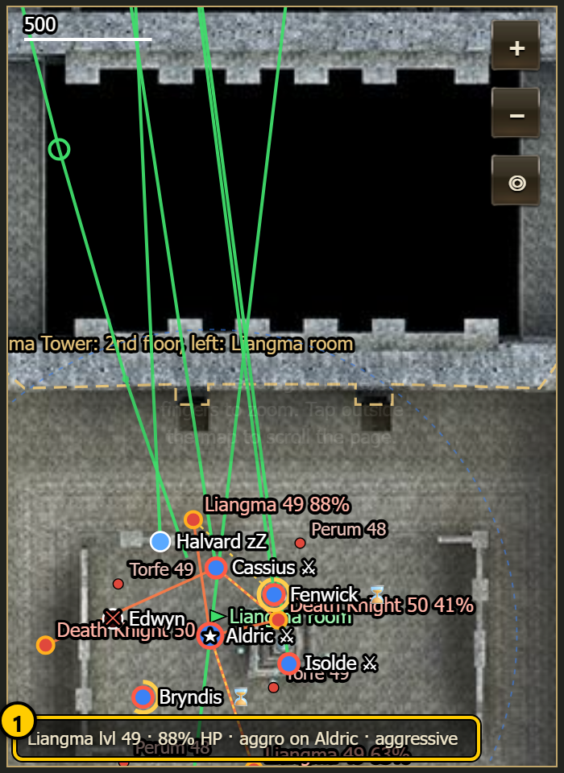

1. **Monster info** - "Liangma lvl 49 · 88% HP · aggro on Aldric · aggressive".

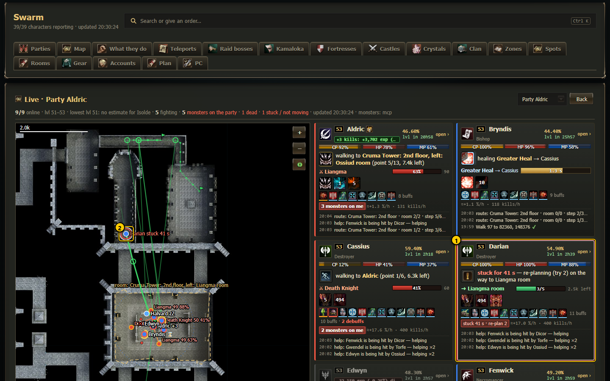

1. **Selected card** - white frame (tapping a card selects the member too; on screens narrower than 1280 px the map scrolls into view).
2. **Highlight** on the map - a white circle around the dot.

**Legend and help:** under the map is a small legend of the symbols, and **What does this mean?** opens a short explanation of every
symbol.

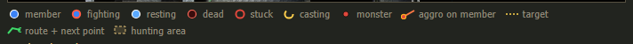

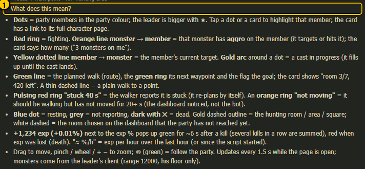

1. **What does this mean?** - tap to open or close the help text.

The monsters come from the leader's game window (everything within 12,000 game units, on his floor only, so monsters on the floor above
or below are not mixed in). Each member also reports the monsters that target or hit it, so aggro lines show even when the leader's list
is missing.

## Member cards

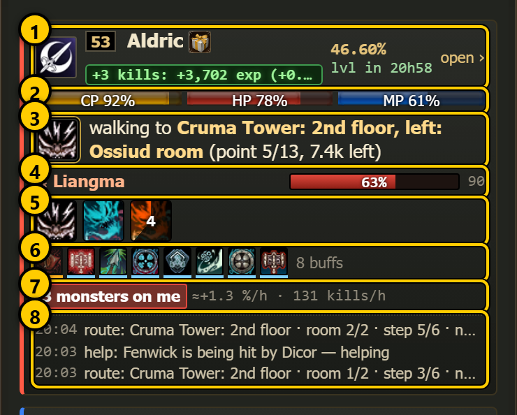

The cards are animated, in the same style as the member cards of the [raid live view](raid-live.md). From top
to bottom (rows that have nothing to show are left out):

1. **Header** - class icon, level, name, **★** for the leader, class (or the exp pop-up), **exp %** in the current level (2 decimals) with the
   [next level estimate](character.md#next-level-estimate) under it (*lvl in 3h09*, *no exp 22m*), and **open ›** (the member's full [character page](character.md)).
2. **Bars** - CP, HP and MP ("CP ?" until the member reports it). They slide smoothly to the new value. The card flashes **red** when the
   member lost 3 % HP or more since the last update and **green** when it was healed. The frame turns orange below 60 % HP and red below
   30 %.
3. **What it does right now** - the icon of the skill it casts, with a **sweep that fills the icon** until the cast lands; the icon of
   a skill it just used (with a short gold glow); otherwise a small activity icon. Next to it one line in plain words (list below, at most
   2 lines).
4. **Target** - "⚔ monster" with the monster's **HP bar** and distance (♛ in gold for a raid boss). When it has no target but walks a
   route: "➜ goal", a green **progress bar** (point 3/6) and the distance left.
5. **Key skills** - up to 7 skills it used or has on cooldown lately (potions and scrolls left out), with the game's dark **cooldown
   sweep** and the seconds left. Hover for the name.
6. **Buffs and debuffs** - small icons, debuffs first (red frame), then the buffs that run out first, each with a thin **time bar**
   (orange and blinking in the last minute); up to 14 icons, then "+n", then "8 buffs · 2 debuffs". An older script only sends the count
   and the debuff names (chips).
7. **Chips** - see the table below.
8. **Last 3 things it tried** - time, what, and **✓** done, **✗** failed, **…** still running. Hover a line (desktop) for the whole
   text and what the member was doing at the time.

A **cast bar** appears between rows 3 and 4 while it casts: the skill (or "Teleport .giran"), its target and a bar with the **time left**;
afterwards it stays a few seconds in green (landed) or red (interrupted, refused). Rows that have nothing to show are left out.

With *reduce motion* on in the device settings, nothing pulses, blinks or slides; the sweeps and bars still show the progress.

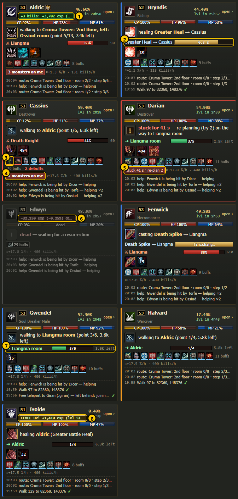

1. **Exp pop-up** - three kills in a row, summed (see [Exp pop-ups](#exp-pop-ups)).
2. **Cast bar** - Bryndis heals Cassius; the bar shows the time left.
3. **Debuff icons** - red-framed icons first (here poison and slow), then the buffs.
4. **"2 monsters on me"** - red, pulsing chip; hover it for the monster names and levels ("(hits)" = it hits, not only targets).
5. **Stuck chip** - "stuck 41 s · re-plan 2"; the card also gets a red frame.
6. **Lost exp** - red pop-up "−32,150 exp (−0.25%) died".
7. **Route progress** - "➜ Liangma room", point 3/6, 3.6k left.
8. **LEVEL UP!** - gold pop-up.

**Chips:**

| Chip | Means |
|---|---|
| **3 monsters on me** (red, pulsing) | monsters with aggro on this member; brighter when one of them hits it |
| **stuck 41 s · re-plan 2** (red) / **not moving 25 s** (orange) | the walker reports stuck / the dashboard sees no movement while it should walk |
| Buff icon + number | (older script only) long buffs on the member (red below 10); hover for the time left on the longest buff |
| Purple chips | (older script only) debuffs on the member (poison, slow ...) |
| **SoE 1** (red) | fewer than 2 Scrolls of Escape |
| **shots 80** (red) | 100 soulshots / spiritshots or fewer |
| **≈+1.3 %/h · 131 kills/h** | experience per hour and kills per hour, over the last hour (or since the script started, at least 3 minutes); hover for the exp points. This one counts deaths in; the next level estimate leaves them out |

**Card colours:** the left edge has the party colour (red when 2 or more monsters are on the member). Dead = grey. Not reporting =
faded. Stuck = red frame. Selected = white frame. Tap a card (not its link) to select that member on the map; on a phone the map scrolls into view.

**What it does right now** - the first that fits, in this order:

| Line | When |
|---|---|
| *not reporting for 5 min — offline or its script stopped* | no report for more than 30 seconds |
| *dead — waiting for a resurrection* / *dead — no healer alive* | dead (the second when no healer of the party is alive and reporting) |
| *escaping (running to a safe spot) — why · round 2/5* | it escapes from a fight; the phase can also be *waiting until nothing hits*, *Scroll of Escape*, *.townname*, *waiting for the leader*, *crowd control* |
| *casting Death Spike → Liangma (0.6 s left)* | a cast is running; heals say *healing*, a `.townname` says *teleporting:* |
| *stuck for 41 s — re-planning (try 2) on the way to Liangma room* | its walker reports stuck |
| *healing Aldric (Greater Battle Heal)* | it cast a heal on a teammate in the last 4 seconds |
| *Trading with Aldric: giving 30 Healing Potion (window open, putting the items in · 12 s)* | a trade; the part in brackets is where it stands: *walking over to ...*, *asking ... to open the trade (try 2/5)*, *waiting for ... to open the trade*, *window open ...*, *confirmed, waiting for ... to confirm*, *done ✓* (stays 30 s), *failed: <reason>*. "(fund round)" for an adena round. An older script only shows *trading with X (giving / receiving)*. |
| *waiting for its turn at Helvetia — 2nd in line, ~14 s* | a team step of the leader where the members take turns (selling, buying ...) |
| *waiting while Aldric trades with Bryndis (supply hand-out)* | the leader hands things out one by one; someone else's turn |
| *ready — waiting for the others (selling at Helvetia)* / *step failed — ...* | its part of a team step is done |
| *selling at Helvetia (item 3/7)* | selling at a shop |
| *buying supplies — ...* | a supply run or a shop visit |
| *teleporting — ...* | a teleport, `.townname`, escape or unstuck started in the last minute |
| *walking to Liangma room (point 3/6, 3.6k left)* | walking a route; *· not moving 25 s* is added when it does not move |
| *fighting Liangma (63% HP, 90 away) · Aggression* | it has a monster target (plus the skill it just used) |
| *used Might on Cassius* | it used a skill in the last 4 seconds |
| *in combat* | in combat, no target known |
| *resting (HP 58%, MP 21%)* | sitting to regain HP / MP |
| *walking to the grocer (Helvetia) (1.2k left)* | walking one of the recorded Giran town routes |
| *the walk step from its intent log (2.4k left)* | a plain walk order (walk, move, NPC visit, rescue, regroup) |
| *team step: selling at Helvetia* | a team step without anything more specific |
| *gather team ...* | the leader waits for the team |
| *waiting for Bryndis (1.2k away), Cassius (dead)* | the leader waits for the team (with how far each one is) |
| *waiting at a checkpoint for ...* | the leader waits at a checkpoint of a team walk |
| *before .giran: ...* | what the leader still waits for before a teleport |
| *waiting for orders* | idle after `!stop` |
| *helping Cassius — Liangma is hitting them* | it helps a teammate that is being hit |
| *hunting pair Aldric + Cassius: ...* | [hunting pairs](../live/party-live.md) are on |
| *in a team step with Aldric — waiting for the next step* | an older script inside a team step |
| *following Aldric (300 away)* | a member following its leader |
| *leading: hunting at Sea of Spores: area 15 · 14 kills in 5 min* | the leader while hunting |
| anything else | its current task, or *idle* |

## Exp pop-ups

Every member reports each change of its experience. The dashboard turns that into a small pop-up next to the **exp %**:

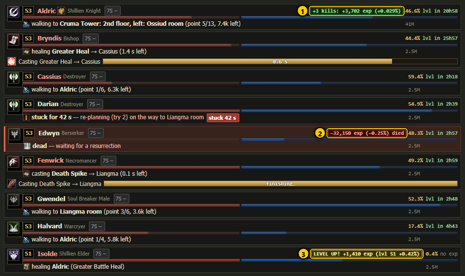

1. **Gain** - green "+3 kills: +3,702 exp (+0.029%)". Kills less than 6 seconds apart are added up ("+3 kills: ...").
2. **Loss** - red "−32,150 exp (−0.25%) died". Exp was lost (by death; "died" is added when a death caused it).
3. **Level up** - gold "LEVEL UP! +1,410 exp (lvl 51 +0.42%)". The % is then the part of the new level.

Details:

- The **%** is the share of the current level: 2 decimals from 0.1 %, 3 or 4 decimals for smaller amounts.
- A gain right after a resurrection ends in "res" (exp given back by the resurrection).
- The pop-up shows for about 6 seconds after your browser first sees the change, floats up and fades. A change older than 15 seconds
  when your browser first sees it is not shown (so opening the page does not replay old kills). Nothing shows for a member that is not
  reporting.
- Hover the pop-up with the mouse to see each single change with its time and the monster names.
- With *reduce motion* switched on in your phone or computer settings, the pop-up does not move, it only fades.
- Where it shows: on the live cards (it takes the place of the class name, so the name stays readable), on the
  [Parties](parties.md) tab member rows (it floats to the left of the exp %) and on the [character page](character.md).

The **≈ %/h** chip on the cards adds all gains and losses of the last hour.

## How to ...

**Watch what a party does in a dungeon**

1. Open the [Parties](parties.md) tab and tap **Live** on the party card.
2. Leave **◎** on (green): the map follows the party.
3. Read the cards from the top: the leader first. Red chips and red frames need attention.

**Find out why a member does not come**

1. Look for a red ring ("stuck") or an orange ring ("not moving") on the map, or a red line in the summary.
2. Tap the member's dot. The line under the map and its card say where it is going and for how long it is stuck.
3. Check **Last 3 things it tried** on its card for a failed step (✗).
4. To act, open its full page with **open ›** and use the orders there (see the [character page](character.md) and the
   [override menu](override.md)).

**See which monster is on whom**

1. Find the orange lines on the map: each goes from a monster to the member it is on.
2. Tap a monster: the line under the map lists everyone it has aggro on.
3. The red chip "n monsters on me" on a card lists the names.

## Notes

- The page reads one batch per refresh from the dashboard server (`/api/live?party=<leader>`): every member's live state file
  (`Logs/swarm_state_<name>.json`, written by `swarm.js` every 2 seconds), the last steps of its intent log (`Logs/intent_<name>.log`) and the
  monsters around the leader from L2Swarm (cached for 3 seconds). Buff icons and key-skill cooldowns come from the same state files (fields `buffList` and `ov`).
- Exp pop-ups, aggro lists, CP, debuffs, "healing X" and target lines need a `swarm.js` that reports them. Routes and "stuck" need a
  walker that publishes its route. With an older script the page still works; those parts are just empty.
- The plain-words activity line comes from `Dashboard/activity.js`, which the Parties tab member rows and the character page use too, so
  all three say the same thing.
- Nothing on this page sends anything to the game.
