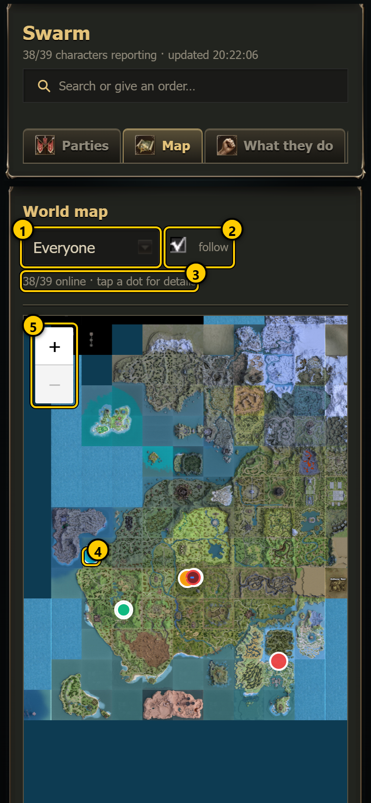
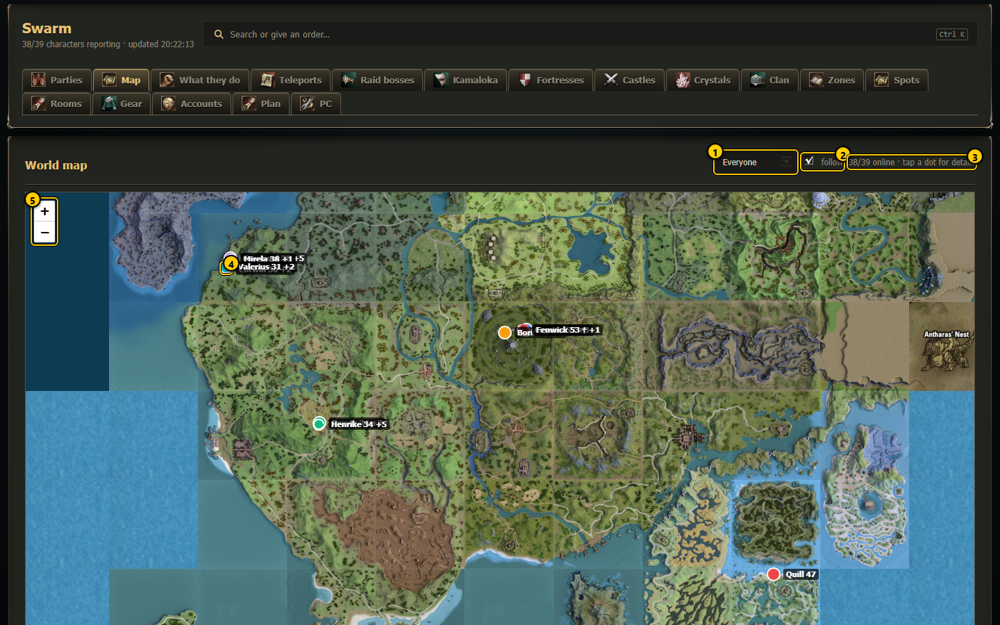
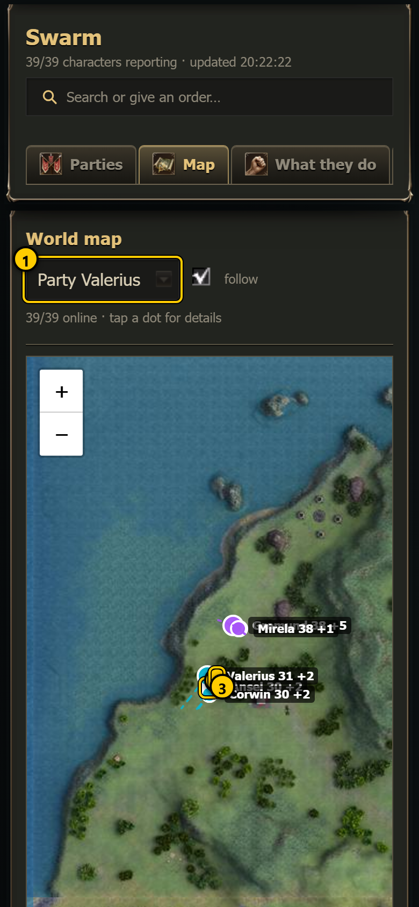
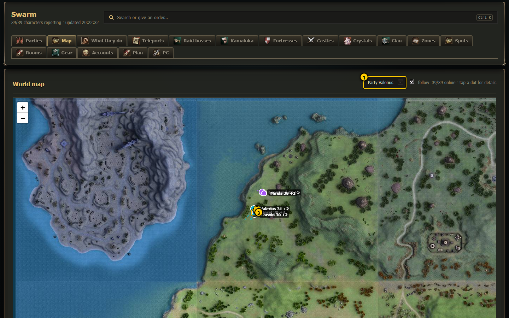
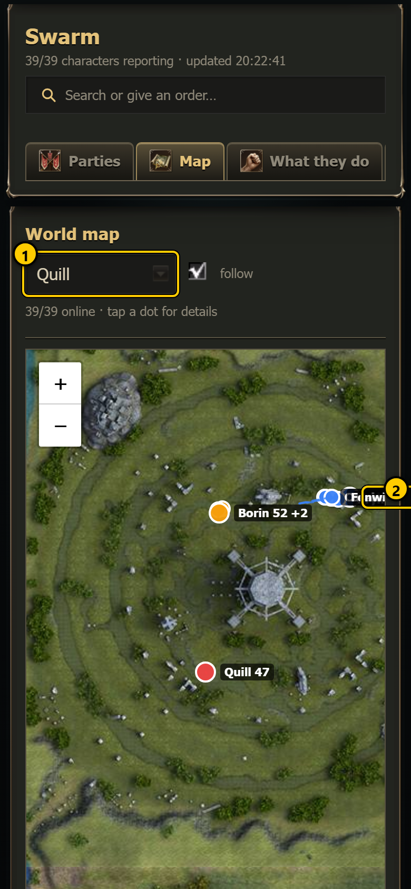
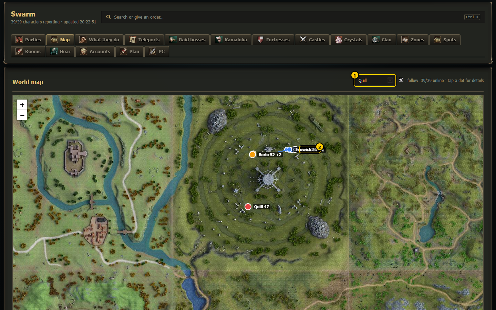
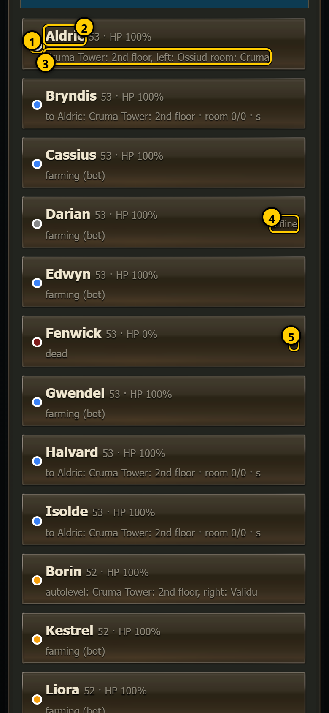
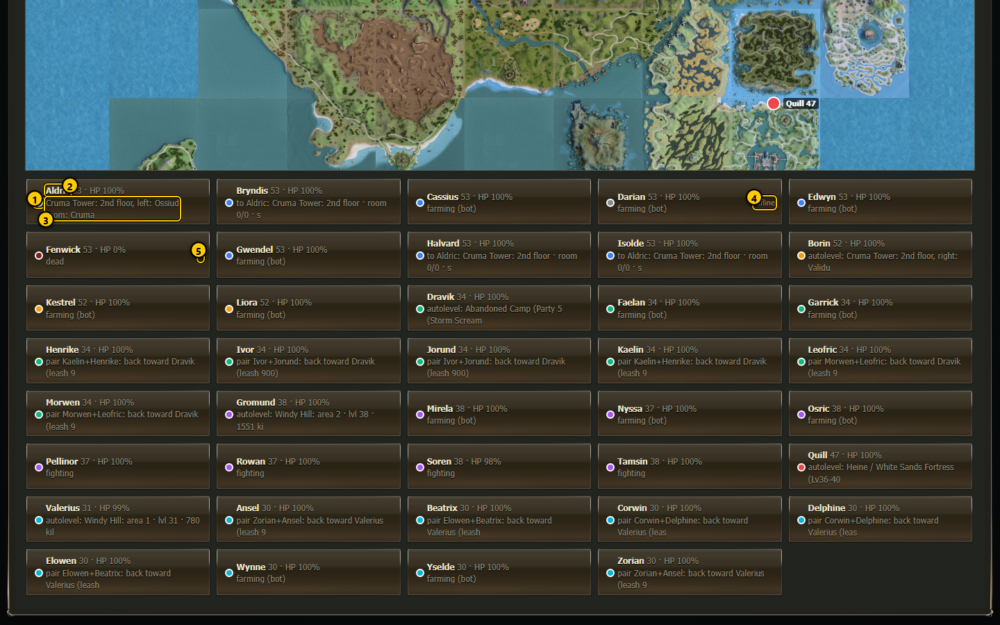

# Map  (`#/map`)

The world map shows **every character as a dot** on the Lineage 2 world map, coloured by party, with a dashed line to where each one is
walking. Use it to see at a glance where the parties are, whether someone was left behind, and who is offline or dead. Below the map is a
list of all characters; tapping one centres the map on it.

The map is the game's own world map art (one tile per game region, from your `Maps` folder). It is drawn with the Leaflet map library,
which the page loads from the internet (cdnjs). Without internet the tab says *map library could not load (no internet?)*. Positions come
from the script state of each character (`Logs/swarm_state_<Name>.json`) and refresh every 4 seconds.

## The map

 

1. **Keep in view** - which characters the map keeps in view: `Everyone` (all online characters), `Party <leader>`, or one character by
   name.
2. **follow** - when ticked, the map moves by itself to keep that choice in view as the characters move. Dragging the map unticks it,
   so you can look around; picking something in the menu ticks it again.
3. **Online count** - `38/39 online · tap a dot for details`: characters that reported in the last 30 seconds / all characters seen in
   the last 6 hours.
4. **Dot labels** - `Name level`. Characters standing within 300 game units of each other share one label: `Aldric 50 +8` means Aldric
   and 8 more stand there. Labels are hidden when you zoom far out.
5. **Zoom** - `+` / `−` buttons; you can also pinch (phone) or use the mouse wheel. Drag to move the map.

## One party in view, walk-target lines

 

1. **Party Valerius** picked in *Keep in view*: the map zooms to that party (here hunting in pairs, spread over a field).
2. **Character dot** - filled with the party colour (each party has its own colour; the same colours are used on the Parties tab and the
   character mini-map). The **party leader's** dot is larger.
3. **Walking to** - a dashed line in the party colour from a character to the place it is walking to (its current step, while that step
   has no result yet).
4. **Label** - name and level (`+n` when several stand together).

**Dot colours**

| Dot | Meaning |
|---|---|
| party colour, white ring | online, alive |
| larger dot | party leader |
| dark red with a red ring, label ends with ✝ | dead |
| grey, half transparent, label ends with `(offline)` | the script has not reported for more than 30 seconds |

Characters that have not reported for more than 6 hours are not shown at all.

**Tap a dot** to open that character's [character page](character.md).

## One character in view

 

1. **One character** picked: the map centres on it and zooms in.
2. **Its dot**.

## The list below the map

 

1. **Colour dot** - party colour; grey = offline, dark red = dead.
2. **Name · level · HP %**.
3. **Task** - the first 48 characters of what the character is doing.
4. **offline** - shown on the right for characters that stopped reporting.
5. **✝** - dead.

The list is sorted by party, leader first, then by name. **Tap a row** to keep that character in view: the map centres on it, *follow* is
ticked, and the page scrolls up to the map.

## Every control

| Control | What it does | Saved? |
|---|---|---|
| Keep in view menu | Everyone / Party X / one character | no (resets when the page reloads) |
| follow | keep the choice in view while they move | no |
| Drag / zoom | look around (unticks follow) | no |
| Tap a dot | opens the character page | – |
| Tap a list row | centres the map on that character | no |

Nothing on this tab sends an order or changes a file.

## How to ...

**Find a character that was left behind**

1. Pick its party in *Keep in view*. A dot far away from the others stands out at once.
2. Tap the dot to open its page and read its story and timeline.

**Watch one character travel**

1. Tap its row in the list (or pick it in *Keep in view*).
2. Leave *follow* ticked: the map pans along as it moves; the dashed line shows where it is going.

## Notes

- The map shows the surface. For characters underground (catacombs, towers) use the [character page](character.md#where-it-is-live-map)
  live map, which switches to the right floor.
