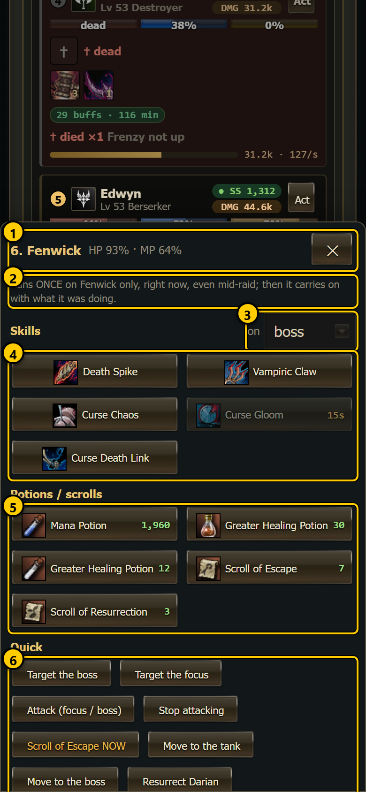
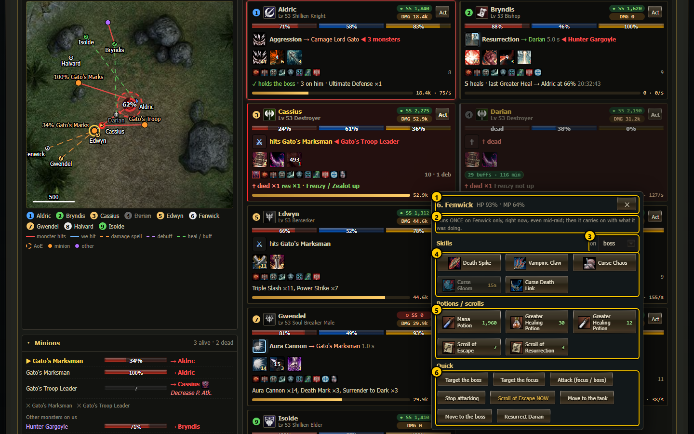
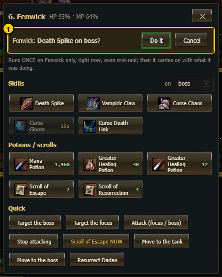
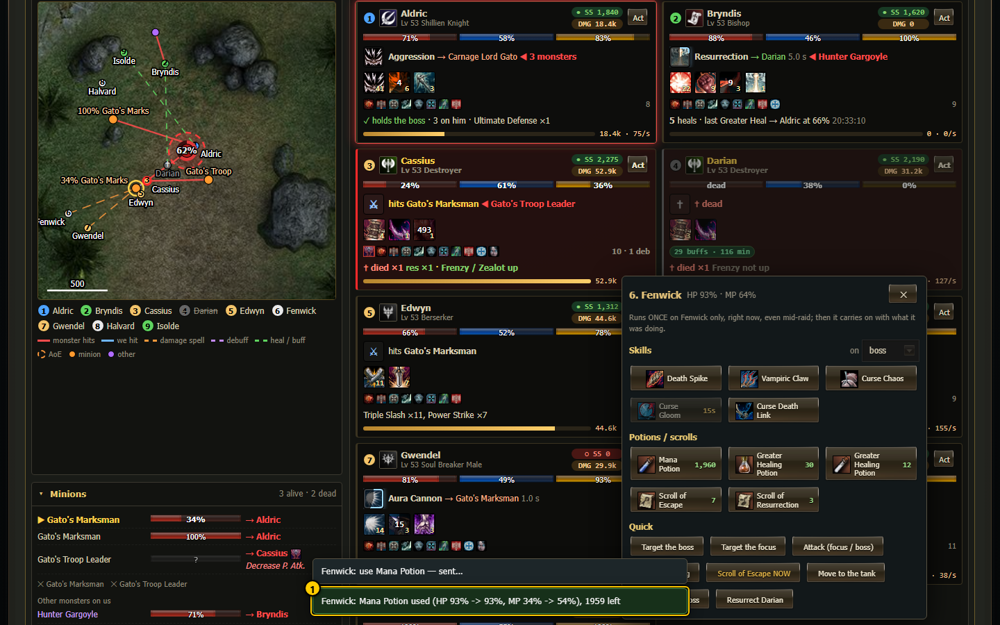
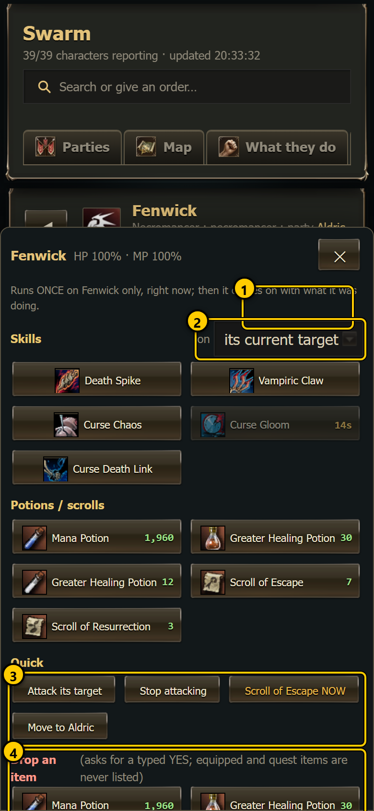
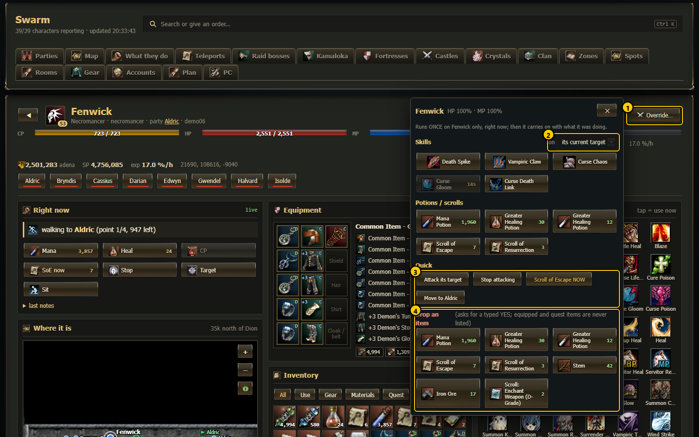
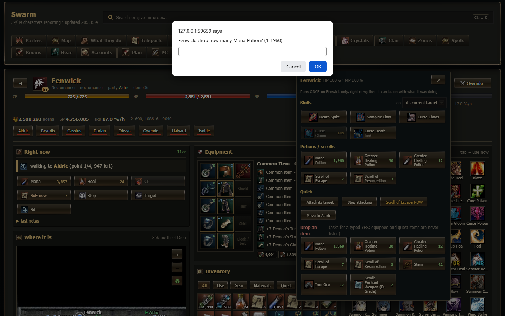

# Override menu (Act / Override…)

The **override menu** makes **one** character do **one** thing **once**, right now: cast one of its skills, use a potion or a scroll, target,
attack, stop, walk to someone, resurrect a dead teammate, or drop an item. It works at any time, also in the middle of a raid. After the
action the character carries on with what it was doing. Use it when the automatic behaviour is not enough, for example a healer should heal
someone now, a mage is out of mana, or someone must leave with a Scroll of Escape.

It is a small panel for one character. It opens from:

| Where | Button | Panel |
|---|---|---|
| [Raid live view](raid-live.md) | **Act** on each team card | raid set: targets *boss* and *focus*, "Target the boss", "Move to the tank" ... |
| [Kamaloka live view](../live/kamaloka-live.md) | **Act** on each team card | character set (no boss / focus targets), with **Drop an item** |
| [Character page](character.md) `#/char/<Name>` | **Override…** in the header | character set, with **Drop an item** |

The same orders also exist as commands in the [command center](command-center.md) (category **Fight**, "Override: ...") and in the
[command reference](../05-commands.md) (`!ov ...`).

## The panel in a raid

 

1. **Header** - "6. Fenwick" (the member's number on the raid map and its name), its HP and MP (and "dead"), and **✕** to close.
2. **Note** - "Runs ONCE on Fenwick only, right now, even mid-raid; then it carries on with what it was doing." When the character has not
   reported its own skill and item list yet, the note adds "Skill / item lists are a guess until its swarm.js reports them."
3. **on** - who a skill is cast on: *boss*, *focus* (the minion the team kills now), *self* or a living teammate. On the character page
   the first choice is *its current target*.
4. **Skills** - its active skills (toggles left out). A dimmed button with seconds = on cooldown ("ready in 12 s" when you hover);
   hover also shows the MP cost.
5. **Potions / scrolls** - potions, elixirs, Scrolls of Escape / Resurrection, antidotes, herbs ... in its bag, with the count. A
   button with count 0 is greyed out.
6. **Quick** - one-tap actions (list below).

The panel floats next to the button on wide screens (640 px and wider) and slides up from the bottom as a sheet on phones. It refreshes
every second. Close it with **✕**, the **Esc** key or a tap outside it. In a raid it also closes by itself when the raid ends.

## Every action

**Quick buttons:**

| Button | Raid | Character page / Kamaloka | What the character does |
|---|---|---|---|
| **Target the boss** | yes | - | selects the boss |
| **Target the focus** | yes | - | selects the team's focus target (the boss when there is none) |
| **Attack (focus / boss)** | yes | - | attacks the focus target, else the boss |
| **Attack its target** | - | yes | sends `attack` without a target: the character attacks the team's focus target, else the boss. Outside a raid or Kamaloka there is neither, so it answers "no monster "focus" in sight". |
| **Stop attacking** | yes | yes | stops moving and drops its target (its own routine may pick one again) |
| **Scroll of Escape NOW** | yes | yes | reads a Scroll of Escape (any kind in its bag). A hit can interrupt the cast. The party does not follow. |
| **Move to the tank** | yes | - | walks next to the tank |
| **Move to the boss** | yes | - | walks next to the boss |
| **Move to <teammate>** | - | yes | walks next to the first teammate in the list |
| **Resurrect <name>** | one per dead teammate | one per dead teammate | its resurrection skill on that teammate; a Scroll of Resurrection only when it has no res skill |

**Skill buttons** cast that skill once on the target chosen in **on**. **Potion / scroll buttons** use that item once.

**What the character checks before it acts** (it refuses and says why):

- it is dead (only *stop* works then);
- a skill it has not learned, a skill on cooldown, or not enough MP;
- a target that is not in sight;
- no such item in the bag;
- a walk to someone more than 6,000 game units away ("too far for an override walk");
- a resurrection on a teammate that is not dead, or no res skill and no Scroll of Resurrection.

It always stands up first if it is sitting.

## Confirm and result

1. **Confirm line** - tapping any action does not send it yet. A yellow line asks "Fenwick: **Death Spike on boss**?" with
   **Do it** and **Cancel**.

After **Do it**:

1. A toast at the bottom says "Fenwick: ... — sent…".
2. The order goes to that character only, as the swarm command `!ov <name> <action>`.
3. The dashboard waits up to 25 seconds for the character's answer and shows it as a toast: green = done, red = refused or failed. Without
   an answer: "no answer from its window yet (it may still run)". If the order could not be sent at all: "not sent — <reason>".

1. **Result toast** - for example "Fenwick: Mana Potion used (HP 93% -> 93%, MP 34% -> 54%), 1959 left". A cast answers like
   "Death Spike → Carnage Lord Gato cast (MP 64% -> 58%)".

Each toast stays about 6.5 seconds.

## On the character page (Drop an item)

 

1. **Override…** - the button in the character page header.
2. **on** - *its current target*, *self* or a teammate.
3. **Quick** - the character page set (attack its target, stop, Scroll of Escape, move to a teammate, resurrect).
4. **Drop an item** - opens the list of its bag. Equipped items and quest items are never listed (and the character refuses to drop them).

**Dropping is destructive.** It asks twice, with browser dialogs:

1. "drop how many <item>? (1-n)" - only for stacks; the whole stack is suggested.
2. "<name>: DROP <item> ×n on the ground. This cannot be undone. Type YES to do it." - only the exact word **YES** sends it. Anything else
   (or Cancel) shows "cancelled" and sends nothing.

The dropped item lies on the ground where the character stands.

## How to ...

**Give a mage a Mana Potion in a raid**

1. On the [raid live view](raid-live.md), tap **Act** on the mage's card.
2. Tap **Mana Potion** under Potions / scrolls.
3. Tap **Do it**. The toast shows the MP before and after.

**Make the healer heal the tank now**

1. **Act** on the healer's card.
2. Set **on** to the tank's name.
3. Tap the heal skill (it must not be dimmed), then **Do it**.

**Get a stuck character out with a Scroll of Escape**

1. Open its [character page](character.md) and tap **Override…**.
2. Tap **Scroll of Escape NOW**, then **Do it**. Keep in mind that a hit interrupts the scroll, and that the party stays where it is.

## Notes

- One action = one swarm command `!ov <name> <action> ...` sent to that character (through L2Swarm, or through the file channel when
  L2Swarm does not answer). Party chat reaches the whole party, but only the named character's window acts.
- The character writes its answer to `Logs/override_<name>.json` and to its notes as "user override (...)", so it also shows in its
  recent steps on the character page.
- The skill and item lists come from the character's own report in its live state file (`ov`: skills with ready / cooldown, potions and
  scrolls with counts, the bag for dropping). Until a character reports them, the panel shows a guess: the skills it used most in the
  raid and the usual potions and scrolls, without counts.
- The `!ov` commands: `cast <skill id> [boss | focus | tank | self | <teammate> | <object id>]`, `use <item id or object id>`, `soe`,
  `drop <object id> [count]`, `target <...>`, `attack [<...>]`, `stop`, `move <tank | boss | teammate>`, `res <teammate>`.
