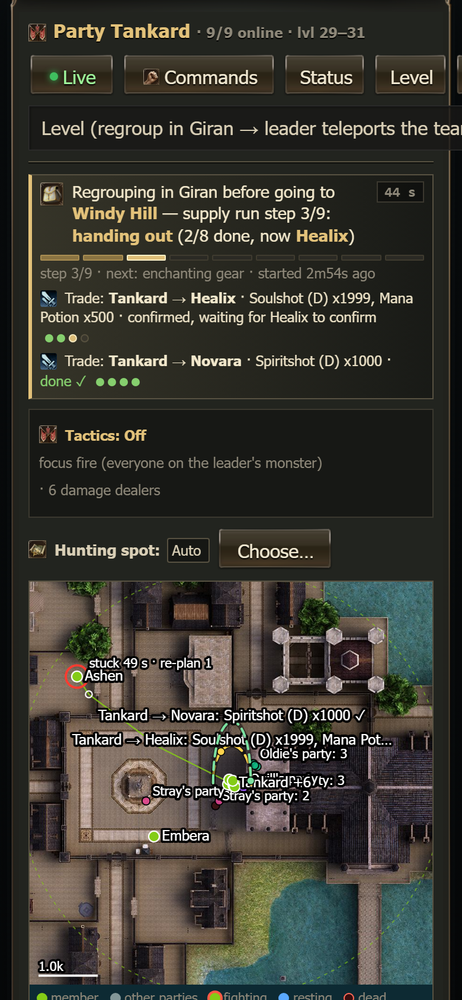
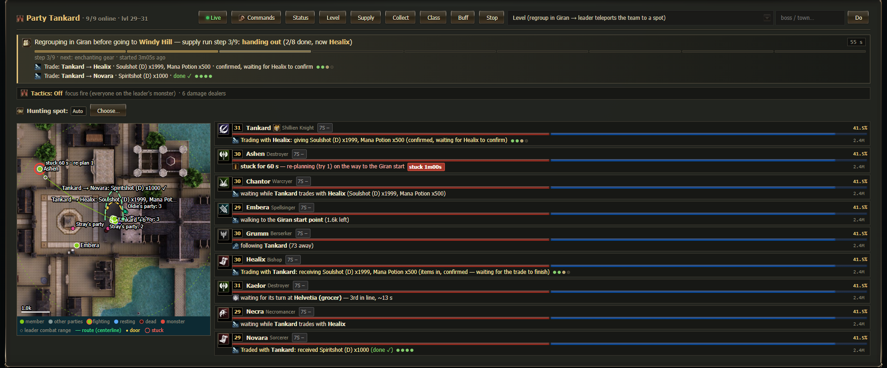
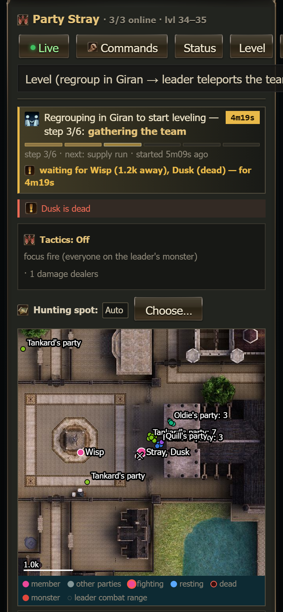
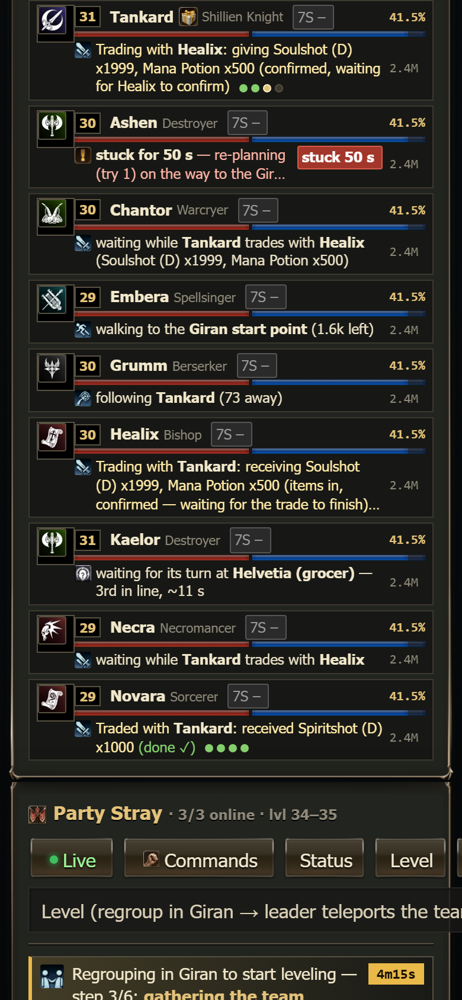
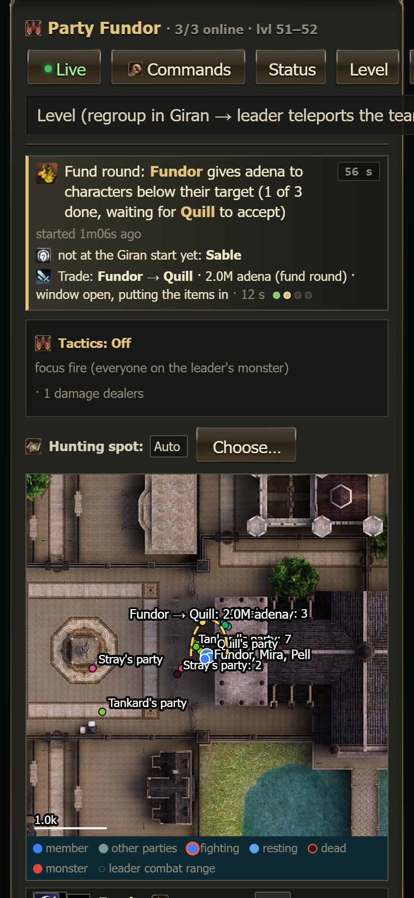
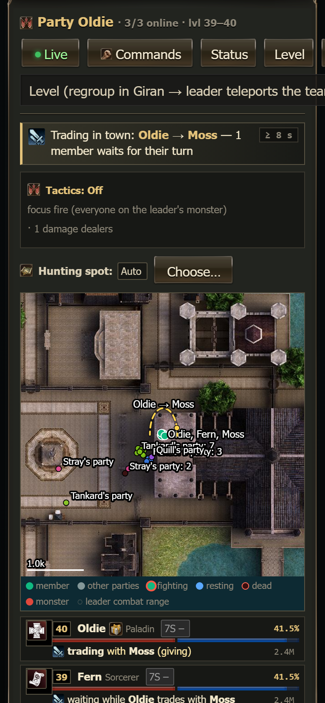

# Party status on the Parties tab

Every party card on the [Parties](parties.md) tab starts with a **status banner**: one sentence that says what the whole party is doing
right now and why, a step bar, how long the current step has taken and what comes next. Every member row says in plain words what that
character is doing, and trades are shown with both sides. So when the party seems to "just stand" in Giran, the card tells you that it is
in the middle of a supply run, who is trading with whom, and who it is waiting for.

The banner and the rows only show things. They never send an order.

## The status banner

 

1. **Icon + sentence** - what the party does, in words. The names and the place are in gold. Examples:
   - *Regrouping in Giran before going to Windy Hill — supply run step 3/9: handing out (2/8 done, now Healix)*
   - *Supply run in Giran — step 2/10: buying at Helvetia (grocer) — Soulshot (D) x4000, Mana Potion x1500*
   - *Fund round: Tankard gives adena to characters below their target (1 of 3 done, waiting for Healix to accept)*
   - *Collecting adena: members hand what is above their keep to Tankard — step 3/3: handing adena over (1/4 done)*
   - *Travelling to Windy Hill: area 1 — step 4/4: walking to the area — 2400 to the centre*
   - *Hunting Windy Hill: area 1 · 24 monsters here · rotating 2 areas · 25 kills in 5 min*
   - *Raid: Serpent Demon Bifrons — clearing the area (4 left, now Turek Orc Warlord)*
   - *Waiting for orders since 21:26*
2. **Time box** (top right) - how long the current step has taken. It turns **yellow** when the step takes unusually long (see
   [Warnings](#warnings)). A **≥** in front (*≥ 40 s*) means the dashboard only knows how long it has seen this state, not when it started.
3. **Step bar** - one segment per step of the run: done steps dark gold, the current step bright gold (it pulses gently), the rest grey.
   Hover a segment on a desktop for its name.
4. **Step line** - *step 3/9 · next: enchanting gear · started 3m06s ago*: where the run stands, the next step and how long the whole run
   has been going.
5. **Trade lines** - every trade in the party: *Trade: Tankard → Healix · 2.0M adena · window open, putting the items in* with four
   dots (asked → window open → confirmed → done). A finished trade stays for about 30 seconds with **done ✓** (green) or **failed: …** (red).
6. **Team step line** - while the leader runs a step that everyone must answer: *Team step reporting what it needs: 7/9 ready — waiting
   for Wisp (1.2k away), Dusk (dead)*.
7. **Waiting line** - who the leader waits for before he moves on (gathering the team, a checkpoint, before a teleport).

### The steps of each run

| Run | Steps |
|---|---|
| Supply run | regrouping in Giran · everyone reports what it needs · buying at Helvetia · handing out · enchanting gear · unloading loot to a teammate · members sell at Helvetia, one after another · gear upgrades in the shops · dyes and symbols · collecting adena above their keep |
| Giran regroup | teleporting to Giran · walking to the Giran start · gathering the team · supply run (when one is due) · handing adena to other teams · Seven Signs sign-up |
| Trip to a hunting spot | regrouping in Giran · gathering the team · teleporting · walking to the area |
| Collect adena | asking who has adena · gathering · handing adena over |
| Fund round | walking to the Giran start · handing out (n of m, who it waits for, who has not come to the start yet) |

A supply run that starts inside a Giran regroup (or a regroup inside a trip) shows the inner run with the outer one in front:
*Regrouping in Giran before going to Windy Hill — supply run step 3/9 …*.

### Warnings

When a step takes longer than usual the banner gets a yellow edge, the time box turns yellow and a line under it says why, when the
dashboard knows: *waiting for Wisp (1.2k away), Dusk (dead) — for 4m20s*. Other reasons: a trade that does not move on (*trade Tankard →
Healix stays at "asking Healix to open the trade (try 3/5)"*), members that do not move (*not moving: Ashen*), or simply *taking longer
than usual*.

Usual times: 3 minutes for most steps; buying 5 minutes; enchanting 6; walking to the area 7; members selling and dyes 10; gear upgrades 15;
the fund round 2.5. Hunting and waiting for orders never warn.

## Member rows

The line under the HP/MP bars says what the character does, with an icon, in up to two lines (three for a trade):

| Line | Meaning |
|---|---|
| *Trading with Tankard: receiving 2.0M adena (window open, waiting for the items)* | it is in a trade; the other side, what, and where the trade stands. The four dots: asked, window open, confirmed, done. |
| *Traded with Tankard: received Spiritshot (D) x1000 (done ✓)* | a trade that just ended (about 30 seconds). |
| *waiting while Tankard trades with Healix (Soulshot (D) x1999)* | it is in the leader's team step, but someone else trades now. |
| *waiting for its turn at Helvetia (grocer) — 3rd in line, ~12 s* | members sell or shop one after another; it waits for its turn. |
| *ready — waiting for the others (selling at Helvetia)* | its part of the team step is done. |
| *walking to the Giran start point (1.6k left)* | it walks a recorded Giran route (grocer, warehouse, weapon shop, …). |
| *stuck for 48 s — re-planning (try 1) on the way to the Giran start* | its walker reports it is stuck; it tries a new path by itself. |
| *waiting for Wisp (1.2k away), Dusk (dead)* | the leader is gathering the team. |
| *following Tankard (73 away)*, *fighting Babbling Wind (70% HP, 80 away)*, *resting (HP 40%, MP 22%)*, *dead — waiting for a resurrection* | the usual states. |

**Chips** at the end of the line:

- **stuck 48 s** (red) - its route walker reports it is stuck. **not moving 25 s** (yellow) - it should be walking but has not moved.
- **no progress 1m10s** (yellow) - a trade has been at the same point for more than 45 seconds.
- **step 3m20s** (yellow) - its part of a team step has been running for more than 3 minutes.

Hover a row on a desktop to see the raw task text the script reports.

## Trade lines on the party map

Every trade in progress is drawn on the [party map](parties.md#party-map) as a gold dashed line from the giver to the receiver, with a
dot that travels in the direction the items go and a label *Tankard → Healix: 2.0M adena*. When both stand on the same spot (the
Giran start) the line is a loop above them. A finished trade turns green (✓) or red (✗) for about 30 seconds. A trade with a character of
another party (fund rounds) is drawn too.

## Older scripts

The step bar, the step times, the items of a trade and the "waiting for its turn" lines need a current swarm.js. With an
older script the card still works out what it can from the task texts: *Trading in town: Oldie → Moss — 1 member waits for their turn*,
*trading with Oldie (receiving)*, *waiting while Oldie trades with Moss*. The time box then shows **≥** (how long the dashboard has seen it).

## Motion

The pulsing current step, the trade dots and the moving trade lines are switched off when the device asks for reduced motion (iPhone:
Settings → Accessibility → Motion → Reduce Motion). Everything else stays the same.
