# Parties

The **Parties** tab (`#/parties`) is the page you use most. It shows every party as one card: who is in it, what each character
does right now, where the party hunts, a small live map, and the buttons that give the whole party an order. It opens when you
open the dashboard. Words like *leader*, *spot*, *claim*, *SoE* and *Seven Signs* are explained in the [glossary](../06-glossary.md).

The page refreshes by itself every 4 seconds (every 1.5 seconds while somebody escapes from a fight or casts something long, see
[Party live states](../live/party-live.md)). Nothing on it changes the game until you press a button and answer **OK** in the
question that follows.

## Parties tab (`#/parties`)

 

1. **Tabs** - the dashboard's pages. **Parties** is the first one (see [Dashboard basics](../03-dashboard-basics.md)).
2. **Party header** - the party's name (= its leader's name), how many of its characters report right now out of all, and the lowest
   and highest level in the party. After it, in green, **lowest 51→52 in 9h14 (Pell last)**: when the party's LOWEST level goes up
   — the slowest of the online members at the lowest level decides, because hunting spots are picked by the lowest level. It reads
   *lowest lvl 60: no estimate for Late* when one of them gets no exp. The live party view shows the same in its summary line.
3. **Party buttons and task menu** - orders for the whole party ([Party buttons](#party-buttons)).
4. **Tactics** - hunting pairs on/off and their settings ([Tactics box](#tactics-box-hunting-pairs)).
5. **Hunting spot** - where the party hunts, your own choice and its live status, **Choose…** ([Hunting spot line](#hunting-spot-line)).
6. **Party map** - the leader's surroundings: members, monsters, the hunting room or square ([Party map](#party-map)).
7. **Member rows** - one row per character ([Member rows](#member-rows)). Tap a row to open that [character's page](character.md).

What else can appear on the tab:

- **Above the party cards:** the raid hunter line (*Raidhunt not running. Last: …*, with a **Raidhunt** button), and while a raid or a
  Kamaloka runs, its live view. These belong to the raid and Kamaloka pages: see [Raid bosses](raid-bosses.md),
  [Raid live view](../live/raid-live.md) and [Kamaloka live view](../live/kamaloka-live.md).
- **Under the header:** the [status banner](#status-banner), party alerts ([Alerts](#alerts)) and, only for a class-quest escort, a line *Class-quest escort (one at a
  time, the whole party helps): A → ▶ B → C* with the character being helped now in gold.
- **No party at all:** *No characters are reporting yet. Is L2Swarm running with swarm.js loaded?* - start L2Swarm (see
  [PC](pc.md)) and check that `swarm.js` is loaded on the accounts.

The order of the cards follows the character names. A character belongs to the party of its leader as set in `swarm.config.json`
(see [Getting started](../01-getting-started.md)). A solo character (here **Quill**) gets its own card.

On a desktop the map and the member list stand side by side; on a phone the map comes first and the members below it.

The whole page at desktop size, for reference:

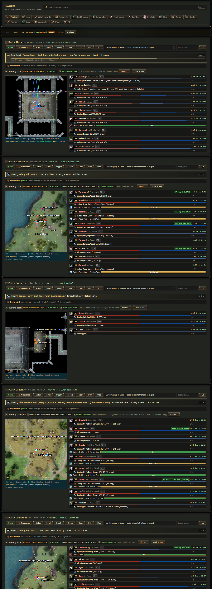

## Party buttons

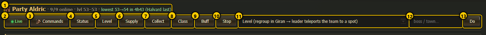

1. **Party name · online · levels** - *9/9 online* means all nine characters reported within the last 30 seconds.
2. **● Live** (green) - opens the party's live map page (`#/live/<leader>`): what every member does right now (aggro, casts,
   fights, stuck, routes, selling). That page has its own chapter: [Live party map](live-party.md).
3. **Commands** - opens the command center sheet for this party: every command, sorted by category, with a dry run before it is
   sent (see [Command center](command-center.md)).
4. **Status** - `!status`: every member writes HP, MP and what it does into party chat (you see it in the [What they do](what-they-do.md) timeline
   and on the character pages).
5. **Level** - `!level`: the leader takes everyone to Giran, regroups, picks a hunting spot for the party's lowest level (or your
   chosen spot, see below) and teleports the team there.
6. **Supply** - `!supply`: in Giran every member reports what it lacks (Scrolls of Escape, Scrolls of Resurrection, shots, Spirit Ore,
   potions), the leader buys it all at the grocer and hands it out by trade.
7. **Collect** - `!collect`: members keep 2M adena below level 40, 2.5M at 40-75 and 3M from 76, and trade the rest to the leader.
8. **Class** - `!classchange`: everyone whose level allows it changes class through the Community Board (Alt+B → Career → Professions).
9. **Buff** - `!buff`: rebuff from the Community Board.
10. **▶ Start / ■ Stop** (the first, big button of the row; it never moves) - the party's **run switch**, see [Start and Stop](#start-and-stop-the-run-switch).
11. **Task menu** - every other party order (see the table below).
12. **Argument box** - for the menu entries that need a name: a boss, a town, a place, a character.
13. **Do** - sends the order chosen in the menu (with the text of the argument box).

## Start and Stop (the run switch)

Every party has ONE switch, shown as the big first button of its card and as the line right under the party head:

- **○ Stopped — does nothing until you press Start** (red line, green **▶ Start** button). This is the **default**: after an update,
  a restart of L2Swarm or a new install every party is stopped. A stopped party does nothing on its own: no leveling, no idle
  "watchdog" leveling, no resume of what it did before a restart, no supply runs, no daily Kamaloka, no raid hunter / circuit, no
  Seven Signs / warehouse / letters / clan hand-over trips, no regroups and no "back to the leader" walks.
  It still logs in, heals, drinks potions, defends itself, resurrects teammates, respawns in town after a death, answers trades and
  **obeys every order you send** (Supply, Town, a mission, Go to …): the order runs, then the party waits again.
- **● Running: <what it does>** (green line, red **■ Stop** button). A running party works by itself exactly as before.

**▶ Start** asks first and shows what it will start: the raid circuit when one is switched on for the party, else leveling at your
chosen spot (or hunt here 24/7, or the leader's pick after a Giran regroup). If it already runs, nothing new starts. Ordering
**Level**, a raid hunt, a circuit, Hunt here, a dungeon, Help a character, a zone, Level to … or a soul crystal hunt also switches the
party on. **■ Stop** (= `!stop`) stops everyone at once (a raid boss fight that is on is finished first) and switches it off. The
switch survives restarts: a party you started resumes its activity after a restart, a stopped one stays put.

The header has **▶ Start all** / **■ Stop all** and shows how many parties run. On a [character's page](character.md) a **member** can be
stopped on its own: it then stands still (no follow, no assist, no team walks) and its party goes on without it; **▶ Start** brings
it back. A party Start / Stop resets these per-character switches. The line says *the bots have not picked it up yet* for a few
seconds after a change, and *the bots run an older swarm.js* when the script with the switch is not deployed yet.
A member switched to [Hands off](character.md#hands-off) is shown on the line as *· ✋ hands off: <name>* (Hive leaves it alone; its
own L2Swarm profile keeps running).

The switches are kept in `Scripts/data/run_state.json` (read by the bots every 2 seconds).

**Every button asks first.** The question names the party and how many characters get the order, shows the command, and lists the
members that are busy right now and will drop what they are doing:

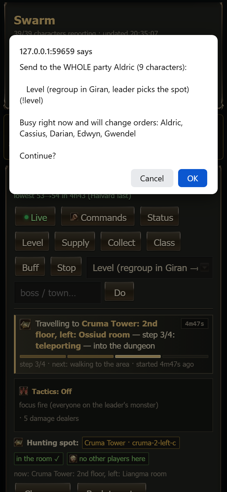 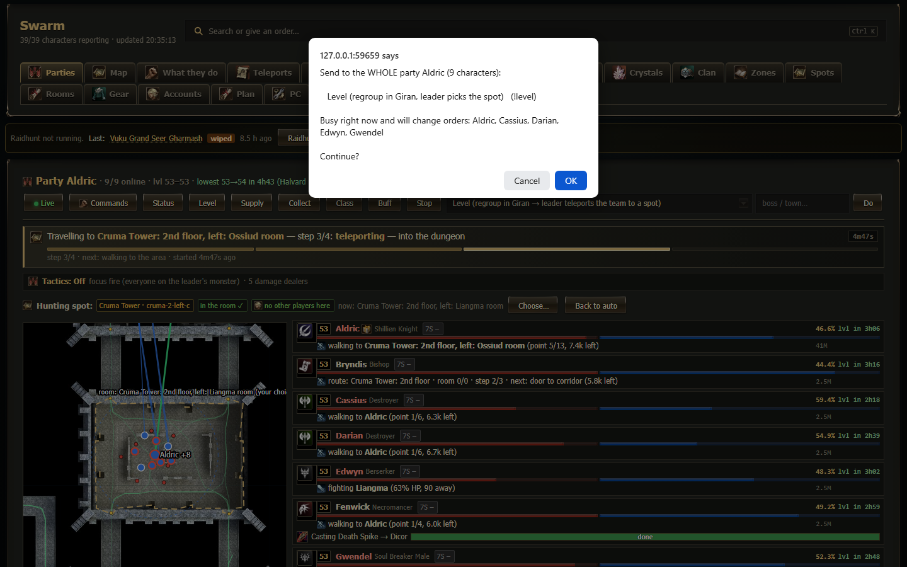

Press **OK** to send it, **Cancel** to do nothing. After sending, the line under the page header says *✓ `!level` → party Aldric. The
character confirms it in its notes.* (or the error). The order goes to the party leader's window, and the leader passes it on.

**Task menu + Do.** Choose an entry, type the argument if the entry needs one, press **Do**. Example: *Town teleport .&lt;town&gt;* with
`giran` in the box sends `!town giran`:

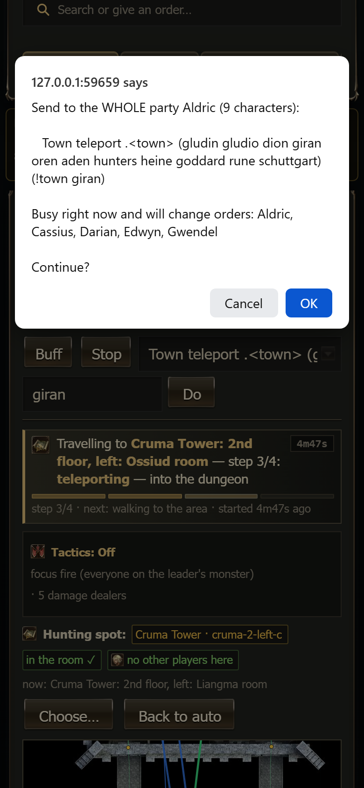 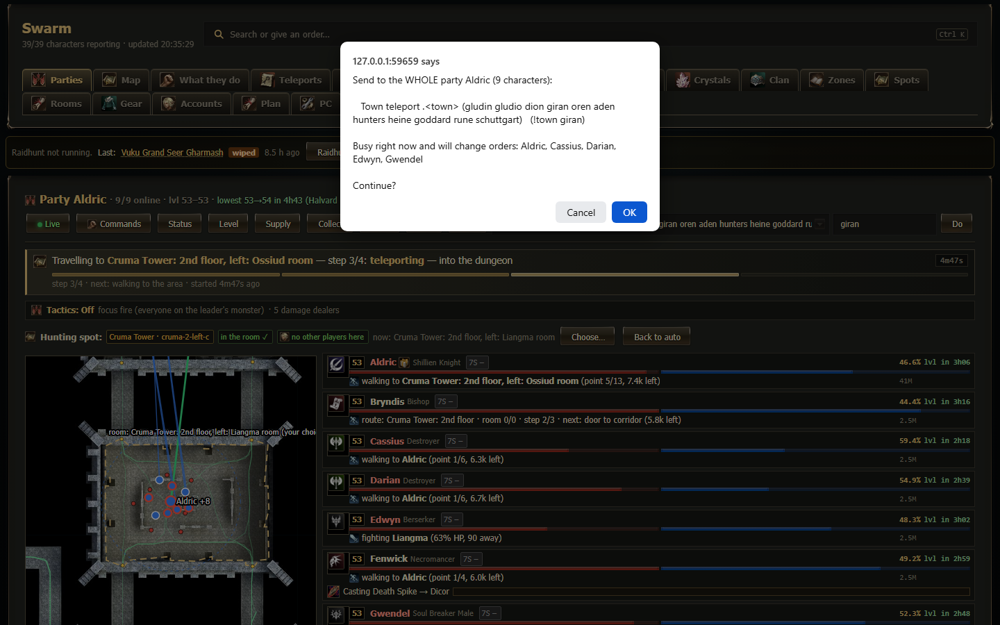

If an entry needs an argument and the box is empty, nothing is sent and the page says *type the boss / town / place in the box next to
the menu first*.

| Menu entry | Command sent | What the party does |
|---|---|---|
| Level (regroup in Giran → leader teleports the team to a spot) | `!level` | Same as the **Level** button. |
| Supplies: leader buys SoE/SoR/shots/spirit ore in Giran + hands out | `!supply` | Same as **Supply**. |
| Collect adena to the leader | `!collect` | Same as **Collect**. |
| Better gear now | `!gearup` | Party to Giran, everyone buys and puts on upgrades (see [Gear](gear.md)). |
| Better gear for one character… | `!gearup <name>` | Party to Giran, only that character buys. |
| Gear plan (dry run) | `!gearplan` | Writes what each would buy to `Logs/gear_plan_<name>.json`, buys nothing. |
| Dungeon: level inside… | `!dungeon <name>` | Level inside a dungeon (e.g. *Branded*, *Sacrifice*, *Worship*). |
| Dungeon off | `!dungeon off` | Back to the normal hunting spots. |
| Soul crystals: fetch / store / status | `!soul get` / `!soul store` / `!soul` | See [Crystals](crystals.md). |
| Seven Signs: sign up with the Lords of Dawn (Giran) | `!dawn` | Every member signs up with Dawn. |
| Class change now | `!classchange` | Same as **Class**. |
| Cabinet setting… | `!cabinet <setting> on/off` | Switches a Community Board Cabinet setting, e.g. *Forward Drop on*. |
| Status / Rebuff | `!status` / `!buff` | Same as the buttons. |
| Sell marked items + junk now | `!sell` | Sells at the shop (list on the [Gear](gear.md) page). |
| Raid hunter / Stop raid hunter | `!raidhunt` / `!raidhunt stop` | Hunts raid bosses in the party's level range (see [Raid bosses](raid-bosses.md)). |
| Raid mission… | `!mission raid <boss>` | One raid boss. |
| Joint raid… | `!jointraid <boss> with <leader>,<leader>` | Several parties on one boss (order the main party). |
| Learn the clan focus skill now | `!clanskill` | Clan leader only (see [Clan](clan.md)). |
| Kamaloka mission | `!mission kamaloka` | See [Kamaloka](kamaloka.md). |
| Siege… / Stop the siege | `!siege fort <name>` / `!siege castle <name>` / `!siege stop` | See [Sieges](sieges.md). |
| Stop mission | `!mission stop` | Ends a raid or Kamaloka mission. |
| Help character… / Stop helping | `!assist <name>` / `!assist off` | The whole party assists that character / follows the leader again. |
| Town teleport .&lt;town&gt; | `!town <town>` | gludin, gludio, dion, giran, oren, aden, hunters, heine, goddard, rune, schuttgart. |
| Gatekeeper teleport to… | `!gk <destination>` | Any gatekeeper destination. |
| Walk to… | `!goto <NPC / place / x y>` | Walks there. |
| Stop leveling | `!autolevel stop` | Ends leveling. |
| Escape (SoE) | `!soe` | Everyone leaves the fight and goes to a town (`.townname`). |
| Stop everything | `!stop` | Same as **■ Stop**: the run switch goes OFF. |
| Start | `!start` | Same as **▶ Start**: the run switch ON + the party's activity. |

Every command is described in the [command reference](../05-commands.md).

> **Phone tip.** On a narrow phone the button row is wider than the screen: the last buttons, the argument box and **Do** are cut off
> at the right edge (picture below: 1 header, 2 Live, 3 Commands, 4 the task menu). Use **Commands** (it has every order) or turn the
> phone sideways.

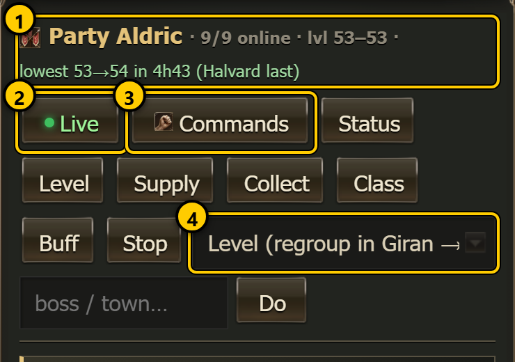

## Status banner

Right under the header a banner says in one sentence what the whole party does now (supply run, regroup, fund round, trip, hunting,
raid, waiting for orders), with a step bar, how long the step has taken, what comes next, the trades in progress and who the leader
waits for. It turns yellow when a step takes unusually long. Everything about it (every sentence, the steps of each run, the
warnings, the trade lines on the map): [Party status](parties-status.md).

## Alerts

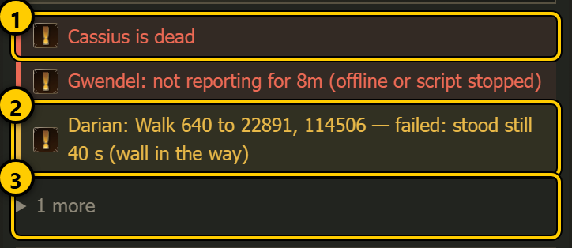 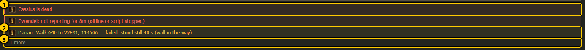

Under the header the card lists what needs your attention, worst first. At most three lines show; the rest hide behind **n more**
(tap to open).

1. **Red line** - a character is dead, or has not reported for a while (*not reporting for 8m (offline or script stopped)*).
2. **Gold line** - a step failed in the last 10 minutes (*Walk 640 to … — failed: stood still 40 s*), or one of its last notes says it
   gave up / failed / could not. Normal path retries are not shown.
3. **n more** - the hidden lines.

A line **No Scroll of Escape: …** sums up every live member with no SoE left (a supply run buys them).

## Member rows

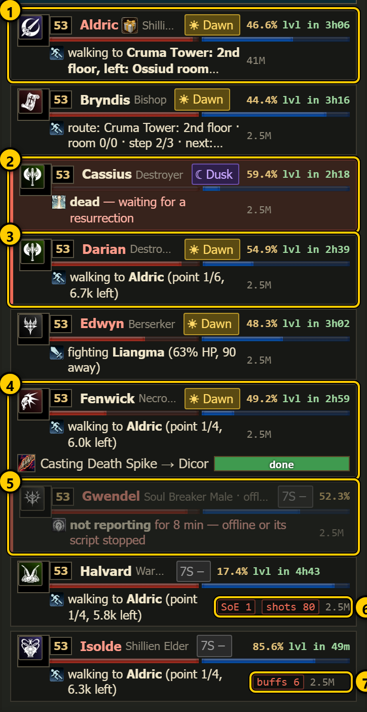 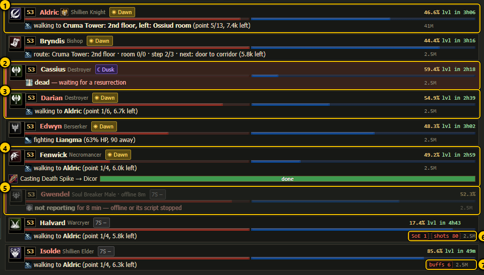

The leader is always first, the others follow in name order.

1. **Leader** - the gold star after the name.
2. **Dead** - dark red row.
3. **Problem** - a red bar on the left edge: this character has an alert (see above).
4. **Resting** - the task reads *resting …* with the sitting icon; on the map the dot turns light blue.
5. **Offline** - a faded row with *offline 8m* after the class: no report for more than 30 seconds.
6. **Low supplies** - red chips before the adena: **SoE n** (fewer than 2 Scrolls of Escape), **shots n** (100 or fewer).
7. **Low buffs** - **buffs n** (fewer than 10 buffs).

A name in light red means the character fights right now. Tap anywhere on a row to open its [character page](character.md).

### One row, part by part

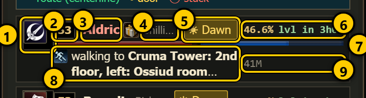

1. **Class icon** - the game's class icon (a role icon when the class is not known yet).
2. **Level**.
3. **Name** - with a gold star for the party leader.
4. **Class** - the current class name.
5. **Seven Signs mark** - see below.
6. **Experience** - how far into the current level, in %. For about 6 seconds after a change a small pop-up appears left of it:
   green **+1,234 exp (+0.01%)** for a gain (*+3 kills: …* when several kills came together, **LEVEL UP!** on a new level), red
   **−5,000 exp (−0.20%) died** for a loss. Hover it on a desktop for the monsters and times.

   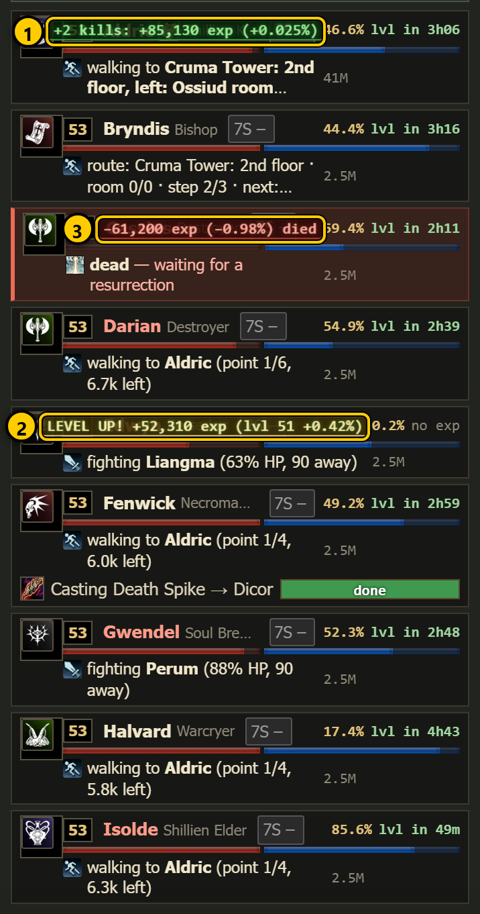 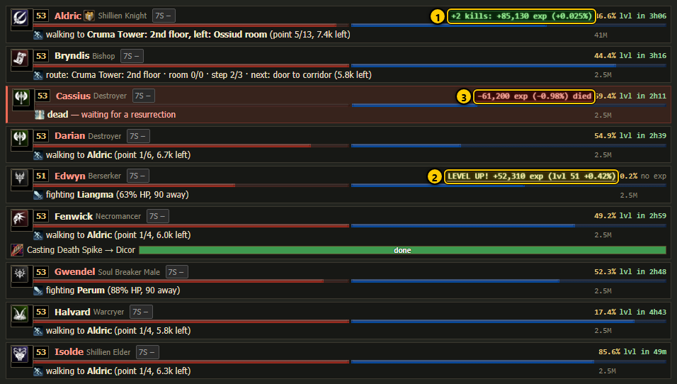

   In the picture: 1 a gain from two kills, 2 a level up, 3 a loss on death.

   After the % comes the **next level estimate** in short: **lvl in 1h25** (green), **lvl in 6d** for more than 48 hours, **no exp
   22m** when the character got nothing for a while, **no exp** when it gets nothing at all. Hover or long-press it for the rate and the
   clock time; it is calculated as on the [character page](character.md#next-level-estimate). The same short text is on the cards
   of the [live party view](live-party.md) and next to the level on the [Accounts](accounts.md) page.
7. **HP and MP bars** - red and blue; the HP bar turns warning-coloured below 30 %.
8. **Task** - what the character does now in plain words, with an icon: *Trading with Tankard: receiving 2.0M adena (window open,
   waiting for the items)*, *waiting for its turn at Helvetia (grocer) — 3rd in line*, *fighting Liangma (63% HP, 120 away)*, … plus a
   **stuck** / **no progress** chip when it does not get on. Every line is explained in [Party status](parties-status.md#member-rows).
9. **Adena** - short form (35M, 2.6M, 840k), after any low-supply chips.

Under a row a **cast bar** or an **escape box** can appear while the character casts something long or escapes from a fight
([Party live states](../live/party-live.md)).

### Member rows during a team task

During a supply run, a collect or a fund round the activity line says who trades with whom (with four stage dots: ask → window
open → confirm → done), who waits while others trade, who is ready, whose turn it is, and red chips mark a member that is **stuck**,
**not moving**, a trade with **no progress** or a team **step** that takes long. Pictures and every text: [Party status → Member
rows](parties-status.md#member-rows).

### Seven Signs mark

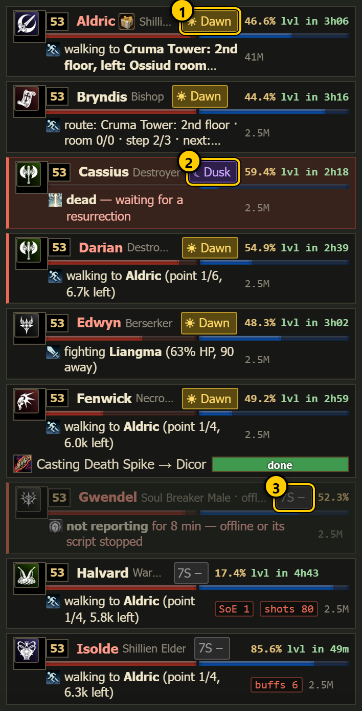

1. **☀ Dawn** (gold) - signed up with the Lords of Dawn this cycle.
2. **☾ Dusk** (purple) - signed up with Dusk.
3. **7S –** (grey) - not signed up this cycle (or never checked).

Hover a mark on a desktop to see when it was checked. Catacombs and necropolises need every member signed up (always Dawn here), so a
party full of grey marks cannot hunt there - see [the Seven Signs check in the picker](#seven-signs-check). The data comes from
`Logs/sevensigns_<name>.json`, written by the bots when they read the Priest of Dawn; the order **Seven Signs: sign up** (`!dawn`) in
the task menu signs everyone up.

## Tactics box (hunting pairs)

Normally the whole party attacks the leader's monster (**focus fire**). With **hunting pairs** the leader splits the damage dealers
into small groups and gives each group its own monster near him, so more monsters die at once. It is used only while leveling - never
in raids, Kamaloka, missions or during teleports.

The closed box is one line:

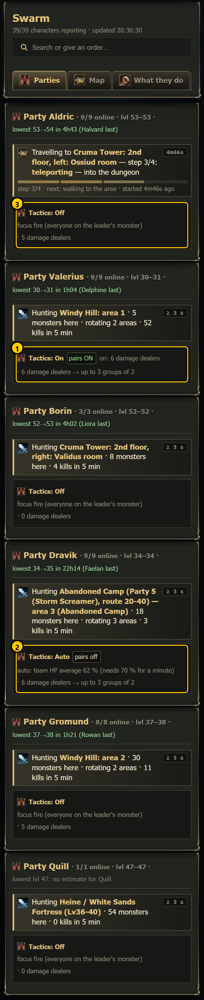

1. **Tactics: On** - groups are live: green **pairs ON** chip and the reason (*on: 6 damage dealers*).
2. **Tactics: Auto** - the leader turns groups on only when the party is strong; here they are off right now and the reason says why
   (*auto: team HP average 62 % (needs 70 % for a minute)*).
3. **Tactics: Off** - *focus fire (everyone on the leader's monster)*.

After the state: how many damage dealers the party has and, when not off, *→ up to N groups of 2*. *waiting for the leader's report*
means the leader has not reported a tactics state yet (offline, or an older script).

Tap the line to open the box:

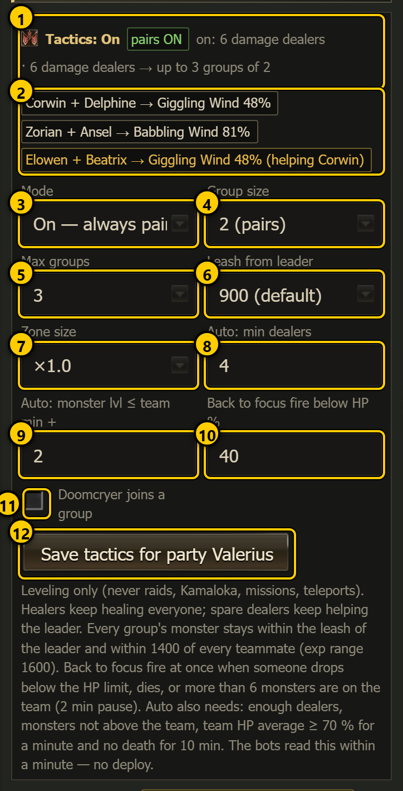 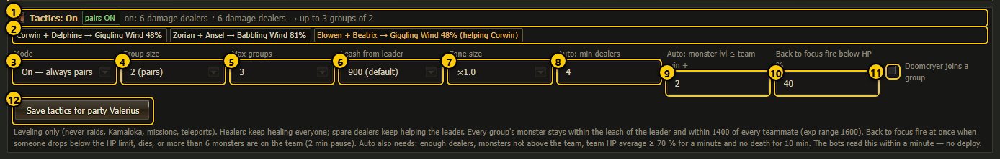

1. **Summary** - tap again to close.
2. **Live groups** - one chip per group: *Corwin + Delphine → Giggling Wind 48%*; *looking* = no monster yet; a gold chip *(helping X)*
   = that group helps another group whose monster is strong.
3. **Mode** - *Off — focus fire*, *Auto — only when strong*, *On — always pairs*.
4. **Group size** - 1 (each dealer alone), 2 (pairs, default) or 3 (trios).
5. **Max groups** - 1 to 6 (default 3). Dealers left over keep helping the leader.
6. **Leash from leader** - 600 to 1300 (default 900): how far from the leader a group's monster may be.
7. **Zone size** - ×1.0 to ×2.0: makes the hunting zone bigger while groups are on.
8. **Auto: min dealers** - Auto mode needs at least this many damage dealers (default 4).
9. **Auto: monster lvl ≤ team min +** - Auto mode only when the monsters are at most this many levels above the party's lowest
   level (default 2).
10. **Back to focus fire below HP %** - default 40.
11. **Doomcryer joins a group** - normally the doomcryer stays a buffer; tick to count it as a dealer.
12. **Save tactics for party …** - saves (asks first, see below). *saved hh:mm* appears next to it.

Who counts as a damage dealer: destroyers, doombringers, inspectors (Soul Breaker / Hound), necromancers, nukers, daggers, mages,
archers. Healers keep healing everyone in any mode.

The rules the bots follow (also written under the settings): every group's monster stays within the leash of the leader and within
1400 of every teammate (the server shares experience only within 1600). The party goes back to focus fire **at once** when someone
drops below the HP limit, someone dies, or more than 6 monsters attack the team - then it waits 2 minutes. **Auto** also needs
enough dealers, monsters not above the team (see the level margin), a team HP average of at least 70 % for a minute, and no death for
10 minutes.

Saving asks first:

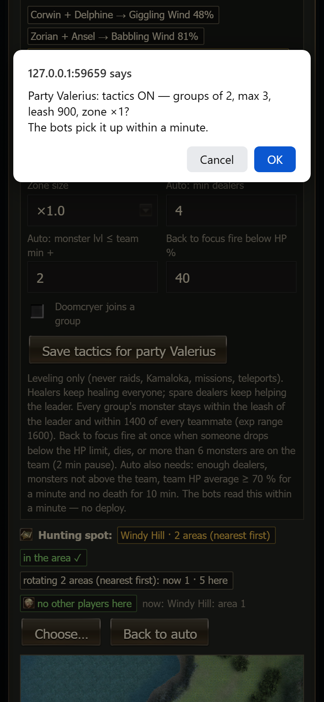 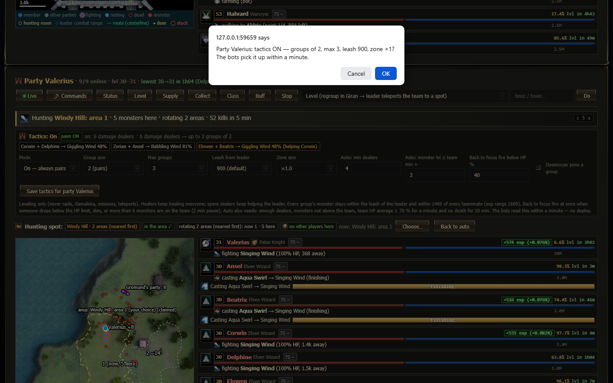

The settings are saved in `Scripts/data/party_tactics.json` (one entry per party leader; `_defaults` holds the defaults). The bots
read the file within a minute - no restart or deploy. A few expert fields (`maxAdds`, `expRange`, `hpAvgMin`, `noDeathMin`,
`cooldownMin`, `helpHp`) exist only in the file; the dashboard keeps them when it saves. Switches are written to party chat, the
leader's notes and `Logs/tactics.log`.

The live view of the groups is explained again in [Party live states → Hunting pairs](../live/party-live.md#hunting-pairs-live).

## Hunting spot line

The leader normally picks the hunting spot himself (**Auto**): the best place for the party's lowest level from the team's list of
zones, then the datapack spots. On this line you can **choose the spot yourself** - a dungeon room, several rooms, field areas, one
of your zones or a datapack spot. Your choice wins over the automatic pick until you press **Back to auto**.

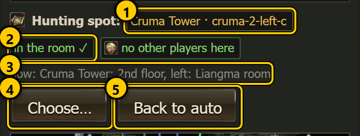 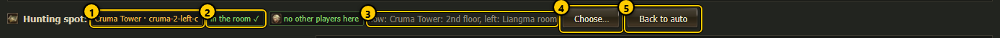

1. **Current choice** - *Auto*, or (gold) what you chose: *Cruma Tower · cruma-2-left-c*, *Cruma Tower · any free room*,
   *Cruma Tower · 4 rooms (in your order)*, *Windy Hill · 2 areas (nearest first)*, *Windy Hill · area 3*, a zone name, or a datapack
   spot *(datapack)*. Added flags: **· stay** (stay even if occupied) and **· level override** (you allowed a spot above the safe
   level).
2. **Live status** - what the leader does with your choice right now (all states below).
3. **now: …** - where the leader hunts at this moment (his hunting zone, or the spot he claimed).
4. **Choose…** - opens the [hunting-spot picker](#hunting-spot-picker-choose).
5. **Back to auto** - only shown while a choice of yours is active. Asks first, then the leader picks again by himself.

Further chips on the line: the **rotation chip** while the party moves between several rooms or areas, and for a chosen catacomb or
necropolis a red or gold **Seven Signs chip** when the party cannot enter now.

**Hunting timer** (2026-10-15): every choice in the picker first asks **how long** the party hunts there and **what then**, and shows
the supplies it needs for that time. A running timer is shown on this line as **⏱ Hunting at … — 1 h 12 min left** with **Extend** and
**End now**. See [Hunting timer](hunt-timer.md).

### Live status of your choice (every state)

The leader reports the state of your choice every few seconds. Two pictures show all states (on these two pictures the maps and member
rows are hidden so the spot lines of several parties fit on one screen).

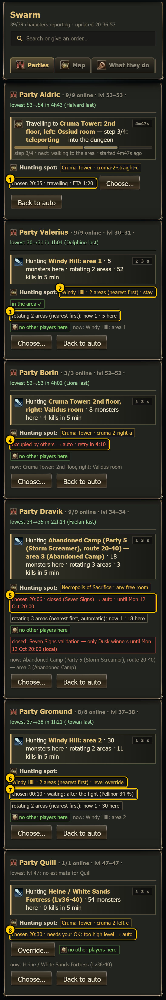 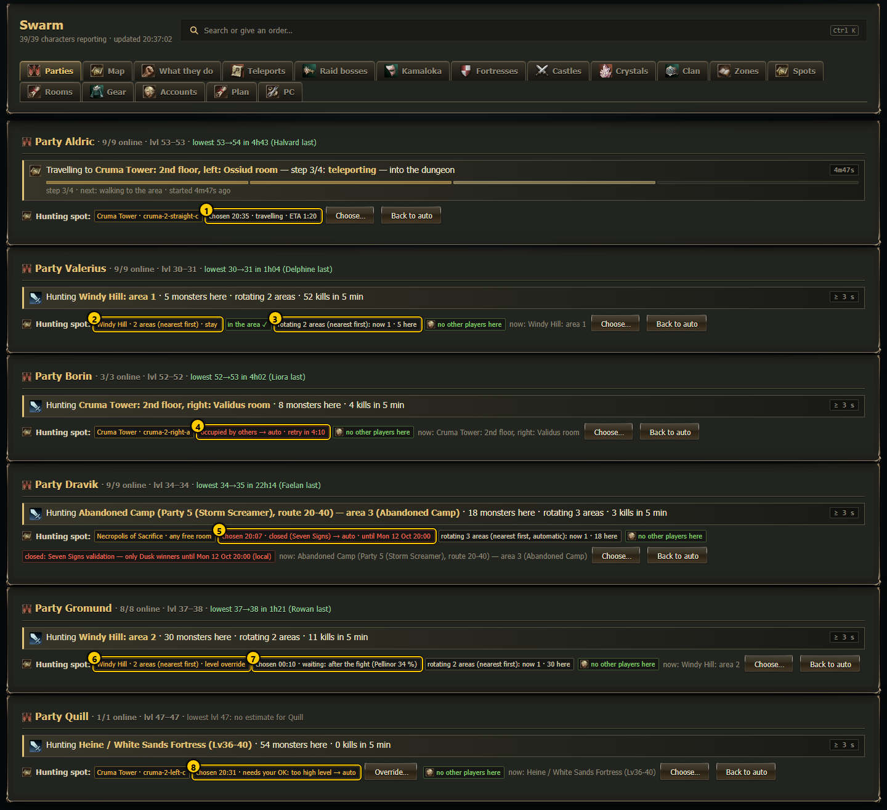

1. **chosen 06:54 · travelling · ETA 1:20** - the leader is on his way. An ETA is shown when he walks on the same dungeon floor;
   teleport trips have none.
2. **· stay** - this choice stays even when other players hunt there.
3. **Rotation chip** - *rotating 2 areas (nearest first): now 1 · 9 here* - see [Rotation](#rotation-between-rooms-or-areas).
4. **occupied by others → auto · retry in 4:10** (red) - other players hunt there. The party hunts its automatic spot meanwhile and
   tries your spot again within 5 minutes. Tick **stay even if occupied** in the picker to stay anyway.
5. **closed (Seven Signs) → auto · until Mon 12 Oct 20:00** (red) - a catacomb or necropolis the party may not enter in this Seven
   Signs period. No trip is made; the party hunts its automatic spot and goes there by itself when the period changes. The red chip
   after it explains why (*closed: Seven Signs validation — only Dusk winners …*).
6. **· level override** - you allowed this choice although it is above the safe level.
7. **waiting: after the fight (Pellinor 34 %)** - the leader has seen your choice but waits: after the fight, the supply run first,
   in a raid, in Kamaloka, on a mission, escaping, rescuing a teammate, dead, or a `!dungeon` / `!assist` order holds the spot.
8. **needs your OK: too high level → auto** (gold) + **Override…** - the place is more than 6 levels above the party's highest level
   (monsters or the teleport landing). The party hunts its automatic spot until you press **Override…** and answer **Yes, override**.

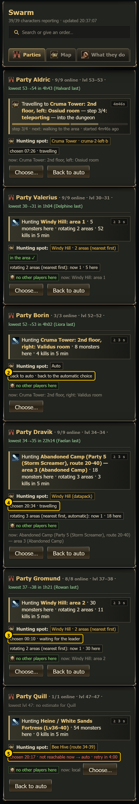 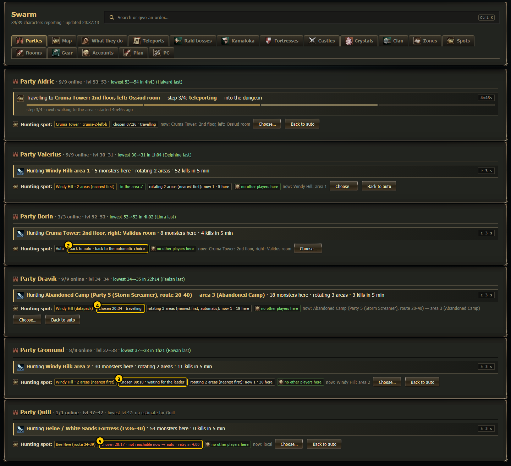

1. **chosen … · not reachable now → auto · retry in 3:11** (red) - the trip failed (here: *could not get to Cruma Tower 2nd floor via
   Ponti*; hover for the full reason). The party hunts its automatic spot and tries again within 5 minutes.
2. **back to auto · back to the automatic choice** - you pressed Back to auto; the leader is switching.
3. **chosen 06:41 · waiting for the leader** - your choice is saved but the leader has not reported anything about it for 30 seconds
   (offline, busy logging in, or an older script).
4. **chosen 11:30 · travelling** (no ETA) - travelling by teleport (.town, gatekeeper, floor teleporter); hover for *normal travel …*.
5. **not reachable now → auto** on a solo character: same as 1.

Other texts you may see in the chip: **in the room ✓** / **in the area ✓** / **there ✓** (green: arrived), **seen by the leader**,
**leaving the current spot**.

### Rotation between rooms or areas

When you choose several rooms (or field areas), the party hunts the first one and moves on to the next when it is empty. The chip reads
*rotating 4 rooms (in order): now 1 · 6 here*:

- **in order / nearest first** - which one comes next: your order, or the nearest.
- **automatic** - the rotation was set up by the leader, not by you.
- **now N · M here** - the number of the current room or area and how many monsters the leader sees in it.
- **· moving on: …** - the leader decided to move on and why (e.g. *no monster for 35 s*).

Hover the chip on a desktop for the full list: every room with its number, *(now)*, why it is blocked (*claimed by party Borin*),
how many monsters are expected and how many were killed. The party map shows the same list, numbered.

## Hunting-spot picker (Choose…)

**Choose…** opens a full-screen window for that party. It lists every place that fits the party's levels; dungeons and outdoor hunting
grounds open a map where you tap rooms or areas.

### The list

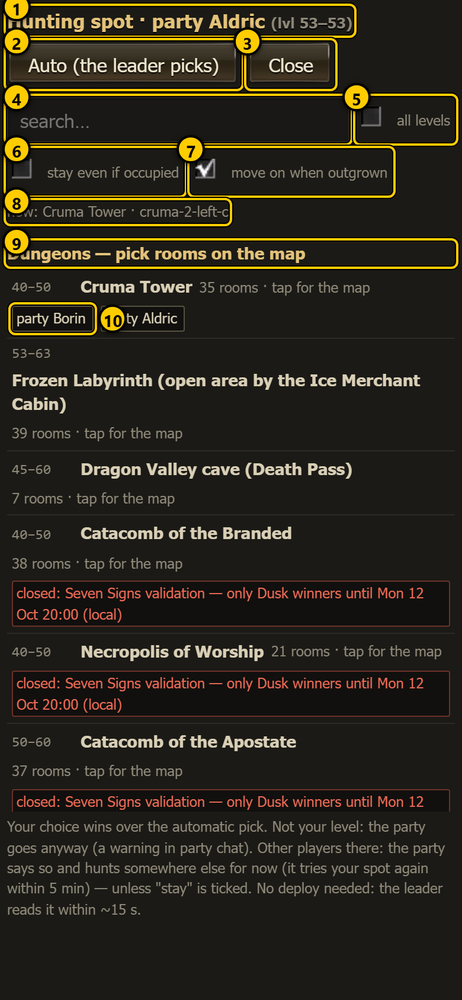 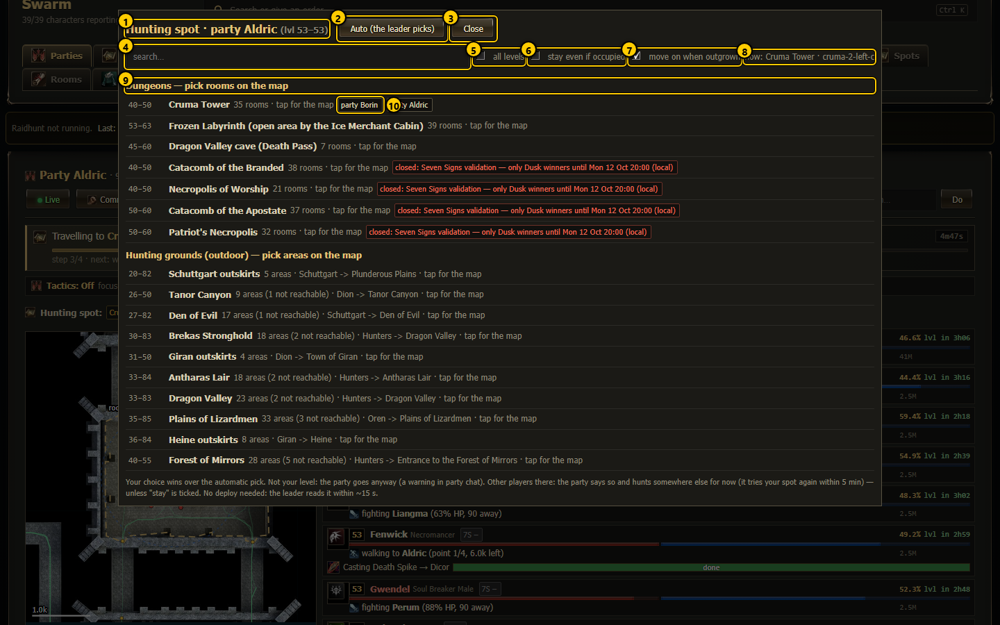

1. **Title** - *Hunting spot · party Aldric (lvl 49–50)*.
2. **Auto (the leader picks)** - go back to the automatic choice (asks first).
3. **Close** - closes without saving (tapping the dark background does the same).
4. **search…** - filters the list by name as you type.
5. **all levels** - shows every place, not only those that fit. Normally a place shows when its level range is within 3 levels of the
   party's levels.
6. **stay even if occupied** - the party stays even when other players hunt there (otherwise it hunts elsewhere and tries again within
   5 minutes).
7. **move on when outgrown** - when the party's lowest level is more than 3 above the monsters there, the leader goes back to Auto and
   finds a better place.
8. **now: …** - the current choice.
9. **Groups** of places, each row with its **level range** on the left:
   - **Dungeons — pick rooms on the map** - *N rooms · tap for the map*; catacombs and necropolises also show their Seven Signs chip.
   - **Hunting grounds (outdoor) — pick areas on the map** - *N areas (M far) · landing · tap for the map*.
   - **Our hunting zones** - the zones from the [Zones](zones.md) page (kind, dungeon, which teams); a zone made of dungeon rooms opens
     the room map, any other zone is saved at once (asks first).
   - **Datapack spots (teleport + walk)** - spots from the game's data: gatekeeper link and number of monsters (at most 150 rows). Saved
     at once (asks first).
10. **Who holds a place** - *party Borin* chip = one of your parties hunts there now; red *occupied by 3 players (4 min)* = other
    players were seen there (the minutes = how long the bots keep away).

The note at the bottom repeats the rules: your choice wins over the automatic pick; a place that is not your level is visited anyway
(with a warning in party chat); other players there make the party hunt elsewhere for now unless **stay** is ticked. No deploy is
needed: the leader reads the choice within about 15 seconds.

With **all levels** ticked and a search word, e.g. *catacomb*:

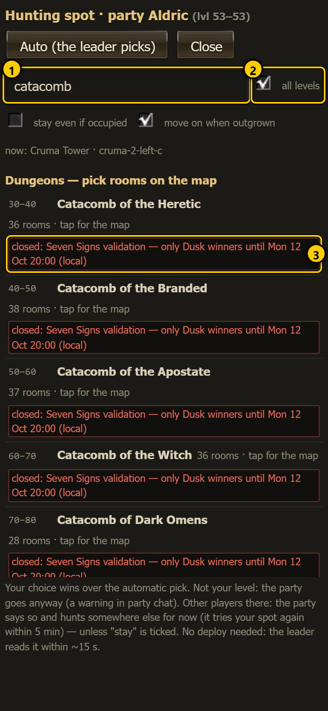 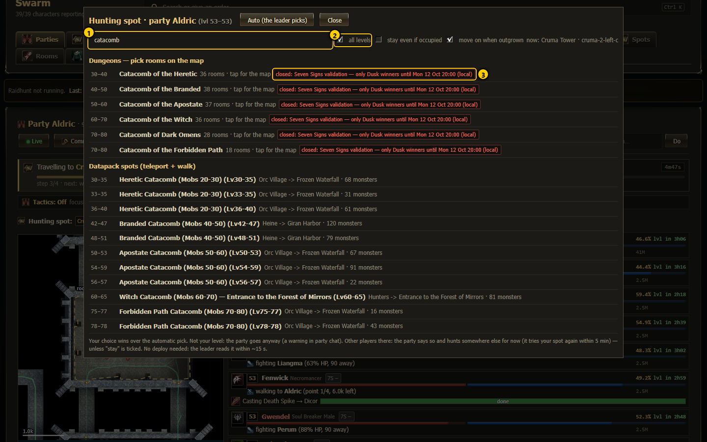

1. **Search word**.
2. **all levels** ticked.
3. **Seven Signs chip** of each catacomb / necropolis for this party (see [Seven Signs check](#seven-signs-check)).

### Dungeon room map

Tap a dungeon (or a zone that is made of dungeon rooms) to open its room map:

 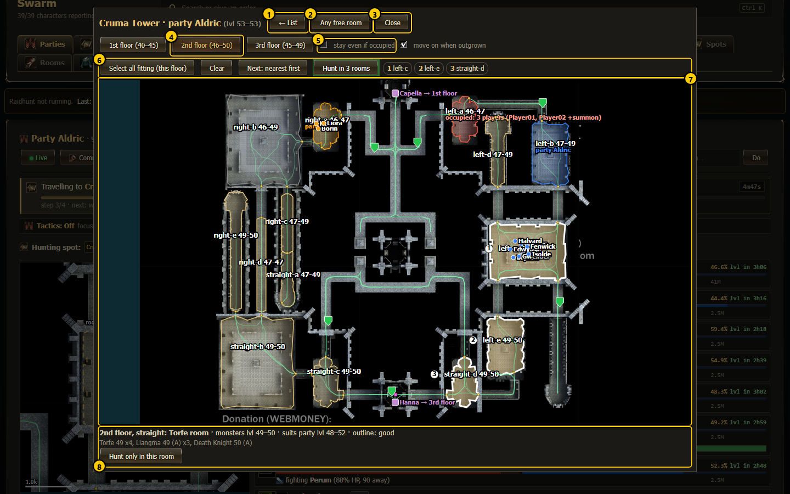

1. **← List** - back to the list (the selection is dropped).
2. **Any free room** - the leader takes whichever fitting room is free (saved at once, asks first).
3. **Close**.
4. **Floor buttons** - one per floor with its level range; the floor that fits the party best opens first.
5. **stay even if occupied** / **move on when outgrown** - as in the list.
6. **Selection bar**:
   - **Select all fitting (this floor)** - adds every room of this floor that fits the party, can be walked to and is not taken by
     another party or by other players.
   - **Clear** - empties the selection.
   - **Next: nearest first / in my order** - tap to switch: after the current room, go to the nearest chosen room, or follow your order.
   - **Hunt in N rooms** (or **Hunt in this room**) - saves the choice (asks first). Greyed out while nothing is chosen.
   - **Numbered chips** - the chosen rooms in order; a room on another floor shows its floor (*F1 left-a*).
7. **Map** - every room's outline on the game map. Colours: **green** fits the party, **gold** close (±3 levels), **grey** other
   levels, **red** other players hunt there (*occupied: …*), **party colour** one of your parties hunts there (*party Borin*).
   **Tap a room** to choose it (a white numbered circle, in the order you tap); tap again to remove it. You can choose rooms on
   several floors. **Green shields** are safe spots. Coloured dots with names are characters on this floor. On a phone, drag inside
   the map to see all of it.
8. **Room info** - the last room you tapped: name, monster levels, which party levels it suits, outline quality, the monsters, who
   holds it, *no walk route from the floor entry* (red) if the bots cannot walk there, and the button **Hunt only in this room**
   (saves just this room at once, asks first).

Several rooms: the party hunts the first one, and moves on to the next when a room is empty (also across floors, through the floor
teleporters).

Saving asks first:

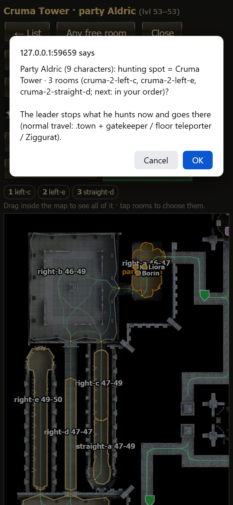 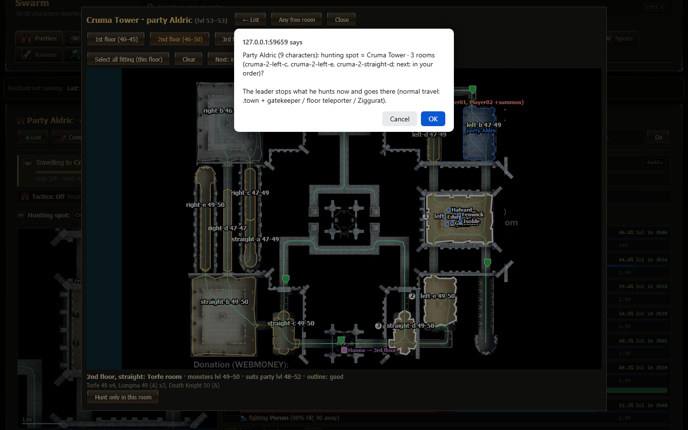

*Party Aldric (9 characters): hunting spot = Cruma Tower · 2 rooms (…; next: in your order)? The leader stops what he hunts now and
goes there (normal travel: .town + gatekeeper / floor teleporter / Ziggurat).* OK saves it, and the picker closes.

### Seven Signs check

Catacombs and necropolises are entered only through the **Gatekeeper Ziggurat**, and only when **every** member is signed up with
the Seven Signs (here always Dawn) and the Seven Signs period allows it. The room map of a catacomb shows a banner with the party's
state:

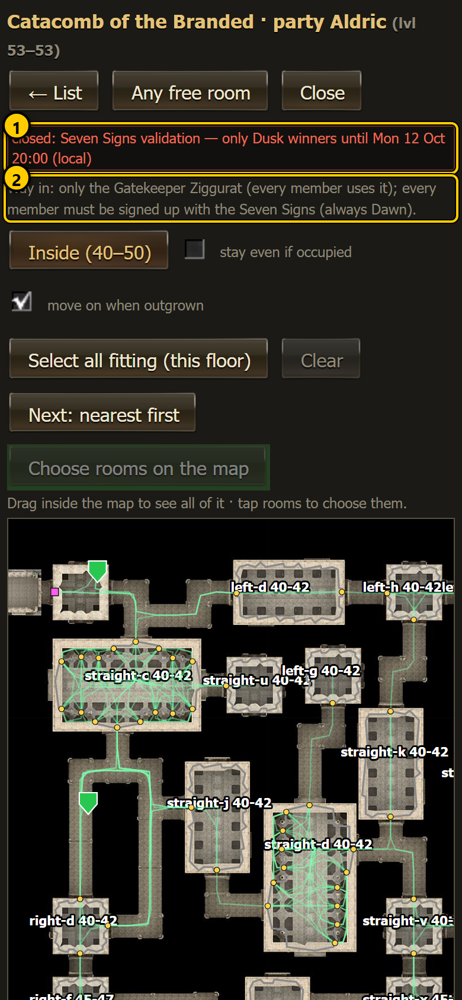 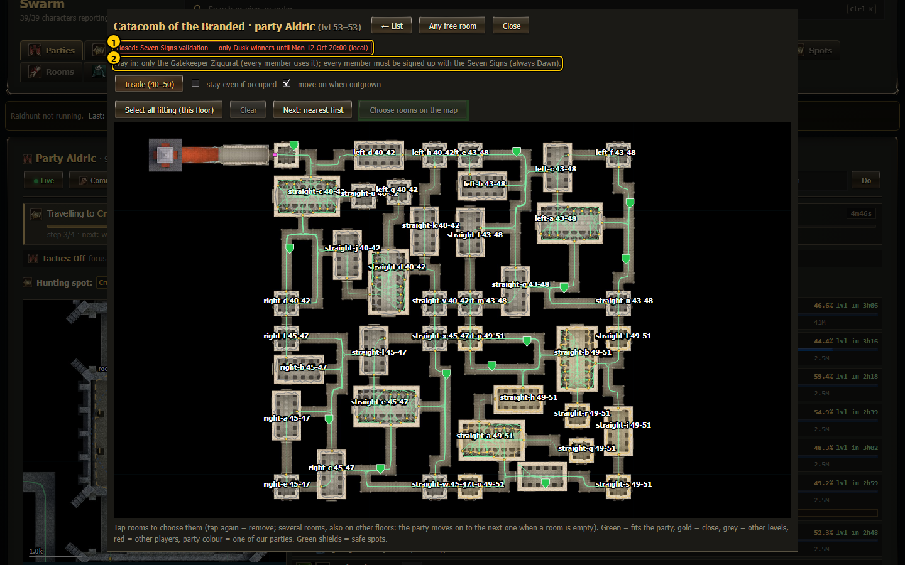

1. **Seven Signs chip** - one of:
   - green **Seven Signs: can enter**,
   - gold **needs sign-up (Dawn) first — competition period** (the leader takes the party to the Priest of Dawn first),
   - grey **Seven Signs period not read yet** (the leader asks the Priest of Dawn first),
   - red **closed: …** with the reason and *until* when (e.g. *closed: Seven Signs validation — only Dusk winners until Mon 12 Oct
     20:00 (local)*). In the validation period nobody can sign up; only those signed up in the last competition (on the winning side) may enter.
2. **Way in** - the reminder that only the Gatekeeper Ziggurat leads in and every member must be signed up.

**Why it is open or closed (2026-10-15).** Next to the chip (in the list, on the room map, on the party card's hunting line, in the
"is closed now" question and in the hunting-timer window) one plain sentence says **why**, with the next change in your local time.
It is the bots' own rule and the bots' own words: when a bot skips a catacomb it writes the same sentence in its notes. The possible
sentences:

| Situation | The sentence starts with |
|---|---|
| Everyone signed up this week | *Open: everyone in the party is signed up with the Lords of Dawn this week.* |
| Validation week, our side won | *Open: it is the Seven Signs validation week, Dawn won …* |
| Gate set to "try" (7 Signs tab) | *Open: the Seven Signs gate is set to "try" — the Ziggurat decides …* |
| Competition week, someone not signed up (party enrolled or the catacomb is your own choice) | *Not signed up yet: … — the leader takes them to the Priest of Dawn (free) first, then goes in.* |
| Competition week, not signed up and not enrolled | *Not open for …: not signed up with the Lords of Dawn, and the Seven Signs sign-up is switched off … — sign up on the 7 Signs tab* |
| Validation week, not signed up last week | *Closed this week: it is the Seven Signs validation period and … were not signed up in the last competition — opens again Mon … (local time) (next competition).* |
| Validation week, the other side won | *Closed this week: … Dusk won, so only Dusk members may enter — … opens again Mon …* |
| No 1st class transfer yet | *Not open for …: no 1st class transfer yet, so it cannot join the Seven Signs — change class first.* |
| The Ziggurat refused this period | *Closed for … until Mon … (local time): the Ziggurat refused it this period.* |
| Sign-up failed 3 times / fee asked | *Not open for … this week: the Dawn sign-up failed 3 times …* / *… asked for a fee or an item …* |
| Nobody read the Priest of Dawn yet | *Unknown: no character has read the Priest of Dawn's page this cycle yet — the leader reads it in a town first, then decides.* |
| Not enrolled and period unknown | *Seven Signs sign-up is switched off for this party (opt-in on the 7 Signs tab) …* |

The [7 Signs tab](../02-concepts.md#seven-signs) shows the same sentence per party, and the [Automations page](automations.md) shows it
in the *Seven Signs sign-up* row.

Choosing a room of a **closed** catacomb opens this question instead of the normal one:

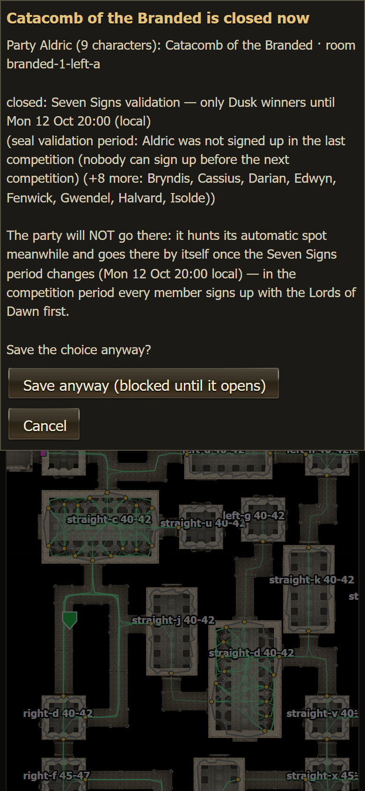 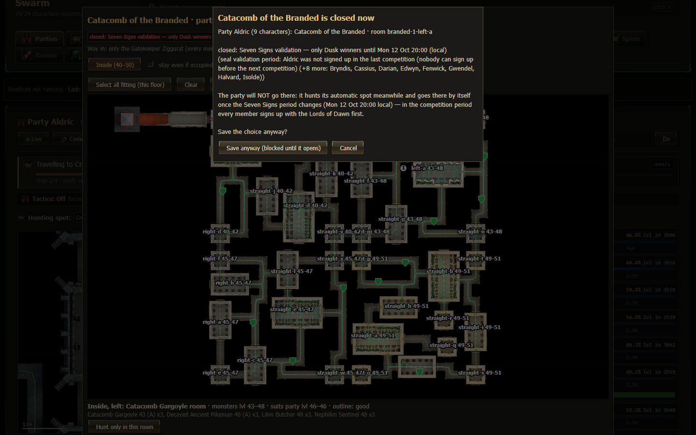

**Save anyway (blocked until it opens)** saves the choice; the party hunts its automatic spot and goes there by itself once the period
changes (the spot line shows *closed (Seven Signs) → auto*). **Cancel** saves nothing. A party that may enter shows the green chip:

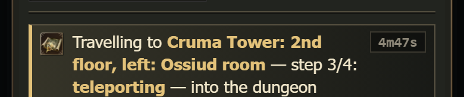

### Level check (above the safe level)

A choice whose monsters are more than **6 levels** above the party's highest level asks first:

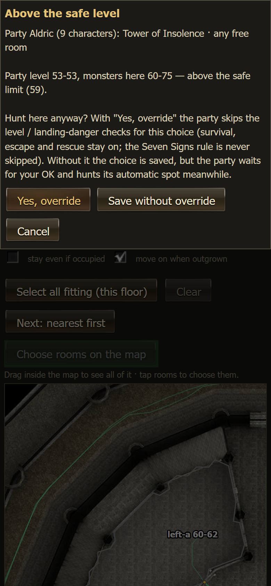 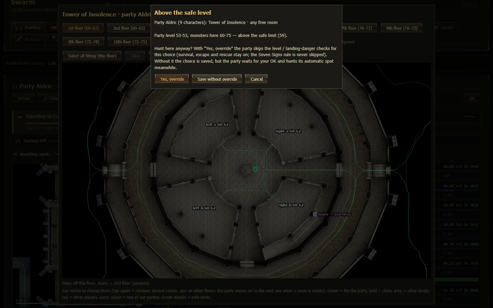

- **Yes, override** - saved with your override: the party skips the level and landing-danger checks for this choice. Survival, escape
  and rescue stay on, and the Seven Signs rule is never skipped.
- **Save without override** - saved, but the party waits for your OK (spot line: *needs your OK*) and hunts its automatic spot meanwhile.
- **Cancel** - nothing is saved.

The bots can also find a danger only on the way (a teleport landing next to high monsters). Then the spot line shows **needs your OK**
with an **Override…** button, which asks the same question:

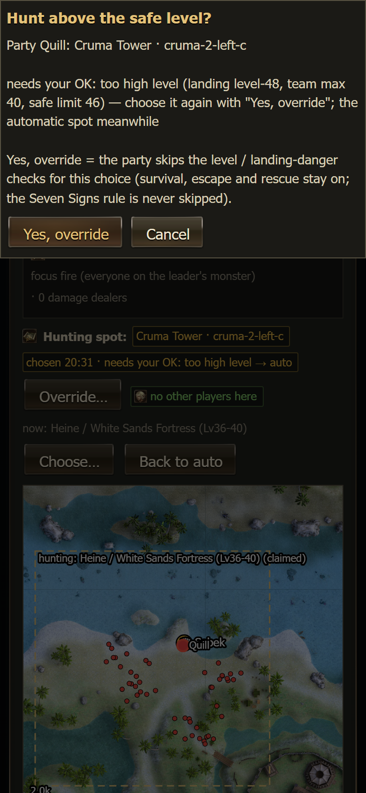 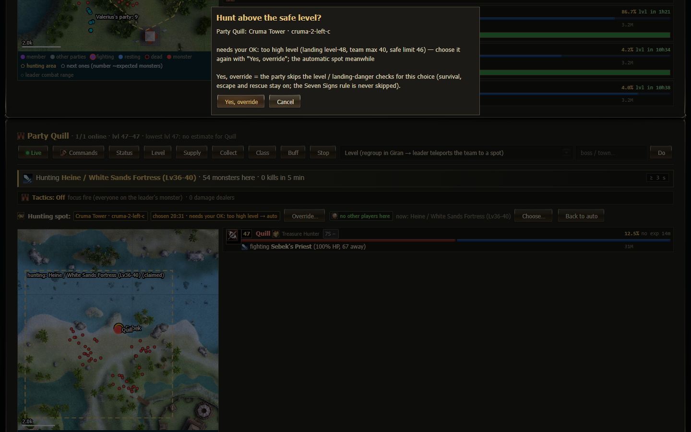

### Field region map (outdoor hunting grounds)

Tap a hunting ground under *Hunting grounds (outdoor)* to open its region map, split into **areas**:

 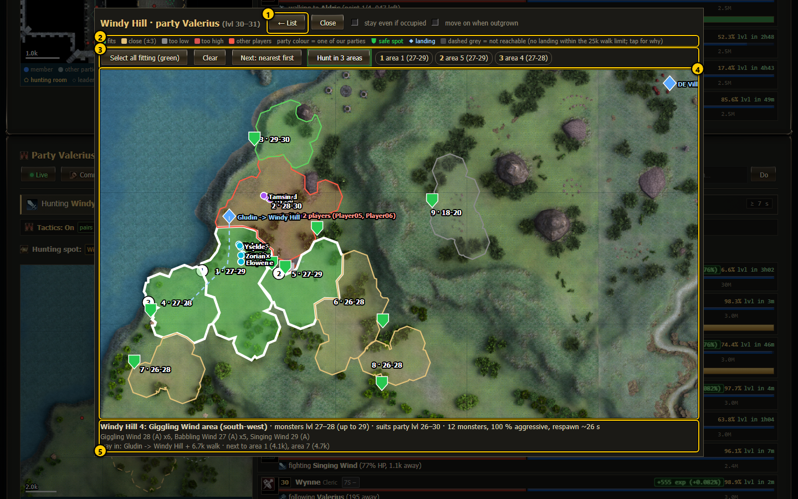

1. **← List / Close** and the **stay** / **move on when outgrown** boxes, as in the dungeon map.
2. **Colour key** - **green** fits, **gold** close (±3), **grey** too low, **red** too high (or monsters above the safe limit),
   **bright red** other players, **party colour** one of your parties, **⛊** safe spot, **◆** teleport landing, **dashed outline** far
   from any landing (not picked automatically).
3. **Selection bar** - **Select all fitting (green)** adds every green area that can be reached and is free (nearest to its landing
   first); **Clear**; **Next: nearest first / in my order**; **Hunt in N areas**; numbered chips *area 1 (27-29)*.
4. **Map** - each area with *number · levels* (*far* when no landing is near). Tap areas to choose them (numbered). The last tapped
   area also shows its way in from the landing as a light-blue dashed line. Blue diamonds are landings with their names
   (*.giran Giran …* for a town command).
5. **Area info** - name, monster levels (and *up to* when single stronger ones live there), which party levels it suits, number of
   monsters, how many are aggressive, respawn time, the monster list, the way in (*way in: … + 1.2k walk*), the neighbour areas
   with walking distance, and a red warning when a raid boss is near.

The party hunts the first area and moves on to the next when an area had no monster for about 35 seconds, when other players hunt
there, or when another of your parties takes it.

### Zones and datapack spots

A zone without rooms and a datapack spot have no map: tapping the row asks *Party X (n characters): hunting spot = &lt;name&gt;?* and
saves it.

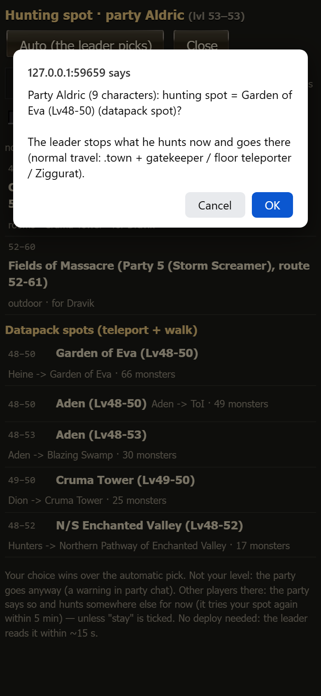 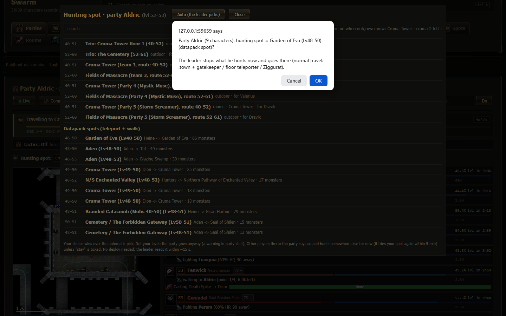

### What is saved

Every choice is saved in `Scripts/data/party_spots.json`, one entry per party leader (an old copy goes to `Settings/backup/` first):

| Field | Meaning |
|---|---|
| `mode` | `auto` or `manual` |
| `kind` | `rooms` (dungeon), `field` (outdoor areas), `zone` (one of your zones), `datapack` |
| `dungeon`, `roomId`, `roomIds` | the dungeon, the first room (`any` = any free room), all chosen rooms in order |
| `region`, `areaIds` | the outdoor region and the chosen areas in order |
| `order` | `nearest` or `rotate` (= in your order) |
| `stay`, `moveOn` | the two tick boxes |
| `override`, `overrideNote` | your "Yes, override" for a place above the safe level |
| `at`, `by` | when, and `dashboard` |

The leader reads the file within about 15 seconds; no deploy and no restart. When a choice changes while the party is on its way to
the old spot, the trip stops and the new choice is taken.

## Party map

The square map shows the area around the party leader, on the game's own map art (the right underground layer inside dungeons). It
grows to fit the members, the hunting room or square, and a chosen room. On a desktop it stands left of the member list.

 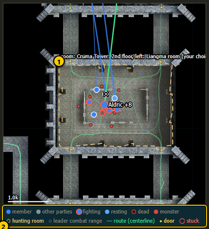

1. **Hunting room** - gold dashed outline with *room: &lt;name&gt;* and *(your choice)* when you chose it, *(claimed)* when the leader
   claimed it for this party. An outdoor area reads *area: …*.
2. **Legend** - what the symbols mean (it changes with what is on the map).

What you can see on the map:

| Symbol | Meaning |
|---|---|
| Dot in the party colour | a member; the leader's dot is bigger. Names next to it (several standing together: *Aldric +4*). |
| Red ring around a dot | the character is fighting. |
| Light-blue dot | resting. |
| Grey dot | not reporting (offline). |
| Dark red dot with ✕ | dead. |
| Small red dots | monsters the leader sees (only on his floor). |
| Gold dot with ♛ and name + HP % | a raid boss in view. |
| Gold dashed ring *♛ name (spawn — not seen)* | the raid boss the party is going for, at its spawn point, not seen yet. |
| Smaller dots in other colours, *Name's party: 3* | members of your other parties in view. |
| Gold dashed outline (polygon) | the hunting room or field area. |
| Gold dashed square *hunting: …* | the hunting square of a normal spot. |
| *local fallback square (the chosen spot was not reached)* / *local fallback room* | the leader could not reach the spot and hunts where he is. |
| White dashed outline *chosen: … · travelling* | the room you chose that the party has not reached yet. |
| Numbered outlines *2 ~9*, *3 ✕* | the next rooms / areas of a rotation: number, ~expected monsters, ✕ blocked. |
| Dashed circle in the party colour | the leader's combat range. |
| *far away: Name 25k, …* (yellow, top left) | members more than 20 000 away from the leader. |
| *left, occupied: … by … (n min)* (orange) | spots the party left because other players hunted there. |
| Faint green lines, yellow dots, magenta squares | inside a dungeon: the floor's **hallway centrelines** (the network every route follows), **doors**, and floor teleporters / landings / entries. |
| Bright green line with dots, a white ring, a dashed circle *→ target* | the **leader's route**: the planned walk along the centrelines (one dot per waypoint, 150-300 apart), the **next waypoint** ringed in white, the walk target. The part already walked is faint and dashed. |
| Thin line in the party colour | a member's own route (when it walks by itself, e.g. back to the leader). |
| Red ring *stuck 25 s · re-plan 1* | a character that has not moved although it should; how long, and how many times it planned a new way. |
| Animated yellow line *giver → receiver: what* | a trade in progress (a loop when both stand on the same spot); green ✓ = done, red ✗ = failed. See [Party status](parties-status.md#trade-lines-on-the-party-map). |
| Scale bar (bottom left) | length on the map. |

The monsters are asked from L2Swarm every 7 seconds while the tab is open. The routes come from each bot's live state (`route`, refreshed
every few seconds, hidden when older than 90 seconds); the centrelines from `Scripts/data/dungeon_graph/<dungeon>.json`. Routes always follow
the centrelines - through hallways and doorways, never a straight line through a wall - so a route that cuts across the map, or a red
*stuck* ring that stays, tells you at a glance that something is off.

### More map pictures

The room you chose, while the party walks there along the hallway centrelines:

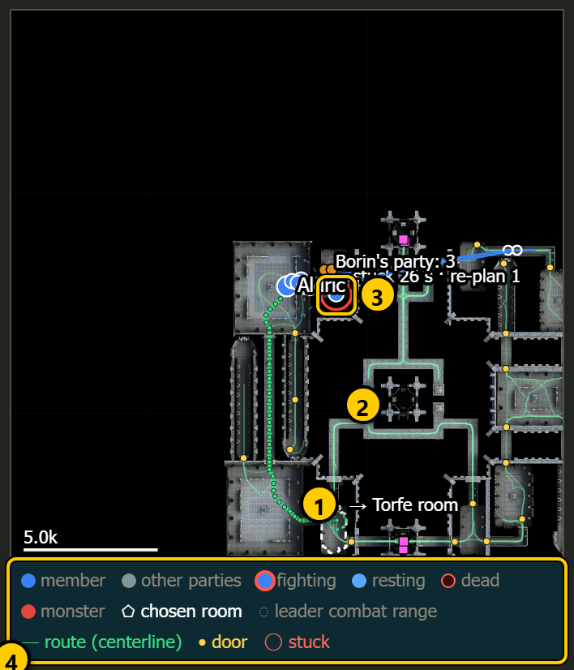 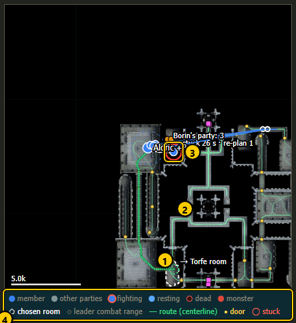

1. **Chosen room** - white dashed outline with *chosen: &lt;room&gt; · travelling*.
2. **Leader's route** - bright green along the centrelines, waypoint dots, the next waypoint ringed, *→ Torfe room* at the end.
3. **Stuck member** - red ring with *stuck 25 s · re-plan 1*.
4. **Legend** - with a route on the map it adds *━ route (centerline)*, *• door* and *◯ stuck*.

A rotation between rooms (current room gold, the next ones numbered with the expected monsters, a blocked one red with ✕):

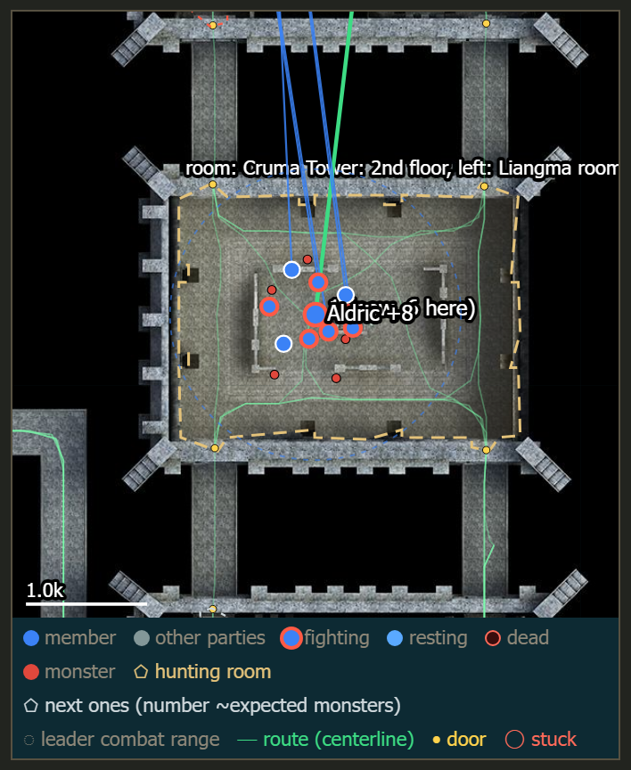 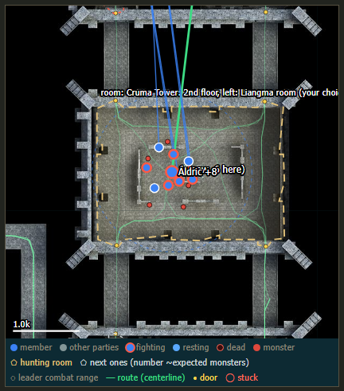

An outdoor field area and the next area of the rotation:

 

A hunting area with a raid boss in view (gold crown), a member far away and another party nearby:

 

A local fallback square and the *left, occupied* note:

## How to …

**Send the whole party leveling**
1. Press **Level** on the party card.
2. Read the question (who is busy) and press **OK**.
3. Watch the member tasks change to *regroup* and then *autolevel: …*.

**Make a party hunt in one dungeon room**
1. Press **Choose…** on the hunting spot line.
2. Tap the dungeon (e.g. *Cruma Tower*). The floor that fits the party opens.
3. Tap a green room. Read the room info (monsters, levels).
4. Press **Hunt only in this room** (or **Hunt in this room** in the selection bar) and **OK**.
5. The spot line shows *travelling*, then *in the room ✓*. The party map draws the room.

**Make a party rotate between several rooms or areas**
1. **Choose…** → the dungeon or hunting ground.
2. Tap rooms / areas in the order you want (or **Select all fitting**).
3. Press **Next:** until it says what you want (*nearest first* or *in my order*).
4. Press **Hunt in N rooms** → **OK**.

**Stop using your own choice**
1. Press **Back to auto** on the spot line (or **Auto (the leader picks)** in the picker) → **OK**.

**Turn hunting pairs on**
1. Tap the **Tactics** line to open it.
2. Mode **Auto** (recommended) or **On**; adjust group size and the rest if needed.
3. Press **Save tactics for party …** → **OK**. Within a minute the summary shows *pairs ON* (or why not).

**Give a special order**
1. Choose the entry in the task menu. 2. Type the argument (boss, town, name) if it needs one. 3. Press **Do** → **OK**.

## Notes and safety

- Every order and every saved setting on this page asks first. Nothing is sent to the game before you press **OK**.
- Orders go to the party leader's window, which passes them on in party chat. The [What they do](what-they-do.md) tab and the
  character pages show what each character made of it.
- Files written by this page: `Scripts/data/party_spots.json` (hunting spot) and `Scripts/data/party_tactics.json` (tactics). Both are
  read live by the bots - no deploy, no restart.
- Everything else on the page is read from the bots' live state files (`Logs/swarm_state_<name>.json`, written every few seconds) and
  from L2Swarm (the monsters on the map).
- A row is faded when its character has not reported for 30 seconds: check L2Swarm and the [PC](pc.md) tab.
- The live parts of a card (escape box, cast bar, rescue trips, rotation, occupied spots, hunting pairs) are explained with pictures in
  [Party live states](../live/party-live.md).
