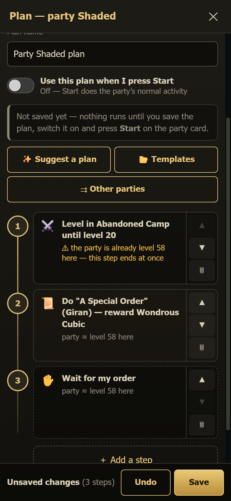
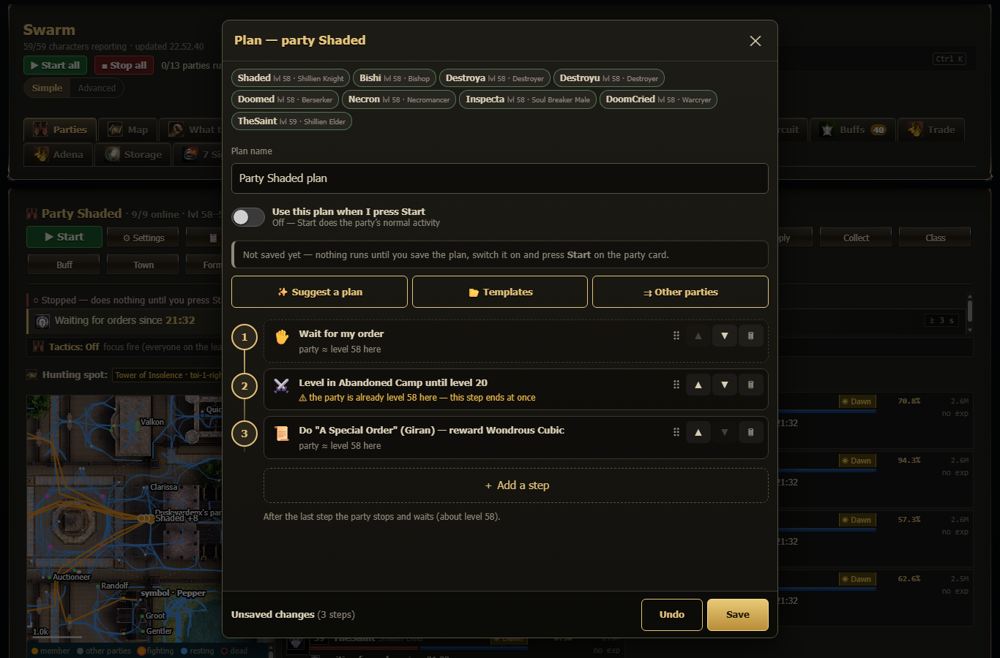
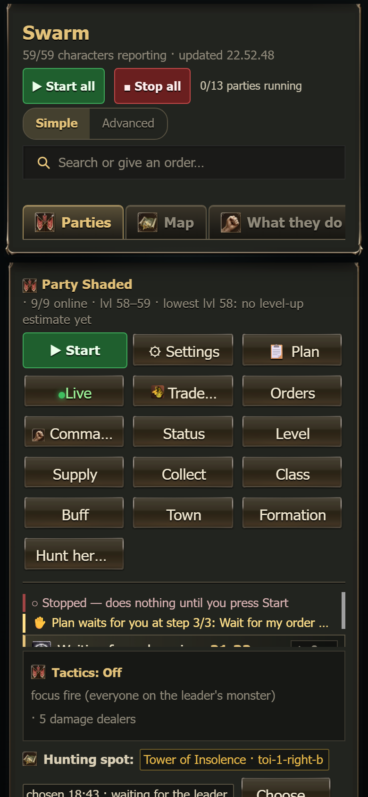
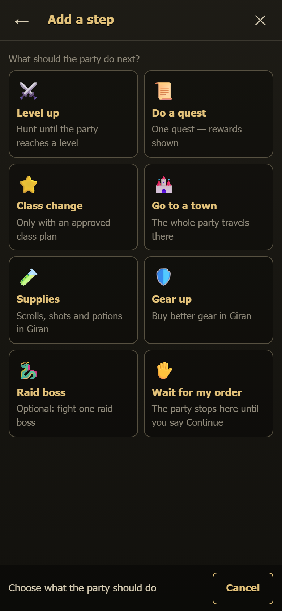
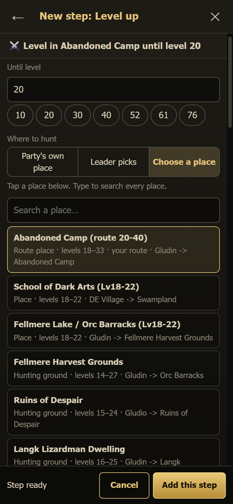
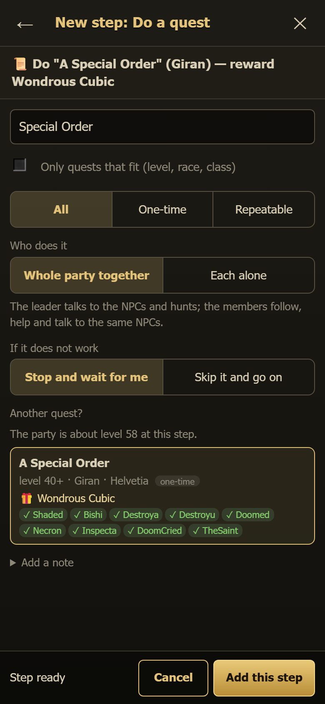
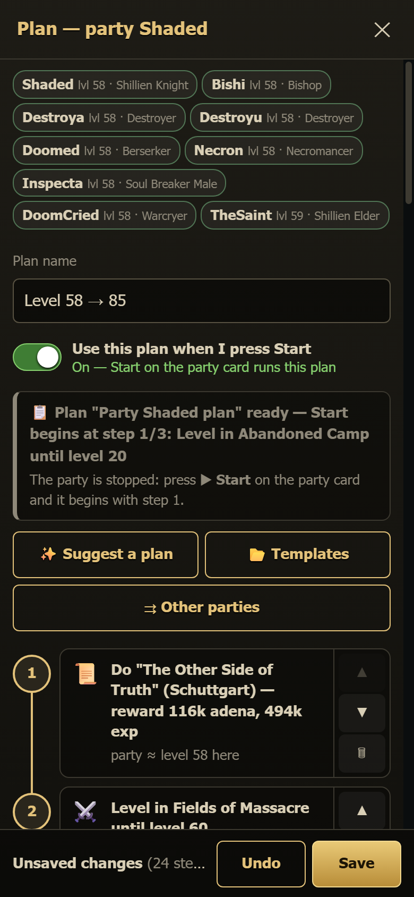
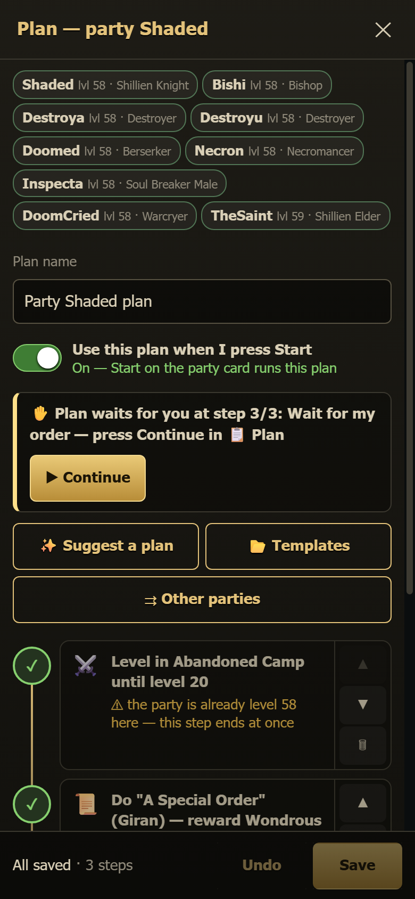
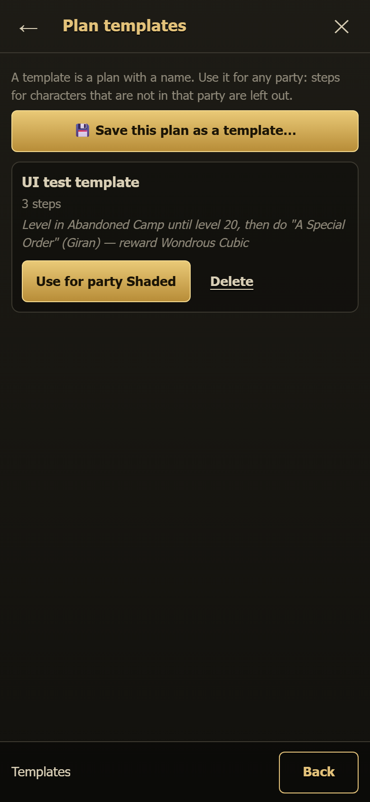

# Party plan (📋 Plan)

A **plan** is a list of steps that a party follows in order, for example: *level in Ruins of Despair until level 20, then do
"A Special Order" (Giran), then change class, then buy supplies, then wait for my order.* You build it once and the party works through
it by itself.

Every party card has a **📋 Plan** button, right after **⚙ Settings**. The ⚙ Settings window also has a **Plan** section with an
**Open the plan** button.

 

## When does the plan run?

Two things must be on:

1. **Use this plan when I press Start** (the switch at the top of the plan). A new plan starts with this switch **off**: *Off — Start
   does the party's normal activity.*
2. The party is **started** (**▶ Start** on the party card).

Then **Start** runs the plan instead of the normal leveling. Nothing happens by itself before that. When you press **■ Stop**, the
plan pauses on the step it was doing. The next **Start** continues with that same step.

The party card shows one line for the plan, for example **📋 Plan step 3/9: Level in Abandoned Camp until level 33**. Tap the line to
open the plan.

## Build a plan

1. Tap **＋ Add a step** and choose what the party should do:

   

   | Step | What the party does | When the step is done |
   |---|---|---|
   | ⚔️ **Level up** | Hunts until the **lowest** member reaches the level. *Where to hunt:* the party's own place (the hunting spot on the party card), *Leader picks* (a place that fits the level), or *Choose a place* (a list of the known places with their levels; type to search). | Everyone is at that level. |
   | 📜 **Do a quest** | One quest. The list shows the level, the town and NPC, *one-time / repeatable*, the **reward** (adena, exp, items) and a ✓ / ✗ for every member (race, class, level). Choose *Whole party together* or *Each alone* (tick who). For a repeatable quest you can set *How many times*. | The quest is completed (the quest engine counts it). |
   | ⭐ **Class change** | Changes class on the Community Board, **only** for characters with an **approved class plan** (Classes page). A character without one is never changed; the step shows who. | Nobody in the step can change any more. If someone is still below the class level, the plan stops there and says who. |
   | 🏰 **Go to a town** | The whole party travels there. | Everyone stands in the town. |
   | 🧪 **Supplies** | The same as **Supply** on the party card: scrolls, shots and potions in Giran for everyone. | The supply run is over. |
   | 🛡️ **Gear up** | Everyone buys better gear in Giran (your Gear page settings decide what). | The shopping is over. |
   | 🐉 **Raid boss** | One raid boss (optional). The list shows the bosses near the party's level. | The boss is dead, or it was not there. |
   | ✋ **Wait for my order** | The party stops and waits. | You press **▶ Continue**. |

    

2. The step shows as a plain sentence. Yellow lines under a step are **warnings**, for example *needs level 40 — the party is about 20
   here*. A warning never blocks you: it only tells you what may go wrong.
3. **Move steps.** On a phone, use **▲ ▼**. On a desktop, drag a step by its **⠿** handle (the arrows work too). **🗑** deletes a
   step. Tap a step to change it.
4. **If it does not work** (quest and raid steps): *Stop and wait for me* (default) or *Skip it and go on*.
5. Press **Save**. If the plan is not switched on yet, you are asked: **Save only**, or **Save and use it on Start**. **Undo** throws away
   your changes.

If someone else saves plans while your window is open (another page or phone), Save tells you so. You can **Overwrite** with yours, or
**Reload** to see theirs.

## Suggest a plan

**✨ Suggest a plan** builds a plan from the party's lowest level up to the level you pick. It uses:

- the party's own hunting places from its leveling route (else the known places for each level),
- the best **one-time** quests that every member can take, near the hunting place's town first (at most two per level band),
- a class change at 20 / 40 / 76, followed by better gear and then supplies in Giran (so the shots match the new weapon grade),
- and **Wait for my order** at the end.

Everything is editable afterwards, and nothing is saved until you press **Save**.

## While the plan runs

The box at the top says where the party is and offers the right buttons:

| The box says | Buttons |
|---|---|
| 📋 *Plan step 3/9: …* (running) | **⏸ Pause the plan**, **⏭ Skip this step** |
| ✋ *Plan waits for you at step 5/9* | **▶ Continue** |
| ⚠ *Plan stopped at step 4/9 — why* | **↻ Try again**, **⏭ Skip this step** |
| ⏸ *Plan paused at step 4/9 — why* (Stop, or one of your own orders took over) | **▶ Go on**, **⏭ Skip this step** |
| ✓ *Plan finished* | **↺ Start again from step 1** |

Done steps get a ✓, and the current step pulses. When you send the party one of your own orders (for example **Town** or **Level** on
the party card), your order wins: the plan pauses, and **Go on** (or **Start**) continues with the same step. After the last step the
party stops (its **Start** switch goes off) and waits for you.

The plan survives restarts. A party that was **started** and running its plan goes on with the same step about a minute after a
restart. A stopped party never starts by itself.

## Templates and other parties

- **📂 Templates → Save this plan as a template…** saves the plan with a name. **Use for party X** puts it on the party you are
  looking at (save afterwards).
- **⇉ Other parties** gives the plan, as you see it now, to the parties you tick. *Use it when they are started* decides whether their
  Start runs it.
- Steps for characters who are not in a party (*Each alone: Bishop1*) are left out there, and the window lists them.

## Simple and Advanced view

The Simple view shows only sentences. The Advanced view also shows step ids, quest and NPC numbers, and a **Details** box with the
file and the raw plan.

## For the curious

- Plans: `Scripts/data/party_plans.json` (written only by the dashboard: lock, conflict check, a history copy in
  `Scripts/data/history/`). Progress: `Logs/plan_progress_<leader>.json` (written by the party leader's window).
- Orders the plan buttons send: `!plan start | next | stop | goto <n> | restart | status` (also in the command center).
- The leader runs every step with the same orders you would send (`!town`, `!supply`, `!gearup`, `!mission raid`, `!classchange`),
  the quest engine (`!quest`) and the normal leveling with the step's hunting place.
