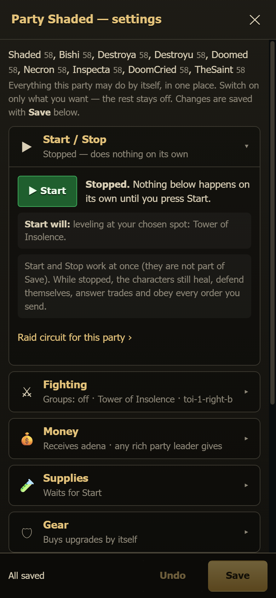

# Party settings (⚙ Settings)

Every party card has a **⚙ Settings** button, right after **Start / Stop**. A character's page has the same button
(**⚙ Party settings**), and it opens the settings of that character's party.

The window gathers in one place everything the party may do **by itself**. Each line has a switch, a sentence that says what the
switch does now, and one line that explains it. Nothing is automatic unless you switch it on: *Off — nothing happens until you switch it
on.* A new party has everything off.

## How to use it

1. Tap a section to open it (Start / Stop, Fighting, Money, Supplies, Gear, Storage, Clan, Daily, Routes). The grey line under each
   title tells you its state at a glance.
2. Change what you want. The bar at the bottom says **Unsaved changes** and lists the sections you changed. A gold dot marks them too.
3. Press **Save**. A question lists every change before anything is written. **Undo** throws your changes away.
4. The bots read the new settings within about a minute. Nothing needs a restart.

If someone else changes the same settings while your window is open (another page, another phone), Save tells you so. You can
**Overwrite** them with yours, or **Reload** to see theirs.

Closing the window with unsaved changes asks first.

## The sections

**Start / Stop.** This shows whether the party is running and what **Start** will do (for example, "leveling at your chosen spot").
Start and Stop act **at once**: they are not part of Save. While a party is stopped, nothing in the other sections happens on its own.
The characters still heal, defend themselves, answer trades and obey your orders.

**Fighting.** This shows the hunting place. **Choose hunting place…** opens the usual picker. It also holds the hunting groups: *Off*
means everyone attacks the leader's monster, *Auto* means groups only when the party is strong enough, and *On* means groups all the
time. The group details are under **Group details**.

**Money (adena).**
- *Adena hand-outs between parties* switches the whole system on or off **for every party**.
- *Party X receives adena* sets whether this party is topped up. You can set the top-up amounts for the leader and for each member.
  Empty means the default amount. You can type `8m`, `300k` or `8,000,000`.
- *Who gives to party X* picks the givers for **this party only**: *Like all* (the shared choice below), *Any leader* (any rich party
  leader), *Chosen* (only the party leaders you tick; the number next to each name is the adena it has now) or *Nobody*. The line
  under it says what happens now, for example "On — only Crafter1 may give to this party". Only party leaders hand out adena.
- *Who gives — all other parties* is **shared by all parties** that did not pick their own givers. The choices are any rich party
  leader, **only the characters you tick**, or nobody. *A giver always keeps at least* protects the giver's own money (shared).
- *Per character* sets an amount for one character. `0` means that character never receives.
- **Collect spare adena to the leader now** sends that order once.

**Supplies.** Three switches, each *Off — nothing happens until you switch it on* on a new install:
- *Supply runs when someone runs low*: the leader goes to Giran by himself, buys escape / resurrection scrolls, shots, potions and
  arrows for everyone and hands them out (also when his bag is full).
- *Sell junk on town visits*: items you marked "sell" are sold whenever a character idles in a town, and old gear + marked items are
  sold during supply runs.
- *Draw symbols (dyes) in supply runs*: a character with a symbol plan buys the dyes and draws its next planned symbol in Giran.

They work only while the party is started (the state line says "works once you press Start" while it is stopped). *Per character*
switches selling and symbols on or off for one character; its own choice wins over the party's switch. A supply run sells and draws
symbols only for the characters whose switch is on, also a supply run you order yourself. **Your orders always work**, even with
every switch off: **Supply run now** (!supply), **Sell now** (!sell) and !dyes on a character standing in Giran.

**Gear.** *Buy gear upgrades by themselves* means the characters buy better gear during supply runs. That costs adena, so Save warns
you when you switch it on. *Per character* can switch it on or off for one character, or **lock** a character's gear so nothing it wears
is ever changed. Enchanting is never automatic: you always start it yourself.

**Storage.** *Store items in a warehouse by themselves*, plus which warehouse, what to store, when and in which town. *Like all
parties* uses the defaults of the Storage page. *Per character* overrides one character. The event-letters switch takes this party in
or out of the letters hand-over, which itself is switched on or off on the Storage page.

**Clan.** This section only appears when there is a clan. *Invite this party into the clan* ticks every member, now and later. The
clan-wide switches are shown read-only: change them on the Clan page.

**Daily.** *Daily Kamaloka*: once a day the party goes into a Kamaloka that it fits. *Seven Signs*: every member signs up with
the Priest of Dawn, which is needed for catacombs and necropolises.

**Routes.** These set what the bots may do on long computed routes: open doors, wait at timed doors, swim, drop off ledges, buy Thief
Keys, walk out of Heine. Each switch says whether it is the default. **Back to the default** removes your own choice.

## Simple and Advanced view

In the **Advanced** view, each section also shows which settings file it writes. The **Simple** view hides that.

## Good to know

- Lines marked **shared by all parties** (the adena hand-out switch, *who gives — all other parties*, the giver's minimum) change
  every party. *Who gives to party X* and the Supplies switches change only this party.
- The window writes only the settings of this party. Every other party's settings stay as they are.
- Everything here can also be changed on the bigger pages (Adena, Gear, Storage, Clan, Kamaloka, 7 Signs, the route view); the links
  at the bottom of each section open them.
