# PC (`#/pc`)

The PC tab watches and controls the **L2Swarm program** on the bot PC: is it running, how much memory it uses, and buttons to start,
restart or stop it and to put a new version of `swarm.js` live. Use it from your phone when the bots stop reporting, when the PC is low
on memory, or after you edited the script.

> L2Swarm needs administrator rights. The buttons do not start it themselves: they run the scheduled tasks **L2Swarm Start**,
> **L2Swarm Stop** and **L2Swarm Restart**, which run elevated without a UAC prompt. The tasks are created once by
> `SETUP_PC_ALWAYS_ON.cmd` (run as admin, see [Getting started](../01-getting-started.md)). Without them a button answers
> "... - run SETUP_PC_ALWAYS_ON.cmd once (as admin) to create the L2Swarm tasks".

## L2Swarm program (`#/pc`)

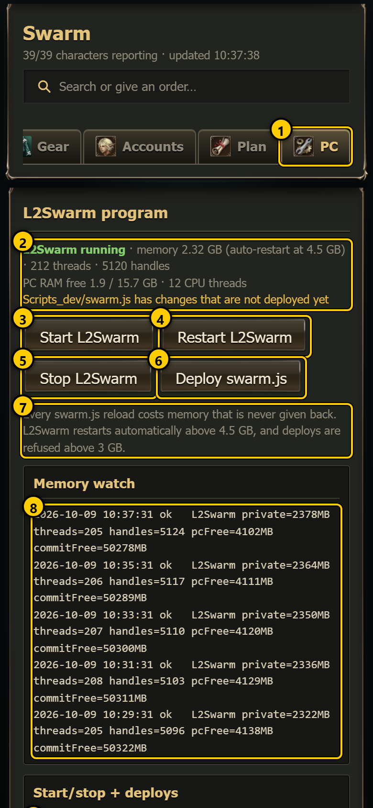 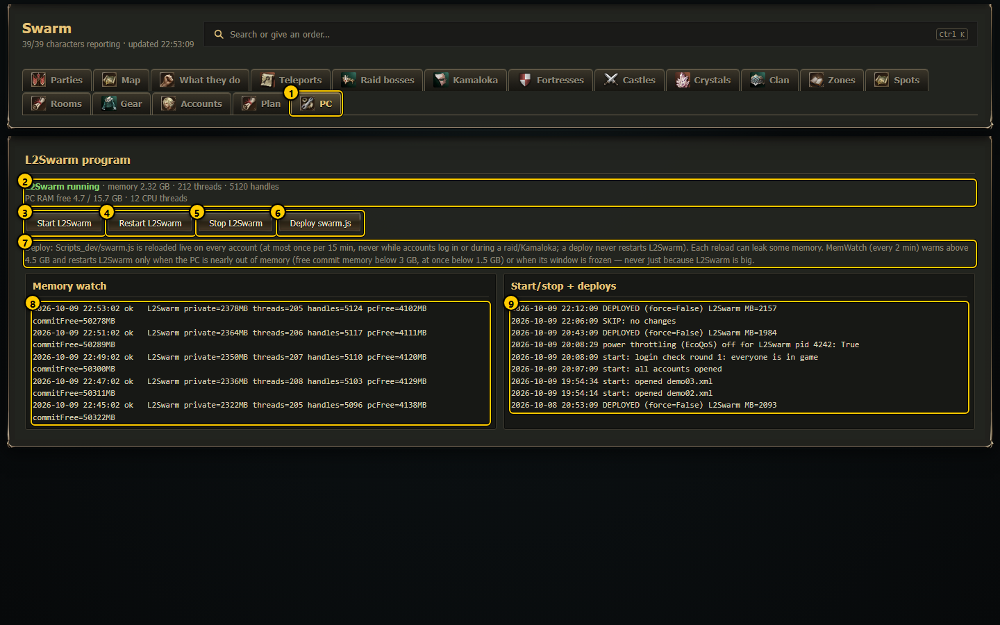

1. **PC tab**: opens this page.
2. **Status**: is L2Swarm running, its memory, threads and handles, the PC's free RAM and CPU threads, and whether a newer `swarm.js`
   is waiting to be deployed (see [Status line](#status-line)).
3. **Start L2Swarm**
4. **Restart L2Swarm**
5. **Stop L2Swarm**
6. **Deploy swarm.js**
7. **The limits line**: a reminder that every script reload costs memory (see [Memory and the limits](#memory-and-the-limits)).
8. **Memory watch**: the last 5 lines of `Logs/memwatch.log`, newest first.
9. **Start/stop + deploys**: the last 5 lines of `Logs/l2swarm_ctl.log` and the last 5 of `Logs/deploy_swarm.log`, mixed by time,
   newest first.

The page refreshes every 15 seconds while it is open. The process numbers (memory, threads, handles) are measured by the dashboard
server once a minute, so they can be up to a minute old.

## Status line

| Look | Meaning |
|---|---|
| 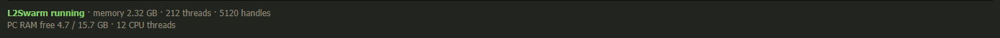 | **L2Swarm running** in green: memory is normal. The line shows the memory in GB, "(auto-restart at 4.5 GB)", threads and handles; then "PC RAM free *x* / *total* GB · *n* CPU threads". The orange line under it says **Scripts_dev/swarm.js has changes that are not deployed yet**. |
| 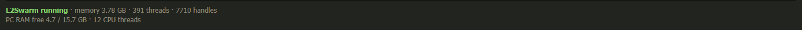 | **Orange**: L2Swarm uses more than 3 GB. |
| 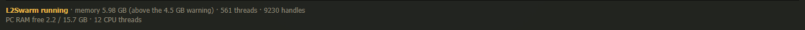 | **Red**: L2Swarm uses more than 4.5 GB. |
| 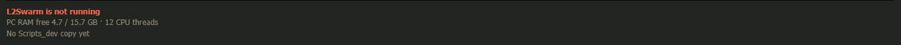 | **L2Swarm is not running** (red). "No Scripts_dev copy yet" = there is no `Scripts_dev/swarm.js` to deploy from. |

The same on a phone:

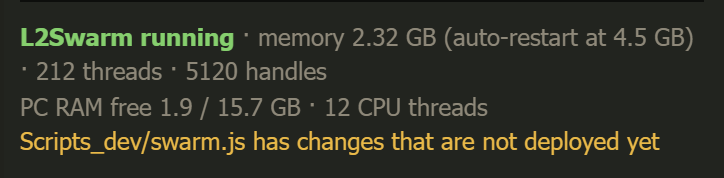 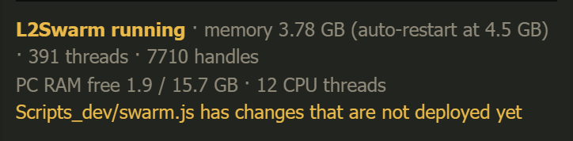
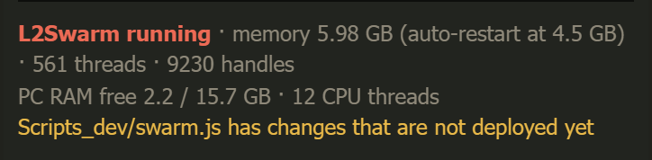 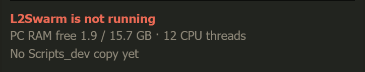

## The buttons

| Button | Asks first? | What it does |
|---|---|---|
| **Start L2Swarm** | No | Runs the task *L2Swarm Start*: starts L2Swarm and logs the accounts in **one by one** (the AutoStart list of L2Swarm is switched off on purpose, because many logins at once are refused by the login server for minutes). Gap between logins: `login.gapSeconds` in `swarm.config.json` (8 s if not set; `Settings/login_gap.txt` wins when present). It closes L2Swarm's empty default account, then checks that everyone got in game and retries the ones that did not. Nothing happens if L2Swarm already runs or another start is busy. |
| **Restart L2Swarm** | Yes: "Restart L2Swarm? All characters log out and back in (about 1 min)." | Runs *L2Swarm Restart*: Stop, then Start (staggered login again). With many accounts the full login takes longer than a minute. |
| **Stop L2Swarm** | Yes: "Stop L2Swarm? All characters log out." | Runs *L2Swarm Stop*: ends L2Swarm at once (a hard stop, so no "are you sure?" window waits on the PC), closes the game clients L2Swarm started for in-game characters, and leaves a "stopped on purpose" mark (`Logs/l2swarm_stopped.flag`) so the memory watch does not start it again by itself. The next Start removes the mark. |
| **Deploy swarm.js** | Only when it is too soon (see below) | Runs `docs/plan/tools/deploy_swarm.ps1`: copies `Scripts_dev/swarm.js` over the live `Scripts/swarm.js`. L2Swarm notices the change and reloads the script on every account. |

After a button, the message line under the header shows the answer, and the status is read again after 2 and 17 seconds.

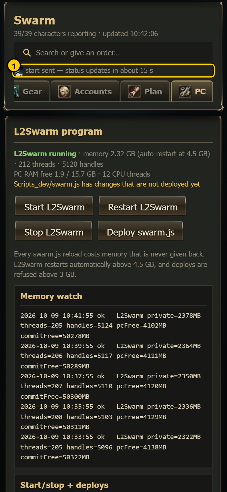 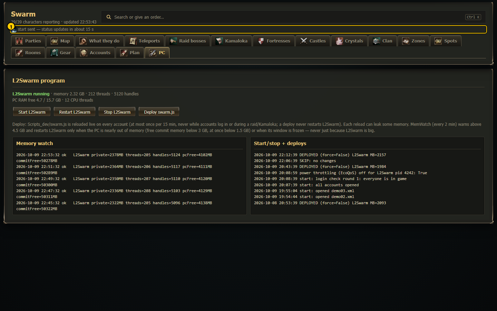

1. "start sent - status updates in about 15 s".

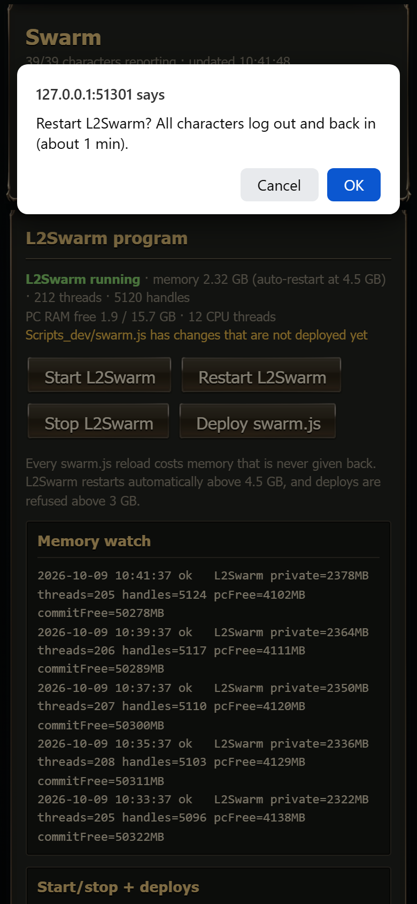 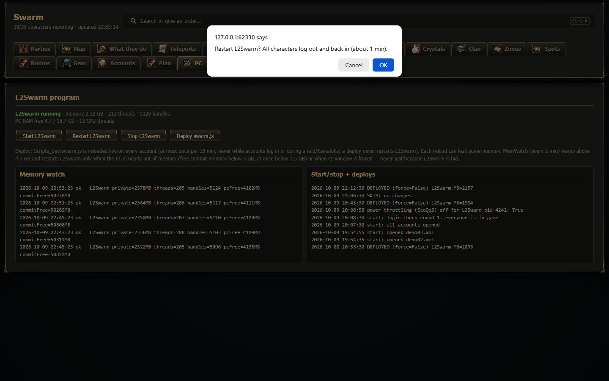

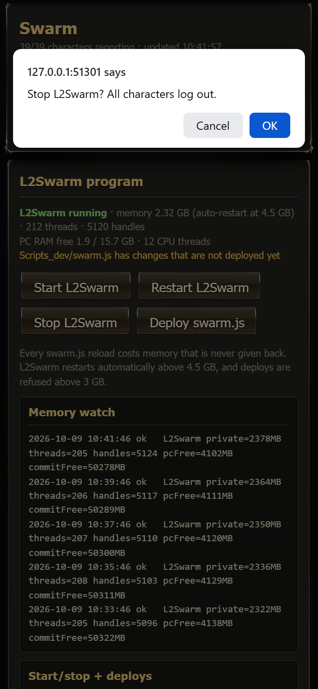 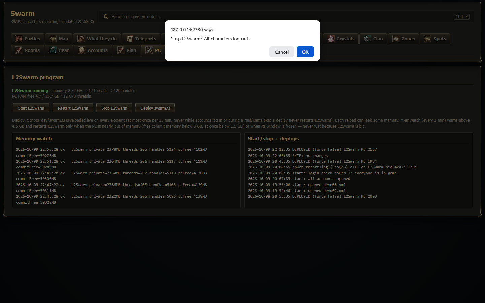

> Before a planned Stop or Restart, send the parties to a town first. Characters left in a hunting ground stay in the world for a while
> after the program stops, and can die there. Never stop or restart during a raid or Kamaloka.

## Deploy swarm.js

You edit `Scripts_dev/swarm.js`, never the live `Scripts/swarm.js` (every write to the live file reloads the script on all accounts at once).
When your edits are done, press **Deploy swarm.js**. The deploy script:

1. **SKIP: no changes** when both files are the same.
2. Checks the syntax (`node --check`). A syntax error: **ABORT: syntax error in Scripts_dev\swarm.js**, nothing is copied.
3. Refuses when the last deploy was less than **15 minutes** ago: "ABORT: last deploy *n* min ago (min gap 15). Batch more edits, or use
   -Force." The page then asks **Deploy anyway?** (OK = deploy with `-Force`).
4. Refuses during a live **raid or Kamaloka** ("ABORT: a fight is live (raid_live.json, ...)"), because the reload would end the fight
   routine.
5. Refuses while accounts are still **logging in** after a start ("ABORT: accounts are still logging in ...").
6. Copies the file: **DEPLOYED (force=False) L2Swarm MB=*n*** (the memory at that moment). It is always a live reload; the deploy never
   restarts L2Swarm.

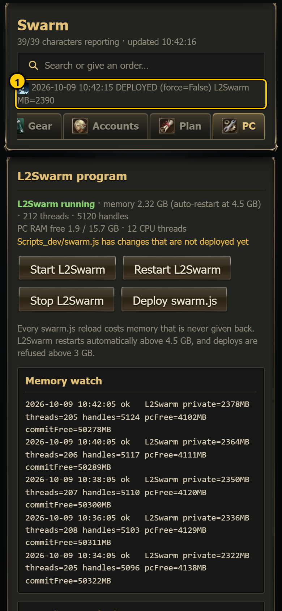 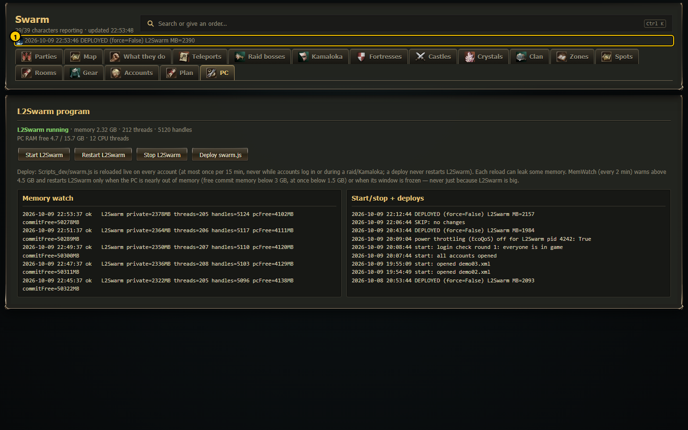

1. The deploy script's answer in the message line.

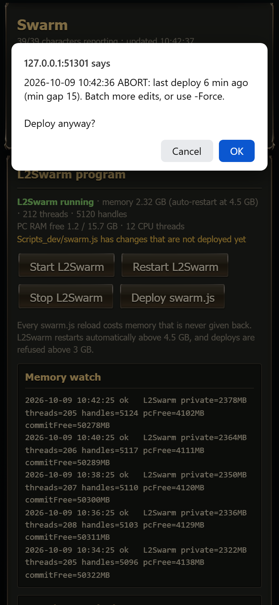 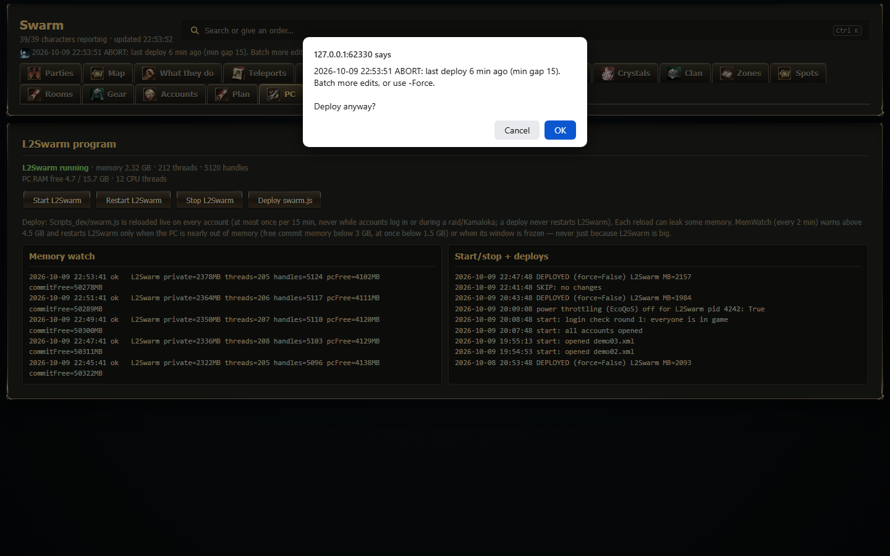

The question shows the deploy script's line, then "Deploy anyway?". **OK** deploys with `-Force`, which skips the 15-minute gap **and** the
live-fight and login checks. Cancel deploys nothing.

 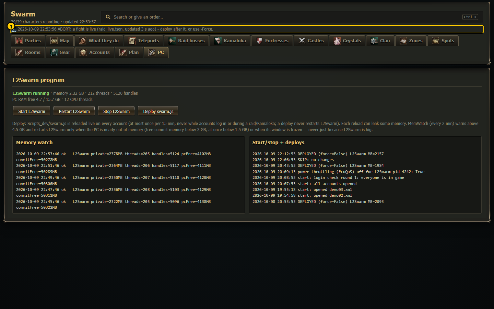

1. Refused: a fight is live. Wait until the raid or Kamaloka is over and press the button again.

Every deploy attempt is a line in `Logs/deploy_swarm.log`, so it also shows in the *Start/stop + deploys* box.

## Memory and the limits

Every reload of swarm.js costs L2Swarm some memory that it does not give back, so the memory slowly grows while it runs, faster with
many deploys. That is why deploys are spaced out and batched.

The **memory watch** (scheduled task *L2Swarm MemWatch*, every 2 minutes, `docs/plan/tools/l2swarm_ctl.ps1 -Action watch`) writes one line
per check to `Logs/memwatch.log`:

```
2026-10-09 08:11:02 ok   L2Swarm private=2380MB threads=212 handles=5120 pcFree=4100MB commitFree=50300MB
```

`private` = L2Swarm's memory, `pcFree` = free RAM of the PC, `commitFree` = free memory including the page file. The line starts with
`WARN` above 4.5 GB. Other lines you may see: `RESTART ...` (it restarted L2Swarm), `HIGH ... (live fight ... - no restart)`, and
`DEADLOCK ...` (L2Swarm stopped answering and was restarted).

What the watch does by itself:

- It does **not** restart L2Swarm just because it is big. It restarts only when the PC is about to run out of memory (free commit memory
  below 3 GB), at most once per 30 minutes, and never during a live raid or Kamaloka unless memory is nearly gone (below 1.5 GB).
- It starts L2Swarm again when it is not running (after a crash), unless you stopped it with **Stop** or a start is already running.
- It restarts L2Swarm when its user interface hangs (MCP stops answering and the scripts stop reporting).

The status colours and the limits line on the page use fixed numbers built into the dashboard: orange above 3 GB, red above 4.5 GB,
"(auto-restart at 4.5 GB)", "deploys are refused above 3 GB", and a 20-minute gap in the button's tooltip. The tools themselves use the
rules described above (warning line above 4.5 GB, restart only on low PC memory, 15-minute deploy gap, no memory limit on deploys).
Read the colours as "how big is it", and the memory watch log as "what will happen".

## How to ...

**Put your swarm.js edits live**

1. Save your edits in `Scripts_dev/swarm.js` (several edits together).
2. Make sure no raid or Kamaloka is running and the accounts finished logging in.
3. Open **PC**, check the orange "changes that are not deployed yet" line, press **Deploy swarm.js**.
4. Read the answer: DEPLOYED, SKIP or ABORT with the reason.

**Bring everything back after the bots stopped reporting**

1. Open **PC**. If the status says *not running*, press **Start L2Swarm**.
2. If it runs but the characters do not report, send the parties to town if you can, then **Restart L2Swarm** and confirm.
3. Watch *Start/stop + deploys*: "start: opened ..." lines, then "start: all accounts opened" and "login check round 1: everyone is in game".

## Notes

- Restart and Stop log **every** character out. Start and Deploy do not ask.
- The buttons work from any device that can open the dashboard (on the LAN with the dashboard key).
- Logs: `Logs/memwatch.log`, `Logs/l2swarm_ctl.log`, `Logs/deploy_swarm.log`.
