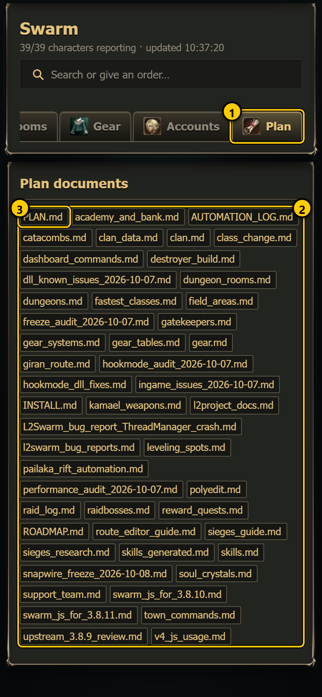
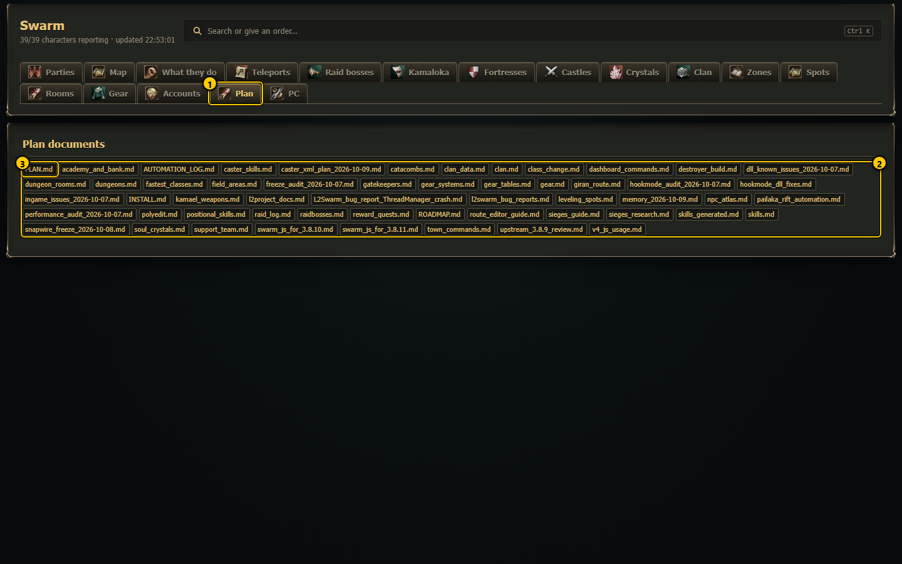
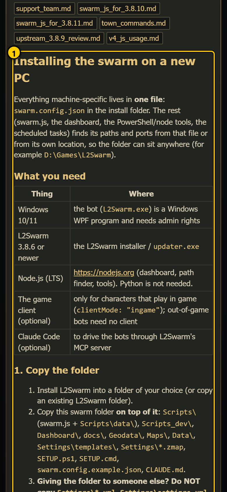
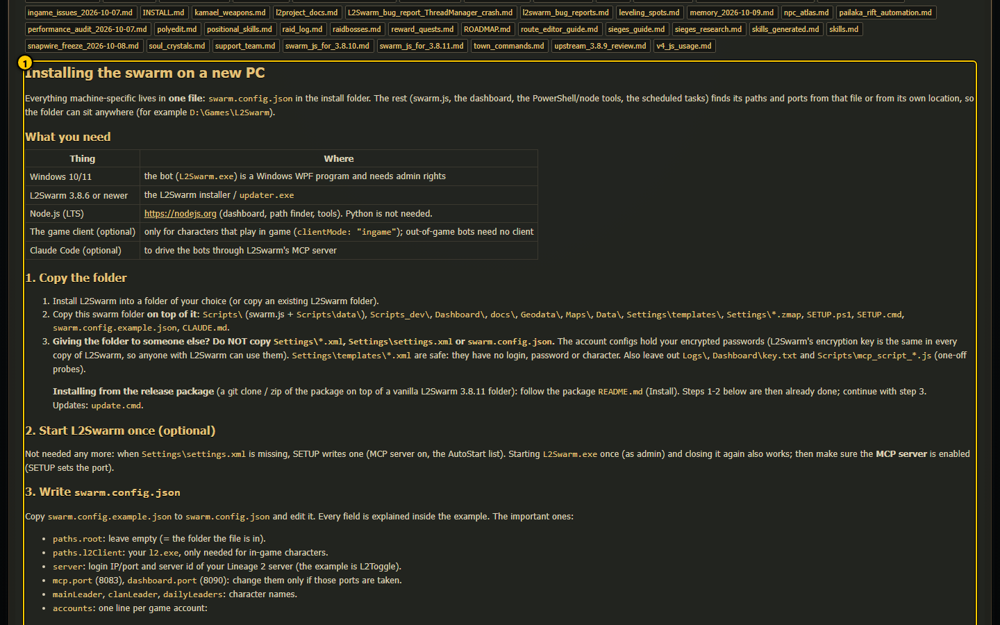

# Plan (`#/plan`)

The Plan tab is a reader for the project's own documents: every Markdown file (`*.md`) in `docs/plan/` and its sub-folders (except the
`tools` and `zones` folders). Use it to read the background documents on a phone, for example the install guide, the Kamael weapon list,
the raid log or the dashboard command list.

## Plan documents (`#/plan`)

 

1. **Plan tab**: opens this page.
2. **Document chips**: one chip per document, sorted by name. Sub-folder files show their folder (`folder/file.md`).
3. **PLAN.md** is always the first chip.

Tap a chip to open the document under the chips:

 

1. **The document**, rendered as formatted text (headings, tables, lists, code). If the Markdown renderer could not load (it comes from a
   public CDN), the plain text is shown instead.

## Every control

| Control | What it does |
|---|---|
| Document chip | Loads that file from the server (`/api/plan?f=<file>`) and shows it under the chips. Read only. |

There is nothing to save or confirm on this page. The list of chips is read once when the page loads; a new file appears after a reload
of the dashboard page.

## Useful documents

| File | What it is |
|---|---|
| `INSTALL.md` | Installing the swarm on a new PC. |
| `dashboard_commands.md` | Every dashboard command. |
| `route_editor_guide.md` | How to record and edit raid routes. |
| `polyedit.md`, `field_areas.md`, `dungeon_rooms.md` | Shapes, field areas and dungeon rooms. |
| `sieges_guide.md` | Fortress and castle sieges. |
| `kamael_weapons.md` | Which sword turns into which Kamael weapon (see [Gear](gear.md)). |
| `gear.md`, `gear_tables.md` | Background tables on gear per grade. |
| `raid_log.md` | Every raid kill, generated from the bots' logs (never edit it by hand). |
| `AUTOMATION_LOG.md` | The project's day-by-day journal. |

## Notes

- Only `.md` files inside `docs/plan/` can be opened; anything else answers "not found".
- To change a document, edit the file on the PC; the tab shows the new text the next time you open it.
