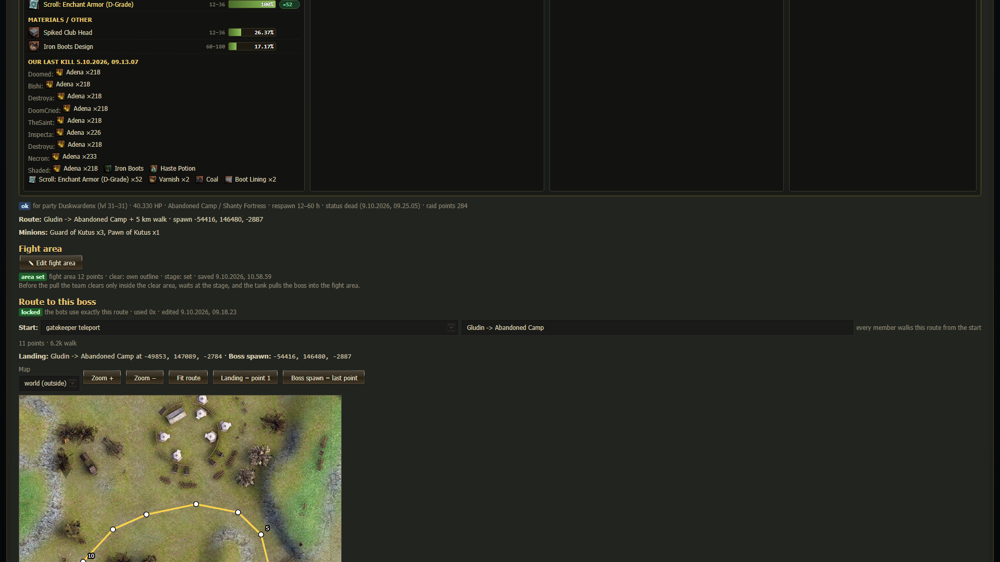
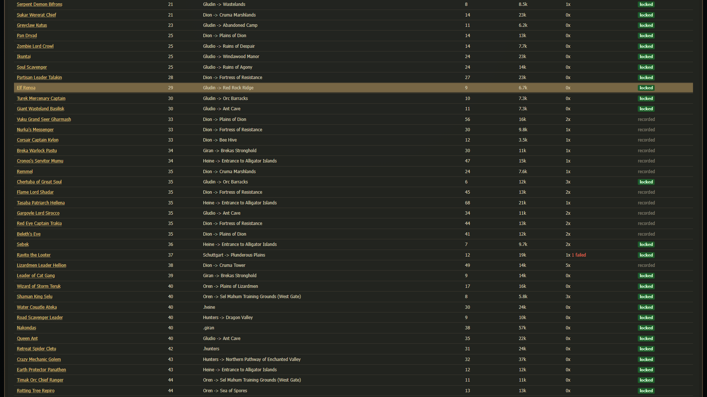
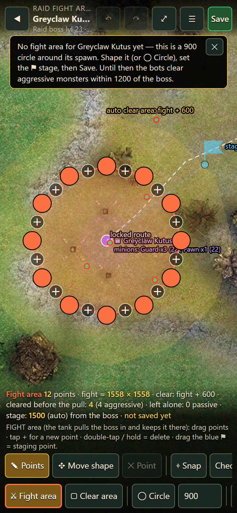
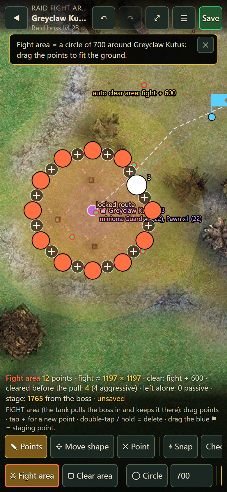
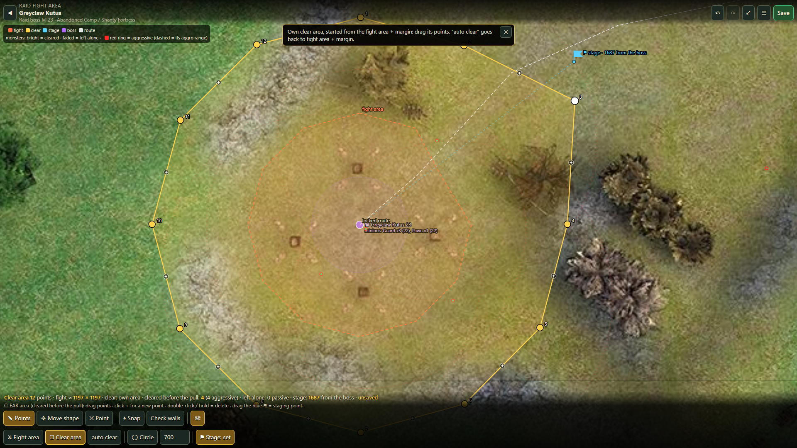
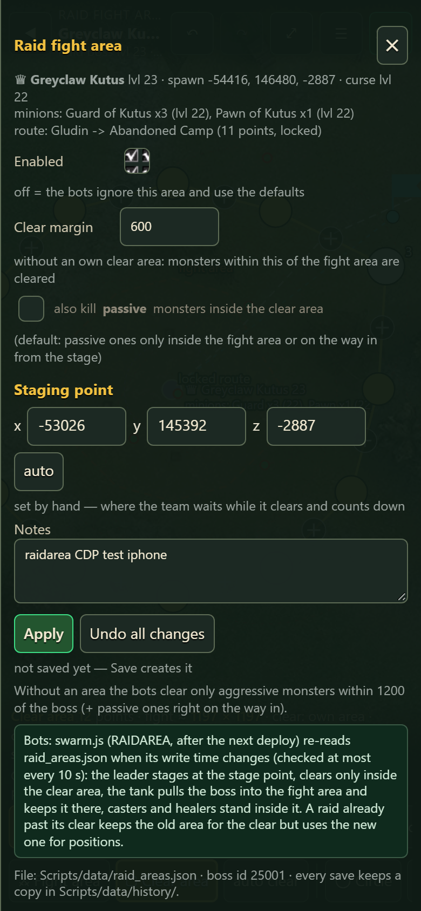
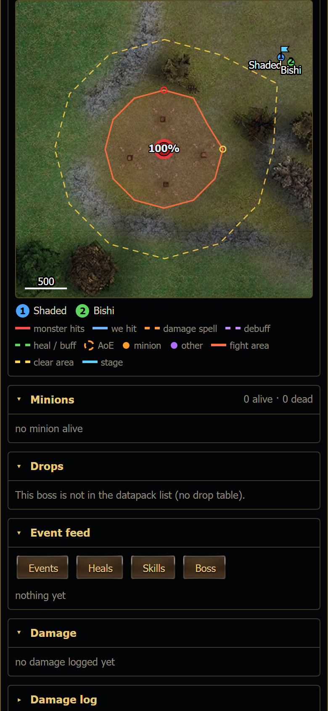

# Raid fight area (`#/edit/raidarea/<boss id>`)

Before a raid the team clears the monsters around the boss. Without a fight area it clears every aggressive monster near the boss, which can be a large area. A fight area lets you choose exactly where the team fights.

For every raid boss you can draw **where the team fights it**, **what is cleared before the pull** and **where the team waits**. The
area belongs to the boss (its npc id), so every party that raids that boss uses it.

## Where

- **Raid bosses tab** (`#/raids`): a boss with an area shows a green **area set** badge next to its name.
- **Boss page** (`#/raid/<id>`): section **Fight area** with **✎ Edit fight area** and a one-line summary (points, own clear outline or
  "fight area + margin", stage set or automatic).

 

The button opens the full-screen shape editor (the same editor as rooms / zones / spots, see [Shape editor](shape-editor.md)).

## The three things you set

| What | On the map | What the bots do with it |
|---|---|---|
| **Fight area** | orange polygon | The tank pulls the boss **into** it after taking aggro and keeps it there (boss walks out: the tank walks back in, the boss follows him). Casters and healers stand inside it, at its edge facing the boss when their normal spacing spot is outside. |
| **Clear area** | yellow; dashed outline = your own, soft yellow band = automatic (fight area + margin) | Before the pull the leader kills only the **aggressive** monsters inside it (passive ones only with "also kill passive"). Monsters that hit us are always killed. An area made automatically clears **only its circle** (no margin); the margin counts once you save the area yourself. Respawns: the clear stops once it killed 1.5x what was there at the start (at least 8), or after 4 minutes, then the countdown starts. |
| **Stage** | blue flag (faded = automatic) | The team walks there first and waits there during the clear and the countdown. Must be within ~3400 of the boss (the leader must see it). |

**No area for a boss** = the defaults: only aggressive monsters within **1200** of the boss (plus anything hitting us); the team waits ~1500 away on the way in and fights where the boss stands.

## How to use

 

1. **✎ Edit fight area** on the boss page. A boss without an area starts as a **900 circle** around its spawn (not saved yet).
2. **◯ Circle** + the number next to it: replace the shape you are editing with a circle of that radius around the boss (quick start).
3. Shape it: **drag a point**, **tap the small +** on an edge for a new point, **double-tap / hold** a point to delete it,
   **✥ Move shape** moves the whole area (the boss spawn stays). Pinch / wheel = zoom, drag the empty map = pan. ↶ ↷ undo / redo.
4. **⚔ Fight area / ▢ Clear area** switch which outline you edit. The first time you open **Clear area** it starts as the fight area
   + margin; just looking and going back keeps it automatic. **auto clear** throws your own clear outline away (fight area + margin again).
5. **⚑ Stage**: drag the blue flag to where the team should wait. The button switches between **Stage: auto** and **Stage: set**.
6. **☰**: clear margin (used without an own clear outline), **also kill passive monsters inside the clear area**, stage x / y / z,
   on / off, notes, **Remove this fight area** (back to the defaults).
7. **Save** (Ctrl+S): asks once with a summary (points, size, how many monsters will be cleared, stage distance).

### What the map shows

- The boss spawn (purple ♛) with a dashed ring where its minions spawn, and the minion list with their levels (**A** = aggressive).
- Monsters from the datapack spawns: **bright = will be cleared**, faded = left alone; a **red ring = aggressive**, with its aggro
  range dashed around it. Colour = level against the boss (grey low, green around, orange a bit above, red far above).
- The saved route to the boss (white dashed), the landing (blue square), the stage -> boss path (blue dotted).
- Bottom line: points, size, *cleared before the pull: N (aggressive / passive)*, *left alone*, stage distance, warnings.

### Checks on Save

Refused: fewer than 3 or more than 200 points, an outline that crosses itself, smaller than 200 x 200, wider than 10000 (fight) /
14000 (clear), a stage more than 3800 from the boss. Saved with a warning: the boss spawn more than 300 outside the fight area (raid
bosses walk home when pulled too far - keep the area at or near the spawn), parts of the fight area outside your own clear outline, a
stage inside the fight area or more than 3000 from the boss, a fight area wider than 4000. **Check walls / ⌖ Snap** work like for
rooms (geodata).

## In the live raid view

The live map draws the fight area (orange), the clear area (yellow), the stage flag and, **during the clear**, every monster still to
kill inside the clear area (red ring = aggressive). The header shows *Raid clearing: N left inside the clear area · K killed* and a chip
**clearing: N left**.

## Files and when the bots use it

- **`Scripts/data/raid_areas.json`** `{ about, areas: { "<npc id>": { boss, fight [[x,y]..], clear [[x,y]..] | null, clearMargin,
  clearPassive, stage [x,y,z] | null, enabled, notes, manual, edited, updated } } }`. Created on the first save; every save first copies
  the file to `Scripts/data/history/raid_areas_<time>.json` (last 50 kept); the write is locked + atomic; a stale editor gets "changed on
  disk" (409). Log: `Logs/polyedit.log`.
- Why not the route file `routes/raid/<id>.json`: the bots rewrite it with route fields only after every successful walk and delete it
  after two failures, so an area stored there would be lost.
- **swarm.js** (Scripts_dev, RAIDAREA block, after the next deploy) re-reads the file when its write time changes (checked at most every
  10 s): a change counts from the next raid's clear; positions in a running fight follow within 10 s.
- **Dashboard**: `GET/POST /api/polyedit?kind=raidarea&id=<boss id>`, `POST ...&action=reset` (remove), `GET /api/polyedit?list=raidarea`
  (badges). Needs a dashboard server restart once after the update (`Dashboard/polyedit_api.js`, `Dashboard/raidlive_api.js` changed);
  until then the boss page says so.

## Tests

- `node docs/plan/tools/test_raid_area.js`: the clear rule with / without an area (passive vs aggressive, inside / outside, path,
  attackers), staging, the tank's pull-in plan, pacing and a chase simulation, the members' clamp, `raidClearArea` run with mocks on a
  synthetic boss camp, the API on a temp copy (save, history, 409, validation, remove), wiring checks.
- `node docs/plan/tools/mobile_check/raidarea_cdp.mjs [iphone] [desktop]`: headless Edge against a sandbox (:8098, temp data, other GETs
  proxied read-only to :8090): boss page -> editor -> circle -> drag -> stage -> clear layer -> panel -> save -> badge -> live map.
  Screenshots `docs/plan/mobile_check/raidarea_<device>_<n>_<step>.png`.
