# Raid bosses, raid routes and reports

The **Raid bosses** tab is where you plan and follow raid boss hunting. It is a **board**: one compact card per raid boss of the High Five
datapack with its level, whether it is probably up (with a live respawn countdown), which of your parties it fits and how far away their
leader is, and badges for a saved route or fight area. From here you send a party to one boss, start an automatic **raidhunt** (one boss
after the other) for any party, open a boss's own page to correct its walking **route** and its **fight area**, and read the **saved
routes**, **fight reports**, **loot log** and **daily dungeons** sections. The **raid team templates** (which classes a big boss needs) live
on the Clan tab and are described at the end of this page. While a raid fight runs, it is pinned on top of the board; the fight itself is
shown in the [Raid live view (raid HUD)](raid-live.md).

Words used on this page (raid curse, focus, minion, landing, `.townname`, …) are explained in the [glossary](../06-glossary.md).

Where the data comes from (all read live, no restart needed):

| What | File |
|---|---|
| Boss list, levels, spawns, minions, nearest teleport, curse level | `Scripts/data/raidbosses_h5.json` (datapack) |
| Drop lists | `Scripts/data/raid_drops_h5.json` (datapack) |
| Seen alive / killed / found dead | `Logs/raid_status.json`, `Logs/raid_seen.log`, `Logs/raid_respawn.log` (written by the bots) |
| Raidhunt progress | `Logs/raidhunt.json` (the party leader writes it every 2 s) |
| Saved routes | `Scripts/data/routes/raid/<boss id>.json` (old versions in `routes/raid/history/`) |
| Fight areas | see [Raid fight area](raid-area.md) |
| Loot | `Logs/raid_loot.log` |
| Fight reports | `Logs/raid_reports/*.json` + `Logs/raid_heals.log` |
| Daily dungeon switches | `Logs/daily_enabled.json`, progress `Logs/daily_<leader>.json`, `Logs/daily.log`, `Logs/kamaloka.log` |

---

## The board (`#/raids`)

Open it with the **Raid bosses** tab. Your choices on this page (party, filters, sort, which sections are open) are remembered in your
browser.

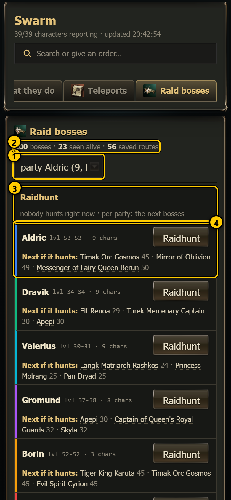 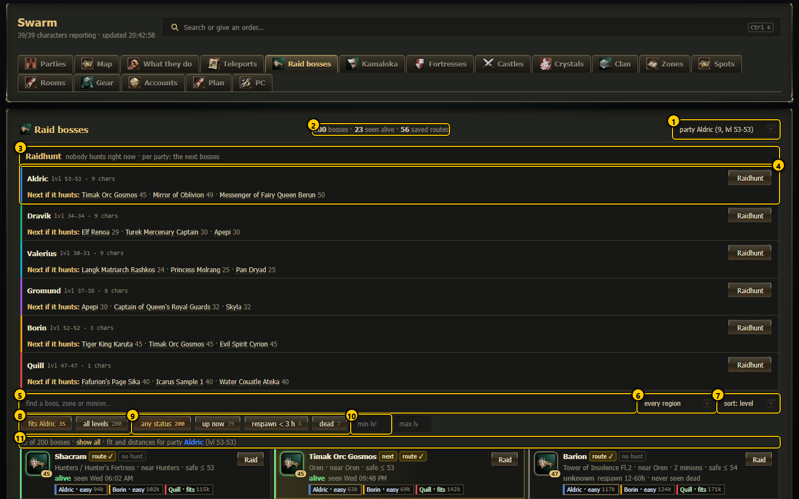

1. **Party** - "party Aldric (9, lvl 49-50)". The fit chips, the distances, the **next** badge and the **Raid** buttons of the cards are for
   this party. (A running raidhunt's party is chosen by default.)
2. **Summary** - how many bosses, how many seen alive, how many saved routes.
3. **Raidhunt** - a fold-out with one row per party; the title says who hunts right now ("party Aldric hunts Carnage Lord Gato" or "nobody
   hunts right now"). Open by default.
4. **One party's row** - party name, level range and size, **Raidhunt** (start it for that party, with confirmation) and **Next if it
   hunts**: the first three bosses raidhunt would take now. While that party hunts, the row shows its progress instead (see
   [Raidhunt row](#raidhunt-row)).
5. **Find a boss, zone or minion** - text filter (also matches minion names and the teleport).
6. **Region** - "near Oren (12)" etc.: only bosses closest to that town.
7. **Sort** - by level, by respawn (up first, then the soonest to come back), by distance from the party leader, or by name.
8. **fits <party> / all levels** - "fits" hides bosses that are too hard or would curse the party; the number is how many bosses there are.
9. **Status filter** - any status / **up now** (alive, should be up, maybe up) / **respawn < 3 h** / **dead**, each with its count.
10. **min lvl / max lvl** - level range.
11. **Count** - "N of M bosses", **show all** (clears every filter), and which party the fit is for.

### Boss cards

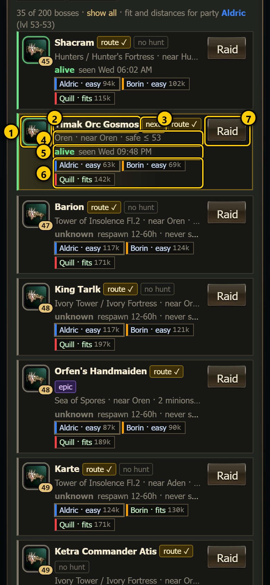 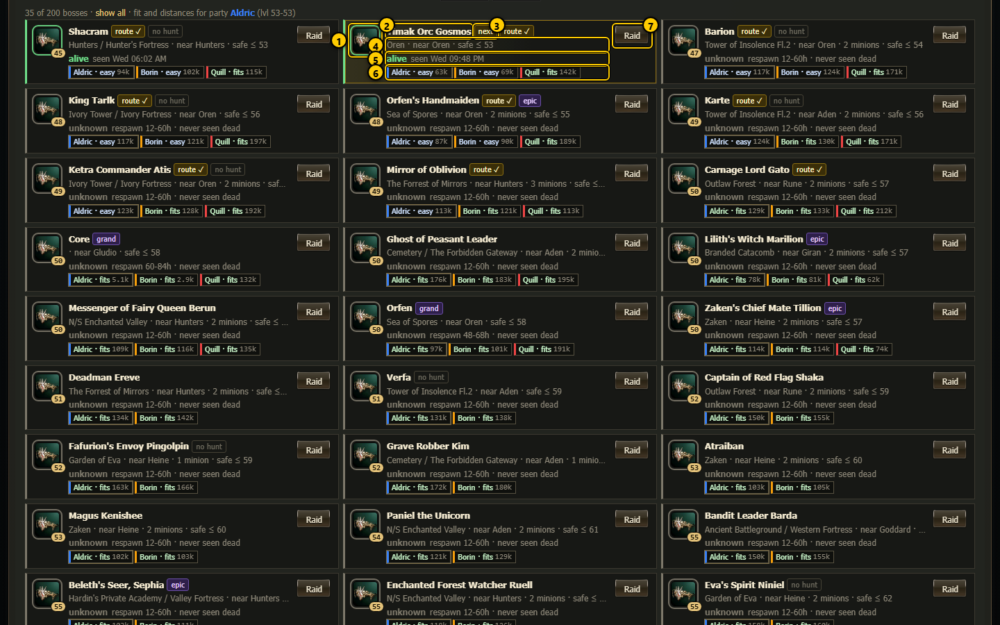

Tap a card (anywhere but its buttons) or its name to open the [boss page](#boss-page-raidid).

1. **Level and status ring** - the boss level; the ring's colour is the status (alive / should be up, maybe up, dead, unknown).
2. **Name** - opens the boss page.
3. **Badges** - **next** (gold: what raidhunt takes next for this party; the card has a gold edge), **LIVE** (being fought now), **area** (a
   [fight area](raid-area.md) is set), **route** / **route ✓** (a saved route / a locked one; **!** = it failed recently), **epic**, **no
   hunt** (raidhunt skips it: epic, inside a dungeon, no walkable way, or not for one party - a manual Raid order still works).
4. **Zone line** - zone, nearest town, number of minions, and **safe ≤ N**: the highest member level that does not get the raid curse
   (the lowest of boss and minion levels + 8). Hover for the teleport and walk.
5. **Status** - **alive** (seen at …), **dead** with "up in 5h 12m" and a bar, **maybe up** with "window ends in …" and a bar, **should be
   up** ("window ended …"), or **unknown** ("never seen dead"). The countdowns tick every second.
6. **Parties** - a chip for every party the boss fits, plus the chosen party even when it does not fit: **fits**, **easy** (well below
   the party but no curse), **too hard** (more than 3 levels above the party's lowest member), **curse** (a member would be cursed), and
   the distance from that party's leader.
7. **Raid** - send the chosen party to this boss now (`!mission raid <boss>`, confirmation).

Under the parties a line shows the last kill ("✓ killed …") with the three biggest loot items, or the last loot.

The fit rule is the same as raidhunt's: no member above the boss's curse level + 8, and the boss at most 3 levels above the party's lowest
member. A card that changes status flashes once.

Cards with every status, sorted by respawn:

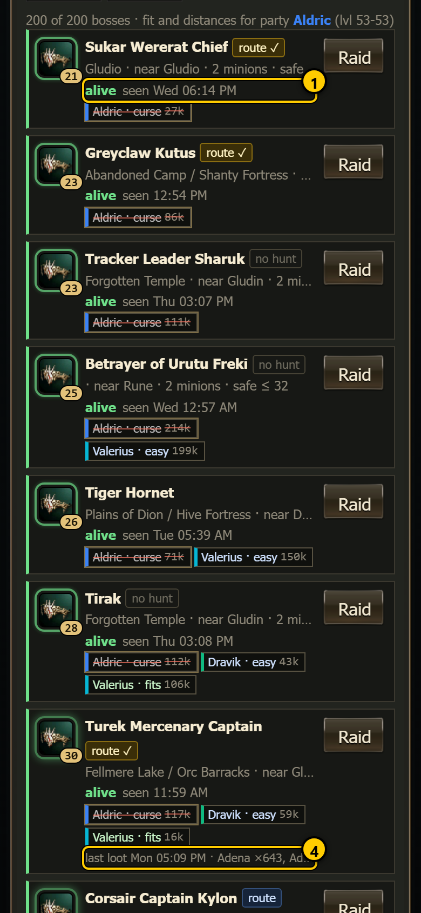 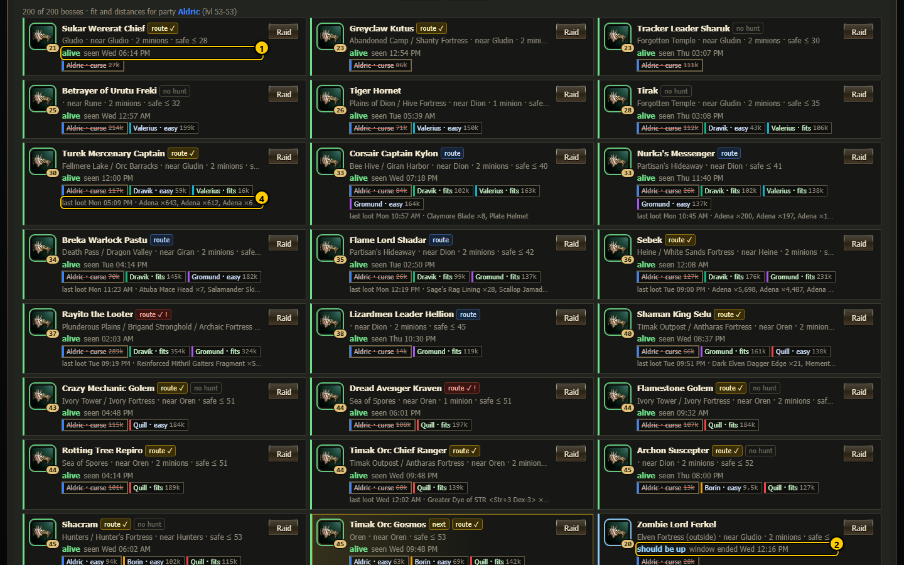

1. **alive**. 2. **should be up** (the respawn window is over). 3. **maybe up** with the countdown to the end of the window.
4. **Last kill** and its loot. A **dead** card (killed, earliest respawn still to come) shows "up in …" with a bar the same way.

The respawn window is the death time plus the datapack respawn time (for most bosses 12-60 hours; the server's real times are not known).
A boss "found dead" (not killed by us) gives only an upper bound for its death time. When the bots have measured a respawn themselves, the
bar's tooltip says "measured … h" (`≤` = upper bound).

Badges and fit chips (desktop, all levels 38-45):

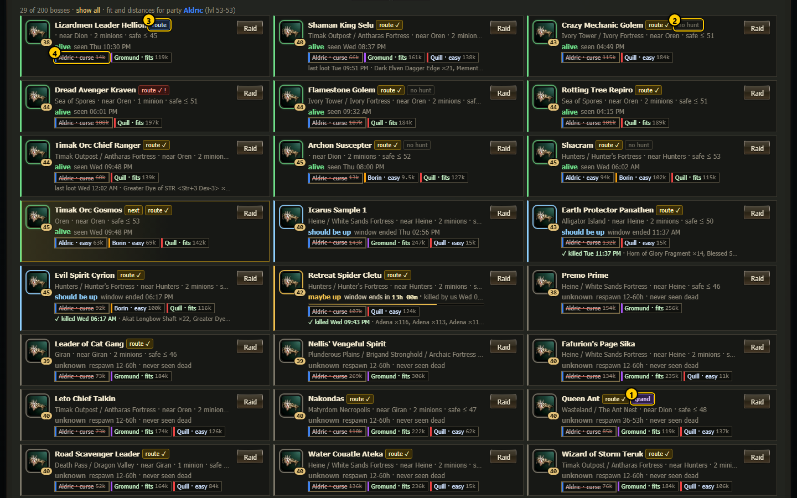

1. **epic**. 2. **no hunt**. 3. **route** badge (✓ = locked, ! = failed lately). 4. **curse** chip. An **area** badge and a **too hard** chip look the same way.

### Confirmations

Every order asks first. The box names the party, how many characters get the order and which of them are busy and will change what they
are doing:

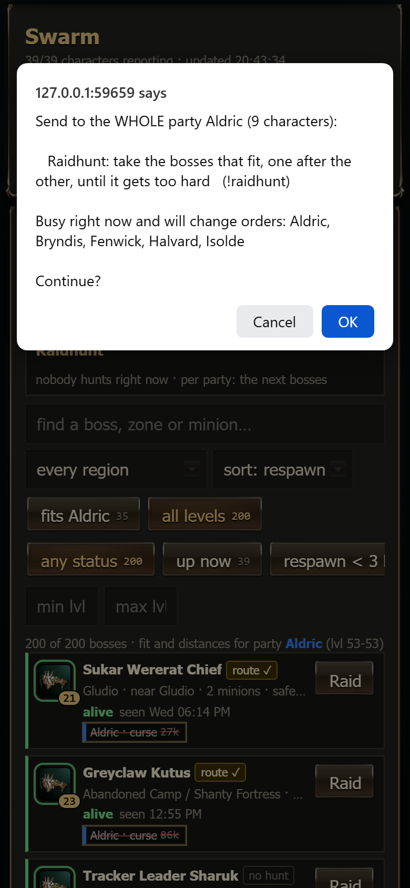 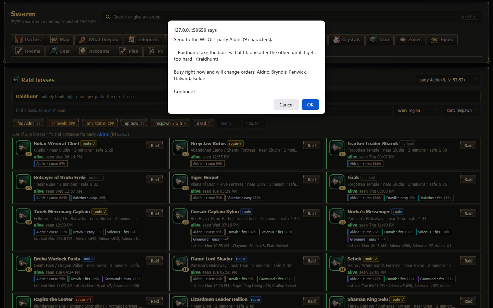

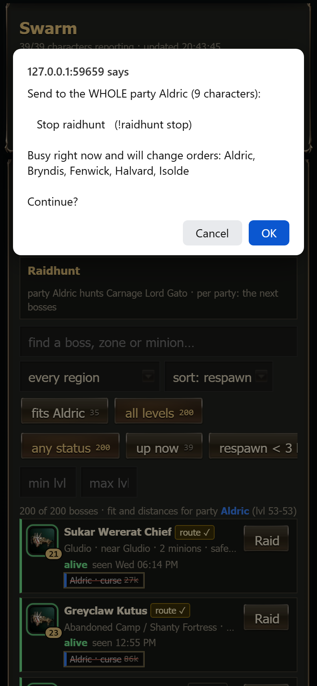
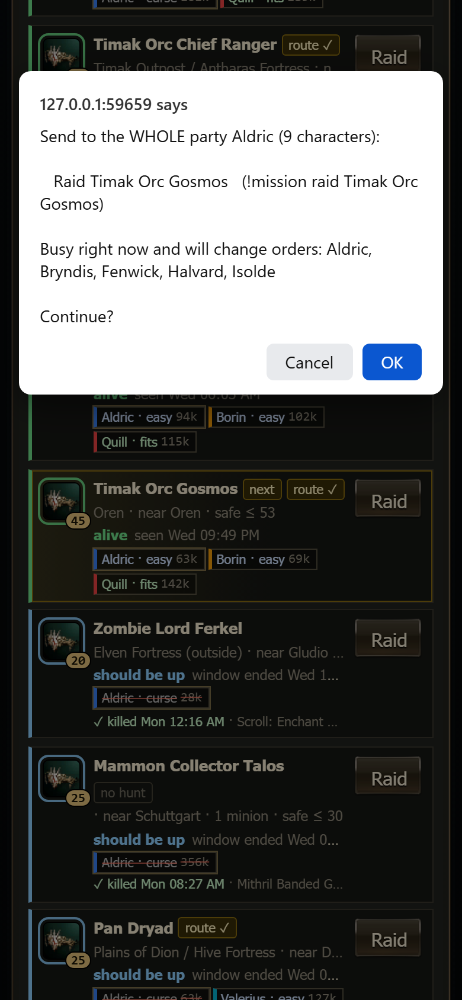 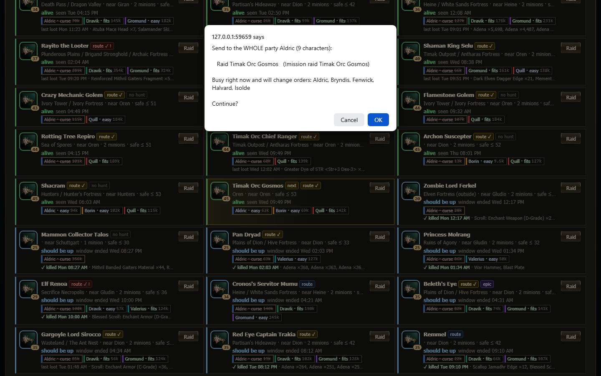

| Button | Sends | Confirmation |
|---|---|---|
| Raidhunt (party row) | `!raidhunt` to that party | yes, with busy characters listed |
| Stop (hunting party row) | `!raidhunt stop` | yes |
| Raid (card) | `!mission raid <boss>` to the chosen party | yes |
| Raid it (boss page) | `!mission raid <boss>` | yes |
| Delete (saved route) | deletes the route file | yes |

### What a raid order does

`!mission raid <boss>` makes the party leader run the whole raid by himself: the party stops what it does, regroups in a town, rebuffs
from the Community Board, restocks, teleports to the landing (or the start of a saved route) and walks to the boss's waiting spot. There it
clears the monsters around the fight area, gathers, raises the dead, counts down in party chat (10, 5, 3, 2, 1, GO) and the tank pulls. The
party never escapes from a raid: it fights until the boss dies or the last member falls. After a kill everyone loots for a minute. The
leader writes the [live view](raid-live.md) during the fight and a [fight report](#fight-reports) at the end. Where it waits, what it
clears and where it fights can be set per boss: [Raid fight area](raid-area.md).

### Raidhunt

**Raidhunt** is "take the next boss on the list until it gets too hard". The party leader:

1. Builds the candidate list: normal raid bosses (no epic bosses), whose raid-curse level is at least the party's highest level - 8 and
   whose level is at most the party's **lowest** level + 3; no bosses inside dungeons (towers, temples, crypts, caves, deep underground);
   no boss whose way there passes monsters far above the party; no boss that is known dead and still inside its earliest respawn; none
   that failed to be reached twice (`Logs/raid_unreachable.json`) or was skipped in the last 12 hours (`Logs/raidhunt_skip.json`).
2. Sorts it: clan quest bosses first, then lowest level, then nearest.
3. Runs a full raid mission on the first one (see above), records the outcome and waits 30 s.
4. Stops at the first **wiped** or **timeout** ("too hard"). A boss that was not found is marked dead; one that could not be reached is
   skipped.
5. When no boss is up, the party levels meanwhile and looks again every 15 minutes.

A raidhunt survives a restart of the bots (it is resumed).

### Raidhunt row

While a party hunts, its row shows the progress (refreshed every few seconds):

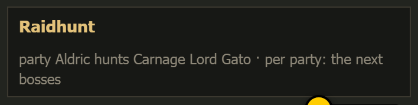 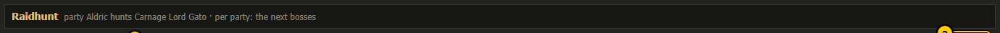

1. **raidhunt · current boss** (lvl, time on this boss); tap the boss for its page.
2. **Stop** - stop the raidhunt (confirmation).
3. **Phase** - Regroup → Teleport → Walk → Fight → Loot → Done; the current one is highlighted, passed ones are dimmed.
4. **Raw step** - the leader's own task text (for example "leading team to Carnage Lord Gato (route point 7/22)").
5. **Next / Done** - the next bosses on its list, and the last results: **killed** (green), **wiped** / **timeout** (orange),
   **not-found** / **lost** (grey).
6. **Other parties** - their own row with **Raidhunt** and "Next if it hunts".

### A raid running: the LIVE pin

While a raid fight runs, a red LIVE strip is pinned on top of the board:

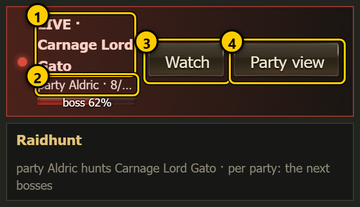 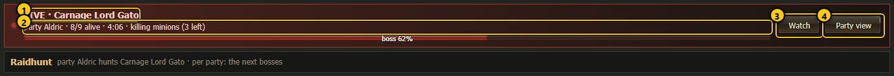

1. **LIVE · boss**. 2. **Party, members alive, fight clock, phase**, and the boss HP bar. 3. **Watch** - the full
   [raid live view](raid-live.md). 4. **Party view** - the live view of the fighting party ([party live view](live-party.md)).
5. The hunting party's row shows the **Fight** phase.

### Saved routes

A fold-out under the board, **closed by default** (your choice is remembered). Its title counts the routes: bosses, locked, learned, and
how many failed lately.

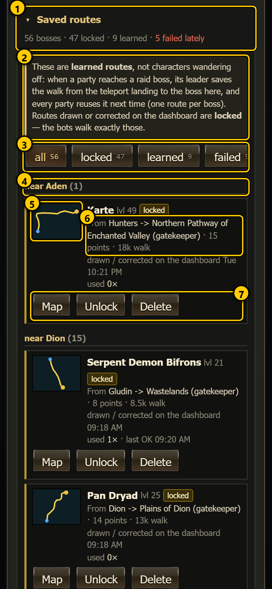 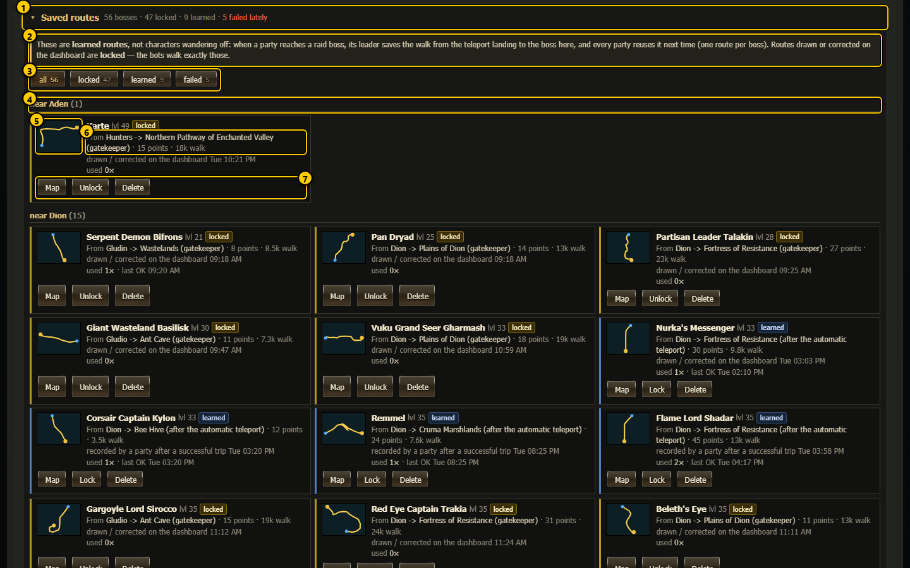

1. **Saved routes** and the counts.
2. **What they are** - these are **learned routes**, not characters wandering off: when a party reaches a raid boss, its leader saves the
   walk from the teleport landing to the boss, and every party reuses it next time (one route per boss). Routes drawn or corrected on the
   dashboard are **locked**: the bots walk exactly those.
3. **all / locked / learned / failed** - filter with counts.
4. **Region group** - "near Oren (5)".
5. **Route shape** - a small drawing of the walk (start dot, end dot).
6. **Details** - the boss (link) and level, **locked** / **learned**; "From <start> · points · km walk" (a `.town` start, a gatekeeper
   start, or "after the automatic teleport"); who recorded it and when, or when it was drawn / corrected on the dashboard; how often it was
   used, the last good use, failures (red) and automatic fixes.
7. **Map / Lock / Delete** - **Map** opens the boss page scrolled to the route editor; **Lock** / **Unlock** changes the lock at once
   (a learned route is dropped after 2 failures, a locked one never); **Delete** asks first:

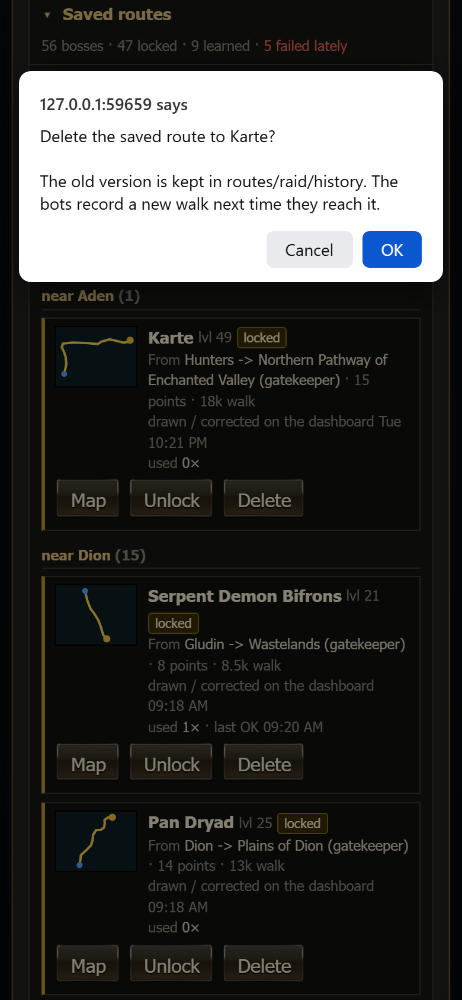

"Delete the saved route to <boss>? The old version is kept in routes/raid/history. The bots record a new walk next time they reach it."

### Fight reports

A fold-out under the board (closed by default; the title shows how many fights and the last one).

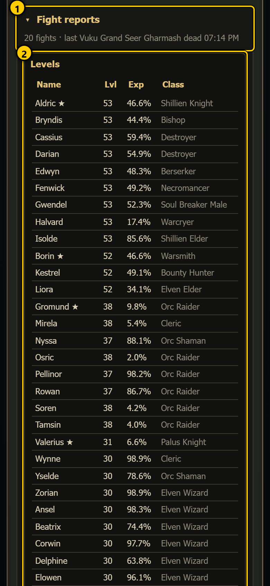 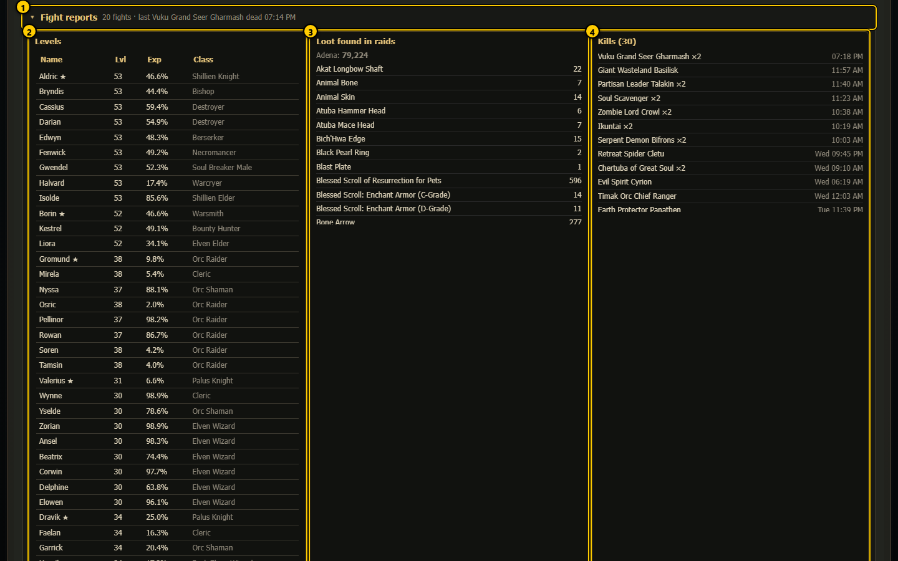

1. **Fight reports** - number of fights and the last result.
2. **Levels** - every character's level, experience % and class (★ = party leader).
3. **Loot found in raids** - total adena and every item ever picked up in raids, with counts.
4. **Kills** - every boss killed (×N when more than once) and the last kill time.

Below them one line per fight, newest first: boss, level, the outcome (**dead** green, **wiped** / **lost** / **timeout** orange,
**not-found** grey), the fight time (m:ss), when, and ✝ N when members died. Tap a line to open it:

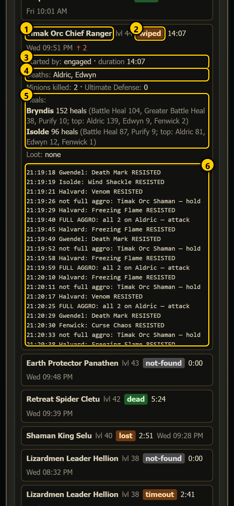 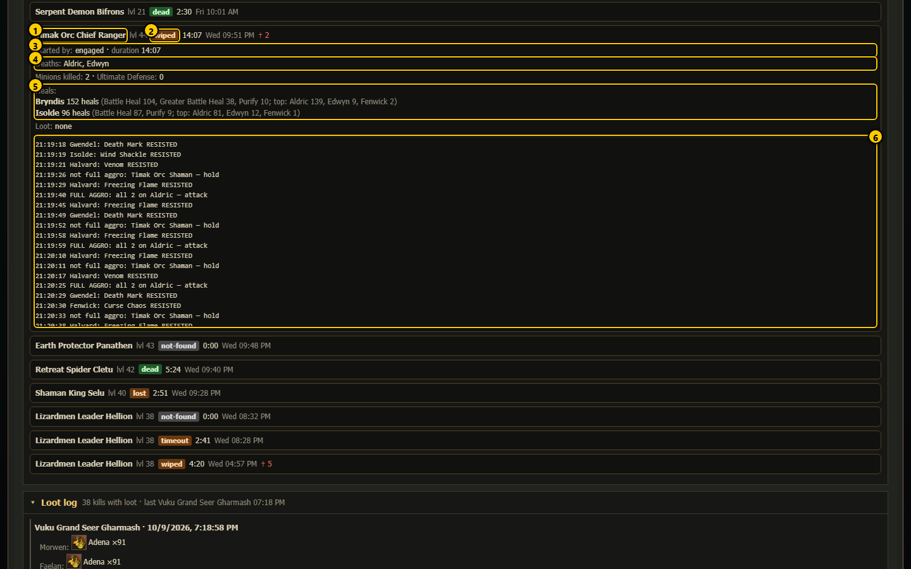

1. **Boss** and level. 2. **Outcome** and duration.
3. **Started by** (pull / engaged) and duration.
4. **Deaths** - who died and how often.
5. **Heals** - per healer: number of heals, per skill, and the three members healed most (from `Logs/raid_heals.log` during the fight).
   Also **Minions killed**, **Ultimate Defense** count, **Loot** (picked up within 5 minutes after the fight) and **Level ups**.
6. **Timeline** - every event of the fight: deaths and wipes in red, minion kills / results / "back up" in green, Ultimate Defense,
   countdown and focus changes in yellow, resisted debuffs and aggro messages in white.

### Loot log

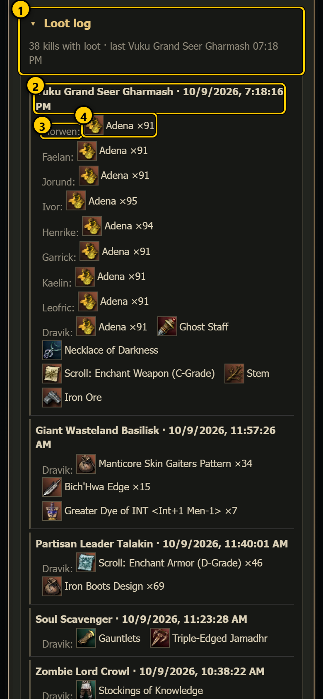 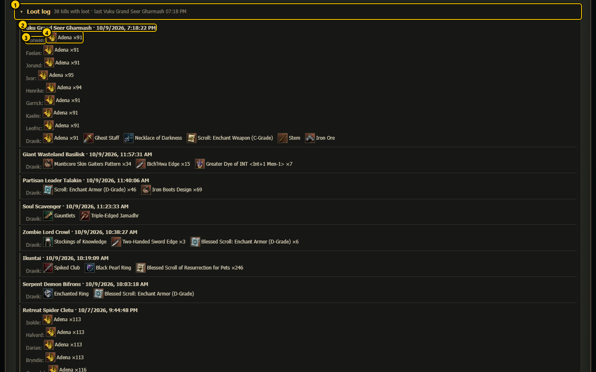

The last 20 kills from `Logs/raid_loot.log` (pick-ups from the same boss within 3 minutes count as one kill):

1. **Loot log** - the title shows how many kills had loot and the last one.
2. **Boss and time** of the kill. 3. **Who** picked it up. 4. **Item** with icon and count.

### Daily dungeons

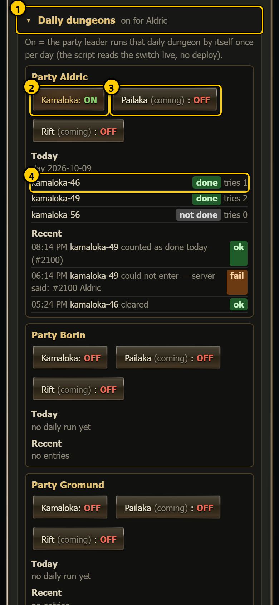 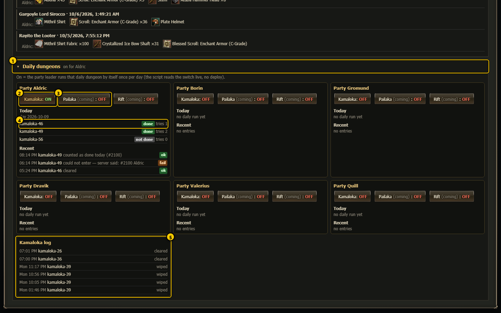

1. **Daily dungeons** - the title says for which parties a daily dungeon is on ("off for every party").
2. **Kamaloka: ON / OFF** - one box per daily leader (the `dailyLeaders` list in `swarm.config.json`). When ON, the party leader takes the
   party into a Kamaloka that fits all members once per day, by himself, when the party is free. The bots read the switch live.
3. **Pailaka (coming)**, **Rift (coming)** - switches that exist but are not built in the script yet.
4. **Today** - the day of the last daily run and, per dungeon, **done** / **not done** and the number of tries (max 2 per day). When the
   last run was on an earlier day it says "resets today". **Recent** lists entries from `Logs/daily.log` (**ok** green, **fail** orange).
5. **Kamaloka log** - the last Kamaloka runs from `Logs/kamaloka.log`.

Tapping a switch asks first:

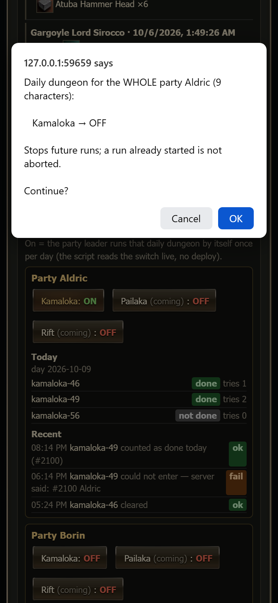

Switching OFF stops future runs but does not abort a run that has started. The answer is saved in `Logs/daily_enabled.json`. Kamaloka itself
has its own tab: see [Kamaloka](kamaloka.md).

---

## Boss page (`#/raid/<id>`)

Tap a card, a boss name, a raidhunt link or **Map** in the saved routes. The tab bar keeps **Raid bosses** highlighted.

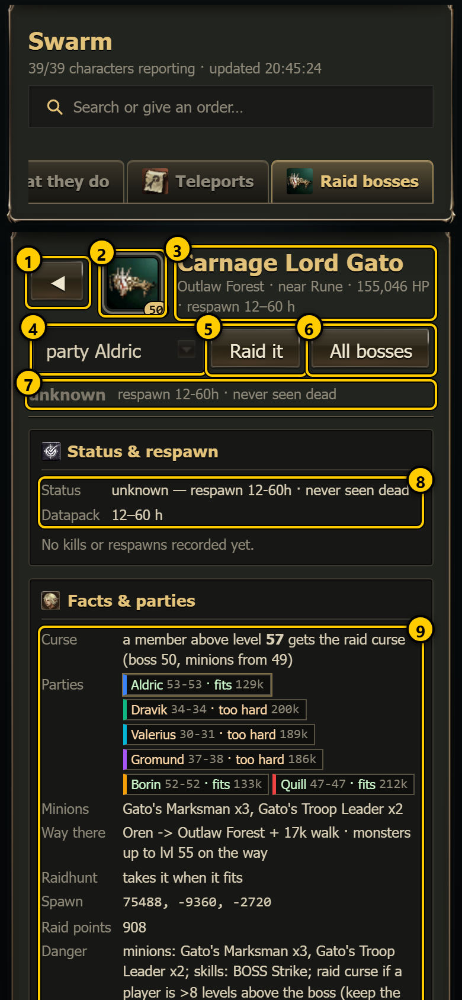 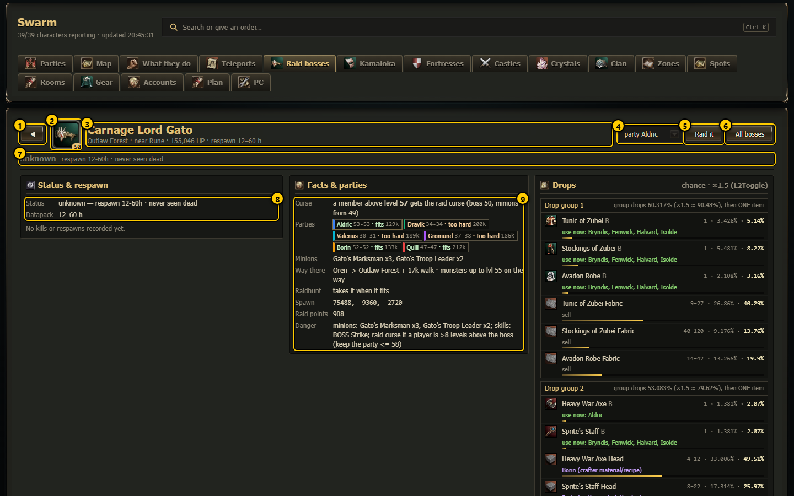

1. **◀ Back** - back to where you came from (the board when you opened the page directly).
2. **Level and status ring**.
3. **Name** (with **LIVE** / **epic** badges), zone, nearest town, HP, datapack respawn hours.
4. **Party** - the party the page is judged for (the same choice as on the board).
5. **Raid it** - sends `!mission raid <boss>` to that party (confirmation). While the boss is fought, a **Watch live** button appears.
6. **All bosses** - back to the board.
7. **Status bar** - the status with its countdown and bar, as on the card.
8. **Status & respawn** - status, the respawn window (earliest – latest), the datapack range and the measured respawn, when it was seen
   alive; below it the kill / respawn history.
9. **Facts & parties** - see below.
10. **✎ Edit** (Fight area) - opens the fight area editor: [Raid fight area](raid-area.md).

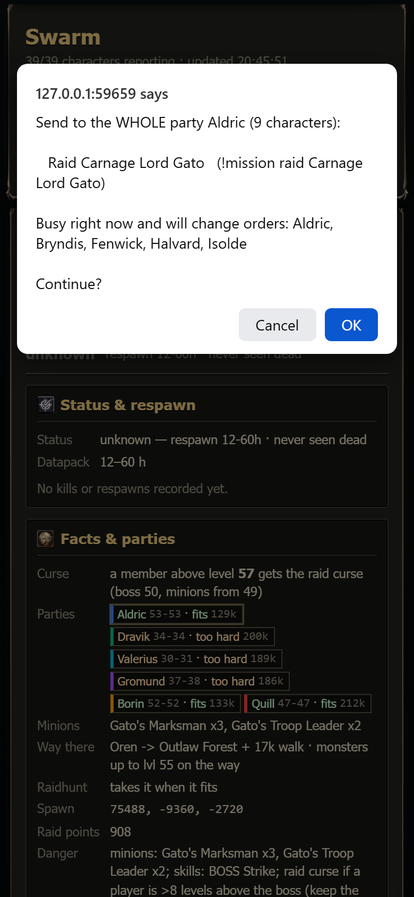

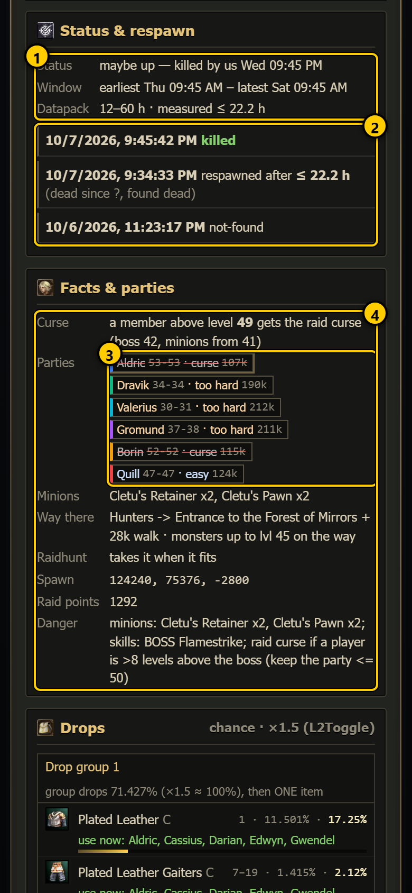 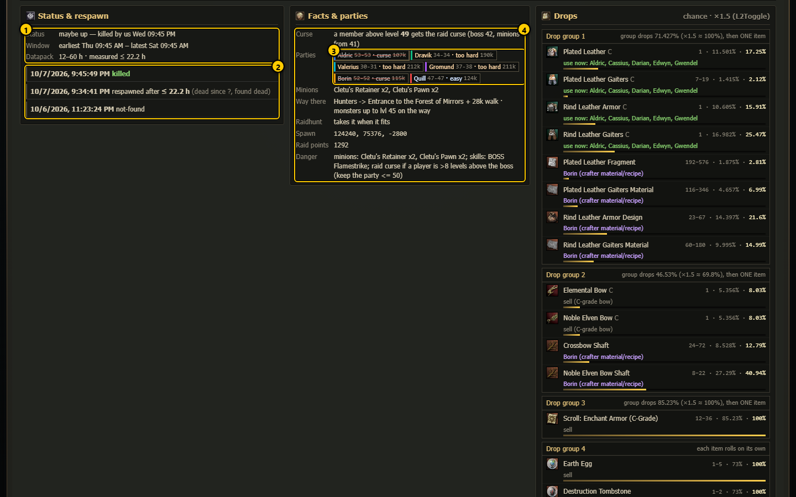

1. **Status & respawn** - status line, window, datapack / measured respawn.
2. **Kill / respawn history** - every kill, "not found" and measured respawn ("respawned after ≤ 22.2 h (dead since …, found dead)"),
   newest first.
3. **Parties** - every party with its level range, its fit (fits / easy / too hard / curse) and the distance from its leader.
4. **Facts** - **Curse** ("a member above level N gets the raid curse", with the minions' lowest level), **Minions**, **Way there** (the
   nearest teleport, the walk, and the highest monster level on the way), **Raidhunt** (takes it when it fits, or why it skips it),
   **Spawn** coordinates, **Raid points**, and **Danger** notes when the datapack has them.
5. **Fight area** - "area set" with the number of points and how the clear area and waiting spot are set, or what the team does without
   one ("clears only aggressive monsters within 1200 of the boss … waits ~1500 away … fights where the boss stands").

When the boss is being fought right now, a **LIVE fight** box with the live view appears at the top of the page:

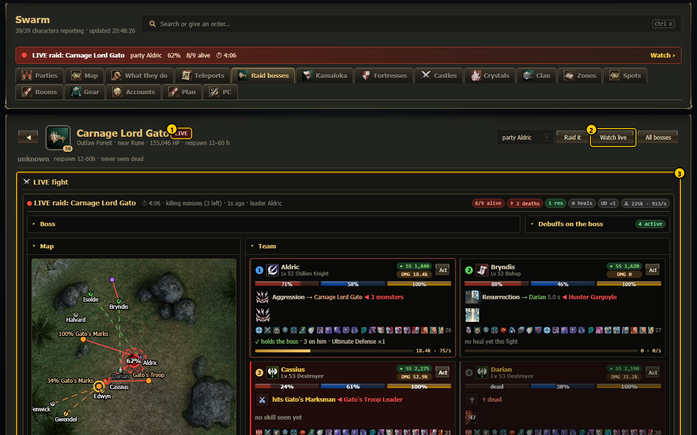

1. **LIVE** badge. 2. **Watch live**. 3. The **LIVE fight** box.

Further down the page: **Route to this boss** (the route editor, below), **Drops**, **What we got from it** and **Fight reports** of this boss.

### Route editor

The route editor is the **Route to this boss** box (its title shows the nearest teleport and the walk). It shows the walk the bots use from the landing (or a town) to the boss, and lets you correct it with numbers, taps on
the map, a character's position, a recorded walk or pasted `/loc` lines. Nothing is saved until you press a Save button.

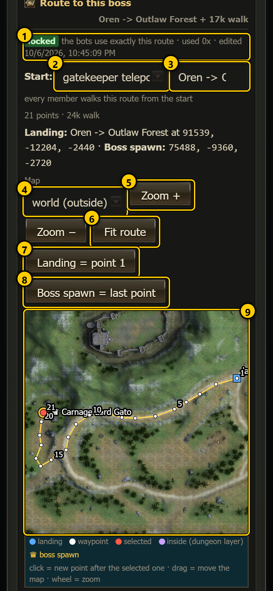 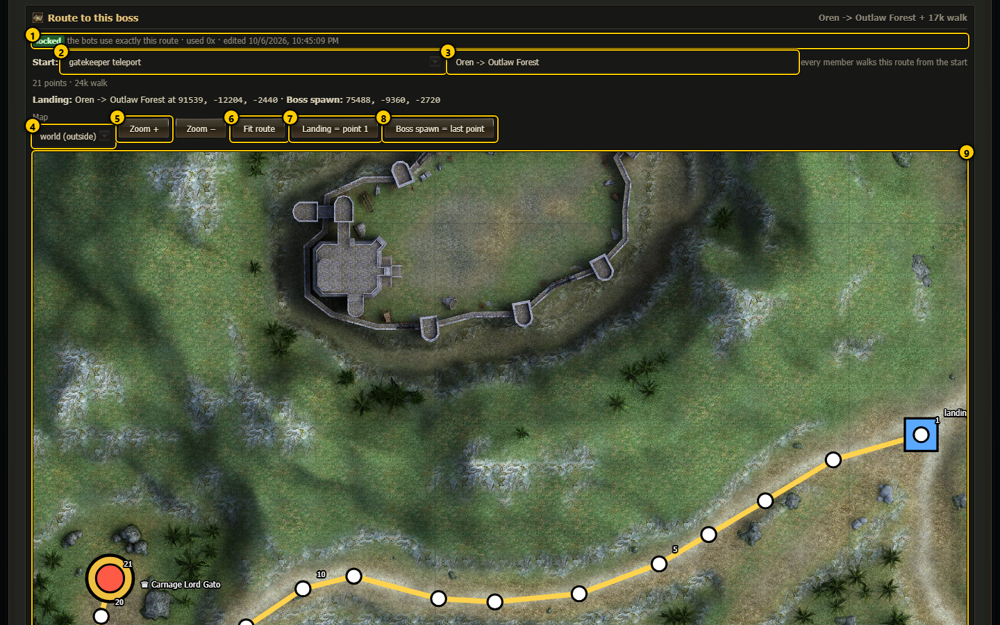

1. **Status** - **locked** (the bots use exactly this route) or **recorded by the bots** (a better walk may replace it), how often it was
   used, how often it failed, and when it was recorded or edited. "not saved yet" = no route for this boss.
2. **Start** - **gatekeeper teleport** or **.townname (walk from the town)**. With a start set, every member walks this route from the
   start itself (the leader waits at checkpoints). Without a start the bots use the route only after their automatic teleport.
3. **Gatekeeper teleport** - type or pick "Town -> destination" from the list (every destination the bots have seen on a live gatekeeper
   menu, prices removed).
4. **Map** - **world (outside)** or **dungeon / floor N** (the client's own map of a dungeon floor, where one exists).
5. **Zoom + / Zoom −** - zoom the map (also the mouse wheel).
6. **Fit route** - zoom so the whole route, the landing and the boss fit.
7. **Landing = point 1** - put the landing in as the first point.
8. **Boss spawn = last point** - add the boss spawn as the last point.
9. **The map** - blue square = landing, green square = a `.town` landing, white dots = waypoints (every 5th is numbered), red = the
   selected point, purple = points inside a dungeon layer, gold ♛ = boss spawn, coloured dots = characters standing nearby (live).
   **Tap** = a new point after the selected one (it takes the height z of the selected point). **Tap a point** = select it. **Drag** =
   move the map. **Wheel** = zoom around the pointer.

Under the line "N points · km walk" the editor shows **unsaved changes** in yellow when you changed something, and the line
**Landing: ... · Boss spawn: x, y, z** with the exact coordinates.

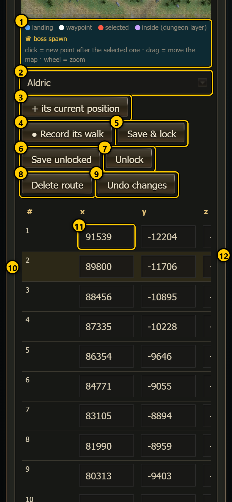 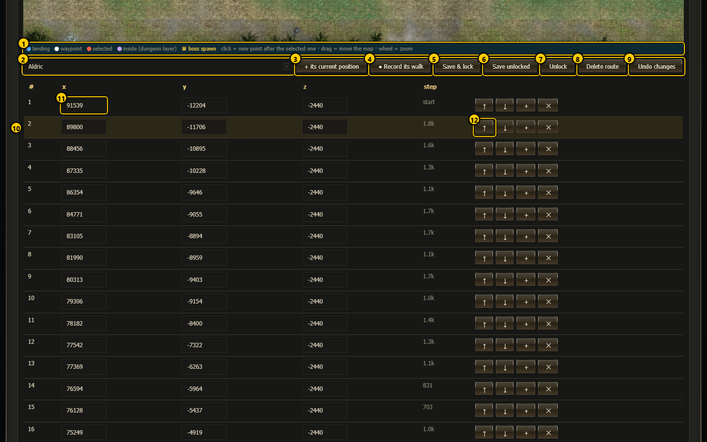

1. **Legend** of the map and the mouse/touch help.
2. **Character** - every character that reported in the last minute.
3. **+ its current position** - insert that character's exact x, y, z after the selected point.
4. **● Record its walk** - walk the character yourself in the game; the editor adds a point every ~250 units (and at every height change
   of 150+) on the map layer shown. The button turns into **■ Stop recording <name>**.
5. **Save & lock** - save, and lock: the bots use exactly this route and never replace it with their own recording.
6. **Save unlocked** - save without locking (a better recorded walk may replace it later).
7. **Unlock / Lock** - change the lock of the saved route without changing its points.
8. **Delete route** - delete the saved route (confirmation; the old file is kept in `routes/raid/history`). The bots record a new one the
   next time they reach the boss.
9. **Undo changes** - reload the saved route (asks first when there are unsaved changes).
10. **Selected point** - the gold row is the selected point (tap a row to select it; the map switches to that point's layer).
11. **x / y / z** - type exact numbers; the change counts as soon as you leave the field.
12. **↑ ↓ + ✕** - move the point up or down, insert a point half way to the next one, delete the point. The **step** column shows the
    distance from the point before (and "floor N" for dungeon points).

Saving needs at least 2 points and a start (or a landing text). Up to 500 points. Every save keeps the old version in
`Scripts/data/routes/raid/history/`. Saving says "saved and locked — the bots use exactly this route" (or "saved").

#### Tap on the map

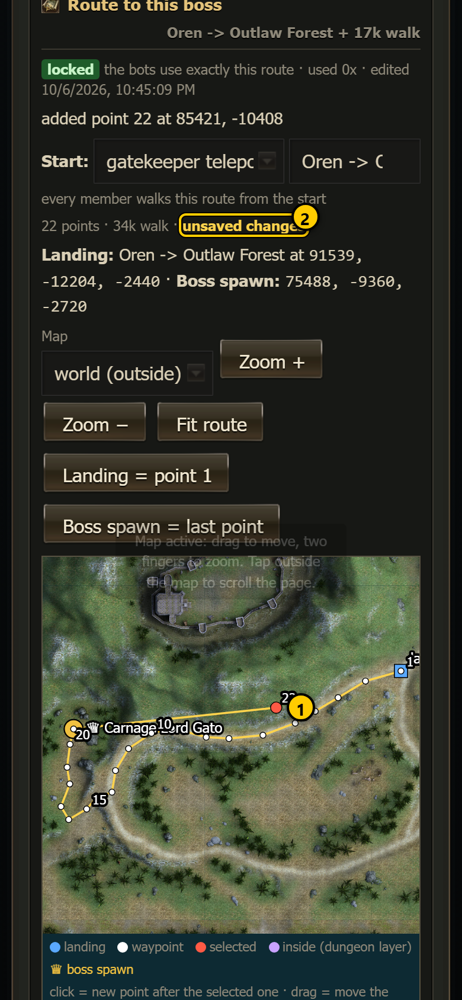 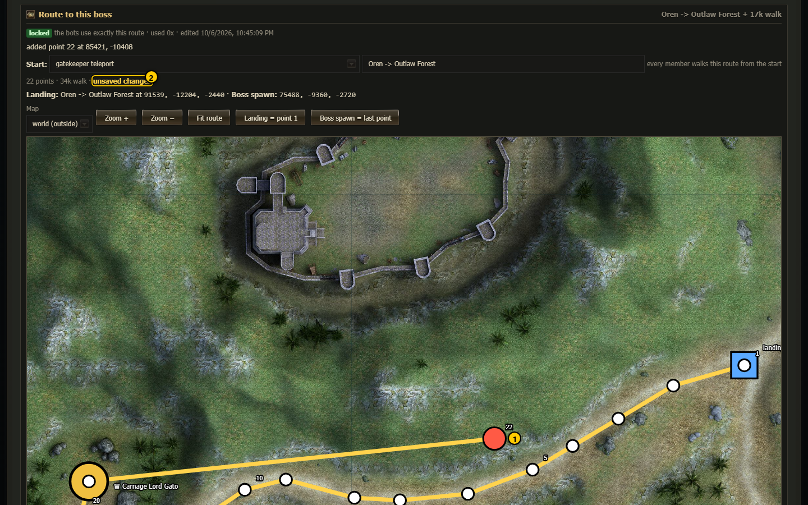

1. The new point appears after the selected one and becomes the selected (red) point; its number is shown.
2. **unsaved changes** appears until you save.

#### Add a character's position

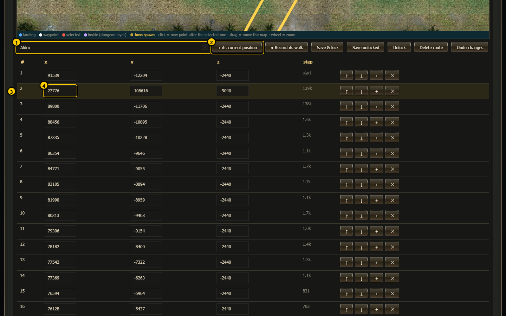

1. Pick the **character**. 2. Press **+ its current position**. 3. The new point is inserted after the selected one (here after point 1).
4. Its exact x / y / z come from the character.

#### Record a walk

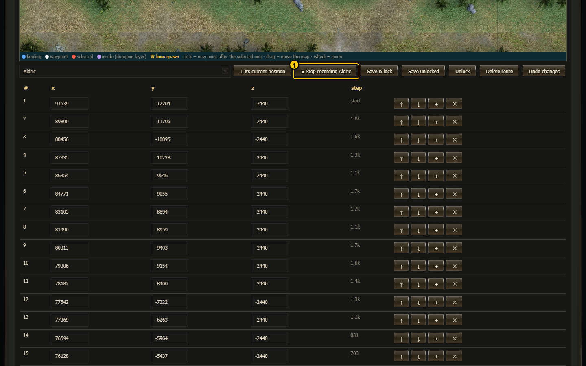

1. While recording, the button reads **■ Stop recording <name>** and the message line counts the points. Walk the character in the game
   (or let it walk), press the button again when you are there, check the points and press Save.

#### Start in a town (`.townname`)

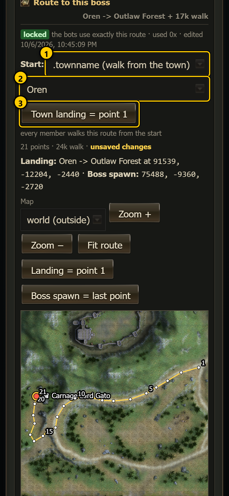 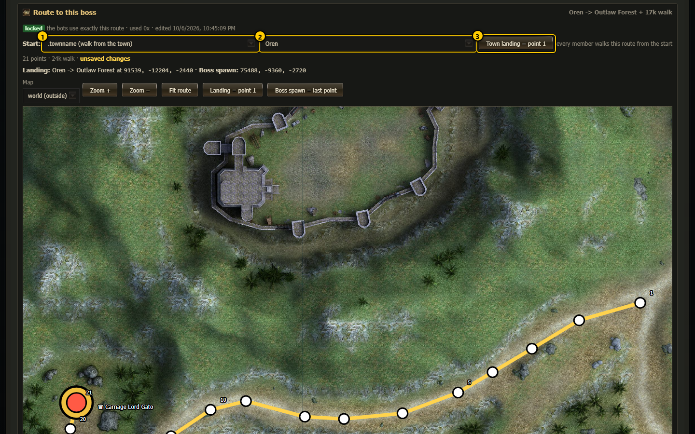

1. Choose **.townname (walk from the town)**.
2. Pick the **town** (Gludin, Gludio, Dion, Giran, Oren, Aden, Hunters, Heine, Goddard, Rune, Schuttgart). The bots use `.<town>` and land at
   the town's fixed landing spot (green square on the map).
3. **Town landing = point 1** puts that landing in as the first point. The route may lead through the town (for example to a gate);
   your own routes are allowed to walk out of a town.

#### Paste coordinates

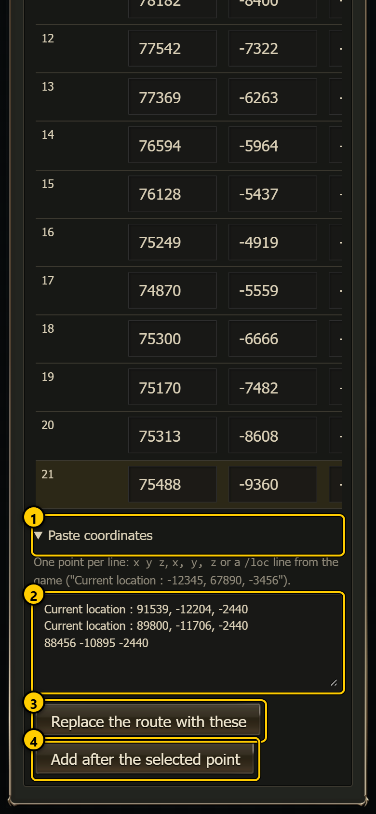 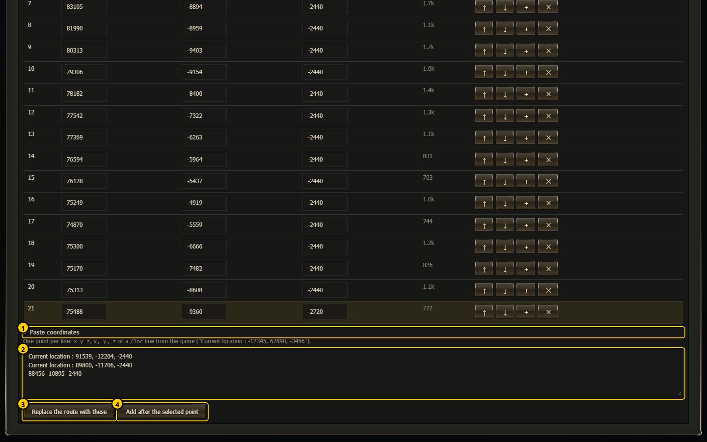

1. Open **Paste coordinates**.
2. One point per line: `x y z`, `x, y, z`, or a `/loc` line copied from the game ("Current location : -12345, 67890, -3456").
3. **Replace the route with these** - replaces every point (needs at least 2 lines; asks first).
4. **Add after the selected point** - inserts the pasted points after the selected one.

#### Delete

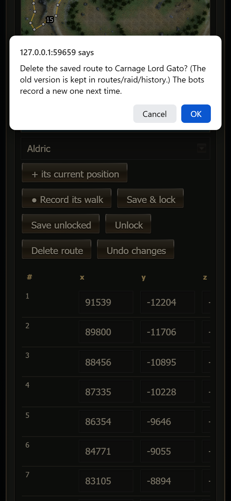

"Delete the saved route to <boss>? (The old version is kept in routes/raid/history.) The bots record a new one next time."

#### A boss without a saved route

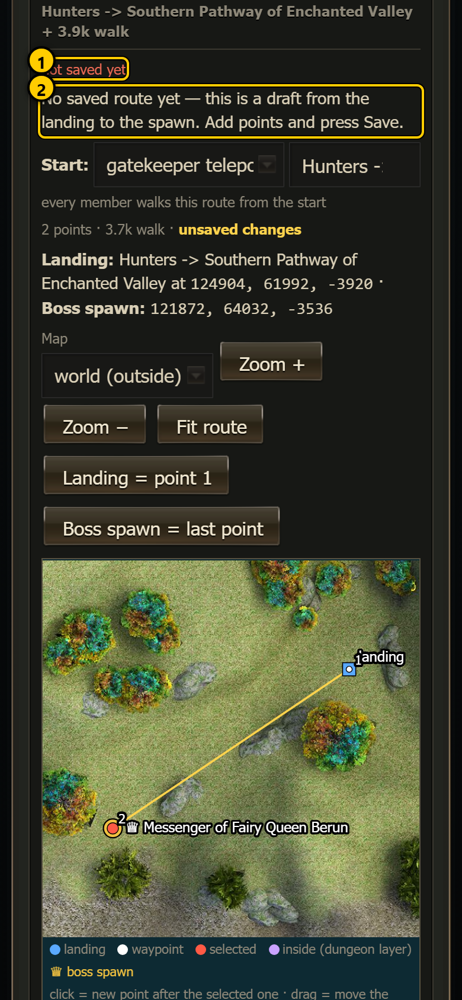 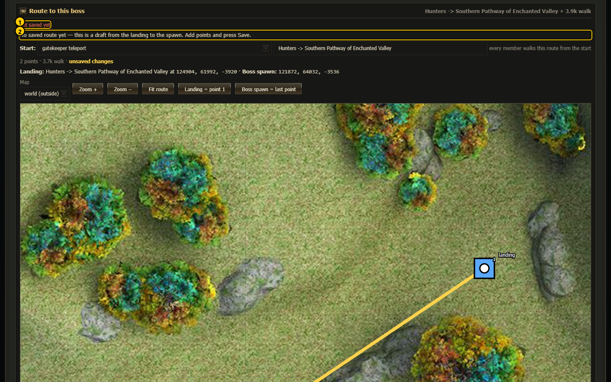

1. **not saved yet**. 2. The editor starts a **draft** from the landing to the boss spawn: "No saved route yet — this is a draft from the
   landing to the spawn. Add points and press Save." Nothing is written until you save.

#### Dungeon floors

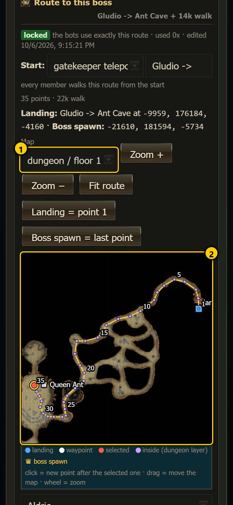 

1. **Map → dungeon / floor N** shows the client's map of that floor (only where the client has one for that area).
2. Points you add while a floor is shown belong to that floor (purple); points of another layer are dimmed. Walk from the entrance outside
   on the world map to the door, then switch the map to the floor and continue inside. Use **Record** or **+ its current position**
   inside, because the height (z) matters there.

### Drops

 

The full drop list from the datapack.

1. **Drop group** - "group drops X% (×1.5 ≈ Y%), then ONE item", or "each item rolls on its own". Spoil groups are marked **Spoil group**.
2. **Count · chance · ×1.5** - how many drop, the datapack chance, and in bold an estimate for a server with 1.5 × drop rates (the server's
   real rates may differ).
3. **Who / what** - for the chosen party at its current levels:
   - green **use now: names** - members that can wear/use it now;
   - **soon (lvl N): names** - members up to 8 levels below its grade;
   - blue **<crafter> (crafter material/recipe)** - give it to the crafter;
   - **upgrade gear (X-grade enchant)** - an enchant scroll someone can use;
   - grey **sell (...)** - nobody in the party can use it; **check (special)** - life stones, soul crystals, dyes, books.
4. **Chance bar** - the ×1.5 chance as a bar.

### What we got from it and its fight reports

 

1. **What we got from it** - every kill of this boss from the loot log, per character.
2. **Fight reports** - the fight reports of this boss only (same cards as in [Fight reports](#fight-reports)).

---

## Raid team templates (Clan tab, `#/clan`)

For big bosses (epic bosses such as Queen Ant, Core, Orfen, Zaken, Baium, and many normal raid bosses) a **template** says which
roles and classes the fight needs, the boss's weak element, and the tactics. The dashboard proposes a team from **all** your characters
(any party). Open the **Clan** tab and scroll down to **Raid team templates**.

 

1. **Boss** - pick a boss: ★ = epic boss, then name, level and "weak to <element>" when it has one clear weak element.
2. **Summary** - level window (the levels the template wants), **weak to** (or "no single weak element"), the element to avoid, the boss's
   defence per element, and how to get in (entry).
3. **Role ×count** - tank, healer, buffer, nuker, melee, summoner, archer … with the classes that fit; **Job** says what that role does in
   this fight.
4. **Proposed** - the best matching characters (class first, then role, then level): name (opens the character page), class, level and
   party. Orange chips warn: **raid curse risk** (above the level window) or **under-levelled** (below it). **Missing** = places no
   character could fill.

Under the table: **N/M places filled from parties ...**, the **Tactics** list, and the note that in a raid on this boss the bots use the
template (nukers prefer skills of the weak element, the tank keeps the minions).

How the proposal is made: only characters that reported in the last 15 minutes count; a matching class scores most, a matching role less,
a nuker whose class has strong skills of the weak element gets extra points, and a level inside the window counts too. Templates come
from `Scripts/data/raid_templates.json` (generated by `docs/plan/tools/raid_templates.js` from the datapack). When that file is missing
the box says so.

---

## How to ...

**Find a boss for a party now**
1. Pick the party at the top of the board.
2. Keep **fits <party>** on, and pick **up now** (or sort by respawn).
3. The card with the gold **next** badge is what raidhunt would take; any card with a **fits** chip and an up status works.
4. Tap the card to check the route, fight area and drops, then press **Raid it** and confirm.

**Let a party hunt bosses by itself**
1. Open **Raidhunt** at the top, press **Raidhunt** in that party's row, confirm.
2. Follow its row (phase, next, done). During each fight the LIVE strip is pinned on top and the red banner appears on every page.
3. Press **Stop** in its row to end it.

**Correct a route the bots get stuck on**
1. Open **Saved routes**, filter **failed**, press **Map** (or open the boss page and scroll to **Route to this boss**).
2. Tap a point near the problem to select it, then tap the map to add a point around the obstacle, or fix x / y / z in the list.
3. Inside dungeons use **Record its walk** or **+ its current position** to get the right height.
4. Press **Save & lock**. The bots use it from the next trip on.

**Write a route from a town**
1. **Start: .townname**, pick the town, press **Town landing = point 1**.
2. Add the points (tap, position, record or paste), finish with **Boss spawn = last point**.
3. **Save & lock**.

**Choose where the team fights a boss**
1. Open the boss page, press **✎ Edit** in **Fight area** and follow [Raid fight area](raid-area.md).

**Switch the daily Kamaloka on for a party**
1. Open **Daily dungeons** under the board, tap **Kamaloka: OFF** in that leader's box, confirm.

## Notes

- Every order (Raid, Raid it, Raidhunt, Stop, daily switches, route delete / replace) asks for confirmation; Cancel sends nothing.
- Route saves, lock / unlock and deletes are written at once (`Scripts/data/routes/raid/`) and keep the old version in `history/`. The bots
  read routes live.
- The fit, the **next** badge, the distances and the drop "Who / what" always refer to the chosen party.
- The board re-reads the boss list every 30 s, the routes every minute, the raidhunt progress every 3 s; countdowns tick every second. The
  fight reports and daily sections load only while they are open.
- A boss "found dead" gives only an upper bound for its death time; trust **measured** respawns over the datapack range once the bots have
  some.
