# Raid live view (raid HUD)  (`#/live`)

The **raid live view** shows a raid fight while it runs: the boss and its HP over time, the debuffs on it, every team member's skills,
cooldowns and buffs, a map, the minions, the boss's drop list, an event feed and the damage numbers. Use it to watch a raid as it happens and,
when needed, to give one member a one-time order with **Act** (the [override menu](override.md)).

It shows up by itself while a raid runs:

| Where | What |
|---|---|
| **Live banner** at the top of every page | a red bar "LIVE raid: boss · HP · alive · clock · **Watch ›**". Tap it to open `#/live`. |
| **`#/live`** | the full view (this page). Without a running raid it says "No raid is running right now. This page shows the fight as soon as one starts." |
| **Raid bosses** tab | the same view above the boss table (inside the raid hunt box while a raid hunt is fighting) |
| **Boss page** `#/raid/<id>` | the same view at the top of the page |
| **Parties** tab | the live block at the top |

A raid counts as running while the leader's live file is younger than 30 seconds. When the fight ends, the view disappears by itself (an
open Act panel closes too). The rules the bots follow in a raid are described in [Raid bosses](raid-bosses.md); the older description of the
live raid block is in [the live raid page](../live/raid-live.md). Words such as focus, minion and aggro are in the
[glossary](../06-glossary.md).

The view refreshes every second. The information is the same on every device; only the layout changes.

## The whole view

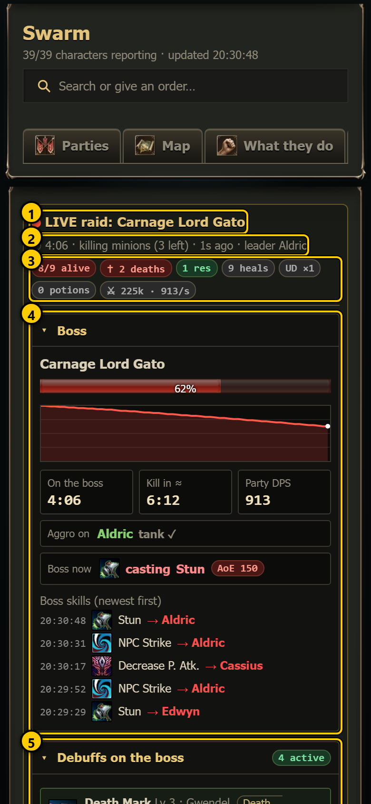 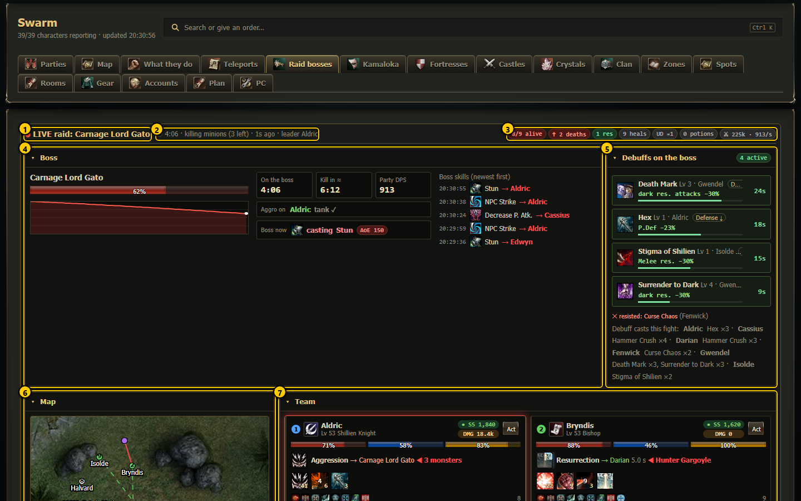

1. **LIVE raid: <boss>** - with a pulsing red dot.
2. **Clock, phase, age, leader** - "⏱ 4:06 · killing minions (3 left) · 1s ago · leader Aldric": time since the raid started, the phase the
   leader reports (for example waiting for the tank, killing minions, on the boss), how old the data is and the party leader.
3. **Totals chips** - see [Top line](#top-line).
4. **Boss** - see [Boss](#boss).
5. **Debuffs on the boss** - see [Debuffs on the boss](#debuffs-on-the-boss).
6. **Map** - see [Map](#map).
7. **Team** - one card per member, see [Team cards](#team-cards).

The whole page, top to bottom:

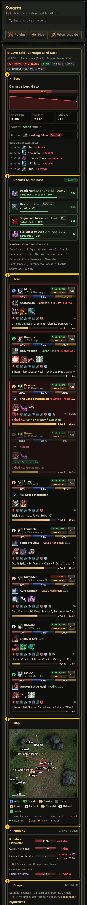 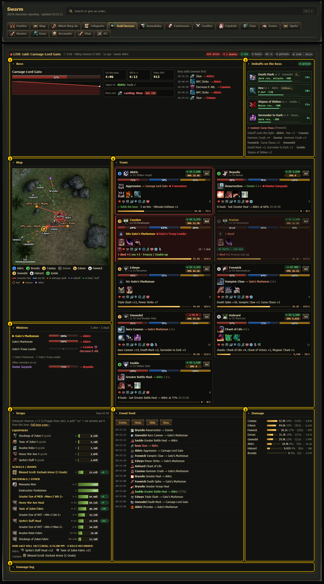

1. **Boss** 2. **Debuffs** 3. **Map** 4. **Team** 5. **Minions** 6. **Drops** 7. **Event feed** 8. **Damage** 9. **Damage log**
(folded until you open it).

## Layout per device

The layout follows the width of the view itself (not of the screen), so the same view also fits inside the boss page and the Raid bosses
tab.

| Width of the view | Layout |
|---|---|
| Phone (under 720 px) | One column: Boss, Debuffs, Team, Map, Minions, Drops, Event feed, Damage, Damage log. |
| Tablet (720-1149 px) | Two columns: Boss over the full width; Debuffs + Minions; the Team over the full width; Map + Event feed; Drops; Damage + Damage log. |
| Desktop (1150 px and up) | The raid HUD: Boss over two columns + Debuffs; Map and Minions on the left, the Team (cards side by side) on the right; then Drops, Event feed, Damage; the Damage log at the bottom. |
| Full HD (1560 px and up) | Four columns: as desktop, and the Event feed runs down the right edge the whole height. |

Every section folds: tap its title (the small ▸ turns). Your choice is remembered in this browser (the Damage log starts folded).

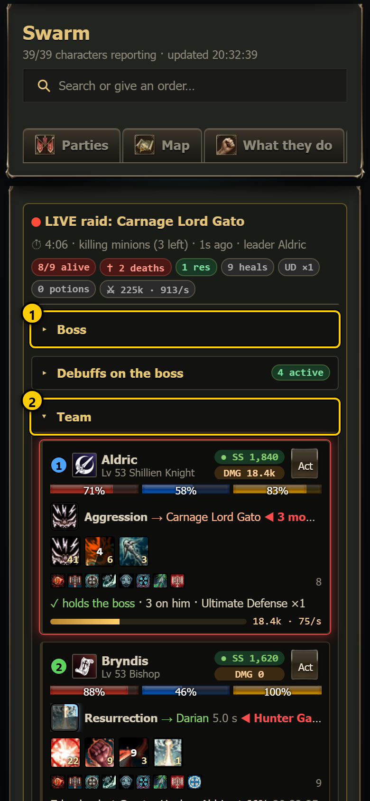

1. **Folded section** - only the title shows.
2. **Open section**.

## Top line

| Chip | Means |
|---|---|
| **8/9 alive** | living members / all; green when everyone is alive, red otherwise |
| **✝ 2 deaths** / **0 deaths** | deaths this fight (from the leader's event list) |
| **1 res** | resurrections this fight |
| **9 heals** | heals logged this fight (`Logs/raid_heals.log`) |
| **UD ×1** | the tank's Ultimate Defense uses |
| **0 potions** | potions used by the team (only when the members report their skill / item use) |
| **⚔ 225k · 913/s** | damage the team logged and damage per second |
| **clearing: 3 left** | before the pull: monsters still to kill inside the clear area (see [Raid fight area](#raid-fight-area-on-the-map)) |

## Boss

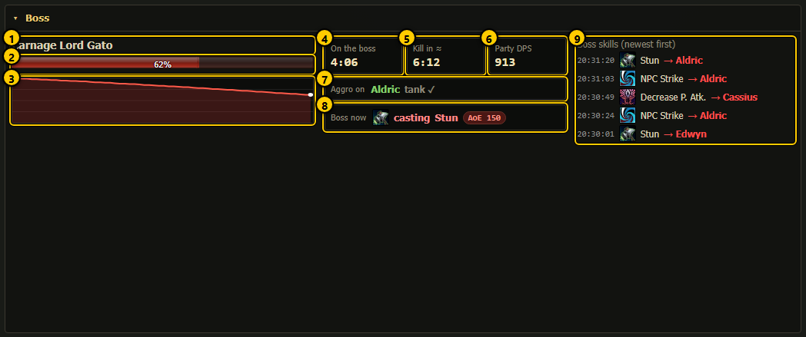

1. **Boss name** - gold when the boss is the team's current focus target. Red chips after it are boss states the leader reports.
2. **HP bar**.
3. **HP line** - the boss's HP since the raid started. "HP line: collecting…" until there are two points.
4. **On the boss** - time since the raid started.
5. **Kill in ≈** - time left at the speed of the last 60 seconds ("—" while the HP does not drop).
6. **Party DPS** - all damage the team logged ÷ fight time.
7. **Aggro on** - who the boss attacks. Green name + "tank ✓" = the tank holds it; red name + "NOT the tank" = it is on someone else;
   "nobody (idle)" = no target. "· from its hits" = known from the boss's attacks (the game does not tell us its target directly).
8. **Boss now** - the skill it is casting right now; a red **AoE 150** chip = it hits an area (radius in game units). "not casting"
   otherwise.
9. **Boss skills** - its last 8 skills, newest first: time, icon, name and target.

## Debuffs on the boss

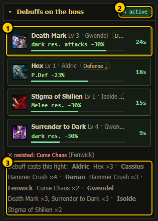

1. **One debuff card** - icon, name, level, who cast it, its type (for example *Defense ↓*, *Poison*, *Death Mark*, *Melee res. ↓*), what it
   does in numbers ("P.Def −23%") and a bar with the seconds left.
2. **n active** - debuffs on the boss now (not counting resisted ones).
3. **Debuff casts this fight** - every debuff each member cast at the boss, with counts.

More:

- Debuffs of the same type replace each other on the boss. The older one is shown faded: "replaced by ... — same type".
- **✕ resisted:** (red) lists casts the boss resisted, with the caster.
- When the members do not report counts, the line reads "Recent debuff casts" (icon, skill, caster, seconds ago).
- The game server does not send the effects on a monster, so a debuff only shows when the caster reports it. "Nobody in this party has put
  a debuff on the boss" means none of them cast one (for example a party without a necromancer or a Shillien Saint).

## Team cards

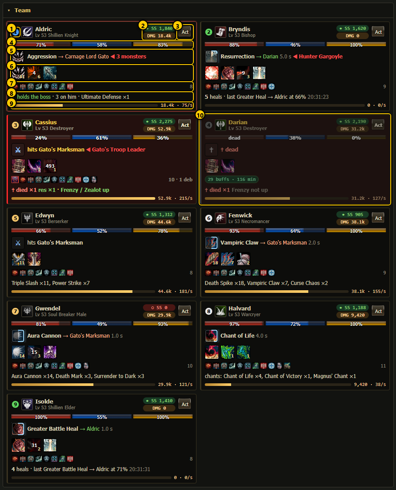

Every card has the same rows in the same place, so the bars line up across the grid:

1. **Number** - the same number as on the map, in the role colour (blue tank, green healer, gold melee, white caster, grey dead).
   Next to it: class icon, name, level and class.
2. **SS and DMG** - **SS** = soulshots / spiritshots in the bag (● green = auto-use on and some left, ○ red = off or empty, "shots ?" =
   unknown). **DMG** = damage dealt this fight; hover for hits, critical hits, the biggest hit and the damage taken.
3. **Act** - opens the [override menu](override.md) for this member.
4. **HP / MP / CP bars** - CP shows "CP ?" until the member reports it. The bars glide to new values. The card flashes **red** when the
   member lost 3 % HP or more since the last refresh, **green** when it was healed by 3 % or more.
5. **Doing now** - the skill it casts (the icon gets a progress ring while the cast runs, and the seconds left), the target (green when it is
   a teammate), "hits <monster>" for melee hits (⚔), or "✝ dead". "◀ 3 monsters" / "◀ <names>" (red) = monsters attacking this member.
6. **Key skills** - its most used skills this fight (up to 6, potions left out) with a **cooldown sweep** like the game's skill bar:
   a dark sector and the seconds until the skill is ready. The small number in the corner = how often it was cast. Hover for the reuse time.
7. **Buffs / debuffs** - buff icons (a red frame = a debuff on the member) and the count ("8 · 1 deb"). Without a buff list: debuff chips
   and a chip "12 buffs · 650 min" (green from 10 buffs).
8. **Role line** - depends on the role:
   - tank: "✓ holds the boss" or "✗ boss is on <name>" or "boss idle" · monsters on him · Ultimate Defense uses
   - destroyer: "↓ draining HP for Frenzy" / "Frenzy / Zealot up" / "Frenzy not up"
   - healer: number of heals and the last one (skill → target at its HP %, time), or "no heal yet this fight"
   - doomcryer: chants cast with counts, or the last chant, or "no chant seen this fight"
   - everyone else: the 3 most used skills with counts
   - "✝ died ×n" and "res ×n" come first when they happened.
9. **Damage bar** - its share of the best damage dealer, the damage and the damage per second.
10. **A dead member** - grey, "✝ dead", HP bar empty.

The member that holds the boss's aggro has a **pulsing red frame**. The HP colours: orange below 60 %, red below 30 %.

One card close up:

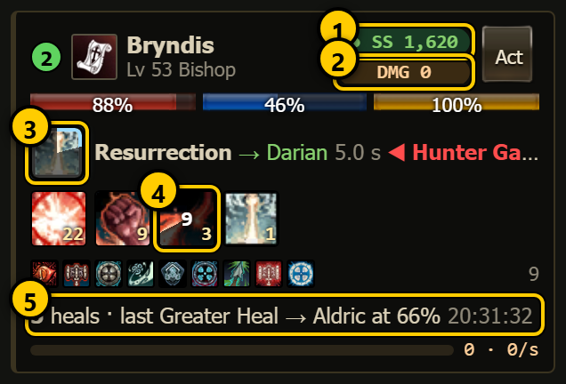

1. **SS** - shots in the bag, green dot = auto-use on.
2. **DMG** - damage dealt.
3. **Cast icon** - with the progress ring while casting.
4. **Cooldown sweep** - seconds until ready.
5. **Healer role line** - heals and the last heal.

How the cooldowns are known: from the datapack's reuse time of each skill and the last time the dashboard saw the member cast it. When the
member reports its own skill timers (the same data the override menu uses), those win.

## Map

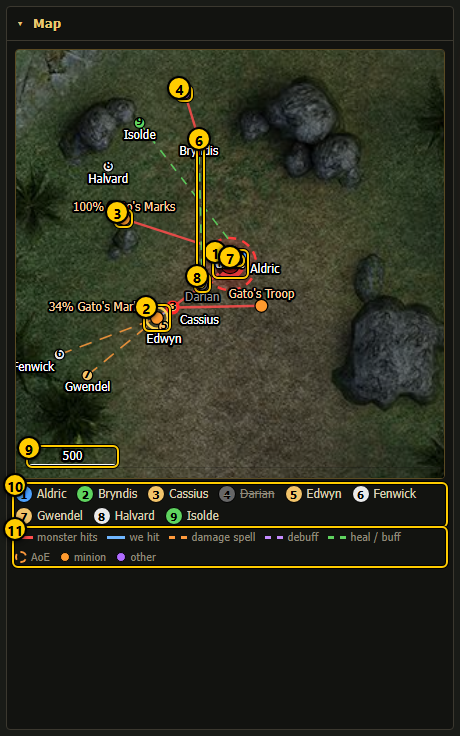

Centred on the boss, on the game's own map art (underground maps for deep dungeons). The map only grows during a fight, it never jumps
back.

1. **Boss** - big circle with a red HP ring and its HP %.
2. **Yellow ring** - the team's focus target.
3. **Minion** - orange dot with "HP% name" above it.
4. **Other monster** - purple dot (a monster that is not the boss's minion but fights us).
5. **Red line** - a monster hits that member.
6. **Green dashed line** - a heal or buff on a teammate.
7. **Purple dashed line** - a debuff cast.
8. **Dead member** - grey dot with ✝.
9. **Scale bar** - 500 game units.
10. **Numbered names** - member number, colour and name (dead members struck through).
11. **Key** - the line and dot colours.

More lines: **blue** = a member hits (melee), **dashed orange** = a damage spell. **Dashed circles** = an area skill landing, with its real
radius (red when the boss casts it). Member dots are numbered in their role colour; an **orange** outline = HP under 60 %, **red** = under
30 %. Names are placed so they never overlap.

## Raid fight area on the map

When a [raid fight area](raid-area.md) is set for the boss (or the leader reports one), the map also shows it and grows to fit it:

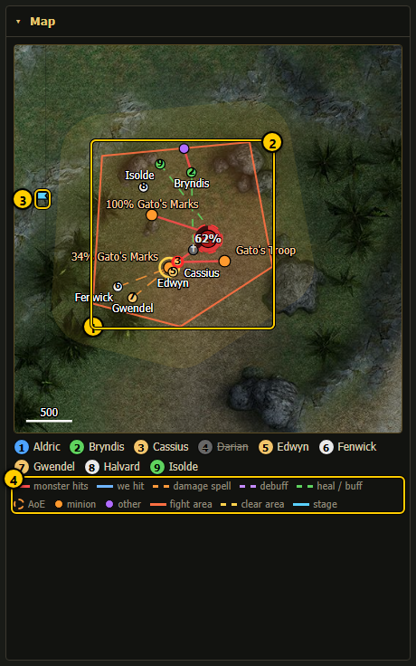

1. **Fight area** - orange outline: where the team fights; the tank pulls the boss into it.
2. **Clear area** - a yellow band around the fight area (the automatic margin), or a yellow dashed outline when a clear area was drawn
   by hand: only monsters inside it are killed before the pull.
3. **Stage point** - blue flag: where the team waits before the pull.
4. **Key** - "fight area", "clear area" and "stage" are added to the line key.

Before the pull, monsters still to clear show as yellow rings (red for aggressive ones), and the top line shows "clearing: N left".

## Minions

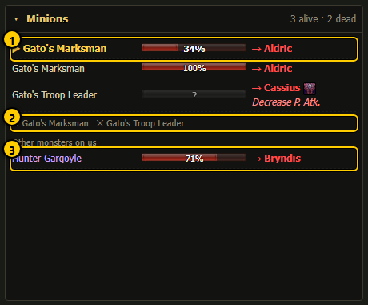

1. **▶ focus** - the minion the team kills now (gold). Each row: name, HP bar, its target ("→ Aldric" in red, or "idle") and the skill it
   casts.
2. **Dead minions** - "✕ name ×2".
3. **Other monsters on us** - monsters that are not minions but hit the team (purple names).

The section title says "3 alive · 2 dead".

## Drops

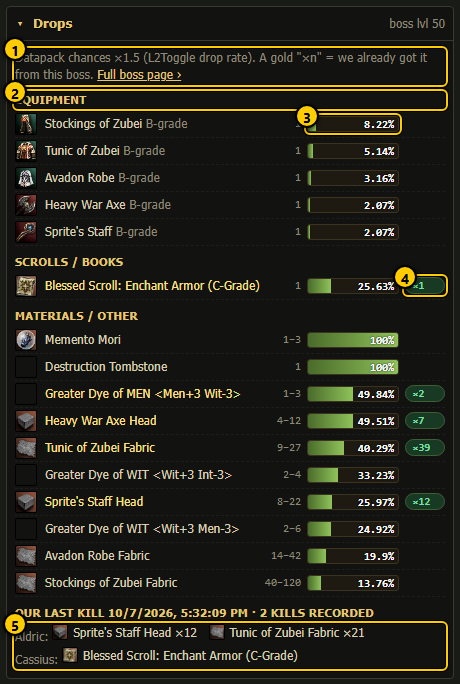

1. **Rate line** - the datapack chances are multiplied by the server's drop rate (×1.5). **Full boss page ›** opens the boss page with
   the complete table.
2. **Group** - Equipment, Recipes, Scrolls / books, Materials / other, Adena.
3. **Chance bar** - the chance after the rate, with the count range left of it. Hover a row for the drop group, "one item of the group
   drops", spoil, the datapack chance and what the item is useful for.
4. **Gold ×n** - we already got this item from this boss (that many in total).
5. **Our last kill** - what each character got at our last kill of this boss (right after a kill this is the fight that just ended), and
   how many kills are recorded.

The section title shows the boss level. Bosses that are not in the datapack list say "This boss is not in the datapack list (no drop
table)". The drop list is loaded once per boss; our own loot (`Logs/raid_loot.log`) is re-read every minute.

## Event feed

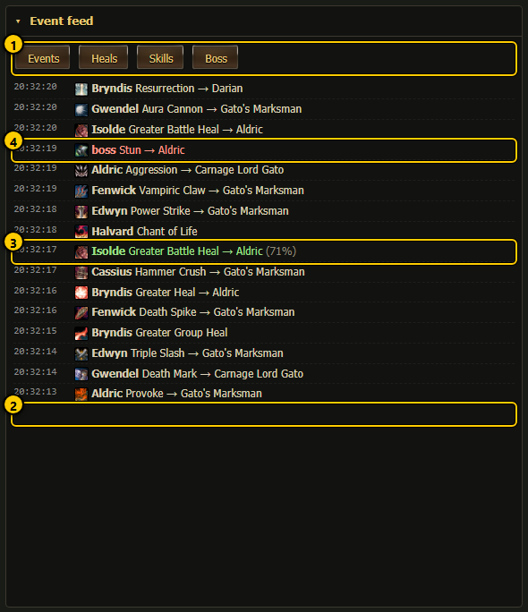

1. **Filter buttons** - **Events**, **Heals**, **Skills**, **Boss**: each switches one kind on or off (remembered in this browser).
2. **Death** (red) - "DIED: <name>".
3. **Heal** (green) - healer, skill → target (target HP % at the time), from the heal log.
4. **Boss skill** - the boss's casts with their target.

Newest first, up to 80 lines, each with its time. Other colours: resurrections ("back up: <name>"), minion kills (gold), the final result,
and warnings such as "RESISTED" or "interrupted" (orange). A heal shows once (from the heal log), not again as a skill.

## Damage and damage log

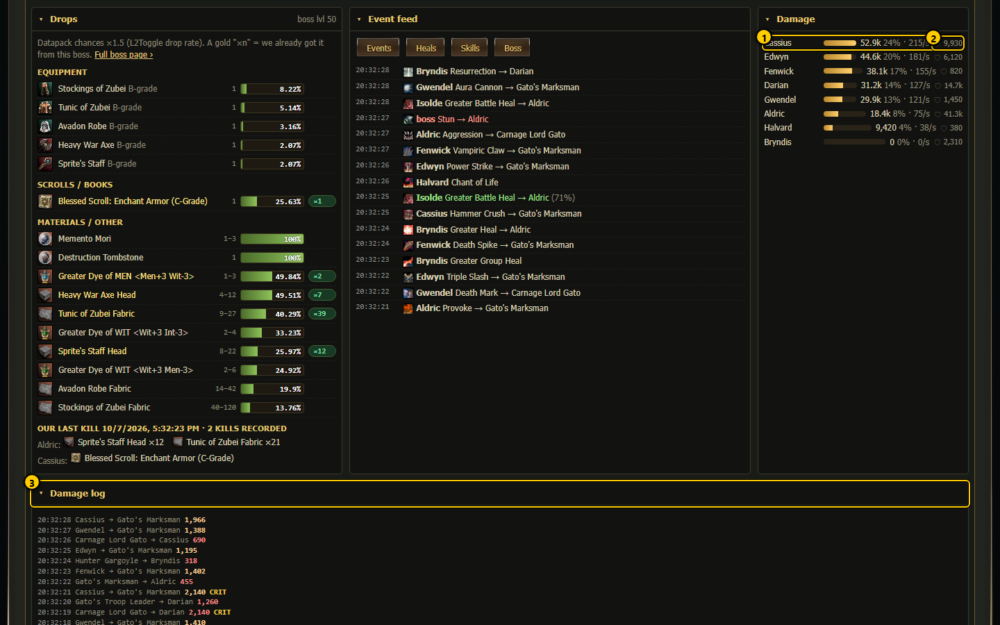

1. **Damage per member** - name, bar (share of the best), damage, share of the team in % and damage per second.
2. **🛡 damage taken**.
3. **Damage log** - the last 40 hits, newest first: who hit whom, the damage, and **CRIT** for critical hits. Folded by default; tap
   the title to open it.

## Act (override)

**Act** on any team card opens the [override menu](override.md) for that member: cast one of its skills, use a potion or scroll, target,
attack, stop, move to the tank or boss, or resurrect a dead teammate, once, even in the middle of the fight.

## Kamaloka

The [Kamaloka live view](../live/kamaloka-live.md) uses the same team cards (with the same Act menu) for its Team section.

## How to ...

**Check that the tank holds the boss**

1. Look at **Aggro on** in the Boss panel: green "tank ✓" is good.
2. On the team cards, the member with the pulsing red frame has the boss's aggro.
3. The map shows a red line from the boss to that member.

**Make a healer heal someone right now**

1. Tap **Act** on the healer's card.
2. Pick the target in **on** (a teammate), tap the heal skill, then **Do it**.
3. Watch the toast at the bottom for the answer. See [override menu](override.md).

**See what the boss can drop**

1. Open the **Drops** section.
2. Gold **×n** chips mark items the team already got from this boss.
3. Tap **Full boss page ›** for the full table.

## Notes

- Everything comes from `Logs/raid_live.json` (written by the party leader's window every second during a raid), the members' own
  `Logs/swarm_state_<name>.json`, `Logs/raid_heals.log`, `Logs/raid_loot.log` and the datapack. The dashboard adds them together in
  `/api/raidlive`.
- Skill casts per member, potions, CP and the HP line need a `swarm.js` that writes them. Without them the view still works: it builds a
  short skill history from what it sees every second, and samples the boss HP itself.
- The only thing on this page that sends anything is **Act** (it always asks with **Do it** first).
