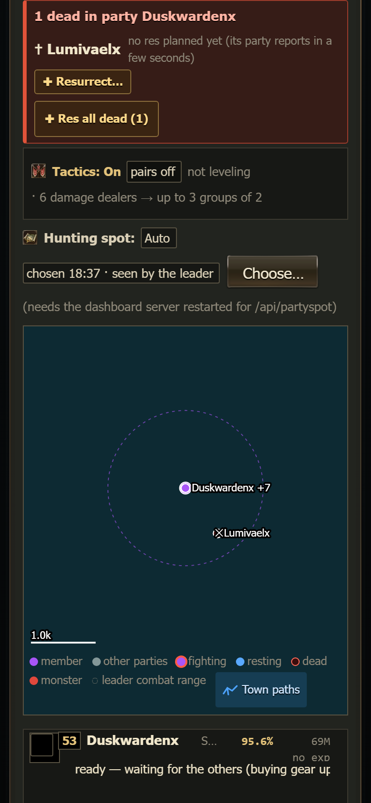
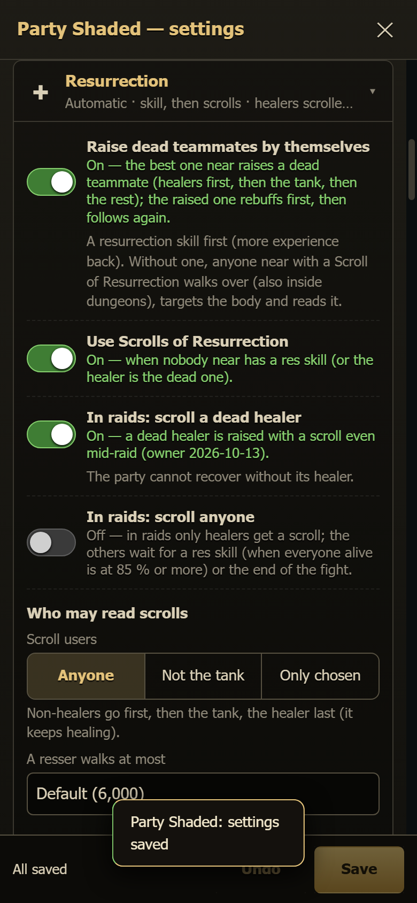

# Resurrection (raising dead teammates)

When a teammate dies, the party raises it **by itself**: the best one near walks to the body and uses a resurrection skill or a
Scroll of Resurrection. You can also pick **who** raises it and **how**, with one tap.

## What the party does by itself

1. **Who is raised first.** Healers first (the party cannot recover without them), then the tank, then the rest.
2. **Who raises it, and how.**
   - A **resurrection skill** first (Resurrection, Mass Resurrection, and any other skill named "... Resurrection"). It gives more
     experience back and uses no scroll.
   - With no skill near (or when the healer is the dead one): **anyone** near who carries a **Scroll of Resurrection** or a **Blessed
     Scroll of Resurrection**. Damage dealers go first, then the tank, the healer last (it keeps healing).
   - One character raises one body at a time. Two dead and two characters with scrolls: each takes one.
3. **The walk.** The chosen one stops following, walks to the body (inside dungeons room by room), targets the body and casts the skill
   or reads the scroll. Default: it walks at most **6,000**. Your orders walk up to **12,000**.
4. **Saying yes.** The dead character accepts the resurrection by itself.
5. **Rebuff first.** The raised character **buffs up before anything else**:
   - the Community Board **Buff Me** (when your server and the party use board buffs),
   - otherwise its own self buffs,
   - and the party's buffers give it their buffs at once.

   A raised **healer** then heals the party (it never attacks). Only then does it follow and fight again. This takes about 5 to 25
   seconds. A raised healer cuts its buffing short when a teammate is dying.

The party card shows it while it happens: *"Chanter4 is walking over with a Scroll of Resurrection"*, then *"alive again (Chanter4) —
rebuffing first"*. When nobody can raise the body, the card says why. For example: *"the nearest one who could (Chanter4) is 11,878
away — more than 6,000"*.

## Raids

- The healer's resurrection skill waits until **everyone alive is at 85 % HP or more**: heal first, raise next.
- A **dead healer may be raised with a scroll mid-raid** (rule changed on 2026-10-13: without a healer the raid is lost).
- Other dead members are **not** scrolled in a raid unless you switch on *In raids: scroll anyone* (see below).
- Your orders (the Resurrect button, **Res all dead**) always work in a raid.

## Resurrect a teammate yourself

A dead member's row on the Parties tab, its character page, and the dead card on the party card all have **✚ Resurrect**. Tap it.
The window lists everyone of the party who can raise it, with what they carry and how far away they are:

- *Nuker11 — Resurrection · 857 away*
- *Chanter4 — Scroll of Resurrection (3) · 858 away*
- *Chanter4 — Blessed Scroll of Resurrection (1) · 858 away*
- **Best one near (automatic)**

One tap sends the order. A name = that character does it (walks over, targets the body, casts / reads). *Best one near* lets the party
pick, as described above. A small message tells you the result.

**✚ Res all dead** on the party card raises every dead member of the party: healers first, then the tank, then the rest. It asks once.
It keeps trying for up to 2 minutes.

## Settings (party card → ⚙ Settings → Resurrection)

| Setting | Default | What it does |
|---|---|---|
| Raise dead teammates by themselves | **On** | Off = a dead teammate waits for your order. (This is the one automation that is on by default on a new install: it keeps the party alive.) |
| Use Scrolls of Resurrection | On | Off = only resurrection skills. Your orders may still use scrolls. |
| In raids: scroll a dead healer | On | A dead healer is raised with a scroll even mid-raid. |
| In raids: scroll anyone | Off | On = every dead member may be scrolled mid-raid. |
| Who may read scrolls | Anyone | *Not the tank*, or *Only chosen* (tick the names). |
| A resser walks at most | 6,000 | How far a character walks to a body by itself (1,500 to 15,000). |
| More → Blessed scrolls first | Off | A Blessed Scroll (more experience back) before a normal one. |

The section also shows what each member carries right now (*Bishop1 Resurrection · Chanter4 3 scrolls, 1 blessed*). Scrolls come with the
supply run (Settings → Supplies, or *Supply run now*).

## Commands

| Command | Who acts |
|---|---|
| `!res <dead>` | the best one near (party order) |
| `!res <dead> scroll` / `skill` / `blessed` | the best one near, with that method |
| `!res <dead> by <name>` | only that character |
| `!resall` | every dead member, one resser each |
| `!ov <name> res <dead> [skill\|scroll\|blessed]` | that character, now (the Override menu's "Resurrect …") |

Technical: settings file `Scripts/data/res_rules.json` (per party; missing = the defaults above), read by the bots every 5 seconds.
The decision code is `RES-PURE` in `swarm.js` (`resDecide`, `resAfterStep`); the tests are `docs/plan/tools/test_resurrect.js`
and `test_resurrect_ui.js`.
