# Fortresses, castles and sieges

Routes: `#/forts`, `#/forts/<id>`, `#/castles`, `#/castles/<id>` and the live view `#/siege/live`
(see [Siege live view](../live/siege-live.md)).

These two tabs are where you look up every fortress and castle, check whether your clan may attack it, plan a siege with
several parties, and start it. The bots then run the whole siege by themselves: regroup in Giran, travel, regroup outside,
wait for the start, kill the objectives, and raise the flag or engrave the artifact.

> **Read this first.** The siege code is built but **not tested on a live server**. The rules and numbers come from the
> L2J High Five datapack (a "datapack" is the server's game data; see the [glossary](../06-glossary.md)). Your server may use
> other clan levels, fees, start times or NPC levels. A fortress siege needs clan level **4**, a castle siege clan level **5**
> (the values in `Scripts/data/fortresses.json` and `castles.json`). Fortress commanders are level 78.

Both tabs have the same layout, from top to bottom:

1. the title bar with **Live view** and **↻** (reload),
2. a compact live box (only while a siege runs),
3. the clan eligibility bar,
4. the world map (left) and the detail panel of the selected target (right; below the map on a phone),
5. **Plan a siege** (the planner form) and its warnings,
6. **Planned sieges** (saved plans),
7. **All fortresses** / **All castles** (table),
8. **Rules + sources**.

The page reloads its data every 15 seconds while it is open, and the countdowns in the plan list every 30 seconds.

## Fortresses tab (`#/forts`)

Use this tab to choose a fortress and plan a fortress siege. `#/forts/<id>` opens it with that fortress selected
(for example `#/forts/104` = Valley Fortress). Without an id, the page selects the fortress of the next planned siege, or the first one.

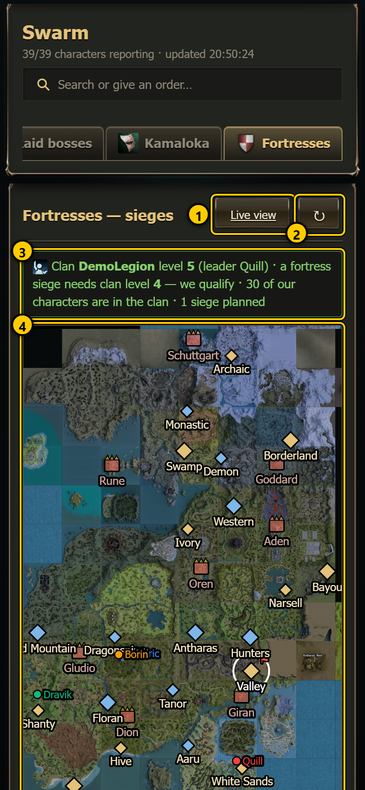 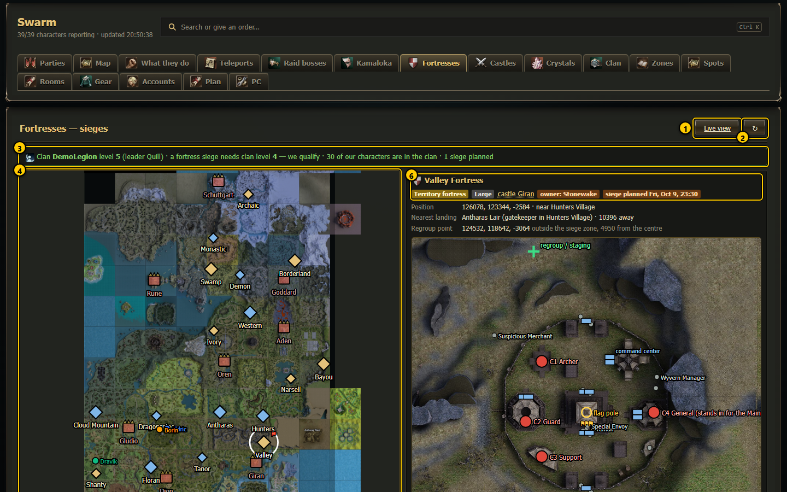

1. **Live view** - opens the [siege live view](../live/siege-live.md) (`#/siege/live`).
2. **↻** - reads the fortress, castle, plan and clan data again right now.
3. **Clan eligibility bar** - your clan, its level, the clan leader (and "offline" when he is not reporting), the clan level a
   fortress siege needs, and whether you qualify. Green frame = you qualify; red frame and red text = "we cannot register yet
   (level X/4)". It also counts how many of your characters are in the clan and how many sieges are planned.
4. **World map** - all 21 fortresses and all 9 castles on the game map. Tap a marker to select it.
5. **Legend** - what the markers mean (below).
6. **Detail panel** - everything about the selected fortress (see [Fortress detail panel](#fortress-detail-panel)).

### The world map

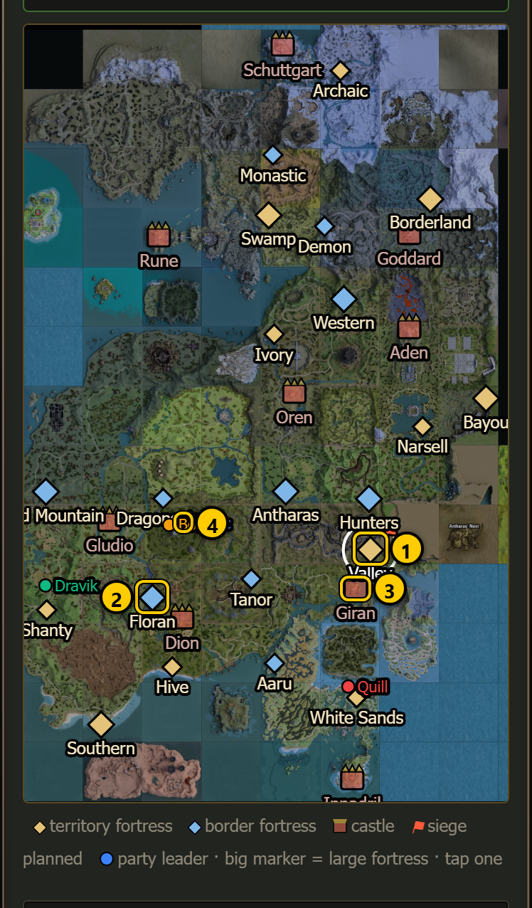 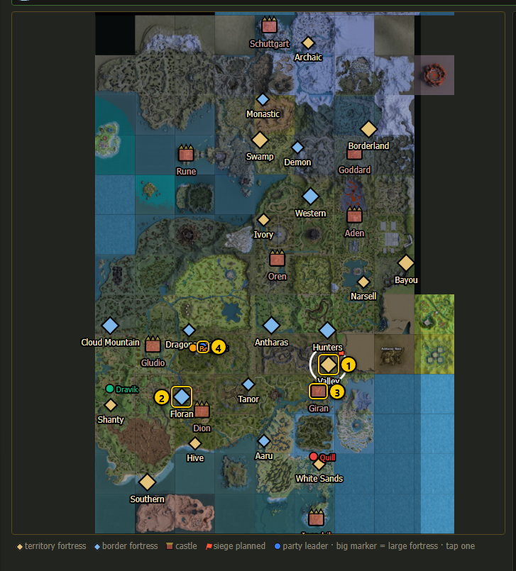

1. **Selected fortress** - a white ring. A red **⚑** next to a marker means a siege is planned there.
2. **Diamonds** - fortresses. Gold = territory fortress, blue = border fortress. A larger diamond is a large fortress.
3. **Red boxes with a crown** - castles. On the Fortresses tab they are dimmed; tapping one switches to the Castles tab.
   Thin dashed lines join each castle to its fortresses.
4. **Coloured dots** - where each party leader is right now (one colour per party, the same colours as in the planner).

A pulsing red ring marks the target of a siege that is running now.

### Fortress detail panel

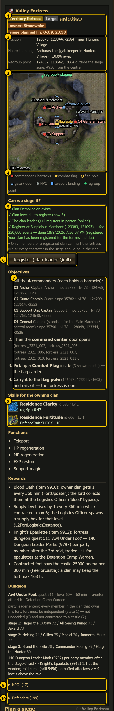 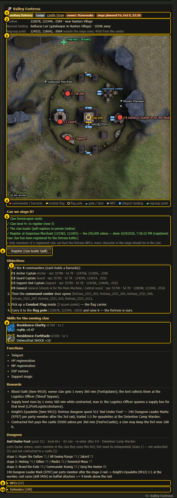

1. **Chips** - Territory or Border fortress, Small or Large, the castle it belongs to (tap it to open that castle), the owner,
   and "siege planned <date>" when a plan exists. "owner unknown" means no bot has seen a "... is victorious" system message
   for this fortress yet; the bots write the owner to `Logs/siege_owners.json` whenever they see one.
2. **Position block** - map coordinates and nearest town, the nearest teleport landing (and which town's gatekeeper sends you
   there, and how far it is), and the **regroup point**: a safe spot outside the siege zone where the parties gather before
   the start (attackers inside the zone are sent to town when the siege starts).
3. **Close-up map** - the area around the fortress on the game map (see [Close-up map](#close-up-map)).
4. **Close-up legend**.
5. **Can we siege it?** - a checklist. Green ✓ = done, red ✗ = missing, • = a note:
   - the clan exists,
   - the clan level is high enough,
   - the clan leader is online (only he can register),
   - where to register (the fortress's Suspicious Merchant, with its position) and the fee; after a registration it shows
     "done <time> (<result>)" from `Logs/siege_registrations.json`,
   - a reminder that only members of a registered clan can hurt the fortress NPCs.
6. **Register (clan leader <name>)** - sends `!siegereg fort <name>` to the clan leader, after a confirmation (below). Greyed
   out while the clan level is too low, with "clan level 4 needed — now X" next to it.
7. **Objectives** - what has to happen, in order: kill every commander (each holds a barracks; listed with NPC id, level and
   position), then the command center door opens, pick up a **Combat Flag** inside, carry it to the **flag pole** and raise it.
8. **Skills for the owning clan** - the residence skills the owner gets, with icon, id, level and effect. Below it:
   **Functions** (teleport, HP/MP regeneration ...), **Rewards** (Blood Oath, Knight's Epaulette, supply boxes ...) and the
   **Dungeon** (the fortress dungeon quest: level, time, re-entry, bosses per stage, reward).
9. **NPCs (n)** - a fold-out list of every NPC of the fortress: role, name, title, NPC id and position.
10. **Defenders (n)** - a fold-out count of the defending guards by name.

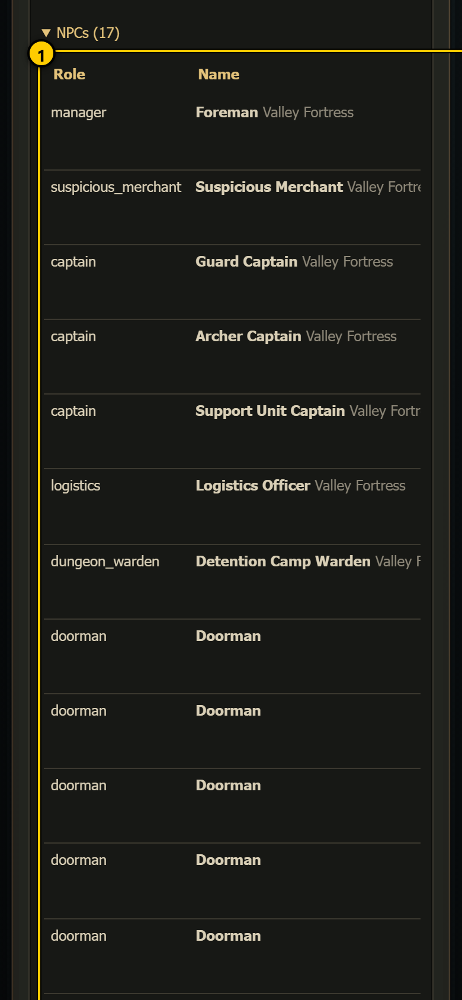 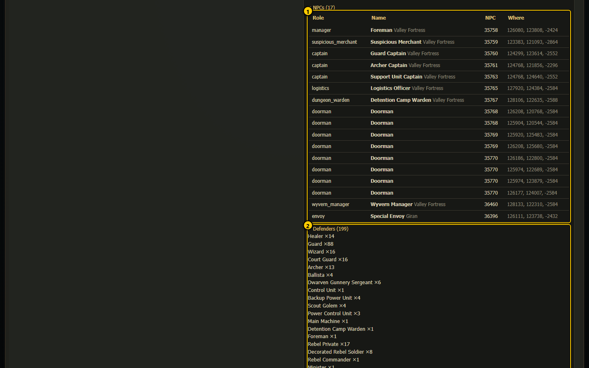

1. **NPCs** - role, name, NPC id, position.
2. **Defenders** - every guard type with its count (for example "Guard ×88").

### Close-up map

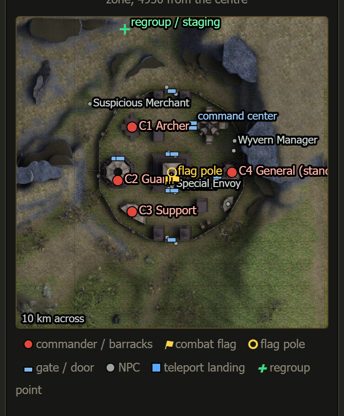 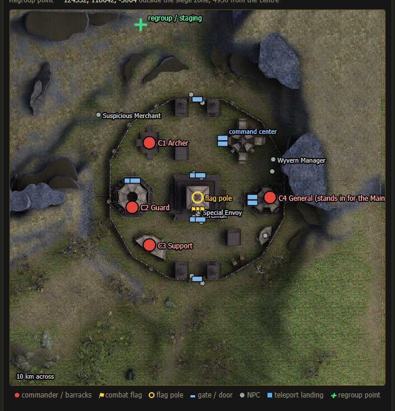

| Marker | Meaning |
|---|---|
| Red circle **C1**, **C2** ... | a commander (with its role: Archer, Guard, Support, General) |
| Yellow **⚑** | a Combat Flag spawn point (inside the command center) |
| Yellow ring "flag pole" | where the flag is raised |
| Blue bar | a gate or door; the first command-center door is labelled "command center" |
| Grey dot | an NPC (merchants, envoys, managers are named). Hover or long-press for name, title, role and NPC id |
| Blue square "landing: ..." | the nearest teleport landing (only when it is on this map piece) |
| Green **✚** "regroup / staging" | the regroup point (the plan's own point while you edit a plan) |
| "n km across" | the scale |

On the Castles tab the close-up also shows the **Holy Artifact** (yellow circle), **Control Towers** (purple triangles) and
**Flame Towers** (orange triangles).

### Registering the clan

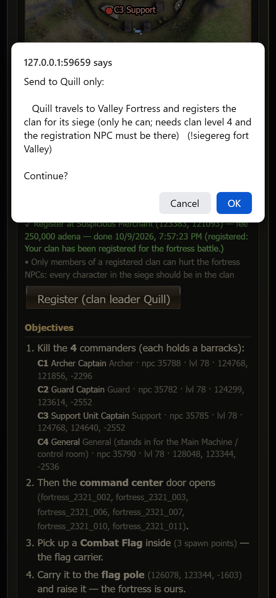 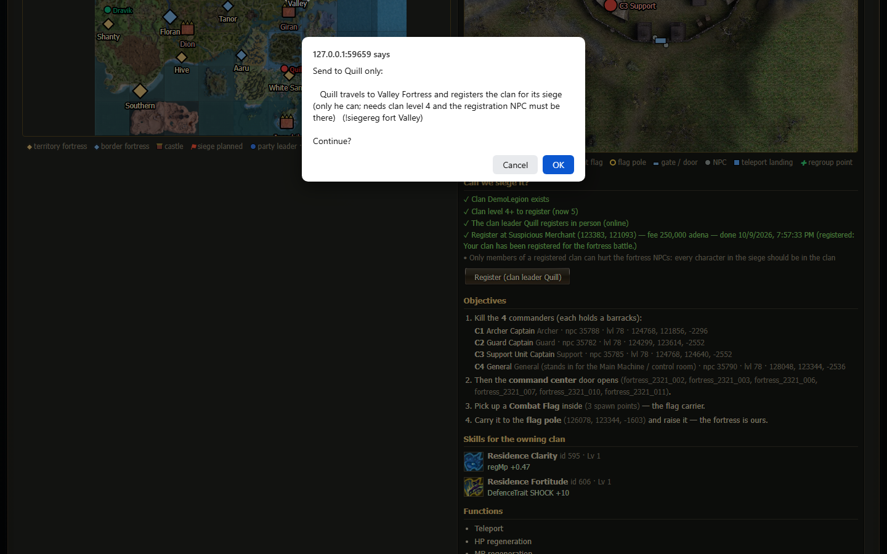

**Register** asks first: "Send to <clan leader> only: <clan leader> travels to <fortress> and registers the clan for its
siege ... (!siegereg fort <name>)". Press **OK** to send it. The clan leader then:

1. checks the clan level again (too low = it stops and writes "refused here: clan level 4 needed ..."),
2. travels to the fortress's Suspicious Merchant (town first, then the gatekeeper, then a walk),
3. clicks through the merchant's pages to the register link. The first clan to register pays 250,000 adena (L2J value).
   The merchant only stands there while the fortress can be registered for.

The result is written to `Logs/siege_registrations.json` and shown in the checklist. The NPC pages are saved as
`Logs/siegereg_*.html`. In L2J a fortress siege starts **60 minutes after the first clan registers**, so register first, then plan.

While the clan level is too low the button is greyed out:

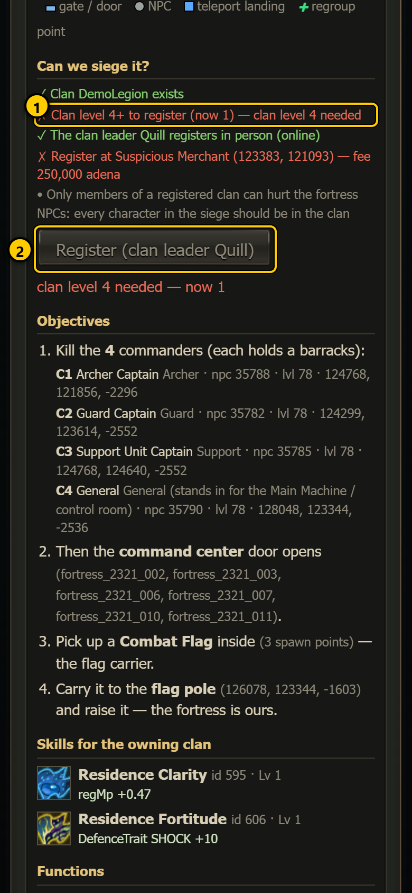 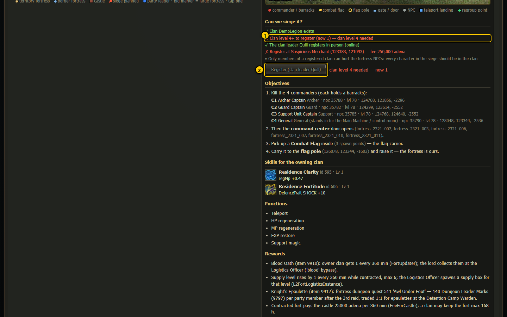

1. **Red ✗** - the check that fails.
2. **Register** - greyed out, with the reason next to it.

## Plan a siege

The form below the map plans a siege for the selected target. Its title says which one ("for **Valley Fortress**").
A plan is saved to `Scripts/data/siege_plans.json`, which the bots read live.

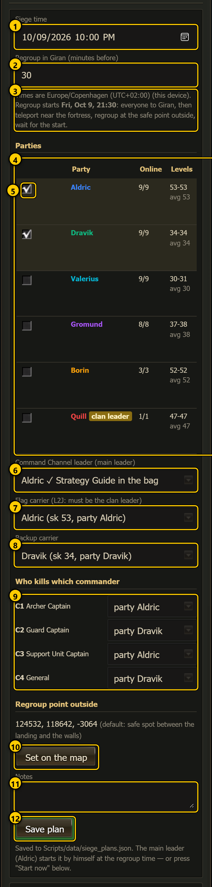 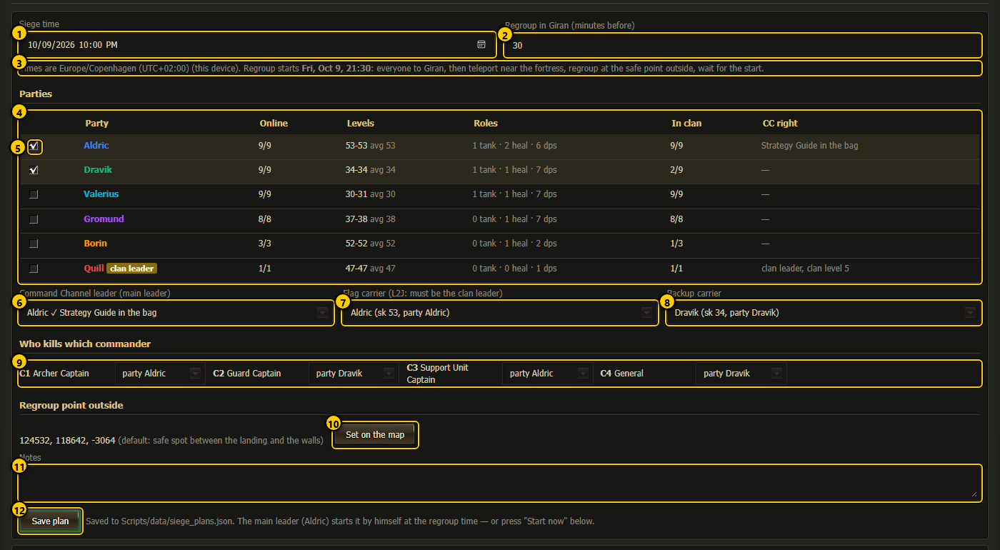

1. **Siege time** - date and time of the siege start, in this device's time zone. The default is two hours from now, rounded down to the full hour.
2. **Regroup in Giran (minutes before)** - 5 to 240 (default 30). At "siege time minus this", the bots stop what they are doing and start.
3. **Time zone line** - the time zone used and the exact time the regroup starts. It updates while you type.
4. **Parties** table - one row per party: party name (in its map colour, plus a "clan leader" chip for the clan leader's
   party), online/size, level range and average, tanks/healers/damage dealers, how many are in the clan, and whether the
   leader has the Command Channel right ("CC right").
5. **Checkbox** - tick the parties that take part. By default the two biggest parties (3+ characters) are ticked.
6. **Command Channel leader (main leader)** - one of the ticked party leaders. He starts the plan, waits for the other
   parties, opens the Command Channel (a channel joining several parties; see the [glossary](../06-glossary.md)) and writes
   the live view. Leaders without the right are marked "(no CC right yet)".
7. **Flag carrier** (fortress) - who carries the Combat Flag. Healers are never offered. The default is the clan leader when
   his party is ticked, otherwise the sturdiest member (tank first, then destroyers ...).
8. **Backup carrier** - a second choice.
9. **Who kills which commander** - one select per commander: a party or "any party". The default spreads the commanders over
   the ticked parties.
10. **Set on the map** - pick your own regroup point (see below). The line before it shows the current point and whether it is
    the default ("safe spot between the landing and the walls") or "set by you".
11. **Notes** - free text (up to 500 characters), shown in the plan list.
12. **Save plan** - saves the plan (no confirmation). It becomes **Save changes** when you edit a saved plan, and **New plan**
    appears next to it.

For a castle the flag fields are replaced by **Engraves the artifact (must be the clan leader)** and there is no commander list
(see [Castles tab](#castles-tab-castles)).

Ticking or unticking a party redraws the form and picks new defaults for carrier, backup, commanders and CC leader when
the old choice is no longer in a ticked party. Your own choices stay when they are still valid.

### Warnings

Under the form a box counts the chosen parties and characters and lists every problem it finds. Red = it will not work,
orange = it may not work, green = a confirmation. It updates while you change the form.

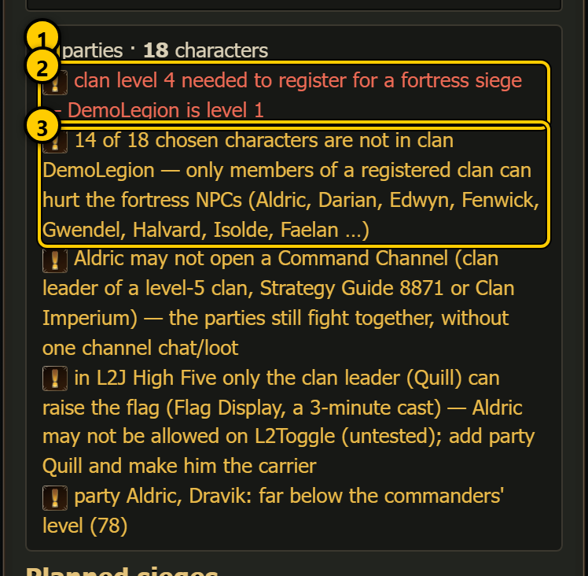 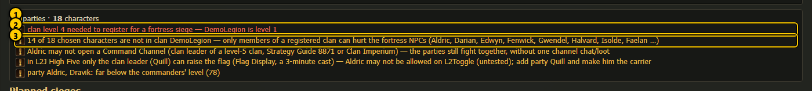

1. **Count** - "2 parties · 18 characters" ("no problems found" when the list is empty).
2. **Red** - for example "choose at least one party", "clan level 4 needed to register ...", "only the clan leader can engrave the Holy Artifact".
3. **Orange** - for example characters who are not in the clan (only members of a registered clan can hurt the NPCs),
   characters offline now, a CC leader without the Command Channel right, no flag carrier, a carrier who is not the clan
   leader (in L2J High Five only the clan leader can raise the flag), a siege time in the past ("the leader would start at
   once"), a party far below the commanders' level, a party without a healer.

When the clan leader carries the flag the box says so in green: the flag slows him to 20 % and every party escorts him; the
3-minute Flag Display cast must not be interrupted.

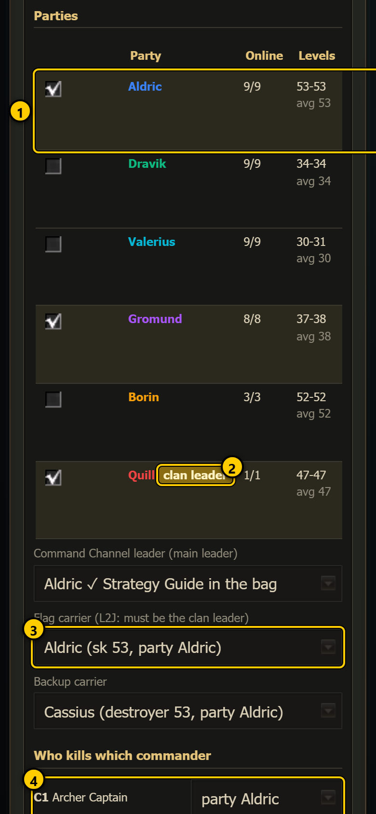 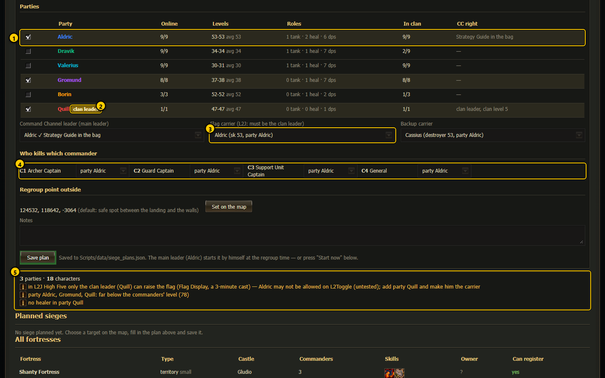

1. **Ticked rows** are highlighted.
2. **clan leader** chip.
3. **Flag carrier** - switched to the clan leader as soon as his party is ticked.
4. **Who kills which commander** - spread over the ticked parties (round-robin).
5. **Warnings box**.

### Setting your own regroup point

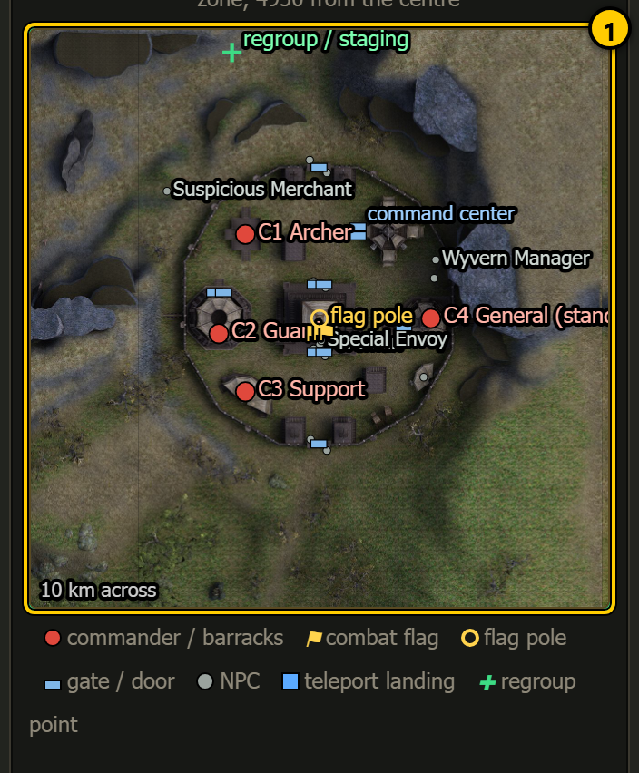 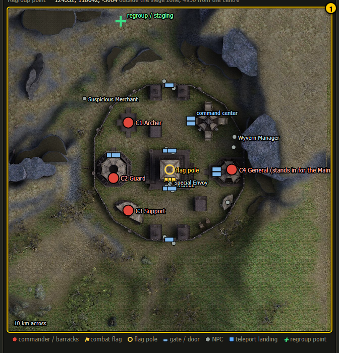

1. After **Set on the map** the button reads "Tap the close-up map…" and the close-up map gets a green frame. Tap the spot.
   Tap the button again to cancel.

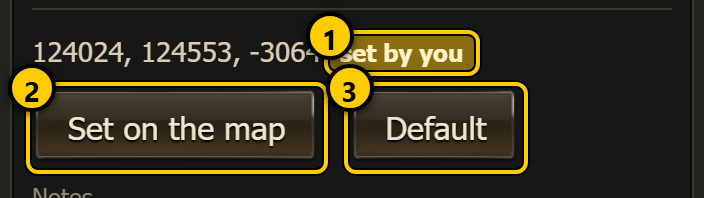 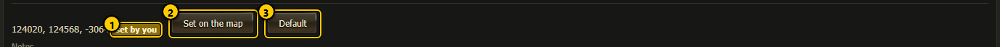

1. **set by you** - the new point (its height is taken from the default point).
2. **Set on the map** - pick again.
3. **Default** - back to the point from the data.

Choose a spot **outside** the siege zone; attackers inside the zone at the start are teleported to town.

### How to plan a fortress siege

1. Register the clan first (see [Registering the clan](#registering-the-clan)); the siege time follows from the registration.
2. Tap the fortress on the map (or its row in the table).
3. Set **Siege time** and **Regroup in Giran**.
4. Tick the parties. Tick the clan leader's party too, so he can carry the flag.
5. Check the CC leader, flag carrier, backup carrier and the commander list.
6. Optional: set your own regroup point and write a note.
7. Read the warnings, fix the red ones.
8. Press **Save plan**. The status line at the bottom says "siege plans saved", and the plan appears under **Planned sieges**.

At regroup time the plan's main leader starts it by himself (he checks the plan file every 30 seconds). He waits if a raid or
Kamaloka is running and starts after it.

## Planned sieges

Every saved plan of this kind (fortress or castle), sorted by time.

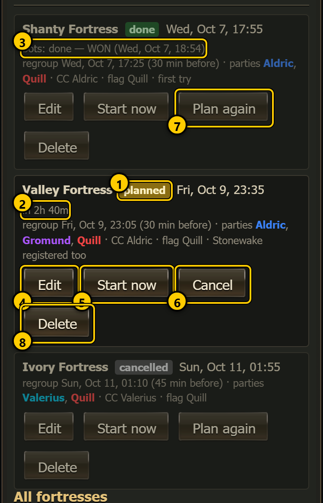 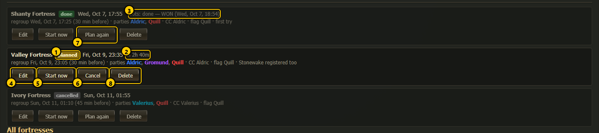

1. **Status chip** - `planned`, `done`, `cancelled`, or **LIVE** while the bots run it.
2. **Countdown** - "in 2h 40m" (planned plans only). Below the title: the regroup time, the parties in their colours, the CC
   leader, the flag carrier or engraver, and your notes.
3. **Bots** - what the main leader reported in `Logs/siege_runs.json`: `starting`, `started` or `done`, with the result
   (for example "WON", "wiped", "time is up", "could not reach the target") and the time.
4. **Edit** - loads the plan into the form above (and switches to the right tab).
5. **Start now** - sends `!siege plan <id>` to the plan's main party, after a confirmation. The siege starts at once
   (the regroup included); a planned start time still in the future is kept as the start time.
6. **Cancel** - sets the plan to `cancelled` after a confirmation. The bots ignore cancelled plans.
7. **Plan again** - (shown instead of Cancel on a cancelled or done plan) sets it back to `planned`, no confirmation.
8. **Delete** - removes the plan from the file after a confirmation.

**Watch live ›** appears on the plan that is running now.

Every change to the plan file first copies the old file to `Settings/backup/siege_plans_<time>.json`.

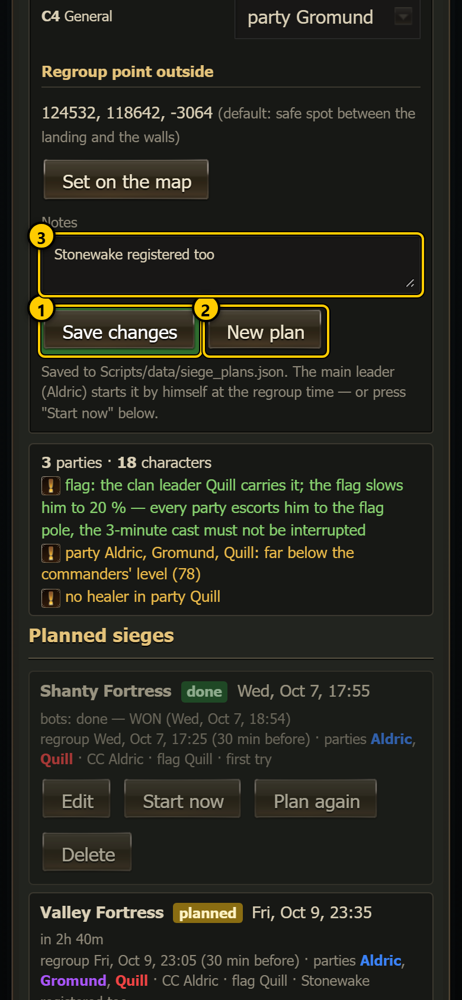 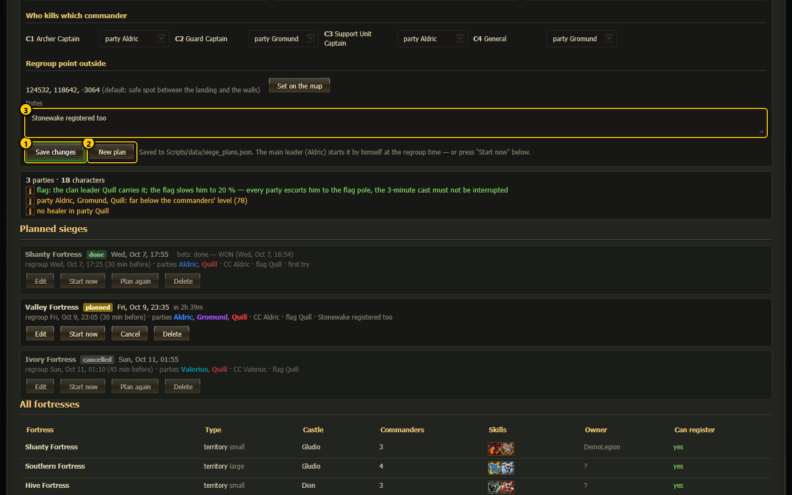

1. **Save changes** - saves over the same plan.
2. **New plan** - empties the form for a new plan of the same target.
3. All values of the plan (time, parties, roles, commanders, regroup point, notes) are in the form.

The confirmations:

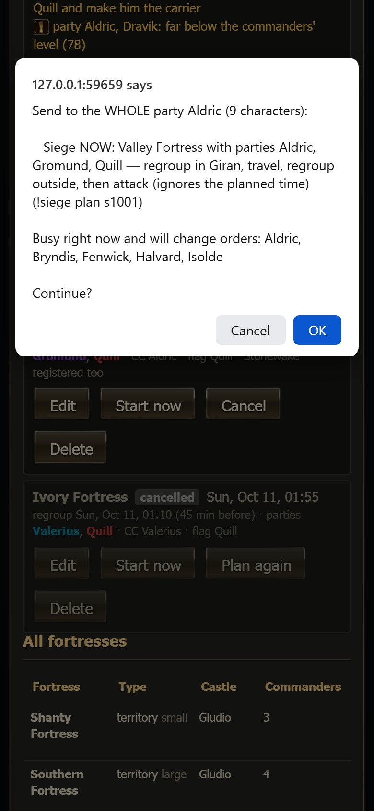 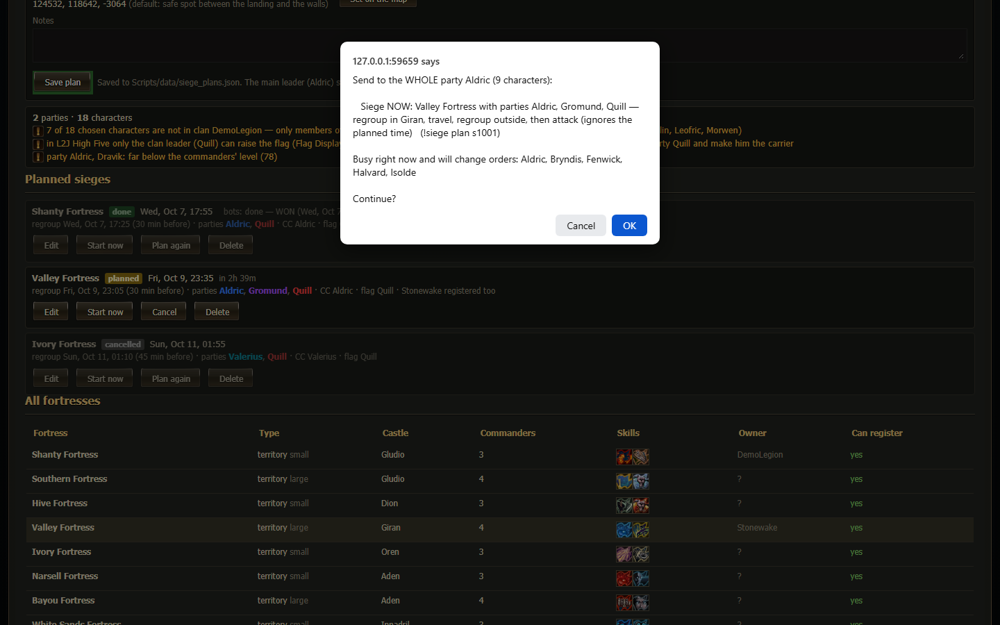

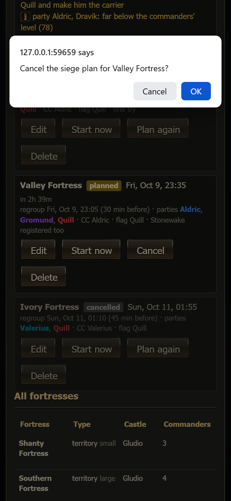 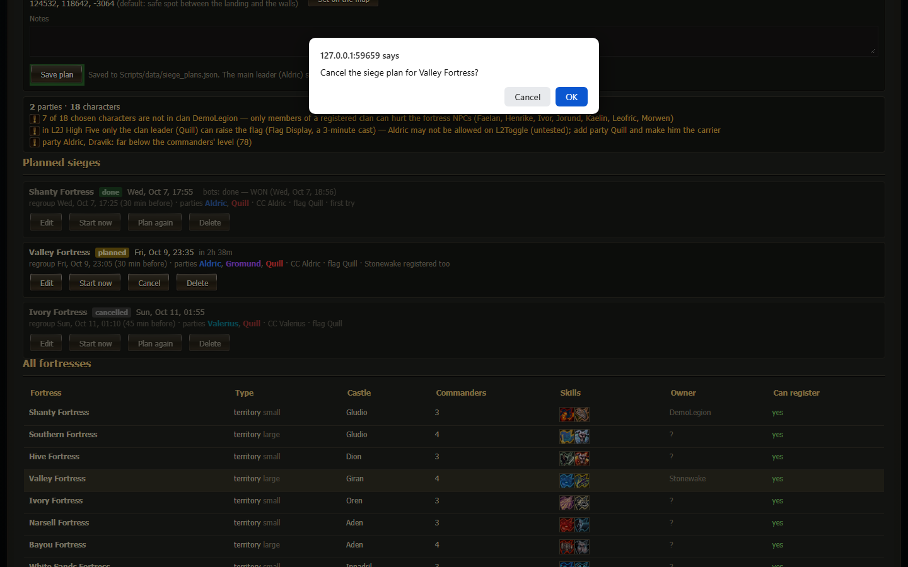

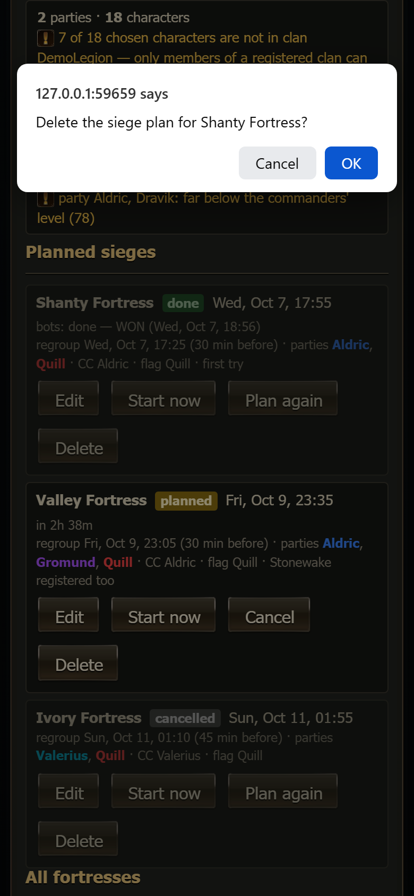 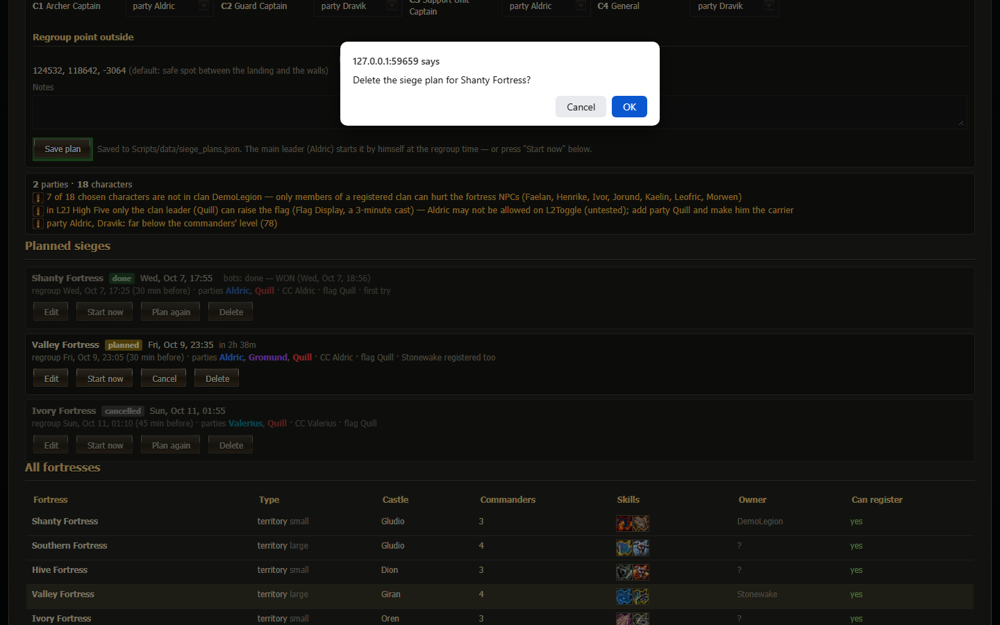

**Start now** uses the standard order confirmation ("Send to the WHOLE party <name> (n characters): ... Busy right now and
will change orders: ..."). **Cancel** and **Delete** ask "Cancel/Delete the siege plan for <target>?".

## All fortresses table

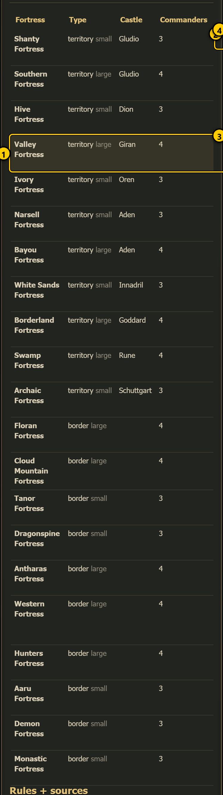 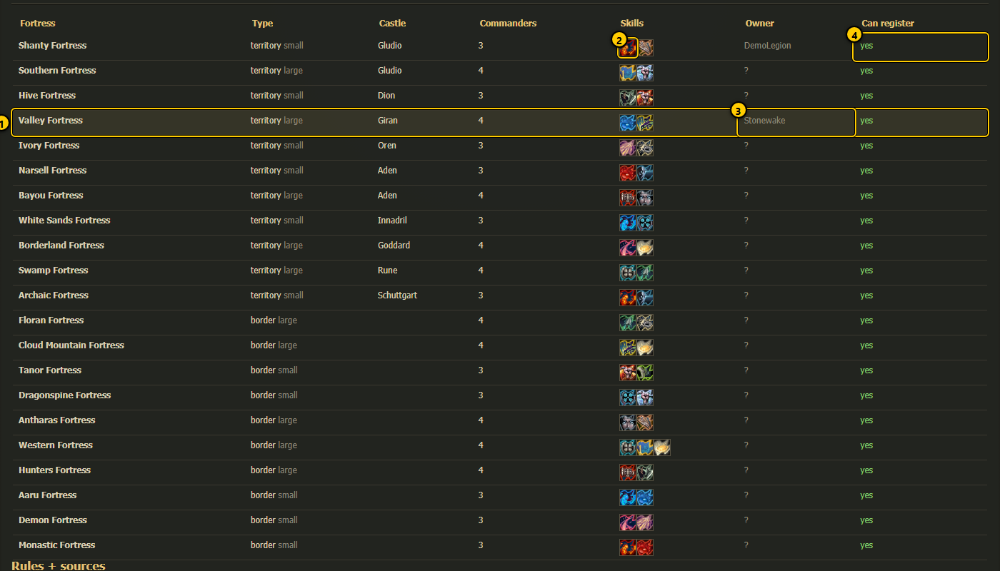

1. **Selected row** - tap any row to select that fortress (same as tapping the map).
2. **Skills** - icons of the owner's skills; hover for name and effect.
3. **Owner** - the clan seen winning it last ("?" = unknown).
4. **Can register** - "yes" or "clan lvl 4".

Other columns: name, type and size, castle, number of commanders. On a phone the table scrolls sideways.

## Rules + sources

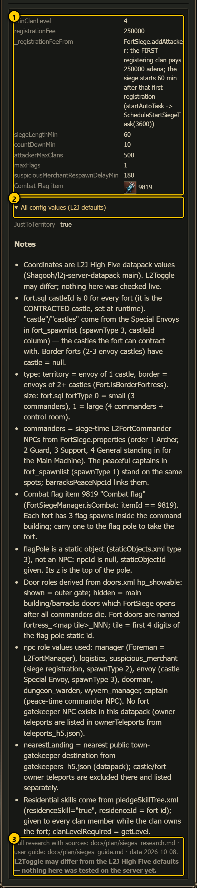 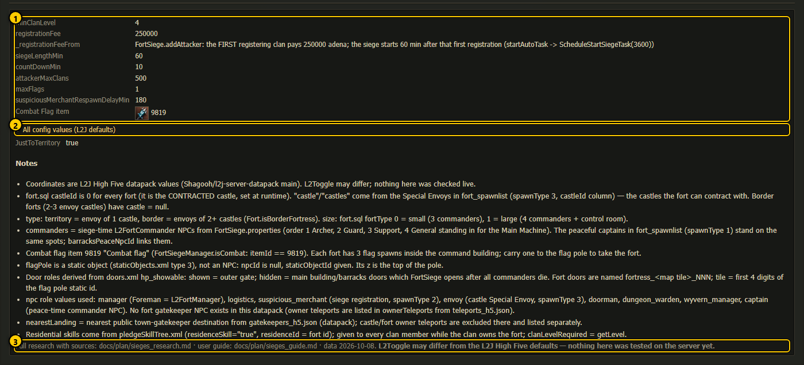

1. **Rules** - the main values from the data file: minimum clan level, registration fee, siege length, count-down, maximum
   attacker clans, the Combat Flag item ...
2. **All config values (L2J defaults)** - a fold-out with every other config value.
3. **Sources** - where the research is (`docs/plan/sieges_research.md`), the data date, and the warning that the server may differ.

The **Notes** list (on the Castles tab) explains how the data was made (castle NPC roles, control and flame towers, siege schedule ...).

## Castles tab (`#/castles`)

The same page for the 9 castles. `#/castles/<id>` selects a castle (1 Gludio, 2 Dion, 3 Giran, 4 Oren, 5 Aden, 6 Innadril,
7 Goddard, 8 Rune, 9 Schuttgart).

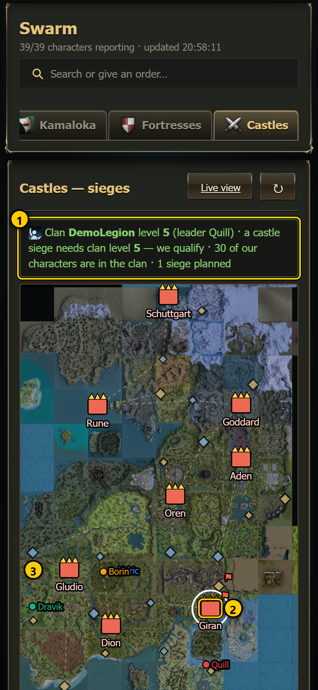 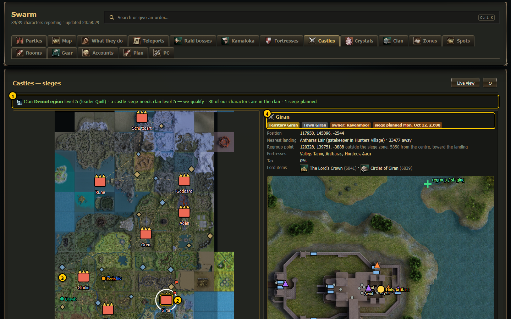

1. **Eligibility bar** - the same as on the Fortresses tab, for clan level 5.
2. **Selected castle** - castles are bright here, fortresses dimmed and smaller.
3. **Dashed lines** - from each castle to its fortresses.
4. **Detail panel**.

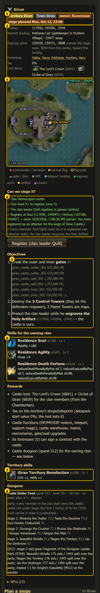 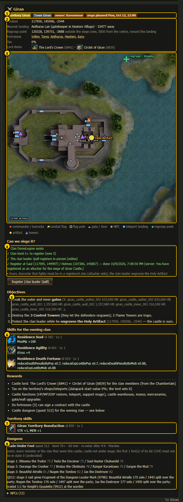

1. **Chips** - territory, town, owner, planned siege.
2. **Position block** - position, nearest landing, regroup point, its **fortresses** (tap one to open it), the default tax
   and the **lord items** (crown and circlet with icons and item ids).
3. **Close-up** - gates and walls, Control Towers, Flame Towers, the Holy Artifact.
4. **Can we siege it?** - like the fortress checklist; registration is at the castle's Messenger or Chamberlain, and every
   fighter must be in a registered clan (attacker side). **Register** sends `!siegereg castle <name>`; the clan leader talks
   to the Messenger and sends the "join siege" request. Registration closes 24 hours before the siege (L2J).
5. **Objectives** - break the outer and inner gates, destroy the Control Towers (they let defenders respawn; Flame Towers
   are traps), protect the clan leader while he engraves the Holy Artifact.
6. **Skills for the owning clan**.
7. **Territory skills**.
8. **Dungeon** - the castle dungeon quest.

Below them: **Rewards** (crown and circlets, tax, castle functions, its fortresses' contracts, the dungeon) and the NPC list.

### Plan a castle siege

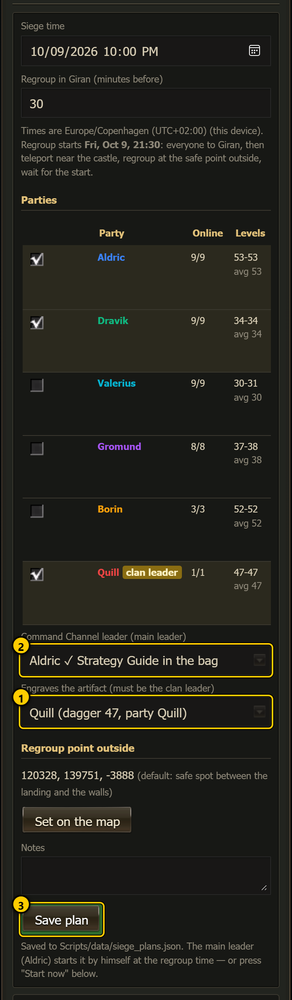 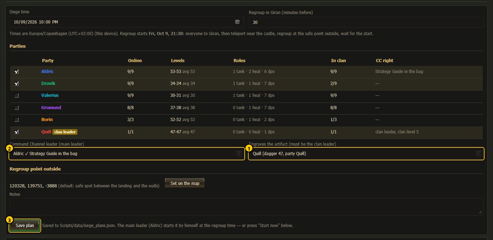

1. **Engraves the artifact (must be the clan leader)** - the list holds the members of the ticked parties; the default is
   the clan leader, so tick his party. Any other choice gives a red warning.
2. **Command Channel leader**.
3. **Save plan**.

All other fields work as for a fortress.

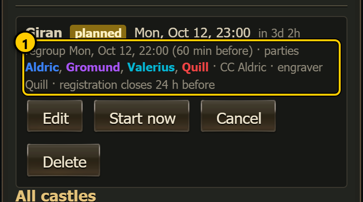 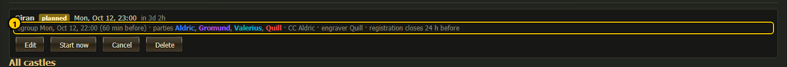

1. The plan line shows the regroup time, parties, CC leader, **engraver** and notes.

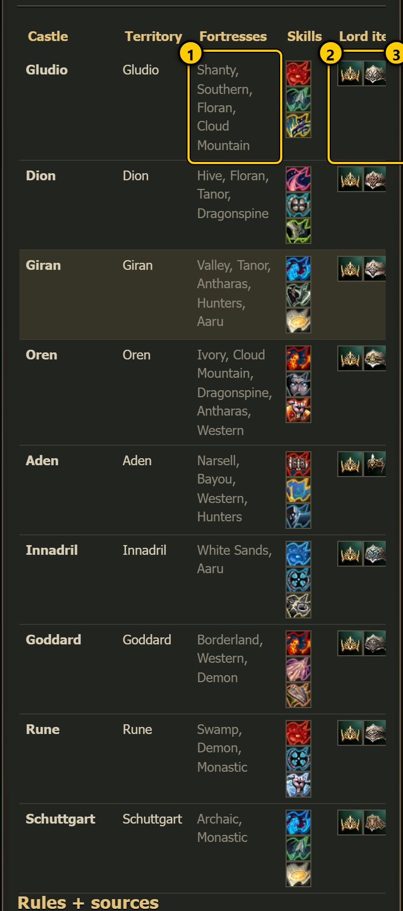 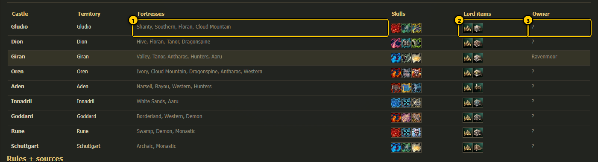

1. **Fortresses** - the castle's fortresses.
2. **Lord items** - crown and circlet icons.
3. **Owner**.

## What the bots do in a siege

Every ticked party leader runs the siege for his own party; members follow and assist as always. The main (CC) leader also
waits for the others, opens the Command Channel and writes the live view.

1. **Regroup in Giran** - the normal Giran regroup.
2. **Travel** - town first, then the gatekeeper landing nearest the regroup point, then the team walks there.
3. **Regroup outside** - each leader waits for his team. The main leader waits up to 15 minutes for every party, invites
   the other leaders into the Command Channel (if he has the right) and gives GO.
4. **Wait for the start** - until the server's start message or the planned time; the party rebuffs (`!buff`) 4 minutes before.
5. **Siege** - fortress: break the nearest closed outer gate, each party kills its commander (focus fire), all commanders
   must die within 10 minutes of the first or they come back; then the command center opens and the carrier picks up the
   Combat Flag (item 9819), walks to the flag pole and casts Flag Display (skill 3318, 3 minutes) while every party escorts
   him. Castle: gates, then Control Towers, then the clan leader casts Seal of Ruler (skill 246) on the Holy Artifact.
6. **End** - a win, the siege-end message, the main party dead for 60 seconds, the siege time over, or `!siege stop`.
   Everyone stops and waits for the next order, like after a raid.

Rules: nobody escapes while the siege runs; healers raise the dead and Scrolls of Resurrection are allowed (a siege is not a
raid). Enemy players are only shown on the live view; the bots do not attack them.

**Not built yet:** headquarters (Build Headquarters), the large-fortress control room, ballista bombs, the contract choice
after a win. Gate and flag-pole ids come from server packets read during the siege; this part is untested.

## Commands

All of these are also in the [command center](command-center.md) (category "clan") and the [command reference](../05-commands.md).

| Command | Sent to | What it does |
|---|---|---|
| `!siege plan <id>` | the plan's main party | start a saved plan now (the **Start now** button) |
| `!siege fort <name>` / `!siege castle <name>` | a party | quick siege with this party only, starting now |
| `!siege stop` | a party, or all | stop the running siege (all parties) |
| `!siegereg fort <name>` / `!siegereg castle <name>` | the clan leader | register the clan (the **Register** button) |

## Files

| File | What |
|---|---|
| `Scripts/data/fortresses.json`, `castles.json` | the data shown on these tabs (made by `docs/plan/tools/sieges_data.js`) |
| `Scripts/data/siege_plans.json` | the plans (read live by the bots) |
| `Logs/siege_live.json` | the live view (written by the main leader every 2 seconds) |
| `Logs/siege_runs.json` | plan id -> what the bots did with it |
| `Logs/siege_registrations.json`, `Logs/siegereg_*.html` | registration results and NPC pages |
| `Logs/siege_owners.json` | the owner of each fortress / castle, as last seen |
| `Logs/siege.log` | every siege event |

## Notes and safety

- **Register**, **Start now**, **Cancel** and **Delete** ask for confirmation. **Save plan**, **Plan again**, **Edit**,
  **Set on the map** and **Default** do not.
- Saving or changing a plan is safe: nothing happens in the game until the regroup time (or **Start now**).
- A saved plan **will** start by itself at regroup time. Cancel or delete plans you no longer want.
- Times are stored in UTC and shown in the time zone of the device you are using.
