# Teleports and Giran town routes

The **Teleports** tab (`#/tp`) answers four questions: *which gatekeeper menus do the bots know*, *where is every character right now*,
*which roads do the bots walk inside Giran*, and *where is a certain NPC* (the Find an NPC box, described on its own page). The gatekeeper menus are the real menus the bots saw on the server: every time a bot
opens a gatekeeper, the menu is saved to `Scripts/data/gk_live/<gatekeeper>.json`, and the bots plan every trip from these menus (a
destination that is not on the menu of the town a character stands in is reached through other towns). Words like `.townname`,
landing and SoE are in the [glossary](../06-glossary.md).

## Teleports tab (`#/tp`)

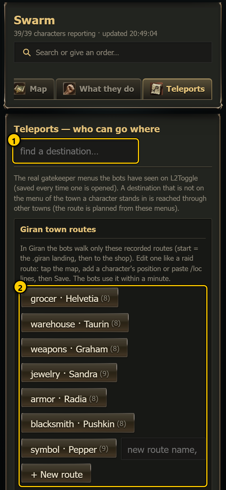 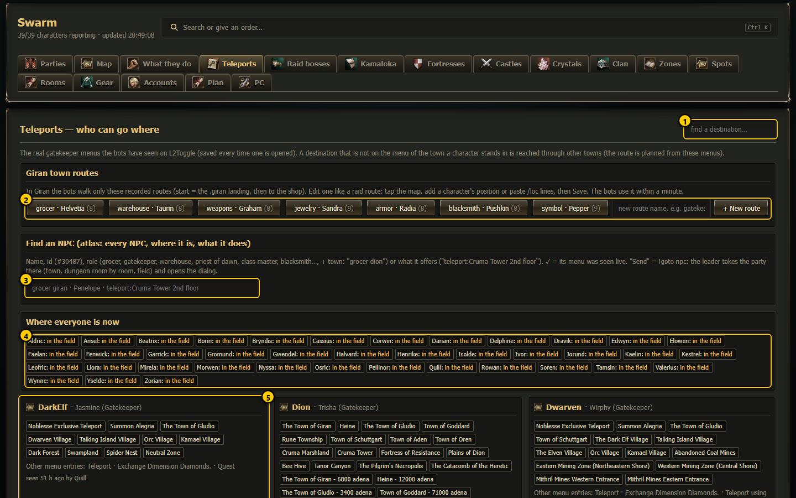

1. **Find a destination…** - filter the gatekeeper cards: only cards with a matching destination (or a matching town name) stay, and the
   matching destinations turn green.
2. **Giran town routes** - one button per recorded route inside Giran, plus a field and **+ New route** (see
   [Giran town routes](#giran-town-routes)).
3. **Find an NPC** - search every NPC of the world by name, id, role ("grocer dion") or what it offers, and send a party to it. It has its
   own page: [Find an NPC](find-npc.md).
4. **Where everyone is now** - one chip per character (see below).
5. **Gatekeeper cards** - one card per gatekeeper the bots have seen, sorted by town.

The tab loads its data when you open it (open it again to refresh).

### Where everyone is now

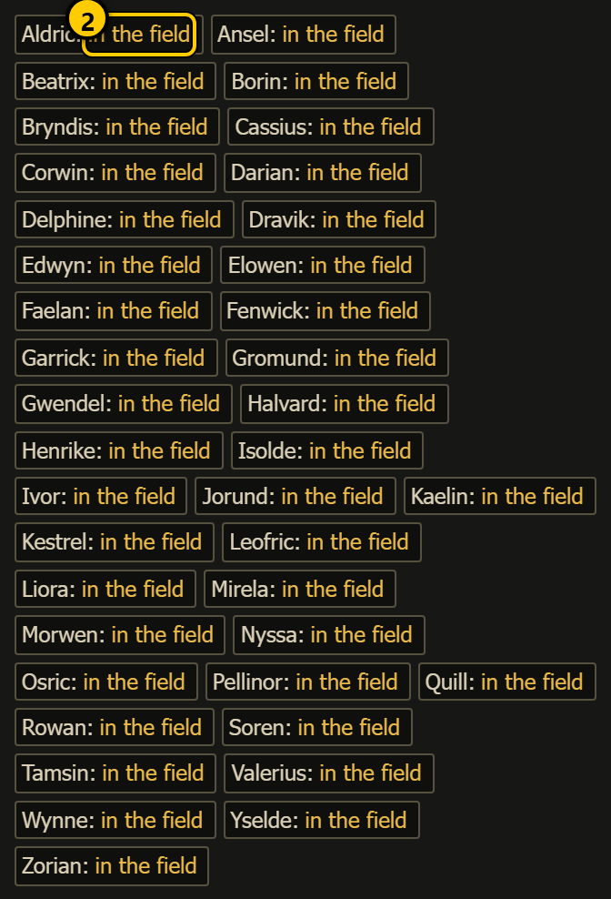 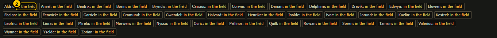

Each chip reads **Name: Town** or **Name: in the field**:

1. **Town** (bold) - the character stands within 6000 of a known gatekeeper of that town. Hover (desktop) to see which gatekeeper.
2. **in the field** (yellow) - no known gatekeeper nearby; **no SoE!** in red is added when it has no Scroll of Escape left.
3. **Red chip** - the character has not reported for more than 30 s (offline or frozen).

Tap a chip to open that character's page ([Character page](character.md)).

### Filter

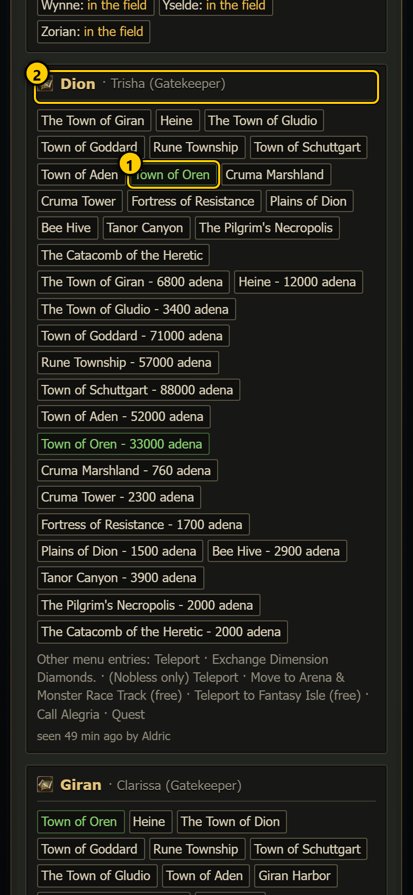 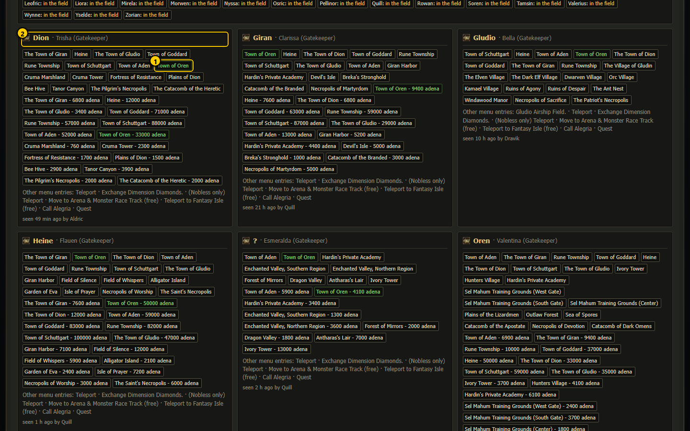

1. **Matching destination** in green (here "oren": Town of Oren, Oren's teleports …).
2. **Town and gatekeeper** of each card that has a match.

### One gatekeeper card

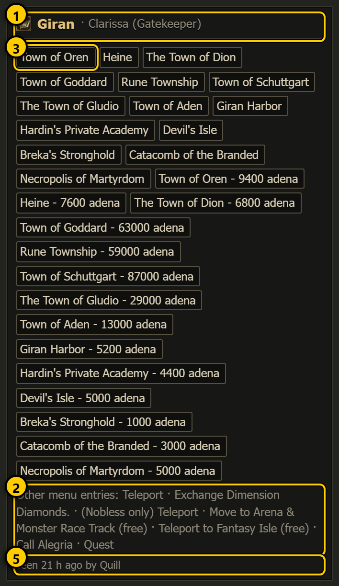 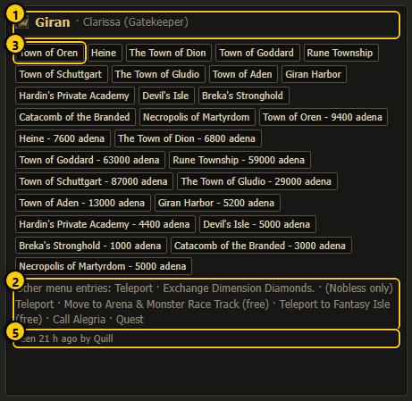

1. **Town · gatekeeper (title)**.
2. **Here now** - characters standing next to this gatekeeper.
3. **Destinations** - every destination link of every menu page the bots opened. A gatekeeper usually has two pages with the same places:
   one without prices and one with the price in adena ("Town of Oren - 9400 …").
4. **Other menu entries** - links that are not destinations (Teleport, Exchange Dimension Diamonds, Nobless teleports, Arena / Monster
   Race, Fantasy Isle, Quest …).
5. **Seen … by …** - when the menu was saved and by which character. "no destinations seen yet" = only the first page was opened.

## Giran town routes

In Giran the bots walk **only** recorded routes: start = the `.giran` landing, then to a shop (grocer, warehouse, weapons, jewelry, armor,
blacksmith, symbol maker …). They never take a shortcut through the town. This box lets you correct those routes with the same editor
as the raid routes ([route editor](raid-bosses.md#route-editor)). The bots re-read `Scripts/data/giran_routes.json` every minute, so a
saved change is used within a minute.

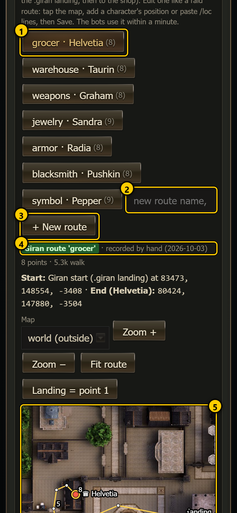 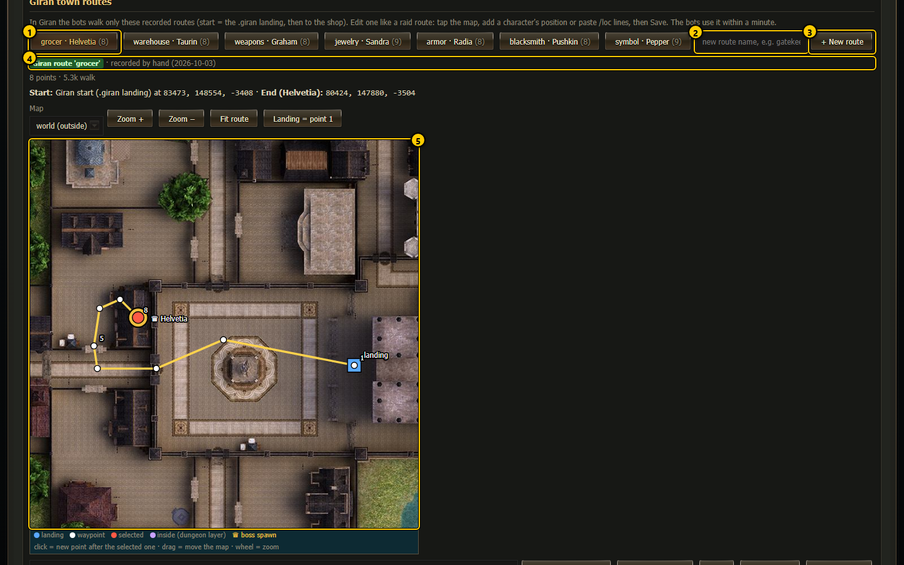

1. **Route button** - `place · NPC (number of points)`. Tap to open that route in the editor below (it asks first when the open route has
   unsaved changes).
2. **New route name** - lowercase letters and digits, for example `gatekeeper`.
3. **+ New route** - opens a draft for that name.
4. **Status** - "Giran route '<name>'" with when it was edited (or "recorded by hand"), or "new route, not saved yet".
5. **Map** - the same map as the raid editor: the blue square is the Giran start (the `.giran` landing), the gold ♛ marks the end (the
   NPC); tap to add points, drag to move, wheel to zoom. The bar above has **Map**, **Zoom + / −**, **Fit route** and **Landing = point 1**.

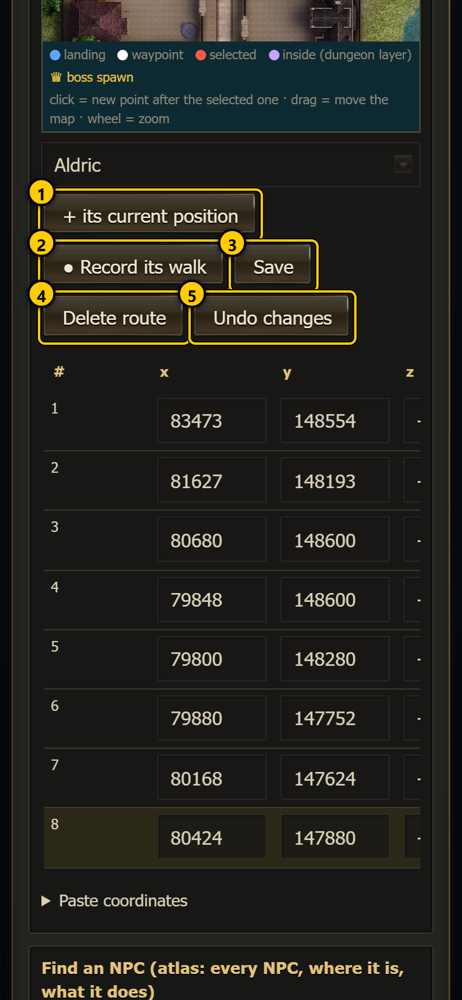 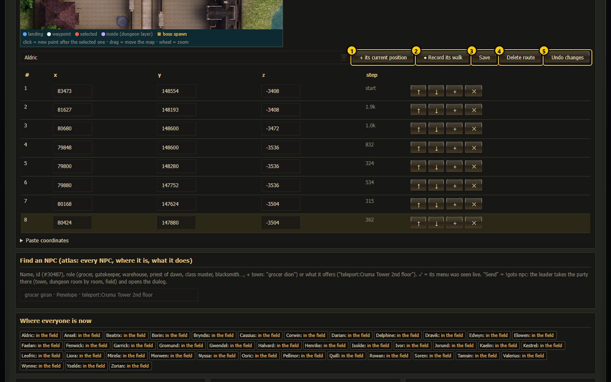

1. **+ its current position** - insert a character's position after the selected point (pick the character in the menu on the left).
2. **Record** - record a character's walk (a point every ~250 units).
3. **Save** - save the route (2 to 200 points). Town routes have no lock: what you save is what the bots walk. If point 1 is more than 300
   away from the Giran start, the start is put in front automatically.
4. **Delete route** - delete it (confirmation). Bots that need it then cannot walk there.
5. **Undo changes** - reload the saved version.

The point list (x / y / z, ↑ ↓ + ✕) and **Paste coordinates** work exactly as in the raid route editor. Every save or delete keeps the
old file in `Scripts/data/routes/giran_history/`.

### A new route

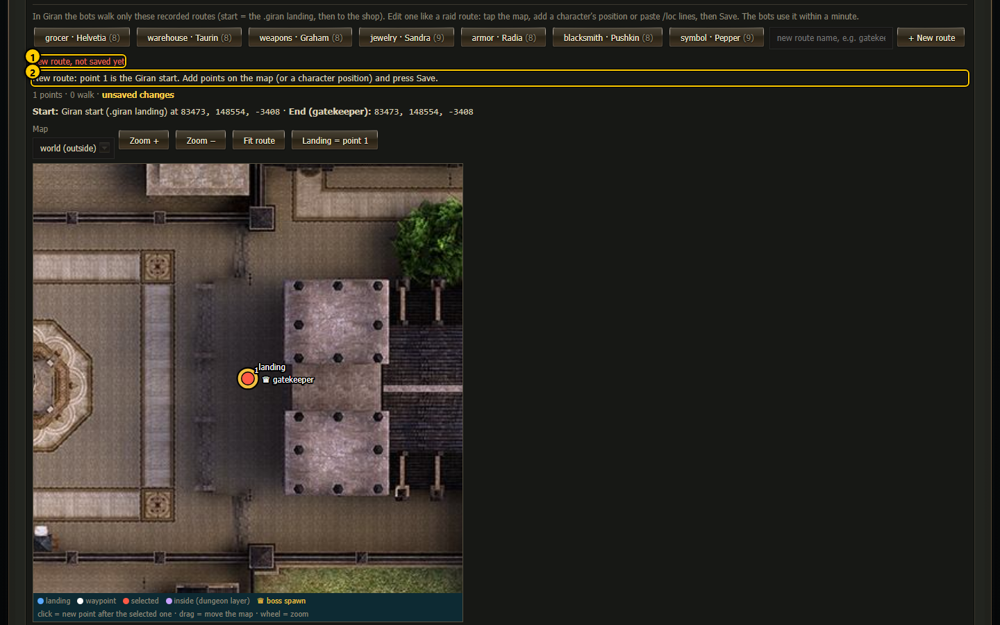

1. **new route, not saved yet**. 2. The draft starts with one point, the Giran start: "New route: point 1 is the Giran start. Add points
on the map (or a character position) and press Save."

### Delete

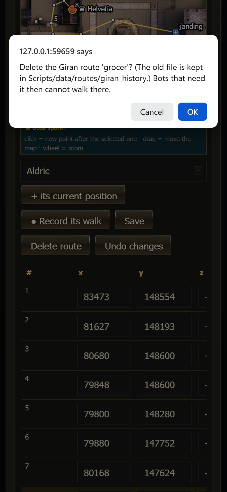

"Delete the Giran route '<name>'? (The old file is kept in Scripts/data/routes/giran_history.) Bots that need it then cannot walk there."

## How to ...

**Check whether a character can teleport somewhere**
1. Type the destination in **Find a destination…**.
2. Look which towns' cards still show it; then look in **Where everyone is now** which town the character stands in.

**Fix a Giran walk that gets stuck**
1. Tap the route button (for example **grocer · Helvetia**).
2. Select the point before the problem (tap it on the map or its row), then tap the map to add a point around the obstacle, or walk a
   character there in the game and press **+ its current position**.
3. Press **Save**. The bots use it within a minute.

**Add a route to a new Giran NPC**
1. Type a name (`gatekeeper`) and press **+ New route**.
2. Add the points from the start to the NPC (record a character's walk is the easiest).
3. Press **Save**.

## Notes

- The gatekeeper menus are only what the bots have seen; a gatekeeper nobody opened yet has no card.
- A price shown with the menu is the server's price at the time it was saved.
- The Giran town routes are shared by every party.
