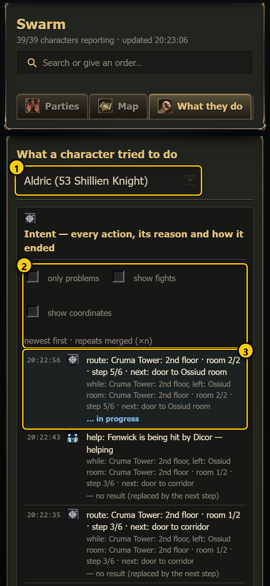
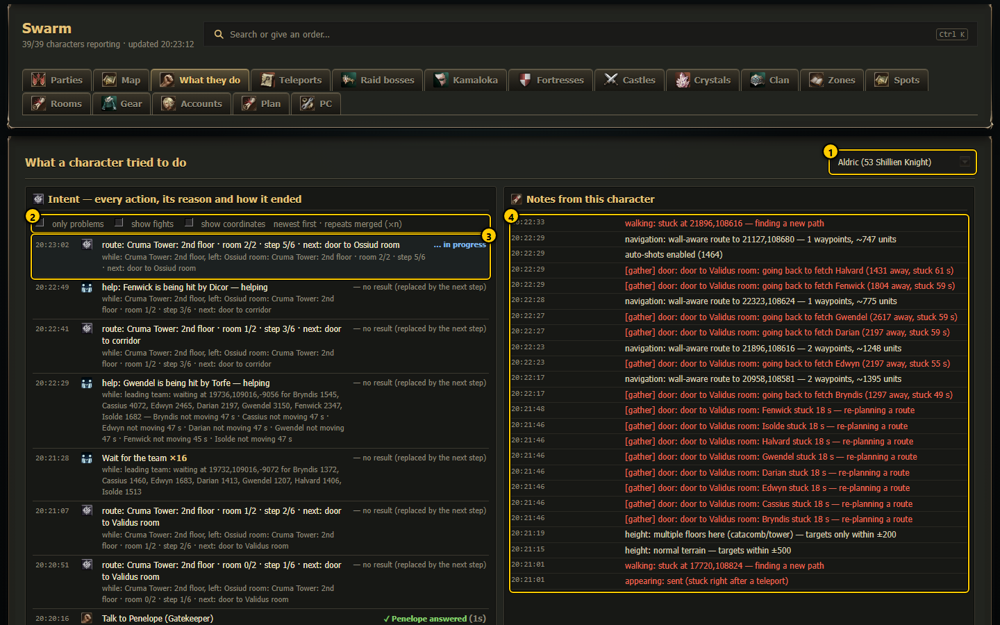
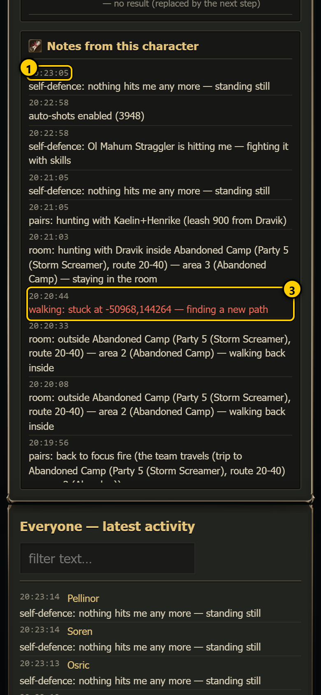
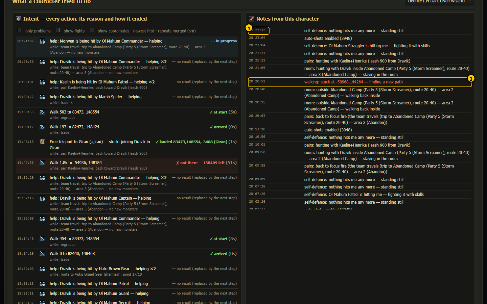
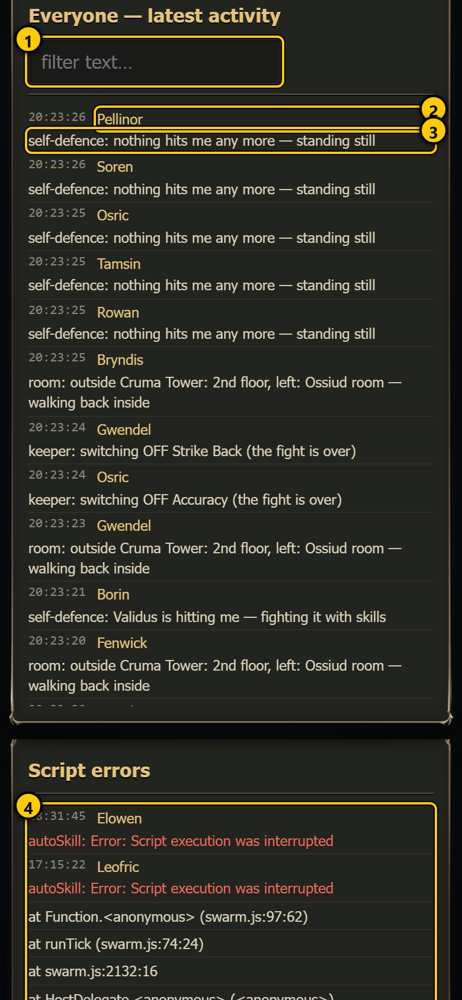
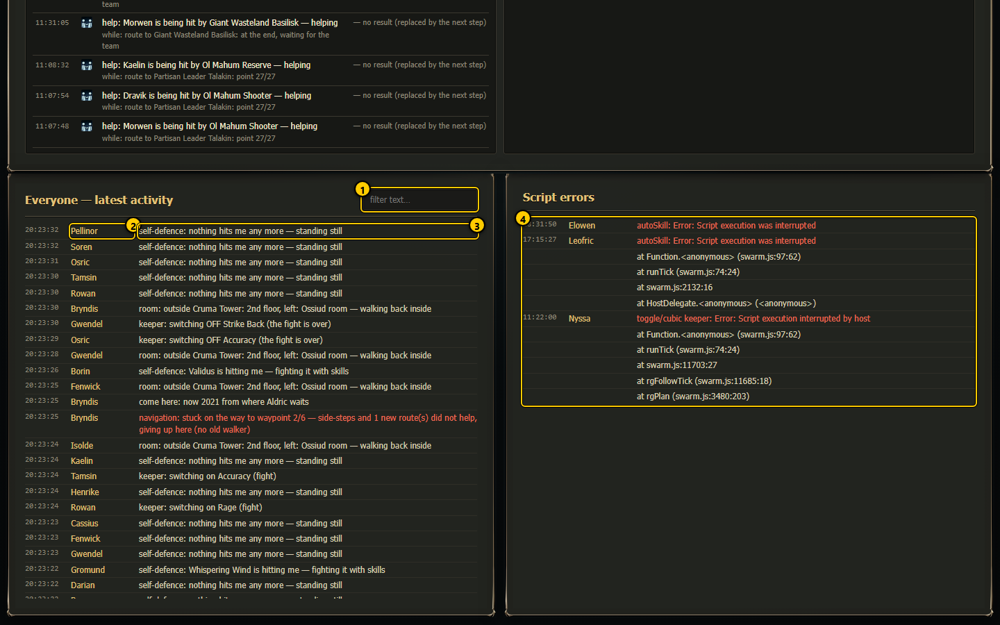
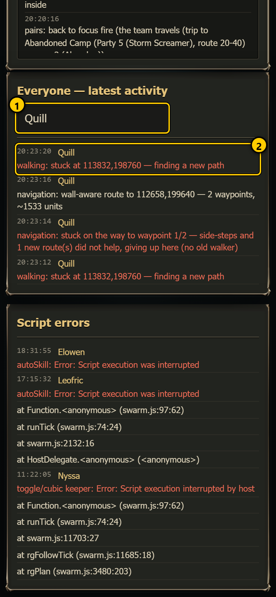
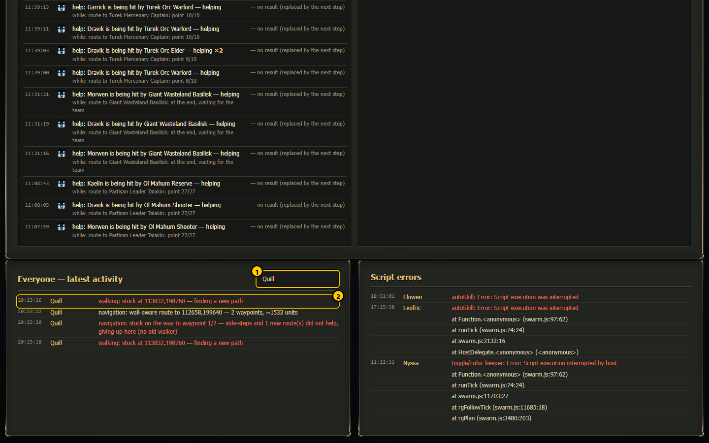

# What they do  (`#/logs`)

This tab answers "what has this character been doing, and what is everyone doing right now?". It shows one character's full
[intent timeline](character.md#recent-steps) and notes side by side, plus the latest activity of all characters and the latest script
errors. Use it to follow a problem back in time, or to watch the whole swarm work.

## One character: timeline and notes

 

1. **Character** - pick a character (the menu shows name, level and class). Your choice is remembered in the browser.
2. **Timeline filters** - **only problems**, **show fights**, **show coordinates**. They work exactly like **Recent steps** on the character page and are
   shared with it (tick them here, and the character page shows the same).
3. **Newest step** - the timeline, newest first: what it tried, why (`while: ...`) and how it ended.
4. **Notes from this character** - its notes (see below).

On a desktop the timeline and the notes stand side by side; on a phone the notes come below the timeline.

### How to read the timeline

Each line is one step the bot tried:

```
08:22:25  [icon]  Free teleport to Giran (.giran) — regroup in Giran: next hunting spot     ✓ landed 83473,148554 (1s)
                  while: dungeon: Ponti -> 2nd floor
```

- **Time** - when the step started (your local time).
- **Icon** - the kind of step: walk, talk to an NPC, teleport, free town command, fight, help a teammate, gather or lead the team, quest,
  resurrect, wait ...
- **Text** - what it tried, in plain words.
- **×n** after the text - the same step happened n times in a row (within 10 minutes) and was merged into one line.
- **while: <task>** - the bigger job the step served.
- **Result on the right:**
  - **✓ <detail>** - it worked, with the time it took in brackets;
  - **✗ <reason>** - it failed, and why (red background);
  - **… in progress** - the newest step, still running (light blue background; at most 15 minutes, after that it counts as no result);
  - **— no result (replaced by the next step)** - the bot moved on before the step reported an end.
- With **show coordinates**: `from x,y,z → x,y,z (distance) · ended at x,y,z`.

Up to 150 steps are shown (the server reads the last 400 lines of `Logs/intent_<Name>.log`).

### Notes from this character

 

1. **Time** of the note.
2. **Green line** - something worked (`DONE`, `worked`, `arrived`, `OK`).
3. **Red line** - something failed (`FAIL`, `failed`, `gave up`, `stuck`, `error`, `dead`).

These are the last 250 notes of the character from the shared log `Logs/swarm_buffs.log` (every bot writes its notes there), newest on
top. The character page shows only the last 3 of them (Right now → last notes).

## Everyone: latest activity, and script errors

 

1. **Filter text** - type any text (a name, a place, a word like `failed`) to show only matching lines. Not case-sensitive.
2. **Name** - which character wrote the line. Tap it to open that character's page.
3. **What happened** - the note itself. Green and red colours as above.
4. **Script errors** - the last 12 lines of `Logs/swarm_errors.log`: JavaScript errors inside swarm.js on any character. A few old errors
   are normal; many new ones after an update mean something is broken (see [PC](pc.md) for deploying a fixed script).

*Everyone — latest activity* shows the last 60 notes of all characters, newest first.

### Filtering

 

1. **Typed filter** - here `Quill`.
2. **Only matching lines** remain.

## Every control

| Control | What it does | Saved? |
|---|---|---|
| Character menu | whose timeline and notes are shown | in your browser |
| only problems / show fights / show coordinates | filter the timeline (also on the character page) | in your browser |
| Filter text | filter *Everyone — latest activity* | no |
| Name in a line | opens the character page | – |

Nothing on this tab sends an order or changes a file.

## Refresh

The everyone/errors lists refresh every 4 seconds; the chosen character's timeline and notes every 8 seconds. Nothing refreshes while the
browser tab is hidden.

## How to ...

**Find out why a character failed to teleport**

1. Pick the character.
2. Tick **only problems**.
3. Look for a red `Teleport to ...` or `Free teleport ...` line; the text after ✗ says why (no adena, the NPC did not answer, landed in
   the wrong place ...). Tick **show coordinates** to see where it stood.

**See what one party did in the last minutes**

1. In *Filter text*, type a word from the party's task, or the leader's name.
2. Read the lines from top (newest) to bottom.
